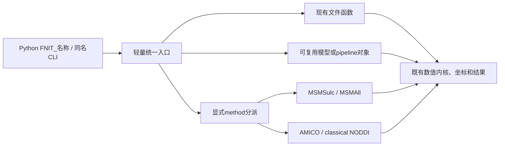

# FNIT 公共接口与迁移索引

## 1. 功能与命名策略

从0.17.0开始，下面33个功能统一使用用户指定的 `FNIT_` 名称；
`from fnit import FNIT_flirt` 与 `from fnit.flirt import FNIT_flirt` 指向同一对象。
函数直接执行，模型／pipeline 类先构造再调用或使用 `.run()` / `.run_bids()`。
配置类和结果类型保留原名。旧计算入口保留显式导入兼容，当前推荐入口以本表为准。
`FNIT_convert_space` 与 `FNIT_fMRISurface_pipeline` 使用用户更正后的拼写。



| 统一入口 | 所属模块入口 | Python形态 | 对应原软件 | 详细说明 |
|---|---|---|---|---|
| `FNIT_fslmaths` | `fnit.fslmaths.FNIT_fslmaths` | 函数 | `fslmaths` | [输入、参数、输出与benchmark](fslmaths/README.md) |
| `FNIT_flirt` | `fnit.flirt.FNIT_flirt` | 函数 | `flirt` | [输入、参数、输出与benchmark](flirt/README.md) |
| `FNIT_fnirt` | `fnit.fnirt.FNIT_fnirt` | 函数 | `fnirt` | [输入、参数、输出与benchmark](fnirt/README.md) |
| `FNIT_applywarp` | `fnit.applywarp.FNIT_applywarp` | 函数 | `applywarp` | [输入、参数、输出与benchmark](applywarp/README.md) |
| `FNIT_convertwarp` | `fnit.convertwarp.FNIT_convertwarp` | 函数 | `convertwarp` | [输入、参数、输出与benchmark](convertwarp/README.md) |
| `FNIT_invwarp` | `fnit.invwarp.FNIT_invwarp` | 函数 | `invwarp` | [输入、参数、输出与benchmark](invwarp/README.md) |
| `FNIT_convert_space` | `fnit.space_conversion.FNIT_convert_space` | 函数 | `CBIG / Workbench space projection` | [输入、参数、输出与benchmark](space_conversion/README.md) |
| `FNIT_mmorf` | `fnit.mmorf.FNIT_mmorf` | 函数 | `mmorf` | [输入、参数、输出与benchmark](mmorf/README.md) |
| `FNIT_SynthStrip` | `fnit.synthstrip.FNIT_SynthStrip` | 模型／pipeline 类 | `mri_synthstrip` | [输入、参数、输出与benchmark](synthstrip/README.md) |
| `FNIT_SynthMorph` | `fnit.synthmorph.FNIT_SynthMorph` | 模型／pipeline 类 | `mri_synthmorph register` | [输入、参数、输出与benchmark](synthmorph/README.md) |
| `FNIT_SynthSeg` | `fnit.synthseg_parc.FNIT_SynthSeg` | 模型／pipeline 类 | `mri_synthseg` | [输入、参数、输出与benchmark](synthseg/README.md) |
| `FNIT_SynthSegPlus` | `fnit.synthseg_parc.FNIT_SynthSegPlus` | 模型／pipeline 类 | `mri_synthseg --parc` | [输入、参数、输出与benchmark](synthseg_plus/README.md) |
| `FNIT_SynthSR` | `fnit.synthsr.FNIT_SynthSR` | 模型／pipeline 类 | `mri_synthsr` | [输入、参数、输出与benchmark](synthsr/README.md) |
| `FNIT_WMHSynthSeg` | `fnit.wmh_synthseg.FNIT_WMHSynthSeg` | 模型／pipeline 类 | `mri_WMHsynthseg` | [输入、参数、输出与benchmark](wmh_synthseg/README.md) |
| `FNIT_fslfast` | `fnit.fast.FNIT_fslfast` | 模型／pipeline 类 | `fast` | [输入、参数、输出与benchmark](fast/README.md) |
| `FNIT_fs_segment_subregions` | `fnit.gems.FNIT_fs_segment_subregions` | 函数 | `segment_subregions` | [输入、参数、输出与benchmark](subregions/README.md) |
| `FNIT_mri_robust_register` | `fnit.robust_register.FNIT_mri_robust_register` | 函数 | `mri_robust_register` | [输入、参数、输出与benchmark](robust_register/README.md) |
| `FNIT_recon_all` | `fnit.recon_all.FNIT_recon_all` | 函数 | `recon-all` | [输入、参数、输出与benchmark](recon_all/README.md) |
| `FNIT_fslvbm` | `fnit.fast_vbm.FNIT_fslvbm` | 模型／pipeline 类 | `fast + fnirt + fslmaths` | [输入、参数、输出与benchmark](fast_vbm/README.md) |
| `FNIT_mcflirt` | `fnit.mcflirt.FNIT_mcflirt` | 模型／pipeline 类 | `mcflirt` | [输入、参数、输出与benchmark](mcflirt/README.md) |
| `FNIT_fMRIVolume_pipeline` | `fnit.fmri.FNIT_fMRIVolume_pipeline` | 函数 | `FEAT / fMRIPrep volume` | [输入、参数、输出与benchmark](fmri/README.md) |
| `FNIT_fMRISurface_pipeline` | `fnit.fmri.FNIT_fMRISurface_pipeline` | 函数 | `fMRIPrep surface / Workbench` | [输入、参数、输出与benchmark](fmri/surface.md) |
| `FNIT_newmsm` | `fnit.msm.FNIT_newmsm` | 函数 | `newmsm` | [输入、参数、输出与benchmark](msm/README.md) |
| `FNIT_melodic` | `fnit.melodic.FNIT_melodic` | 函数 | `melodic` | [输入、参数、输出与benchmark](melodic/README.md) |
| `FNIT_mshbm` | `fnit.mshbm.FNIT_mshbm` | 函数 | `CBIG MS-HBM` | [输入、参数、输出与benchmark](mshbm/README.md) |
| `FNIT_topup` | `fnit.topup.FNIT_topup` | 模型／pipeline 类 | `topup` | [输入、参数、输出与benchmark](topup/README.md) |
| `FNIT_eddy` | `fnit.eddy.FNIT_eddy` | 模型／pipeline 类 | `eddy` | [输入、参数、输出与benchmark](eddy/README.md) |
| `FNIT_dtifit` | `fnit.dtifit.FNIT_dtifit` | 模型／pipeline 类 | `dtifit` | [输入、参数、输出与benchmark](dtifit/README.md) |
| `FNIT_noddi` | `fnit.amico_noddi.FNIT_noddi` | 模型／pipeline 类 | `AMICO / NODDI Toolbox` | [输入、参数、输出与benchmark](amico_noddi/README.md) |
| `FNIT_bedpostx` | `fnit.bedpostx.FNIT_bedpostx` | 模型／pipeline 类 | `bedpostx` | [输入、参数、输出与benchmark](bedpostx/README.md) |
| `FNIT_probtrackx2` | `fnit.probtrackx.FNIT_probtrackx2` | 模型／pipeline 类 | `probtrackx2` | [输入、参数、输出与benchmark](probtrackx/README.md) |
| `FNIT_dMRIPipeline` | `fnit.dmri_pipeline.FNIT_dMRIPipeline` | 模型／pipeline 类 | `TOPUP + EDDY + DTIFIT + registration` | [输入、参数、输出与benchmark](dmri_pipeline/README.md) |
| `FNIT_UKBconnectomePipeline` | `fnit.connectome.FNIT_UKBconnectomePipeline` | 模型／pipeline 类 | `UKB-connectomics / MRtrix tracking` | [输入、参数、输出与benchmark](connectome/README.md) |

群体分析也采用同一前缀：`FNIT_bwas`、`FNIT_bigflica`、`FNIT_superbigflica`、
`FNIT_dictionary_learning`、`FNIT_dictionary_learning_streaming`。
MELODIC已有BIDS包装为 `FNIT_melodic_bids`；这些名字继续转发各自成熟实现。

## 2. Python、输入与输出

### 直接执行文件函数

```python
from fnit import FNIT_flirt

moving_image_path = "/data/sub-01_T1w.nii.gz"           # 原生3D NIfTI，scanner-RAS mm
reference_image_path = "/data/reference/T1w.nii.gz"     # 定义输出网格的3D NIfTI
registered_image_path = "/data/output/T1w_registered.nii.gz"
affine_matrix_path = "/data/output/T1w_to_reference.mat"
registration_result = FNIT_flirt(
    input=moving_image_path,
    reference=reference_image_path,
    output=registered_image_path,
    omat=affine_matrix_path,                           # FSL scaled-mm前向矩阵
    dof=12,
    cost="corratio",
    device="cuda:0",
)
```

`FNIT_fnirt` 同样是现有文件函数，其 `affine` 沿用FSL scaled-mm合同；
不将其换成底层 `TorchFNIRT` 的world变换参数。
`FNIT_applywarp / FNIT_convertwarp / FNIT_invwarp` 返回既有结果对象，
没有额外重采样或改变frame分块策略；保存方式见对应功能页。

### 保留可复用模型

```python
from fnit import FNIT_SynthStrip, FNIT_noddi
from fnit.amico_noddi import AMICONODDIConfig

brain_extraction_model = FNIT_SynthStrip(device="cuda:0")  # 加载一次，可复用权重
brain_extraction_result = brain_extraction_model("/data/sub-01_T1w.nii.gz")
brain_extraction_result.image.save("/data/output/sub-01_brain.nii.gz")

noddi_configuration = AMICONODDIConfig()                   # 原配置全部保留
noddi_model = FNIT_noddi(
    device="cuda:0", method="classic", config=noddi_configuration,
)
# 模型原有 __call__ / run / result.save 的参数与输出均不变。
```

`FNIT_mcflirt` 和 `FNIT_probtrackx2` 实例使用原有 `.run()`；
`FNIT_bedpostx` 使用原有实例调用。不能把文件函数与模型构造参数互换。

### 合并选项与pipeline

- `FNIT_newmsm(..., method="msmsulc"|"msmall")`：分别接收原有 `MSMSulcInputs` / `MSMAllInputs`；
  保留配置、双侧并行、总线程、execution和QC。非法方法在读文件前报错。
- `FNIT_noddi(method="amico"|"classic")`：默认有效算法仍是AMICO；
  `method=None` 用于兼容旧 `fit_method`；两种写法冲突时报错。
  classic保持现有AMICO起点＋连续Watson非线性拟合，不改变模型定义。
- `FNIT_mshbm(..., input_kind="profiles"|"timeseries"|"volume")`：保留原profile、时序和体积输入；
  体积模式不支持的非默认迭代参数明确报错，不忽略请求。
- `FNIT_fMRIVolume_pipeline`、`FNIT_fMRISurface_pipeline` 是原有全流程函数；
  `FNIT_dMRIPipeline`、`FNIT_UKBconnectomePipeline` 是原有pipeline类，保留 `.run_bids()`。

三项method接口的每个参数、结构、完整变量名示例和输出见[方法说明](API_METHODS.md)。
全部33个构造／函数签名和默认值见[签名清单](API_SIGNATURES.json)；
各feature页仍给出每个参数、输出shape/dtype/单位/坐标和已有真实验证。

## 3. 命令行

安装项目主页Conda环境后，下表33个名称均是可执行console入口；也可通过 `fnit FNIT_<name>` 分派。
不启动原软件命令；旧CLI解析器和科学参数继续复用。

```bash
FNIT_flirt -in /data/moving.nii.gz -ref /data/reference.nii.gz \
  -out /data/output/registered.nii.gz -omat /data/output/affine.mat --device cuda:0

FNIT_newmsm --method msmsulc --inputs-json /data/inputs_sulc.json \
  --output-dir /data/output/msm --device cuda:0
FNIT_newmsm --method msmall --inputs-json /data/inputs_features.json \
  --output-dir /data/output/msm_all --device cuda:0

FNIT_noddi --method classic --help
FNIT_melodic --input-bold /data/bold.nii.gz --brain-mask /data/mask.nii.gz \
  --output-dir /data/output/ica --device cuda:0 --random-state 0
fnit FNIT_UKBconnectomePipeline --help
```

- MSM也接受原位置参数 `FNIT_newmsm msmsulc ...`，不允许同时给两次方法。
- NODDI的 `--method` 映射既有 `--fit-method`；同时提供时报错。
- SynthSegPlus命令转发既有 `synthseg --parc`，不创建另一分割算法。
- MELODIC新CLI完整覆盖已有文件函数的参数：`input-bold / brain-mask / output-dir` 必需；
  `n-components=None`、`device=None`、`voxel-batch-size=8192`、`max-iter=500`、
  `tolerance=0.001`、`random-state=0`、`mm-threshold=0.5`。
- 其余每个参数沿用对应功能页的CLI表，统一命令的 `--help` 可现场查看。

## 4. 原软件对应关系

第一节逐功能表列出对应原软件命令；完整命令、源码链接、固定版本及参考文献在各feature页。
统一名字不改变affine/warp方向、标签、统计定义、随机种子、TF32例外或显存策略。

## 5. 本轮验证与现有真实benchmark

本轮是接口统一和公共材料脱敏，没有改动数值内核。
同对象绑定、签名／默认值、轻量导入、全部CLI help、方法分派、参数透传、错误传播与输出回归
由[本轮验收记录](../validation/api_unification_20261016/README.md)记录。
现有真实MRI精度、耗时和脑图仍绑定其实际producer版本，见[benchmark索引](BENCHMARK_INDEX.md)。
没有把改名前的测量标记为本轮重新运行；测试中的小型数据仅用于接口合同，不代替MRI benchmark。

## 6. 迁移与版本

| 版本 | 变化 |
|---|---|
| 0.17.0 | 33个指定入口统一FNIT前缀；MSM/NODDI选项入口；MS-HBM输入类型；同名CLI；公共材料隐私清理。 |
| 0.16.x | 成熟实现与旧计算入口；历史结果保持原生产版本。 |

移除两项独立准备接口：`prepare_subregion_alignment_target`、`reflect_atlas_header`。
当前production不再导出或安装该preparation模块；已有历史实验只从显式固定SHA快照加载，
其结果归档见[历史准备实验](../validation/robust_register/target_preparation_20261006/README.md)。

## 7. 文档、隐私与参考

当前入口以本页和[主页](../README.md)为准；[方法页](API_METHODS.md)解释合并的选项。
公共材料使用通用路径和环境标签；原科学指标、输入／源码SHA与许可证归属保持。
脱敏副本记录独立发布哈希，不声称与原始日志字节相同。
当前树清理不等于清除Git历史；本轮不重写已发布历史。
权重、模板与外置源码仍按[资源许可说明](ASSETS.md)核验。
