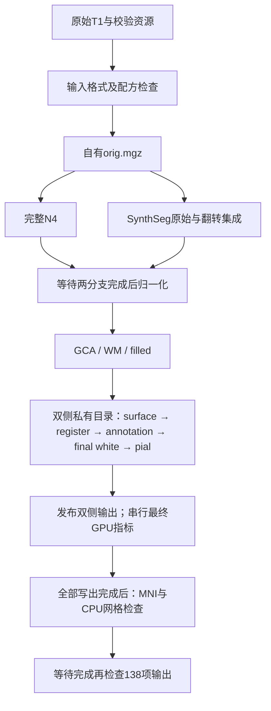

# Python重建候选：程序边界、调度和测量（2026-10-11）

## 1. 功能简介与流程

本次复用项目已有影像计算核，补齐入口配方绑定、原版阶段程序拦截和半球子步骤测量。`backend="python"` 不发现或探测原版程序；所有阶段程序槽位须为 `None`。输入串行/并行选择进入统一配方与报告，非法组合直接报错。完整stable/all-sample EM已接入；默认仍为 `native`，GA与最终pial组件质量及当前整例验证完成前，不发布默认Python配方。



图为调度配置，真实运行的完成状态、墙钟、质量和显存另由运行报告证明。并行输入总4线程分为N4的1线程和SynthSeg的3线程；两个半球各2线程。缺陷体积按左侧重置、右侧累加，最终指标按左右侧串行执行。晚期MNI在所有曲面、标签、统计和目录发布完成后，与CPU网格检查分为2+2线程。

## 2. Python调用、输入输出及参数

以下是候选调用，必须在组件验收后用于正式整例评估：

```python
from pathlib import Path
from fnit.recon_all.native_free import run_recon_all_python

input_t1_image = Path("data/input_T1w.nii.gz")  # 原始单被试三维T1；保留真实空间头
output_subject_directory = Path("results/new_subject")  # 新的空目录
verified_weights_directory = Path("resources/weights")  # 已校验大小和SHA-256的权重
verified_assets_directory = Path("resources/assets")  # 已校验且有合法来源的模板、图谱
reconstruction_report = run_recon_all_python(
    t1=input_t1_image,  # 原始三维T1路径
    subject_dir=output_subject_directory,  # 本次重建的空输出目录
    weights_dir=verified_weights_directory,  # 已校验的模型权重目录
    assets_dir=verified_assets_directory,  # 已校验的模板与图谱目录
    backend="python", topology_backend="python-ga",  # 自有GA候选，质量门独立判定
    device="cuda:0",  # 明确指定目标GPU
    threads=4,  # 全被试总计算线程预算
    input_execution="parallel",  # 完整SimpleITK N4与SynthSeg并行
    mni_execution="parallel-late",  # 全部表面写出后与网格检查并行
    profile_stages=True,  # 同步目标GPU以测量阶段时间
)
```

输入逐项说明：

| 参数 | 意义与格式 |
|---|---|
| `t1` | 原始三维T1 NIfTI/MGH路径；由项目既有影像入口读取，不能用参考软件中间产物替代正式输入 |
| `subject_dir` | 新被试输出目录；输出沿用 `mri/`、`surf/`、`label/`、`stats/` 与运行报告结构 |
| `weights_dir` | 权重目录；运行前核对固定资源清单、文件大小及SHA-256 |
| `assets_dir` | 图谱与模板目录；未明确许可再分发的文件只从原作者获取 |
| `backend` | `python` 选择自有候选程序边界；历史默认 `native` 保留；`python-gpu` 为旧严格CUDA能力诊断 |
| `device` | 明确逻辑设备，例如 `cuda:0`；实际UUID与子进程设备由报告记录 |
| `threads` | 全被试计算预算，本次验证为4；退出恢复调用方线程设置 |
| `input_execution` | `serial` 默认；`parallel` 只支持完整SimpleITK N4、进程内执行、总4线程，无自动回退 |
| `mni_execution` | `in-process` 默认；`parallel-late` 在全部写出后启动既有完整MNI，并与CPU网格检查汇合 |
| `topology_backend` | 显式 `python-ga` 选择已有自有GA；数字拓扑 `python` 与原GA不同，须分别验收 |
| `profile_stages` | `True` 同步目标CUDA设备并测量子步骤；默认 `False` 不增加嵌套同步 |
| `cuda_allocator_cache` | 沿用 `auto/enabled/disabled` 分配器策略；测量须记录实际策略及调用方是否已初始化CUDA |

未列出的既有计算参数保持入口原说明与 `--help` 定义。本次新增内部接口：`python_runtime_selection()` 无输入，返回自有选择信息；`validate_program_boundary(backend, programs)` 接收后端与名称到路径/None的映射，非空槽位抛出 `ValueError`；`execution_dag(threads, input_execution, mni_execution, hemisphere_workers, backend)` 返回声明调度、预算、屏障和待验收门；`original_stage_guard(enabled=...)` 返回仅含执行名的记录，退出恢复环境标志。

报告新增 `execution_dag` 与程序边界记录；worker报告记录进入/退出计算时实际TF32和autocast设置、子步骤及CUDA设备。嵌套 `StageProfiler(reset_peak_memory=False)` 不重置外层峰值，峰值范围明确为最近外层重置或CUDA初始化以来，不能解释为该子步骤独占显存。进程归属未知时自身峰值为 `null`，设备总量与设备上计算进程之和另列。

## 3. 命令行调用

```bash
python -m fnit.recon_all.native_free data/input_T1w.nii.gz results/new_subject \
  --weights-dir resources/weights --assets-dir resources/assets \
  --backend python --topology-backend python-ga --device cuda:0 --threads 4 \
  --input-execution parallel --mni-execution parallel-late --profile-stages
```

批量入口的配方检查也绑定 `input_execution`，不会把并行请求验证成串行配方。API与CLI进入同一检查，错误必须在创建被试输出前传播。审计拦截Python直接调用的 `subprocess`、`os.exec`、`posix_spawn` 及路径别名；自有worker继承拦截标志。此审计不是外部shell后代的系统调用沙箱；完整文件访问证明需独立记录。

整例测量包装器 `benchmark_recon_torch_end_to_end.main()` 现将显式 `--input-execution` 传入同一个成熟配方选择器。此前Python配方默认值会把请求的parallel覆盖成serial；修复后命令和报告均保留请求，Torch N4或非四线程的parallel组合在依赖检查、创建输出及启动进程前抛 `ValueError`。默认serial与全部影像计算核不变。输入仍是原始T1路径、固定资产/权重和新输出目录；输出为原始被试目录、JSON及私有日志，空间/单位沿用上文。包装器属于FNIT测量接口，没有独立官方命令；整例参考仍为隔离的 `recon-all -all`。

```bash
# 显式并行只适用于完整SimpleITK/in-process及总4线程，按成熟1+3预算执行。
python tools/benchmark_recon_torch_end_to_end.py \
  --t1 /data/public_T1w.nii.gz \
  --output-root /data/new-whole-run \
  --weights-dir /data/verified-weights \
  --assets-dir /data/verified-assets \
  --backend python --device cuda:0 --threads 4 \
  --n4-backend simpleitk --n4-execution in-process \
  --input-execution parallel --topology-backend python-ga \
  --code-version ACTUAL_TESTED_COMMIT
```

本次合同核对实际包装器的命令/报告和错误边界，使用失败子进程fixture，不运行MRI；修复后parallel整例尚未测量。旧serial整例和已冻结并行阶段记录保留原源码/脚本哈希，不能改标为修复后的整例提速。

## 4. 对应原软件调用

```bash
# 独立参考环境运行；本项目Python生产候选不调用此命令
recon-all -i data/input_T1w.nii.gz -s reference_subject -all -parallel -openmp 4
```

调度、程序拦截和测量辅助函数没有独立原软件计算命令。annotation对应 `mris_ca_label` 的三个图谱计算，本次只比较同输入自有基线与候选；未运行原软件annotation新参考。

## 5. 精度、运行时间与脑图

当前已确认冻结候选96项stdlib unittest合同测试全部通过；范围为程序边界、配方、CLI/batch、线程恢复、半球调度、MNI屏障及目标设备测量，不能替代真实MRI基准。真实annotation采用两例自有原始T1重建的完整冻结阶段输入，AB/BA顺序、每例总4线程及同一目标GPU；逐一记录资源和输入SHA、六份新annotation、双侧子步骤、完整组墙钟以及显存归属质量。已有annotation先在私有基准副本删除，然后重新生成，参考阶段输入仅用于此次基准，不进入生产重建。

真实annotation两例共12份文件逐字节一致，变化顶点数0，标签Dice均为1。case06基线/候选组墙钟115.79/106.67秒，case07为90.50/97.94秒；变化方向不同，未认定稳定加速。两个私有脑图已生成并登记SHA，未在本任务内进行视觉审阅。真实CLI/API预检失败路径通过，实际SimpleITK2.5.6与共享库哈希已验证。结果见 [typed验证报告](../../validation/recon_all/optimizations/20261011_execution_recipe/README.md)。这些annotation结果只对应其冻结版本。

后续集成已接入完整stable/all-sample EM和可选拓扑GPU距离核；选择器分别记录算法已接入与实际验证范围。完整EM两例同输入LTA一致，但两例均未接受参数更新；完整迭代行为另有合同验证。原始T1到filled的四条连续链与CA重复性结果见 [体积前段说明](N4_VOLUME_PREFIX_PYTHON.md)。它们不包含当前合并版本的双侧表面整例；GA、最终pial质量、138项当前整例及整体指标等效仍待验收。安装核验检查冻结源码、wheel和安装后模块SHA，实际导入完整EM与可选GPU距离接口，不运行CUDA/JIT；它不能替代真实MRI或干净环境隔离验收。脑图留在私有运行目录并登记SHA，不公开被试影像、原始日志、权重或私有路径。

隔离GCA、WM、Talairach和可选Torch N4入口现继承生产程序禁令，避免新Python进程仅带环境标志却未安装执行拦截。[Git `9292a0a7` 安装回归](../../validation/recon_all/optimizations/20261011_integrated_python_install_v3/README.md)的29模块哈希一致，四个worker的fresh CLI help以禁令1实际通过；36项守卫与接线合同通过。该核验不初始化CUDA、不执行影像，不改变各阶段算法或将当前整例标为完成。

## 6. 更新与benchmark记录

| 提交 | 更新及证据 |
|---|---|
| `aeabc5aba9341f0358772eb00b1f07eb2cbaf643` | 本次唯一已提交基线；未采用主仓库未提交算法修改 |
| `c90d05c2949fdaad5b181681ae669b69ba6f8476` | 配方绑定、程序槽位检查、嵌套目标CUDA测量与实际精度记录 |
| `fe4e9de4c1c7b361e254f7804ac7ae749be89984` | 作用域程序拦截、worker传播及真实annotation测量脚本 |
| `7636284e140ef7a7b6bb432df88e915481343eda` | 完整EM单独发布门；不把first-line-search认定完整EM |
| `ae483da4747bc4056544cbf2c1492451259854ca` | 更新22项配方及并行输入测试的旧预期 |
| `0c420804f3f158c4c040b120c9f0fcc4f73e8dbc` | 将N4路由fixture与真实SimpleITK依赖检查分开 |
| `46bf4a13fcaba1130b8d61339691b530cb6ad144` | 补齐cortex输入哈希、脚本身份和设备级独立显存观察；96项合同通过 |

`e900e725d0df6113d6e01714b00543033faec4ae` 增加后续基准输入预检、清除历史报告，并纠正启动计时描述；仅语法校验，真实回归使用此前冻结脚本。首次pytest缺失、旧合同预期失败及annotation输入不全均保留，不从历史记录删除失败，也不计入有效耗时。源码冻结后不修改正在运行的目录或共享环境。

## 7. 参考文献与原软件代码

- 原软件：[FreeSurfer源码](https://github.com/freesurfer/freesurfer)，annotation入口 `mris_ca_label`；重建入口 `recon-all`。
- Fischl et al. Automatically parcellating the human cerebral cortex. Cerebral Cortex 14, 11–22 (2004). DOI:10.1093/cercor/bhg087。
- Fischl et al. Whole brain segmentation: automated labeling of neuroanatomical structures in the human brain. Neuron 33, 341–355 (2002). DOI:10.1016/S0896-6273(02)00569-X。
- Tustison et al. N4ITK: improved N3 bias correction. IEEE TMI 29, 1310–1320 (2010). DOI:10.1109/TMI.2010.2046908。
