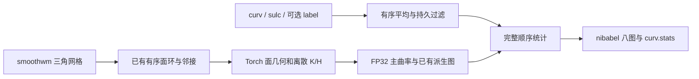
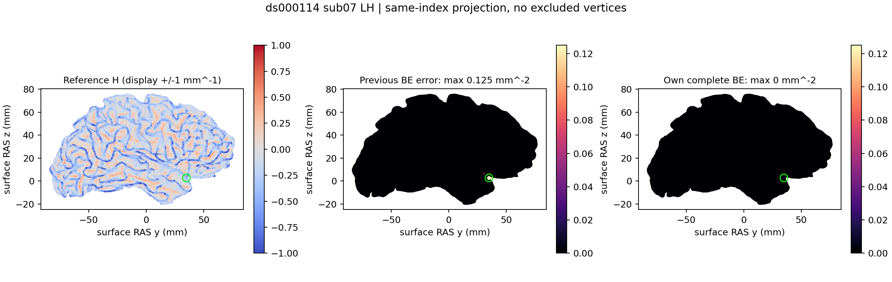

# 完整自有曲率统计与 smoothwm 八张顶点图

[返回曲率输出页](CURVATURE_OUTPUTS.md) · [完整机器报告](../../validation/recon_all/optimizations/20261010_full_curvature_stats/report.json)

## 1. 功能简介

`write_curvature_stats()` 从自产 `smoothwm`、`curv` 和 `sulc` 生成完整
`curv.stats` 及 K/H/K1/K2/S/C/BE/FI 八张图，不调用 FreeSurfer 程序。
离散面环和几何复用 FNIT PyTorch 内核；系统 `acosf` 数学步骤和顺序
统计使用自有 Numba。原始纹理平均、持久过滤、label 和被排除顶点的
纹理保留遵循固定参考命令的状态传递。



这里的 S 是 sharpness `(K1−K2)²`，不是 shape index。连续局部二次
曲面拟合、拓扑缺陷主曲率与这条离散流程的定义不同，不能互换。

## 2. Python 调用、输入与输出

```python
from fnit.recon_all.curvature_stats_python import write_curvature_stats

curvature_report = write_curvature_stats(
    subject_dir="/data/subject",                 # 已生成同侧 smoothwm、curv、sulc
    hemisphere="lh",                            # 左侧；右侧为 rh
    stats_file="/data/result/lh.curv.stats",     # 完整标准文本统计输出
    output_prefix="/data/result/lh.smoothwm",    # 八张标量图的文件前缀
    surface_name="smoothwm",                    # surf/ 下三角网格的名称
    curvature_names=("curv", "sulc"),            # 同顶点顺序的两张原始纹理
    device="cuda:0",                            # 明确目标 GPU；cpu 也是完整自有实现
    angle_backend="source_libm",                # 源 acosf；CPU 主曲率再采用源 sqrtf
    averages=0,                                 # 原始纹理平均次数；标准 recon-all 为 0
    label_file=None,                             # 可选同序 label；None 不排除顶点
    low_pass=None,                              # 可选保留 abs(texture) < 阈值
    high_pass=None,                             # 可选保留 abs(texture) >= 阈值
    overwrite=False,                            # 默认保护已有输出；标准晚阶段可显式覆盖
)
```

### 输入与参数

| 参数 | 类型与默认值 | 数据结构、含义及限制 |
|---|---|---|
| `subject_dir` | 必填 `str/Path` | 被试目录；函数读取 `surf/H.surface_name` 和各 `surf/H.curvature_names` |
| `hemisphere` | 必填 `str` | 只能是 `lh` 或 `rh` |
| `stats_file` | `str/Path/None=None` | 默认 `subject_dir/stats/H.curv.stats` |
| `output_prefix` | `str/Path/None=None` | 默认 `subject_dir/surf/H.surface_name`；不覆盖输入网格本身 |
| `surface_name` | `str='smoothwm'` | nibabel 三角网格：坐标 `(N,3)`、面 `(F,3)`；surface RAS，mm |
| `curvature_names` | `tuple[str,...]=('curv','sulc')` | 有限 FP32 `(N,)` morph；顶点编号必须与网格一致；至少一张 |
| `device` | `str='cuda:0'` | `cpu` 或显式 `cuda:N`；CUDA 失败直接报错，不静默回退 |
| `angle_backend` | `str='source_libm'` | 源 FP32 acosf 以 Numba 执行，再传回目标设备；CPU 使用源 sqrtf。`torch` 保留原设备 acos 诊断路径 |
| `averages` | `int=0` | 非负整数；原始纹理按一跳邻接同步平均，保留有序 FP32 累加，忽略 ripped 邻居 |
| `label_file` | `str/Path/None=None` | FreeSurfer label，已映射同网格顶点索引；只保留 label 中顶点，至少一个有效点 |
| `low_pass` | `float/None=None` | 有限非负阈值，保留 `abs(texture)<threshold`；过滤状态随原始纹理累积 |
| `high_pass` | `float/None=None` | 有限非负阈值，保留 `abs(texture)>=threshold`；与低通和 label 取交集 |
| `overwrite` | `bool=False` | True 可替换输出；输出仍不得与网格、原始纹理或 label 输入同路径 |

标准完整入口不提供连续主曲率、Gaussian 专用过滤、缩放/归一化、直方图
和 shape-index 扩展。边界、孤立、无法闭合面环、退化面及尚未覆盖的
marked 重排分支会明确失败。非法参数、缺文件、顶点数不同、非有限值、
输出别名或全排除掩膜会抛异常；不补占位文件。写入失败可能留下部分
输出，只有成功返回才表示本阶段生成完成。

函数不设置全局 TF32、autocast 或分配缓存；沿用调用者策略，未启用
FP16/BF16。当前几何为逐点算术，TF32 不改变其计算。完整 GPU 接口有
源 acosf 和顺序统计的 CPU 段，不声称全部计算驻留 GPU。

### 输出文件与返回结构

八图为 `PREFIX.{K,H,K1,K2,S,C,BE,FI}.crv`，FP32 `(N,)`，morph 头保存
N、F；不改变输入坐标、面或顶点顺序。K/S/BE/FI 为 mm⁻²，H/K1/K2/C
为 mm⁻¹。原版统计文本为 C 延续写 `mm^-2` 的字段，本接口为格式一致
保留该文本，C 实际单位仍是 mm⁻¹。

默认 `curv.stats` 有十个完整统计节：原始 curv/sulc 和八种曲率。
每节包含均值、总体标准差、极值/首次顶点索引、全表面/ROI 几何、
自然/绝对值/非负/负值积分，以及按顶点数和面积归一化的积分；末尾为
FI、ICIp/ICIn/ICIt 和十组均值汇总。被排除点不更新图值，保留上一张
纹理；极值扫描也保留源命令首点初始化规则。

返回字典：

- `outputs`：`stats` 和八个图名到实际文件路径的映射。
- `vertices/faces/device/angle_backend/averages`：输入网格规模及实际设置。
- `geometry`：面积 mm²、一跳有向边距离均值/样本标准差 mm、平均顶点面积。
- `summaries`：每纹理 `mean/std/min/max/min_vertex/max_vertex/count`，及
  `integrals` `(4,5)`；行是 natural/rectified/positive/negative，列是积分、
  纳入点数、FP32 有序计入面积、积分/点数、积分/面积。负组少于两点时
  源规则的两个归一化值为零。
- `indices`：FI、ICIp、ICIn、ICIt；`active_vertices`：过滤后点数；
  `delta_violations`：源 `H²−K<0` 分支的点数。
- `seconds`：`read_and_checks`、`topology_principal_geometry_jit_transfers`、
  `full_ordered_stats_including_jit`、`write_and_sync`、`total_including_io`。
  总时间包含校验、读写、首次 JIT 和传输；CUDA 同步显式目标设备。

## 3. 命令行

```bash
python -m fnit.recon_all.curvature_stats_python \
  --subject-dir /data/subject --hemisphere lh \
  --stats-file /data/result/lh.curv.stats \
  --output-prefix /data/result/lh.smoothwm \
  --device cuda:0 --angle-backend source_libm --averages 0 \
  --report /data/result/lh.curvature-report.json
```

必填 `--subject-dir`、`--hemisphere`；其余与 Python 默认值一致。
可选 `--label-file`、`--low-pass`、`--high-pass`、`--overwrite`；CLI 固定读取
smoothwm、curv、sulc。`--report` 保存返回字典，并将其打印到标准输出。
本轮实测完整 API；没有将独立 CLI 的冷导入时间混入 API 提速比例。

真实同输入脚本：`tools/benchmark_recon_full_curvature_stats.py`，显式提供
`--subject` 两例目录、`--candidate-directory` 候选模块、`--reference-program`
独立 benchmark 程序、`--assets` 参考资产、`--output` 新目录、`--code-version`
实际版本及 `--device/--threads`。脚本核对两次参考、CPU/GPU/GPU/CPU
完整调用、全部输出 SHA、网格/源码/输入 SHA 和实际精度。可选语义回归
使用 `tools/benchmark_recon_curvature_options.py`，不改变生产输入链。

## 4. 原软件调用

```bash
SUBJECTS_DIR=/data/reference_subjects mris_curvature_stats \
  -m --writeCurvatureFiles -G -o /data/reference/lh.curv.stats \
  -F smoothwm reference_subject lh curv sulc
```

`-m` 是极值报告；默认离散主曲率，不加 `--signedPrincipals`。
平滑对应 `-a 3`，label 对应 `-l FILE`，两种纹理过滤对应
`--lowPassFilter VALUE`、`--highPassFilter VALUE`。原命令只在独立
benchmark 副本运行；函数本身不需要原程序、许可证、权重或模板。

## 5. 本版真实精度、完整阶段时间与显存

2026-10-10，公开 ds000114 sub-06/sub-07 的 **FNIT 自产** smoothwm、
curv/sulc，A100-SXM4-80GB、Xeon Platinum 8369B、4线程，PyTorch 2.5.1、
NumPy 1.26.4、glibc 2.27。开发基线 `54f681dc`，公共几何依赖使用冻结
`79a41cdd`；候选/依赖逐文件 SHA 均在报告。参考为同机独立 Conda 固定
`d932c45b` 源码构建，程序 SHA 为
`14af65b4ac600a6915a5b20f4802b3cbdff85f998f376e135fceef4b48860e91`。
这不是对任意官方发行二进制的跨环境结论。

| 真实输入 | N / F | 两次参考完整 CLI，s | CPU完整 API，s | GPU完整 API，s | 八图/完整统计 |
|---|---|---|---|---|---|
| sub-06 LH | 130679 / 261354 | 2.385 / 2.334 | 2.278 / 0.672 | 0.514 / 0.272 | 所有值及文件字节一致 |
| sub-06 RH | 132459 / 264914 | 1.805 / 1.840 | 0.743 / 0.717 | 0.278 / 0.274 | 所有值及文件字节一致 |
| sub-07 LH | 114247 / 228490 | 1.570 / 1.550 | 0.679 / 0.684 | 0.236 / 0.231 | 所有值及文件字节一致 |
| sub-07 RH | 114951 / 229898 | 1.588 / 1.596 | 0.642 / 0.614 | 0.234 / 0.234 | 所有值及文件字节一致 |

每侧两次参考均重复稳定。16次完整候选调用、每次9个文件全部存在；
八图不同元素数、最大/P99误差均为0；每个文本465个数值字段及文件
字节相同。保留旧探索门 max≤10⁻⁵、P99≤10⁻⁶，本次全部通过。
sub-07 LH 的3次平均、cortex label、低通0.25、高通0.01及组合五种
可选 profile 也全部八图及完整文本一致；其他侧这些可选设置未扩展重测。

时间含验证、加载、邻接/JIT、H2D/D2H、全部统计和文件写入。首个 CPU
API 含首次 JIT；首个 GPU API 含首次算子加载；独立 CUDA 初始化1.411秒
另计，Python 导入另计。参考为冷子进程完整 CLI。共享环境短阶段观察
不能代替原始 T1 整例提速，也不能将热 API 比值当成冷 CLI 速度门。

TF32 matmul/cuDNN 均启用，未使用半精度，未全局关闭分配缓存。
PyTorch allocated 峰值 **299,881,472字节**，reserved **339,738,624字节**。
显式物理 GPU 的父子进程采样间隔请求0.25秒，最大实际间隔0.808秒；
没有采样错误。容器 PID 归属未完整解析，进程树峰值保持 null；整卡
采样上界27,018MiB包含其他作业，不能当作 FNIT 占用或宣称本阶段完整
进程显存已满足20,000,000,000字节。整例显存和干净隔离部署本轮未验证。



图为全部同索引顶点的 surface RAS 投影；H 仅显示范围截于±1，误差
比较仍使用全部顶点。旧 v1 是已采用源 acosf、但仍误用 double 主曲率的
隔离版本；BE局部最大0.125，修复后为0。绿圈是旧最大误差位置。
这不是T1叠加或网格质量验收图。

分别报告：执行完成、完整输出通过、严格同输入复现通过、测试范围内
没有新增退化；输入网格不变。原始 T1 整例和整体脑区指标等效未判定。

## 6. 更新与 benchmark 记录

- 旧离散模块的 Torch acos 相对 source acosf 可有1ULP差异，在小面积
  网格放大。新增显式 `source_libm`；保留旧 `torch` 角度接口，不把尾差
  一概归因随机性。
- 主曲率 `sqrt(float)` 与 FI `fabs(float)` 在固定 Conda 头/编译器中选择
  float 重载。旧实现和测试误提升为 double；本轮修正公共子函数及独立
  表达式 fixture，四侧完整参考证据支持。没有按被试/顶点添加分支。
- CPU Torch sqrt 的向量实现还可产生1ULP；源数学路径复用 Numba sqrtf。
  GPU sqrt 保持 Torch。C 的0.5表达式要求 double sqrt，保留原定义。
- 源过滤路径先做K积分，再按已经重排的面环重新计算顶点面积；H起使用
  新面序的FP32累计。本轮补齐该状态，而不是用并行面积或改变积分定义。
- 可选极值诊断 v5 曾误选源码中未调用的按底层曲率扫描函数；最终接口
  使用实际 `MRISminMaxCurvaturesSearch` 的当前纹理规则。失败报告单列保留。
- [完整报告及失败定位](../../validation/recon_all/optimizations/20261010_full_curvature_stats/report.json)
  绑定 v6 源码/输入/程序。17项CPU契约通过、1项CUDA单元测试本地跳过；
  真实CUDA完整阶段已独立通过。无新增依赖，主页Conda已有Torch、Numba、
  NumPy和nibabel；完整新安装验证由主流程单独进行。

## 7. 参考文献与原实现

- [FNIT 完整自有入口](../../src/fnit/recon_all/curvature_stats_python.py)
- [有序离散核心](../../src/fnit/recon_all/discrete_curvature_torch.py)、
  [已有四张派生图](../../src/fnit/recon_all/curvature_stats_torch.py)
- [FreeSurfer固定曲率命令源码](https://github.com/freesurfer/freesurfer/blob/d932c45b7941662ea380a05efef580568b98d41a/mris_curvature_stats/mris_curvature_stats.cpp)
- [离散曲率与metric properties](https://github.com/freesurfer/freesurfer/blob/d932c45b7941662ea380a05efef580568b98d41a/utils/mrisurf_metricProperties.cpp)、
  [有序纹理平均](https://github.com/freesurfer/freesurfer/blob/d932c45b7941662ea380a05efef580568b98d41a/utils/mrisurf_vals.cpp)
- Fischl B. FreeSurfer. *NeuroImage* 62:774–781, 2012.
  [DOI](https://doi.org/10.1016/j.neuroimage.2012.01.021)
