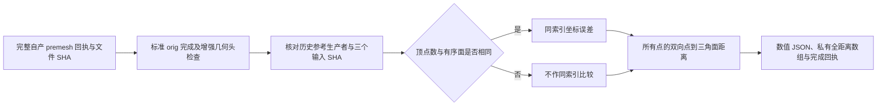

# 完整自有 GA 网格与同输入原生参考比较

## 1．功能与流程

`tools/compare_recon_genetic_mesh.py` 在自有全缺陷 GA、标准 remesh、最终相交清理和增强完成检查都成功后，比较 `orig.premesh` 与 `orig`。它复用仓库已有完整双向点到三角面距离函数；原生参考只在此独立诊断中读取，不进入重建。



严格网格复现、网格质量、整体指标等效分别报告。这里不增加等效阈值，也不将诊断时间计为生产运行时间。

## 2．Python 调用、全部输入与输出

在仓库根目录设置 `PYTHONPATH=src:tools`，使用以下具名调用：

```python
from pathlib import Path
from compare_recon_genetic_mesh import compare

mesh_report = compare(
    premesh_directory=Path("own-ga/candidate"),  # 完整自产 GA 回执、网格和状态
    orig_directory=Path("own-orig/candidate"),  # 完整标准 remesh/清理产物及回执
    strengthened_report=Path("own-validation/report.json"),  # 已通过增强头和产物检查
    reference_subject=Path("isolated-reference/subject"),  # 相同三输入的原生历史参考
    reference_benchmark=Path("isolated-reference/benchmark.json"),  # 历史 benchmark 原字节
    reference_runtime=Path("isolated-reference/subject/fnit-native-free-run.json"),  # 历史运行原回执
    reference_provenance=Path("reference_provenance.json"),  # 已记录参考报告和程序 SHA
    case_name="sub07",  # provenance 中的明确公开被试编号
    hemisphere="lh",  # 只比较这一侧；另一侧另开完整独立任务
    surface_distance_module=Path("validation/recon_all/accuracy_20261003/task_04/reference_surface_distance.py"),  # 已有完整三角面距离
    output_directory=Path("new-comparison"),  # 尚不存在的新诊断目录
    threads=4,  # 现有距离核固定四线程；外层还须固定 BLAS 和四核亲和性
)
```

| 参数 | 类型、输入结构、默认与限制 |
|---|---|
| `premesh_directory` | 必填 `Path`；含完整 GA 的 `report.json`、`COMPLETE.json`、`H.orig.premesh`、状态和映射 NPZ。所有声明输出 SHA 均核验，不读取未完成检查点代替。 |
| `orig_directory` | 必填 `Path`；含 `H.orig`、完整标准阶段报告和 `COMPLETE.json`。报告必须绑定上述 premesh 及其原回执，实际输出 SHA 必须相同。 |
| `strengthened_report` | 必填 `Path`；增强完成检查的成功 JSON，其 orig、父报告、父 COMPLETE 和 premesh 报告 SHA 都须匹配。 |
| `reference_subject` | 必填 `Path`；含参考的 `surf/H.orig.nofix`、`surf/H.qsphere.nofix`、`mri/brain.mgz`、`surf/H.orig.premesh` 和 `surf/H.orig`。前三输入 SHA 须与实际自产 GA 输入相同。 |
| `reference_benchmark/reference_runtime` | 必填两个 JSON `Path`；按历史 provenance 的原 SHA 校验。程序身份从历史生产回执读取，不用今日程序哈希重标旧运行。 |
| `reference_provenance` | 必填 JSON `Path`；`cases` 列表含 `case`、`original_benchmark_receipt_sha256`、`original_runtime_receipt_sha256`、`recorded_original_program_sha256`、`recorded_code_version` 和 `preflight_reference_surface_sha256`（`orig.premesh/orig` 两项 SHA）；顶层含 `frozen_original_source_commit`。两张参考表面还须与启动前只读观察的冻结 SHA 相同。 |
| `case_name` | 必填 `str`，唯一匹配 `cases[].case`；不隐式猜测被试。 |
| `hemisphere` | 必填 `str`，`lh/rh`；决定全部对应文件名。 |
| `surface_distance_module` | 必填 Python 文件 `Path`，提供仓库既有 `_point_to_mesh`；文件 SHA 与实际加载模块 SHA 记录。 |
| `output_directory` | 必填 `Path`，必须不存在；失败产物保留在这个独立目录。 |
| `threads` | 默认且目前仅允许整数 `4`，不接受 bool；与现有精确距离函数的固定 worker 数相同。外层线程/亲和性由调用者固定。 |

两份表面的坐标均为 surface RAS，单位 mm；nibabel 解码坐标为 `(N,3)`，有序面为整数 `(F,3)`。体积尺寸、voxel spacing、三个方向轴和 cras 必须相同且头有效，才能比较距离；文件名注释和完整 footer 字节另外记录。同索引比较只在顶点数和全部有序面相同的时候成立。

返回 `dict` 并写出：

- `report.json`：两阶段的顶点/面数量、结构质量、同索引误差或 `null`、双向三角面距离的 mean/P99/max、超过 0.1 mm 的数量、完整点覆盖证明、参考及自产源码/程序/输入/输出 SHA、线程和诊断墙钟。0.1 mm 只是描述计数，不是新等效门槛。
- `orig.premesh.distances.private.npz`、`orig.distances.private.npz`：两个方向全部源顶点的 float64 距离数组，各方向长度分别为自己的源顶点数，单位 mm；私有保存，不提交原始网格或影像。
- `COMPLETE.json`：只表示只读比较完成，绑定报告 SHA；不表示原始 T1 整例成功。
- `failure.json`：新目录建立后，缺文件、SHA/坐标域/完成门不符或计算异常时的实际失败信息。异常继续抛出；已有输出目录则直接报错，不覆盖它或改写旧回执。

`strict_geometry_reproduction` 只判这两个阶段解码坐标与有序面是否完全一致；原文件字节另列。`overall_metric_equivalence`、完整参考阶段重复性和 `whole_recon_all` 仍单独为 `not_assessed`。本工具不初始化 CUDA、不开半精度；`gpu_memory_bytes=null` 表示没有此项测量。

## 3．命令行

```bash
CUDA_VISIBLE_DEVICES='' OMP_NUM_THREADS=4 MKL_NUM_THREADS=4 \
OPENBLAS_NUM_THREADS=4 NUMBA_NUM_THREADS=4 PYTHONPATH=src:tools \
python tools/compare_recon_genetic_mesh.py \
  --premesh-directory own-ga/candidate \
  --orig-directory own-orig/candidate \
  --strengthened-report own-validation/report.json \
  --reference-subject isolated-reference/subject \
  --reference-benchmark isolated-reference/benchmark.json \
  --reference-runtime isolated-reference/subject/fnit-native-free-run.json \
  --reference-provenance reference_provenance.json \
  --case-name sub07 --hemisphere lh \
  --surface-distance-module validation/recon_all/accuracy_20261003/task_04/reference_surface_distance.py \
  --output-directory new-comparison --threads 4
```

参数与 Python 表一致。任务调度须等待三个自产阶段真实成功退出，不能仅按日志中的阶段名称触发比较。候选不完整时工具在打开参考之前失败。

## 4．原软件对应步骤

没有等价的原软件内部比较命令。被比较的参考步骤是固定源码的 `mris_fix_topology -ga -seed 1234`、`mris_remesh --remesh --iters 3` 与 `mris_remove_intersection`；原生程序只在隔离 benchmark 中生成参考。

当前已复核历史 `79a41cdd` 的同输入原生 GA 参考与原回执，程序 SHA 为 `c3bb6b744f3d3ebcc0bbaf6a79b4266eb712ea51a113b06157456b560654fde6`。它是固定源码独立构建的参考程序；本工具不运行该程序，也不把一次历史参考宣称为全阶段重复性验证。

## 5．真实数据、精度、时间与脑图

2026-10-11 已现场核对 sub07 同输入历史参考：nofix SHA `cfa9c1d0f5681a87d4ae709d0b093e20fdc3466ea6525b7fc94ba61a4708b0f9`、qsphere SHA `cf3c1e339c9d36c5245cb7d75cc11a4bd174ee3267e2f41ce8867061e9eed952`、brain SHA `977f6fb298d38e10588cd636f4db38ca8c3456265b24d6d80d00d54e60e98eed`，与自有完整 GA 的实际输入一致。benchmark/runtime 原回执 SHA 与既有 [GA 参考生产者记录](../../validation/recon_all/optimizations/20261010_topology_volume_python/original_GA_producer/reference_GA_producer_provenance.json) 相同。

六项本地合同通过，耗时 7.73 秒：真实 nibabel 格式往返与完整点证明、不同有序面不作同索引比较、不同 RAS 头拒绝、未完成自产阶段不打开参考、完整回执绑定实际文件、参考启动后变化即拒绝。这些小网格合同不作为 MRI benchmark。

本次比较已在固定四核预算下排队；实际导入检查退出 0，耗时 7.763 秒，当前状态为等待增强 orig 完成门。候选脚本 SHA 为 `34261dbeb0c03efacaf10995ed12a27c11b282abc4f303a90194c7a23e44a178`，七项冻结文件清单 SHA 为 `6726bfb5c87e24bfb2bcbdb89168fac6ec69c196f3f0673a552f87cbf359244e`。它等待完整自产链成功，不中断、不替换正在运行的源码。实际回执与复现合同见[本轮记录](../../validation/recon_all/optimizations/20261011_genetic_mesh_comparison/README.md)。

真实 premesh/orig 比较尚等待全九缺陷及最终质量检查完成。当前没有本工具的真实全网格误差、完成时间或脑图，不把输入复核写成完整比较通过。已有首缺陷真实图及结果见 [完整默认搜索](TOPOLOGY_GENETIC_SEARCH.md)，完整阶段范围见 [全半球 GA](TOPOLOGY_GENETIC_REPAIR.md) 和 [最终 orig](TOPOLOGY_GENETIC_ORIG.md)。

## 6．更新与验证记录

- 本轮复用既有完整三角面距离和完成校验，不重复实现距离算子，不新增依赖。
- 原生输入及输出只在独立诊断读取；失败和源码版本保留，不覆盖正在运行的冻结 GA、orig 或增强校验任务。
- 保留严格解码/原文件比较和双向形状诊断，不设新的整体等效阈值，不改变生产默认。

## 7．参考文献与源码

- [自有比较工具](../../tools/compare_recon_genetic_mesh.py)、[既有完整距离函数](../../validation/recon_all/accuracy_20261003/task_04/reference_surface_distance.py)、[完整点覆盖复用](../../tools/diagnose_topology_volume_shapes.py)。
- [固定 FreeSurfer 拓扑源码](https://github.com/freesurfer/freesurfer/blob/d932c45b7941662ea380a05efef580568b98d41a/utils/mrisurf_defect.cpp)。
- [Fischl 等，2001，Automated manifold surgery](https://doi.org/10.1109/42.906426)。
