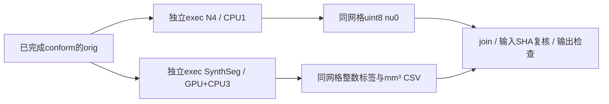
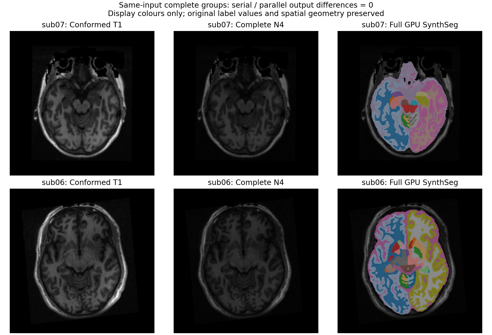
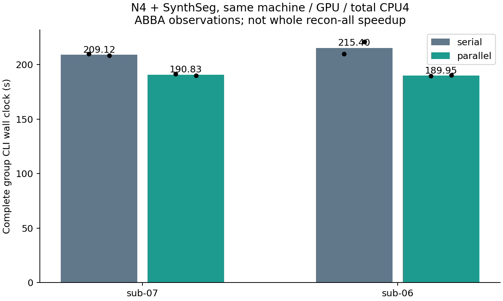

# N4 与 SynthSeg 的独立并行组

## 1. 功能与范围

`run_input_stage_group` 从已有 conformed `orig.mgz` 同时计算完整 N4 与 SynthSeg。它复用 SimpleITK N4 和 FNIT 自有 GPU SynthSeg，没有重新实现算法。两个 fresh-exec Python 子进程隔离模型精度和 ITK 线程，父进程只负责调度、等待与显存采样。

默认 `execution="serial"`。显式 `parallel` 的计算预算是 N4 单线程与 SynthSeg 三线程，总四线程；N4 拟合始终单线程，不采用会改变输出的四线程拟合。并行可行的前提是两者只读取同一个 orig，各自输出互不依赖。



本辅助组不是原始 T1 整例入口。生产调度现提供 `input_execution="parallel"` 显式接线，默认仍串行；组内校验通过不代表整例通过。通用 SimpleITK 库允许使用；原版 FreeSurfer 阶段程序不被调用。

## 2. Python 调用、输入与输出

```python
from fnit.recon_all.input_stage_parallel import run_input_stage_group

input_group_report = run_input_stage_group(
    orig_path="subject/mri/orig.mgz",                 # 自产conformed三维T1；不读官方结果
    n4_output="subject/mri/tmp/nu0.mgz",              # 新路径，同网格uint8偏置校正结果
    segmentation_output="subject/mri/synthseg.rca.mgz", # 新路径，同网格原整数标签、float32存储
    volumes_output="subject/mri/synthseg.vol.csv",    # 新CSV，软组织体积单位mm³
    weights_dir="resources/weights",                 # 既有四文件SynthSeg资源，不下载
    color_lut="resources/assets/FreeSurferColorLUT.txt", # 既有声明颜色表
    report_path="subject/scripts/input-group.json",  # 新JSON；旁边保存request/worker/log
    device="cuda:0",                                 # 显式目标GPU，不能只写cuda
    threads=4,                                       # 固定总计算线程预算
    execution="parallel",                            # 默认serial，显式启用1+3并行
    profile_stages=True,                              # 默认False；剖析模式同步目标GPU
    code_version="tested-commit-and-source-manifest", # 实际冻结源码标识，同时记录源码SHA
)
```

| 参数 | 格式、默认值和限制 |
| --- | --- |
| `orig_path` | 必填 `str/Path`，有限非负单帧三维 MGH/MGZ conformed T1；输入保持只读 |
| `n4_output` | 必填新路径，N4 `uint8` MGH/MGZ；XYZ shape、scanner-RAS毫米affine和surface-RAS头几何不变 |
| `segmentation_output` | 必填新MGH/MGZ路径，复用成熟保存器的 `float32` 存储，数值为原整数标签；原33类模型及原标签值，最近邻恢复输入空间 |
| `volumes_output` | 必填新CSV；subject、total intracranial及32组织名称列；软体积单位mm³，不是标签体素计数 |
| `weights_dir` | 必填目录，含 `synthseg_2.0.h5`、对应 segmentation labels/names 和 topological classes 三个 `.npy`；校验存在并记录SHA，不自动下载 |
| `color_lut` | 必填既有颜色表文本，只读取 |
| `report_path` | 必填新JSON；其旁边 `.n4/.synthseg.request.json/.worker.json/.log` 与 `.N4.json` 也须不存在 |
| `device` | 必填显式 `cuda:N`；无CUDA或GPU前向失败报错，不回退CPU |
| `threads` | 默认整数4，目前仅支持4，不接受bool/float；serial每步4，parallel为1+3 |
| `execution` | 默认serial；parallel两个独立exec，未使用fork或计算线程池 |
| `profile_stages` | 默认False；True统一由成熟worker同步目标GPU；生命周期完成仍执行必要CUDA屏障 |
| `code_version` | 默认 `FNIT-source-hashes`；报告同时记录实际helper与子函数SHA，不能只凭字符串认定版本 |

N4的完整配方见[N4 SimpleITK说明](N4_SIMPLEITK.md)。同输入拟合1、重建1/4的真实浮点与量化零差异是本次并行前置门；不推广为任意拟合线程等价。SynthSeg仍执行原图和翻转的完整集成、后处理、原网格恢复和CSV。模型构造后明确设置cuDNN FP32，实际前向保存dtype、GPU、TF32及autocast记录；不启用FP16/BF16。父进程已初始化CUDA时不改其当前设备、线程、精度、环境或分配缓存。

成功字典包含 `status`、`workers.n4/synthseg`（原结果、完整执行时间、实际线程、精度、分配策略）、`inputs_sha256/final_inputs_sha256`、`outputs_sha256`、`intervals`、`overlap_seconds`、`device_process_tree`、父前后状态和`parent_state_preserved`。`group_wall_seconds`覆盖校验、启动、导入、模型加载、数据传输、影像/CSV写出、join与采样结束；最终报告自身写出由调用外的完整API/CLI墙钟覆盖。采样包含父子同一时刻的目标卡快照，PID归属无法证明时进程树峰值为null，整卡占用单列且包括其他任务。

参数/路径非法抛ValueError，输出已存在抛FileExistsError，资源缺失、计算、CUDA或写出失败传播。运行失败保留JSON与日志，只取消本组新建且独立会话的子进程树，不终止其他任务。失败不标complete，不把半成品补成近似输出。

内部 `run_n4_task(input_path, output_path, threads, report_path)` 与 `run_synthseg_task(input_path, segmentation_path, volumes_path, weights_dir, color_lut, device, threads, cudnn_benchmark, cudnn_deterministic)` 由成熟worker调用；参数均显式具名，后两个bool继承父设置。N4返回原阶段字典与SHA；SynthSeg返回路径、颅内容积、实际前向及模型dtype/device和SHA。两者不读取benchmark参考。

完整调度API使用同一参数；batch API `run_recon_all_python_batch` 的具名参数 `input_execution="parallel"` 原样传递到每个被试CLI：

```python
from fnit.recon_all.native_free import run_recon_all_python

reconstruction_report = run_recon_all_python(
    t1="input/sub01_T1w.nii.gz",  # 原始三维单幅T1；不是已有orig或官方输出
    subject_dir="output/sub01",  # 新目录，从原始影像连续计算
    weights_dir="resources/weights",  # 已校验、声明的项目网络权重
    assets_dir="resources/assets",  # 已校验的模板、图谱和LUT
    native_bin_dir=None,  # Python配方不读取原版程序目录
    backend="python",  # 完整独立Python候选，其整例网格质量另验收
    device="cuda:0",  # 明确目标CUDA编号，依CUDA_VISIBLE_DEVICES解释
    threads=4,  # 输入并行组固定1+3，其余双侧组平分为2+2
    input_execution="parallel",  # 默认serial；只改N4/SynthSeg的依赖调度
    profile_stages=False,  # 默认生产模式，无额外剖析同步
    cuda_allocator_cache="auto",  # 保留已初始化API策略及现有低显存措施
)
```

`parallel`要求完整SimpleITK/in-process N4、总四线程、显式cuda:N且调用方autocast关闭；非法组合在创建被试输出或CUDA初始化前报错。join后执行原nu/归一化与注册/WM/filled；后面的SynthSeg消费已生成的体积和精度元数据，不再次加载模型。完整失败抛异常、写部分报告，不改成成功返回。

## 3. 命令行与安装

本次独立工具CLI用于同输入完整组测试；生产入口的接线和整例记录见[recon-all主说明](README.md)。下例 `--mode group` 执行完整组，输出目录必须为空且不存在；额外 `--initialized-parent` 在父进程持有FP32 CUDA张量时检查API恢复，不能当作CLI冷启动时间。

完整Python调度候选以 `input_execution="parallel"` 显式接入，默认仍serial；接线后的两例原始T1→filled配对已完成，连续前段与独立阶段组分别报告，均不作为整例结论。

```bash
# 显式源码目录和manifest绑定；设备与总线程预算在报告中记录
python tools/benchmark_recon_input_stage_parallel.py \
  --mode group \
  --module-directory src/fnit/recon_all \
  --input subject/mri/orig.mgz \
  --output diagnostic/input-group \
  --weights resources/weights \
  --color-lut resources/assets/FreeSurferColorLUT.txt \
  --device cuda:0 \
  --execution parallel \
  --source-manifest diagnostic/SOURCE_MANIFEST.json \
  --code-version tested-source-version
```

`--mode abba` 在同一个新目录中执行 `[serial, parallel, parallel, serial]`，完整冷exec后再比较体素、dtype、affine、tkr和CSV；`--mode reconstruction-gate`先检查完整N4重建线程1/4，额外必填 `--reference-directory` 指向带输入/源码SHA的既有阶段输出，仅用于诊断。没有新增依赖，使用主页已有PyTorch、nibabel、SimpleITK==2.5.6。

## 4. 对应原软件

原软件的SynthSeg参考命令为 `mri_synthseg --i orig.mgz --o synthseg.rca.mgz --vol synthseg.vol.csv --keepgeom`，非robust、非parcellation的33类配方。N4参考为recon-all固定N4偏置阶段及既有make_nu包装，SimpleITK内部Shrink/B-spline/Exp/Divide没有独立FreeSurfer CLI；不编造mri_nu_correct等价命令。原生源码构建N4只留独立benchmark参考，生产helper不执行它。详见N4及SynthSeg功能页。

## 5. 最新真实精度、耗时与脑图

2026-10-10，在同一台共享A100节点、目标GPU5及同四核预算下，两例公开ds000114的FNIT自产orig分别完成完整冷CLI `[serial, parallel, parallel, serial]`。外层计时包含校验、两子进程启动、Python导入、权重加载、GPU传输、原图和翻转前向、后处理、MGZ/CSV/JSON写出与退出。

| 公开T1 | 串行完整组中位数 | 并行完整组中位数 | 本组观察缩短 | N4/分割不同体素 | 32个非零标签Dice | 体积CSV |
| --- | ---: | ---: | ---: | ---: | ---: | --- |
| sub07 | 209.122827 s | 190.825404 s | 8.7496% | 0 / 0 | 全部1 | 字节相同 |
| sub06 | 215.403231 s | 189.949592 s | 11.8167% | 0 / 0 | 全部1 | 字节相同 |

每例四次输出的三个文件SHA均相同，shape、dtype、scanner-RAS affine及surface-RAS头几何均相同。前置完整N4拟合1、重建1/4的float32结果不同元素数为0，最大/P99误差为0；uint8输出及几何也为0差。这里保留拟合1，没有采用曾改变下游结果的拟合4。

额外完整API试验在父CUDA已初始化并持有FP32张量时执行，目标cuda:5与父当前cuda:0不同：脚本含导入/初始化为191.909691 s，组内为187.992446 s；父buffer、当前设备、线程、精度和缓存环境均保持，输出与串行字节相同。九组均执行完整原图/翻转FP32前向，matmul TF32开启、cuDNN FP32例外保留，未启用autocast或半精度。

九组目标整卡采样上界为5,550,112,768–13,603,176,448字节（含共享任务）。PID命名空间无法证明归属，父子同期进程树显存为null；缓存关闭时allocated/reserved不可用，不能记作0。请求0.5 s采样，实测最大间隔4.964059 s且一份采样失败，故不能宣称捕获了连续峰值或整例20 GB验收。本次测量使用旧冻结采样器，不套用随后新增NVML采样器的精度或开销。

这是两个完整阶段的并行组，尚未测本改动的原始T1整例提速或整体指标等效。SimpleITK相对原版参考既有sub07/sub06的28/99个量化差异仍由[N4功能页](N4_SIMPLEITK.md)报告，本次并行没有增加误差；原版参考不是本组生产输入。完整[机器收据及复现脚本](../../validation/recon_all/optimizations/20261010_input_n4_synthseg_parallel/README.md)保存共享负载、各次墙钟及全部SHA。





随后用实际冻结manifest `655ac22b…` 接线运行两例原始T1→filled（每例各一次串行/并行）。14张体积及几何/dtype、LTA全部0差，逐标签Dice为1，CSV字节相同；六张MGZ仅自产路径尾标签不同，严格字节差另存。sub07完整前段API为486.859→450.809秒，sub06为464.285→503.020秒，方向不一致，不能宣布稳定前段或整例加速。保留串行默认。[完整前段机器记录、外层墙钟、显存和脑图](../../validation/recon_all/optimizations/20261010_input_n4_synthseg_prefix/README.md)同时说明已完成与未测范围。

## 6. 更新记录

- 2026-10-10：新增独立N4/SynthSeg fresh-exec组；复用成熟worker、线程预算、失败取消和显存采样，默认仍串行；完整调度通过显式参数接线。
- 2026-10-10：先验证N4 fit1的重建线程1/4完整输出，再测试SynthSeg线程3/4；拟合线程4的既有传播差异仍由独立N4前段报告记录。
- 2026-10-10：两例八次CLI和一次已初始化CUDA父API完整通过；公开71份数值保真的原始JSON收据及两张派生图，默认仍serial。修正输出说明：成熟SynthSeg保存器实际float32存储整数标签，不冒称int32存储。
- 2026-10-10：API/CLI/batch接线后，两例各完成串行/并行原始T1→filled；解码输出无退化，耗时观察方向不同，未改默认或宣称整例收益。

## 7. 原实现与参考文献

- [FNIT完整N4 SimpleITK实现与固定配方](N4_SIMPLEITK.md)
- [FNIT SynthSeg源码](../../src/fnit/synthseg_parc/synthseg.py)、[SynthSeg原仓库](https://github.com/BBillot/SynthSeg)、[FreeSurfer SynthSeg说明](https://surfer.nmr.mgh.harvard.edu/fswiki/SynthSeg)
- [SimpleITK N4文档](https://simpleitk.readthedocs.io/en/master/link_N4BiasFieldCorrection_docs.html)
- Tustison NJ et al. N4ITK: improved N3 bias correction. IEEE Trans Med Imaging. 2010;29:1310–1320.
- Billot B et al. SynthSeg: Segmentation of brain MRI scans of any contrast and resolution without retraining. Medical Image Analysis. 2023;86:102789.
