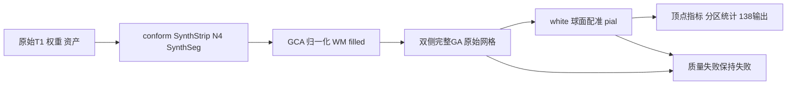

# 独立 Python recon-all：本轮合并与实测

## 1. 功能与范围

本轮推进backend="python"独立候选，复用FNIT的PyTorch及Python/Numba算法；允许SimpleITK等Python库。生产候选不启动原版FreeSurfer阶段程序。混合native对照及公共默认尚未切换，十分钟目标、最终网格与整体指标等效仍未通过。



## 2. 输入、输出与Python调用

标准输入是单幅真实3D T1w及已核验资源；体积使用conformed网格，表面采用surface RAS/mm、有序三角面和同编号顶点图。不同网格不能逐顶点比较。原始T1、资产和个人许可证只保留授权私有位置。

完整参数、返回结构和失败行为见[流程接口](README.md)、[执行配方](EXECUTION_RECIPE_20261011.md)与[pial接口](PYTHON_PIAL_PLACEMENT.md)。实际source_rip默认只将源rip作为SOAP固定/邻居屏蔽域；皮层外pin和清理是两个步骤。强化cortex_pinned_union为显式实验，不作为原版默认。

```python
from fnit.recon_all.native_free import run_recon_all_python

reconstruction_report = run_recon_all_python(
    t1="/data/public_T1w.nii.gz",  # 原始单幅T1w
    subject_dir="/data/new-subject",  # 不复用手动补跑的空输出目录
    weights_dir="/data/verified-weights",  # 已按许可与SHA核验
    assets_dir="/data/verified-assets",  # 已核验固定图谱/模板
    backend="python",  # 独立候选，不调用原版阶段程序
    topology_backend="python-ga",  # 完整自有GA，不裁剪搜索
    device="cuda:0",  # 显式目标GPU，默认TF32，保留FP32例外
    threads=4,  # 双半球各2线程，不另增总预算
)
```

必要阶段或质量失败会抛异常、保留部分报告；上例不是当前整例通过的声明。输出完整性、网格质量、严格复现和指标等效分别记录。

## 3. 命令行与当前下一步

```bash
python tools/benchmark_recon_torch_end_to_end.py \
  --t1 /data/public_T1w.nii.gz --output-root /data/new-whole-run \
  --weights-dir /data/verified-weights --assets-dir /data/verified-assets \
  --backend python --topology-backend python-ga \
  --n4-backend simpleitk --n4-execution in-process \
  --input-execution serial --device cuda:0 --threads 4 \
  --code-version ACTUAL_FROZEN_COMMIT
```

每个路径参数的格式、设备/预算和失败行为见执行配方。包装器现保留显式input-execution请求；parallel只能配完整SimpleITK/in-process及总4线程，非法组合在依赖检查/输出创建/进程启动前失败。当前最终wheel首先应在授权机器做独立target安装，之后从新空目录执行上述原始T1命令；不能将旧失败输出或诊断回放当作连续整例。

## 4. 原软件对照

官方仅在隔离benchmark生成参考，标准整体参考为recon-all -all。GCA对照读取自产nu/brainmask，输出后才解析参考LTA；pial使用冻结同输入参考和实际重复结果。已有函数内部步骤没有独立CLI时沿用其所属命令，不另编造命令。

## 5. 本轮结果

| 范围及实测版本 | 实测结果 | 结论边界 |
|---|---|---|
| 已安装9292a0a7 Torch N4，两例冷CLI及已初始化父API，各200轮 | 冷CLI7.522/7.820秒，父API墙钟8.428/8.660秒；体素、affine、dtype及文件SHA对旧完整Torch与两旧worker全同 | 四组新增差0；旧对原实现4016/3259个+1体素差保留，不是最终wheel整例 |
| 同一wheel guarded GCA，两例自产nu/brainmask | 冷CLI173.706/173.714秒；LTA16矩阵元素对自产/官方0差；完整过程同旧记录 | 官方文件SHA不同；两例EM接受更新为0，未覆盖接受更新后的真实轨迹 |
| pial f527完整阶段，source_rip/显式并集 | 各47步、52个优化/pin事件和同模式末态逐字节相同；源残余32/184面，均EXIT1、无标准pial | 数值回归通过，几何质量失败。默认严格self/cross为226/25896；并集394/25284且2退化面 |
| 状态装配391冻结源的同进程连续三候选ABBA | 热装配中位数0.625708→0.414544秒；热完整三候选API含写入20.919939→20.502265秒 | 33.75%局部/2.00%短流程观察；全字段、反馈和10447次随机流相同，未接默认/未测完整GA |
| 有序CSR独立实验 | 热API33.018→10.355ms，完整候选字段相同 | 只为CSR局部3.19倍，不是整例 |
| 谓词缓存v6前三连续候选 | 命中34.44%，热候选6.362→7.236秒；热扫描0.626→1.291秒 | 负收益，不启用。原EXIT1及三个JSON字节失败保留；另做严格完整类型/值对象重核，不改数值门 |
| 最终7652b7b0独立wheel | 34模块source/wheel/installed SHA一致，库默认source_rip，fresh CLI及依赖检查EXIT0 | 安装/导入/合同通过，不是MRI或整例独立部署证明 |

N4父API保持真实64MiB FP32影像张量。经过可信PID/同快照检查的父子窗口最大2,401,239,040字节；采样请求0.25秒，最长实测间隔0.730秒。整树归属存在未知，全序列峰值仍null；缓存关闭后allocated/reserved=0无效，不能宣称整例低于20GB。各计时边界与实际硬件/线程在原报告中逐项保留，不将局部时间相加为整例。

[旧v2/v3现场退出核查](../../validation/recon_all/optimizations/20261011_current_whole_preparation/README.md)确认同一T1两次均EXIT1、各28/138输出，右侧premesh清理仍有2个相交面。19187.455/18402.517秒是各自失败前墙钟，源版本/环境不同，不能称两例完成或当前提速。10/10公开原始T1、118/118资源SHA可用不代表十例已完成评估。

真实脑图、源码/输入/程序SHA与完整指标分别见：[N4](../../validation/recon_all/optimizations/20261011_guarded_n4/README.md)、[GCA](GCA_COMPLETE_PYTHON.md)、[white/pial](../../validation/recon_all/optimizations/20261011_fnit2_chain/README.md)、[状态装配脑图](TOPOLOGY_STATE_PACK_EXPERIMENT.md)、[负缓存](TOPOLOGY_EDGE_PREDICATE_POPULATION_PREFIX.md)、[最终安装](../../validation/recon_all/optimizations/20261011_integrated_python_install_v4/README.md)。私有脑图保留其哈希和位置说明，公共源不包含原始影像、权重或许可证。

## 6. 更新与未通过项

本轮完成EM协议/共享预处理修正、worker程序守卫、pial默认及固定域报告修正、包装器并行参数修正，保留经过回归的阶段优化和负结果。公共GPU UUID已匿名化，原私有回执哈希及科学字段不改；其他人的未提交工作保持原样。

完整GA原始整例、残余white/pial交叉、最终138项输出、十例整体Dice/双向面距离/厚度面积体积和局部异常仍需当前版本验证。整体等效没有正式阈值结论，不把历史严格复现失败解释为随机性，也不为提高通过数放宽标准。

## 7. 参考与代码

[FNIT完整Python流程](PYTHON_SURFACE_PIPELINE.md)、[完整GA](PYTHON_GENETIC_PROFILE.md)、[固定FreeSurfer源码](https://github.com/freesurfer/freesurfer/tree/d932c45b7941662ea380a05efef580568b98d41a)、[N4说明和参考](N4_COMPLETE_TORCH_20261009.md)、[GCA算法与参考文献](GCA_COMPLETE_PYTHON.md)。
