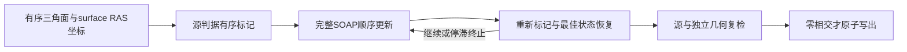

# 自有表面相交检测与完整迭代修复

[返回阶段索引](CONDA_CPP_STAGES.md)

## 1．功能和范围

`run_remove_intersection()` 复用 FNIT 完整 pial 清理模块：有序相交标记、每轮100次SOAP邻域更新、重新标记、接受或恢复最佳几何，以及连续停滞后的终止。生产包装 `remove_intersection_surface()` 要求源判据和独立三角面几何判据均为零相交，不满足就报错。Python/Numba负责计算，源标记也可显式使用已有Torch GPU后端。运行时不查找或执行原版程序。



标准流水线输入是remesh后的 `orig`。自然有相交的 `orig.premesh` 和平滑诊断网格只用于冻结同输入测试，不能当作生产实际输入。输入未相交时保留坐标和文件字节，这是具有明确语义的保留操作。

## 2．Python调用、输入和输出

```python
from fnit.recon_all.mris_remove_intersection_python import run_remove_intersection

report = run_remove_intersection(
    input_path="subject/surf/lh.orig",  # remesh后三角网格，surface RAS/mm
    output_path="subject/surf/lh.orig",  # 允许原位，严格复检通过后才替换
    marking_backend="source_numba",  # 默认有序Numba源判据；另有source_torch
    device=None,  # NumBa默认None；Torch必须显式cuda:N
    candidate_grid_cells_per_axis=2,  # 默认2，完整GPU候选空间索引的分块
    require_zero=True,  # 默认True，两套判据任一残余均失败
    ordered_neighbor_offsets=None,  # 默认None；最终拓扑可传源一环(N+1,)CSR偏移
    ordered_neighbors=None,  # 默认None；与偏移同时提供，保留原序和未被面支撑的边
    report_path="subject/scripts/lh.intersection.json",  # 默认None，保存轨迹和SHA
)
```

| 参数 | 格式、默认值和含义 |
|---|---|
| `input_path` | 必填str/Path；三角表面 `(N,3)` 坐标、`(F,3)`有序面和可选体积几何尾部 |
| `output_path` | 必填str/Path；与输入相同空间，可与输入相同；严格失败不覆盖已有文件 |
| `marking_backend` | 默认 `source_numba`；另有 `source_torch`，完整候选与源判据保持 |
| `device` | 默认None；Torch标记须显式目标CUDA，坐标float32、相交判据float64 |
| `candidate_grid_cells_per_axis` | 正整数默认2；完整候选分块，不截断面对 |
| `require_zero` | bool默认True；False仅用于独立残余诊断，不能作为生产验收 |
| `ordered_neighbor_offsets` | 整数 `(N+1,)` 或None；首0、末E、非递减，与邻居数组同时提供 |
| `ordered_neighbors` | 整数 `(E,)` 或None；编号在 `[0,N)`，保留源顺序和未被面支撑的边 |
| `report_path` | str/Path或None，默认None；失败也保留可写的JSON |

返回dict包含输入/输出SHA、顶点/面数、策略、`cleanup`迭代与相交轨迹、独立几何数量、读入/计算/复检/写出和包含I/O的总墙钟，以及 `execution_status/output_written`。写出只替换坐标载荷，保留有序面和原尾部。包装返回 `(输入相交面数, 被标记顶点数)`。旧 `binary/assets_dir` 仅为调用兼容接受，不读取、不执行。

非法设备、参数或非有限输入会抛异常；严格残余先写失败报告，不覆盖输入或已有输出。不能把标记顶点数当相交面数。最终拓扑压缩保留的有序一环可显式提供，两项CSR在转换前校验；未传时保留既有默认。完整参数及本次阶段范围见 [最终有序邻接](TOPOLOGY_FINAL_INTERSECTION_CSR.md)。

## 3．命令行与真实复现

```bash
python -m fnit.recon_all.mris_remove_intersection_python subject/surf/lh.orig subject/surf/lh.orig --marking-backend source_numba --candidate-grid-cells-per-axis 2 --report-path subject/scripts/lh.intersection.json
```

CLI严格要求零残余。参数含义与上表一致；`--device` 仅在选择 `source_torch` 时给出。真实冻结测试脚本 `tools/benchmark_paint_intersection_python.py` 使用具名 `--intersection-input`（可重复）、`--intersection-reference`、`--output-dir`、`--device`、`--threads`、`--code-commit` 和显式 `--require-zero`。参考程序只在benchmark执行，默认不提供严格标志的运行仅为残余诊断。

主页Conda现有NumPy、SciPy、Numba、PyTorch、nibabel覆盖实现，无新增生产依赖。本接口不改全局TF32，不启用半精度。

## 4．原软件命令与源码

```bash
mris_remove_intersection subject/surf/lh.orig benchmark/lh.orig
```

固定参考提交 `d932c45b7941662ea380a05efef580568b98d41a`：[CLI](https://github.com/freesurfer/freesurfer/blob/d932c45b7941662ea380a05efef580568b98d41a/mris_remove_intersection/mris_remove_intersection.cpp)、[内部几何源码](https://github.com/freesurfer/freesurfer/tree/d932c45b7941662ea380a05efef580568b98d41a/utils)。SOAP和内部标记没有独立官方CLI。参考来自独立Conda源码构建，未复制系统二进制。

## 5．本版真实精度、时间和资源

候选SHA `011e6482cc32bdb02156dd15f24e0b1d24f3a2318c148deb5def1366dcd6f210`。输入来自公开ds000114、FNIT `79a41cdd` 自产输出。A100共享主机、CPU8–11、4线程；两个自然非零输入显式GPU0源标记，CPU SOAP和独立复检。参考各重复两次，坐标全部重现；候选最终有序面、坐标和几何头与参考零差异。

| 冻结输入 | 源相交面／标记顶点 | 最终源／独立相交面 | 自有API含I/O | 参考两次含启动I/O |
|---|---:|---:|---:|---:|
| sub-07 LH `orig.premesh` | 24／43 | 0／0 | 474.618s | 3.871／3.846s |
| sub-07 LH自然平滑诊断网格 | 6／初次标记见收据 | 1／2 | 140.977s | 29.518／31.312s |

第二输入显式 `require_zero=False` 记录完整2200次SOAP后的源算法停滞；坐标与参考相同，但仍有相交，严格包装必须拒绝。第一输入计算380.534s、独立复检94.025s；候选检测、CPU顺序修复和几何复检仍慢，没有加速结论。[完整非零收据](../../validation/recon_all/optimizations/20261010_paint_intersection/source_surface/intersection_gpu_v1/report.json)保留输入、程序、模块哈希及轨迹。

实际post-remesh `orig` 两例四侧严格测试均零相交，坐标和文件字节保留，参考重复零差异；完整API分别71.115、68.318、58.708、57.533s。[四侧收据](../../validation/recon_all/optimizations/20261010_paint_intersection/source_surface/orig_zero_cpu_v4/report.json)。旧版仅检测耗时不能替代本版完整时间。

GPU allocated峰值700,563,968字节、reserved峰值1,646,264,320字节；父子同一时刻显存未采样，不能证明整例预算。此处没有原始T1新整例，整体等效未判定，既有精度门保持。

独立F64检查器另有显式Numba/PyTorch平面过滤候选，参数、真实检测比较与资源边界见[保守平面过滤](TRIANGLE_PLANE_FILTER.md)。完整清理默认与严格复检门槛保持。

## 6．更新与验证记录

2026-10-10：移除运行时原版调用，复用完整自有清理；两个自然非零输入与实际 `orig` 四侧回归完成。严格失败保留文件契约通过。相交数与标记数分开记录；原尾部保留与参考尾部重写不同单独说明。

独立几何谓词的Numba编译实验在可选区间返回值降低阶段报错，没有进入本版冻结源码；失败记录保留，不计生产能力。此前依赖原版非零修复的说明已由本页替换，历史结果保留于Git历史。

## 7．参考文献和原实现

- Fischl B. FreeSurfer. *NeuroImage*. 2012;62:774–781. [doi](https://doi.org/10.1016/j.neuroimage.2012.01.021)。
- [固定FreeSurfer源码](https://github.com/freesurfer/freesurfer/tree/d932c45b7941662ea380a05efef580568b98d41a)。
- [FNIT完整清理](../../src/fnit/recon_all/place_surface_final_cleanup.py)与[包装模块](../../src/fnit/recon_all/mris_remove_intersection_python.py)。
