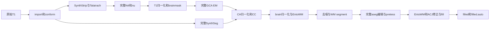

# Python N4 与原始 T1 到 filled 的连续验证

## 1. 功能简介

`volume_prefix_python.run_volume_prefix` 复用 FNIT 已有函数，完整运行单个原始 T1 到 `filled.mgz`，用于评估 N4 差异是否在归一化和白质分割中放大。它不调用原版神经影像阶段程序，不跳过步骤，不读取原版中间结果。SimpleITK 使用独立 Python 库；Torch N4 保留完整 200 轮。



## 2. Python 调用、输入与输出

```python
from pathlib import Path
from fnit.recon_all.volume_prefix_python import run_volume_prefix

raw_t1_file = Path("inputs/T1w.nii.gz")  # 原始三维单T1，保留真实几何。
subject_output_dir = Path("runs/new-python-prefix/subject")  # 必须为空。
weights_directory = Path("resources/weights")  # 已授权且哈希匹配的本地权重。
assets_directory = Path("resources/assets")  # GCA、模板与LUT。
prefix_report = run_volume_prefix(
    t1=raw_t1_file, subject_dir=subject_output_dir,
    weights_dir=weights_directory, assets_dir=assets_directory,
    device="cuda:0", threads=4, n4_backend="torch",
)
```

- `t1`：原始三维 NIfTI T1，毫米 affine，原始数据进入 import/conform，不预填充参考图像。
- `subject_dir`：新的空目录。`mri/` 保存自产强度与标签，`mri/transforms/` 保存自产变换，`stats/` 保存自产 SynthSeg 体积和 EntoWM 统计，`scripts/` 保存 CC 和子进程记录；`volume-prefix.private.json` 保存阶段时间及实际模型精度。
- `weights_dir`：本地 SynthStrip、SynthMorph affine、非 parcellation SynthSeg 和 EntoWM 权重及其标签元数据。逐文件核对项目 `WEIGHT_FILES` 的大小与 SHA，函数不下载。
- `assets_dir`：本地 MNI305 模板、固定 GCA、颜色/皮层下 LUT，按 `ASSET_FILES` 核对。
- `device`：明确的 `cuda:N`，默认 `cuda:0`；本入口要求 CUDA。
- `threads`：此验证配方固定为 4，限制 CPU 与子进程预算。
- `n4_backend`：默认 `simpleitk` 严格参考，拟合 1 线程、重建 4；`torch` 为完整 GPU 候选。两者输出同网格 uint8 `mri/tmp/nu0.mgz`，量化规则保留 floor(x+0.5)。

最终 `filled.mgz` 与 `filled.auto.mgz` 保留自产 conform 网格和毫米 affine，标签为 0/127/255。返回逐阶段秒数、资源/依赖信息、实际模型精度和完成状态。只完成到 filled，不包含双侧表面、厚度、配准或最终整例统计。API 沿用调用者 TF32；CLI 使用 TF32，SynthStrip/SynthMorph/SynthSeg/EntoWM 保留既有 FP32 例外。禁止 autocast；不新增 FP16/BF16。

## 3. 命令行调用

```bash
python -m fnit.recon_all.volume_prefix_python inputs/T1w.nii.gz runs/new-prefix/subject \
  --weights-dir resources/weights --assets-dir resources/assets \
  --device cuda:0 --threads 4 --n4-backend torch

python tools/benchmark_recon_volume_prefix_python.py \
  --input inputs/T1w.nii.gz --output validation/new-prefix-torch \
  --weights resources/weights --assets resources/assets --n4-backend torch

python tools/compare_recon_volume_prefix_python.py \
  --reference validation/new-prefix-simpleitk/subject \
  --candidate validation/new-prefix-torch/subject \
  --producer-source-commit eab334f7 --output validation/comparison.public.json
```

benchmark 只启动自己的 Python producer，拒绝原版神经影像阶段程序启动；允许 NumPy/HDF5/Numba 的标准 CPU 探测及编译器探测。计时包含解释器、导入、加载、传输、JIT 和写出。NVML 每秒采样：整卡总内存与驱动进程列表分别记录；容器 PID 映射未验证时 own GPU 内存为未知，不能将整卡缓存或零值归给本任务。Torch allocated/reserved 为本进程 allocator 计数，不代替父子同时占用的证明。独立 benchmark 在进入诊断入口前重置计数；直接 API 调用报告进程生命周期峰值，不隐式初始化或重置调用者 CUDA 计数。

## 4. 对应原软件调用

只在独立 benchmark 中使用原版参考。对应命令依次为 `mri_convert`、`mri_synthstrip`、SynthMorph affine、完整 N4、`mri_make_uchar`、`mri_normalize`、`mri_mask`、SynthSeg、`mri_em_register -uns 3`、`mri_ca_normalize`、`mri_cc`、aseg 引导 `mri_normalize`、`mri_sclimbic_seg`、ANTs denoise、`mri_segment`、`mri_edit_wm_with_aseg`、`mri_pretess` 和 `mri_fill`。

固定配方的原版前缀可在独立 subjects 目录运行：

```bash
recon-all -sd reference-only -s reference-case -i inputs/T1w.nii.gz -autorecon1
# 后续以固定 recon-all 版本的 autorecon2 volume 配方运行到fill。
# 必须隔离输出；不得把这些文件复制到FNIT producer。
```

这一示例不是完整 benchmark 的已执行命令记录。实际参考命令、源码 SHA 与参数以私有运行 manifest 为准；逐模块具体原版调用见其对应说明页。完整 EM 对应原版调用详见 [GCA_COMPLETE_PYTHON.md](GCA_COMPLETE_PYTHON.md)。

## 5. 最新真实数据 benchmark

2026-10-11，同两例公开 T1 的自产 orig，完整 4×50 轮 N4，收敛阈值 0，mask 全 1，收缩 4、初始三次样条控制点 4³、200 histogram bins、FWHM 0.15、Wiener 0.01。共享 A100、四核 affinity，以下为含加载/传输/JIT/写出的每次文件 API 时间，不含解释器和顶部导入。

| 输入 | 后端 | 首次调用/s | 同进程重复/s | 与单线程参考不同体素 | 最大uint8差 |
|---|---|---:|---:|---:|---:|
| 公共例A | SimpleITK拟合1/重建4 | 193.048 | 194.814 | 0 | 0 |
| 公共例A | SimpleITK拟合4/重建4 | 61.104 | 59.659 | 3233 | 1 |
| 公共例A | Torch完整200轮 | 7.462 | 2.992 | 4115 | 1 |
| 公共例B | SimpleITK拟合1/重建4 | 193.266 | 196.254 | 0 | 0 |
| 公共例B | SimpleITK拟合4/重建4 | 66.922 | 70.348 | 2406 | 1 |
| 公共例B | Torch完整200轮 | 3.831 | 2.830 | 3245 | 1 |

零差异是严格复现诊断。它与是否存在下游退化、整体指标等效分别报告，不能因少数 uint8 体素差 1 直接断言 GPU 不可用，也不根据结果临时放宽等效门槛。当前 Torch 和多线程拟合未通过零差异诊断；两例两臂完整 GCA→归一化→WM/filled 已执行并比较；已观察到下游差异放大，整体等效与退化尚未判定。

比较工具先核对原始输入 SHA、自产 orig/SynthStrip 和初始 Talairach LTA 是否相同，再逐一报告 T1/brainmask/norm/brain/WM/filled 等的不同体素、最大/P99绝对差、平均有符号差、shape/affine/dtype、LTA 元素差和离散分割的每个非零标签 Dice。同时给出非零支持区与实际变化体素的有符号均值、平均绝对差、P99及增减体素数，避免全图背景稀释尾差。WM 图包含强度和编辑标志，主掩膜沿用既有 `WM_MIN_VAL=5`，按存储值 `>=5` 报告 Dice 与成员变化数；非零 foreground 单列为诊断。逐整数 Dice 归入 `stored_value_diagnostic`，仅为强度/标志重合诊断，不能解释为解剖分区。SynthSeg、aseg、EntoWM 与 filled 仍按真正标签比较，filled 标签127为右半球、255为左半球。强度指标不替代分割检查。脑图保存在私有运行目录，不向公开仓库上传原始/衍生脑影像；两例脑图已生成并完成目视检查，保存在私有交付目录，公开记录仅保留指标与哈希。

冻结数值快照 `eab334f7` 的四条原始 T1→filled 连续链均完成19阶段，生产无原版阶段调用。例A顺序为SimpleITK→Torch，例B为Torch→SimpleITK；两例均核对原始输入SHA、orig、SynthStrip和初始Talairach矩阵相同。所有比较影像的shape/affine/dtype一致，GCA LTA元素差均为0。

| 输入 | SimpleITK完整prefix/s | Torch完整prefix/s | nu0不同体素/最大差 | norm不同体素/最大差 | 非零WM诊断Dice（旧回执） | filled不同体素 | filled标签127/255 Dice |
|---|---:|---:|---:|---:|---:|---:|---|
| 公共例A | 671.384 | 469.661 | 4115 / 1 | 267250 / 5 | 0.992582 | 3368 | 0.996373 / 0.997014 |
| 公共例B | 560.634 | 365.826 | 3245 / 1 | 52520 / 4 | 0.997255 | 2289 | 0.997814 / 0.997227 |

这些总时间包括子进程启动、导入、资源核验、加载、传输、JIT与写出，排除资源锁等待；共享设备及运行顺序使其为本轮观测。N4尾差在归一化和WM成员中扩展，不能将nu0最大差1理解为最终零影响。两例SynthSeg、aseg.presurf和EntoWM标签均零差；完整强度、控制帧、WM逐值与成员、filled差异及有符号偏差见[逐体素报告A](../../benchmark/recon_volume_python_20261011/comparison_public_A.public.json)和[报告B](../../benchmark/recon_volume_python_20261011/comparison_public_B.public.json)。每个阶段时间见[CSV](../../benchmark/recon_volume_python_20261011/prefix_stage_times.public.csv)。没有按结果新增通过阈值，严格零差异诊断未通过；退化和整体指标等效尚未判定，Torch N4不自动成为默认。

父进程Torch allocated峰值均为13,072,251,904 bytes，reserved为17,611,882,496至18,717,081,600 bytes；Talairach子进程计数单列于[完整回执审计](../../benchmark/recon_volume_python_20261011/four_route_audit.public.json)。allocator计数不代替父子同时NVML占用；own归属未建立，20 GB整体显存门仍为not_assessed。冻结EntoWM实际前向记录的cuDNN enabled为False，该后端状态也保留在回执，不从FP32存储类型推论全部硬件计算路径。MRI运行来源与最新API合同来源分别记录，未将API边界修复后重标为完整MRI新整版运行。

## 6. 更新和历史 benchmark

- 基线 `aeabc5a`：继承完整 Torch N4 与独立 SimpleITK 适配器；旧 187.711 s 仅是旧环境记录。
- 2026-10-11：两例完整三后端、冷/热同进程检查完成；输入/源码/库 SHA 和参数写入报告。
- `7a8be2c8`：新增完整原始 T1 到 filled 的独立诊断入口与 NVML/资源回执。
- `f7def46c`：补齐 CLI TF32 与 benchmark 外部程序拒绝检查。
- 后续真实 prefix 检查按新源码快照、新输出目录运行，失败记录不覆盖，不把执行完成写成验证通过。

## 7. 原实现与参考文献

- [SimpleITK N4BiasFieldCorrectionImageFilter](https://simpleitk.org/doxygen/latest/html/classitk_1_1simple_1_1N4BiasFieldCorrectionImageFilter.html)
- Tustison et al. N4ITK: Improved N3 Bias Correction. *IEEE Transactions on Medical Imaging* 29, 1310–1320 (2010). DOI: [10.1109/TMI.2010.2046908](https://doi.org/10.1109/TMI.2010.2046908).
- [FreeSurfer 原代码库](https://github.com/freesurfer/freesurfer)，参考仅运行在隔离目录；GCA 固定版本链接及其参考文献见完整 EM 页面。
- [SynthStrip](https://surfer.nmr.mgh.harvard.edu/docs/synthstrip/)、[SynthMorph](https://surfer.nmr.mgh.harvard.edu/docs/synthmorph/)、[SynthSeg](https://surfer.nmr.mgh.harvard.edu/fswiki/SynthSeg)。各模型文件保持原作者授权范围，未复制资源入代码仓库。

benchmark 入口修复：在独立子进程脚本内显式初始化并选择 CUDA 设备，再进入有显存计数的诊断入口；调整不涉及总控计时或生产调度。已运行的 `f3e68107` 冻结诊断快照保留原位置，数值算法未变。计数初始化错误的失败轮保留，不计入完整整例。

冻结 `f3e68107` 例A完成 import/Talairach 23.044 s、完整 N4 约186.55 s、nu 约5.54 s；随后 T1 normalization 的 Triton `ptxas --version` 被验证脚本误拦截。这是 benchmark 编译器检查遗漏，非算法失败；已补齐标准 CUDA 编译工具，失败轮保留，新目录运行完整链。

公开 API 新增外层作用域，复用 `thread_budget`，暂设并恢复 Torch intraop 与调用线程的 Numba mask；不改 interop、调用者环境或已初始化 BLAS，子进程环境仍继承调用者。API 进入时不统一设置 TF32，模型保留已有局部策略并记录实际前向；退出恢复 matmul 精度模式与 cuDNN enabled/TF32/benchmark/deterministic。输入模型的局部策略不代表每一步均继承 caller 开关。

最新 API 的 `total_seconds_including_IO` 从入口开始，包含导入、验证、资源校验和线程/backend恢复，排除最后一次边界元数据写出；旧内部时间另存 `compute_seconds_after_resource_verification`。冻结 `eab334f7` 的四条 MRI 运行仍使用原报告边界，独立 benchmark 的 `wall_seconds_including_spawn_import_load_IO` 已包含启动、核验与读写，不重新命名旧数据。API 作用域只做不运行MRI的正常/异常合同检查。CLI需在启动前设置所需库预算，或使用已有四核隔离 benchmark 启动配置。

比较器参数 `--producer-source-commit` 标明既有输出的冻结生产提交；新回执同时绑定两份成功生产回执的 SHA 与其源码 SHA，输入输出目录含义同上。比较器不修改 MRI 或旧报告，新结果必须指定不存在的输出路径。WM 语义修订另有三个合同检查：强度改变但主掩膜不变、1–4与5阈值边界、编辑标志255/1；这些小数组只验证指标定义，不用于 benchmark。

`b2ccf19e` 比较器在既有四份成功输出上独立重算，两例报告与三个合同均完成，未重跑 MRI、未覆盖旧回执。完整误差与原报告相同，新增主掩膜结果如下；每格为 Dice / 成员变化体素数。

| 输入 | wm.seg >=5 | wm.asegedit >=5 | wm >=5 |
|---|---:|---:|---:|
| 公共例A | 0.987641 / 12512 | 0.992698 / 7892 | 0.992582 / 8032 |
| 公共例B | 0.995310 / 4315 | 0.997274 / 2602 | 0.997255 / 2622 |

见 [新报告A](../../benchmark/recon_volume_python_20261011/comparison_wm_semantics_public_A.public.json)、[新报告B](../../benchmark/recon_volume_python_20261011/comparison_wm_semantics_public_B.public.json) 与 [合同回执](../../benchmark/recon_volume_python_20261011/comparison_wm_contracts.public.json)。主掩膜阈值沿用现有 mri_segment 与既有验证定义；强度整数 Dice 仅作 stored-value diagnostic，不能用于判断解剖分区退化。整体等效与退化仍未判定。
