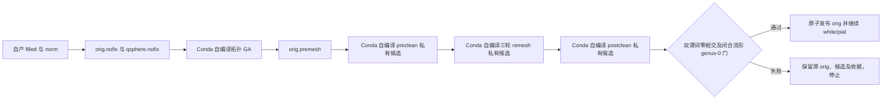

# 显式 Conda 表面加速配方

## 1. 功能与流程

本配方针对表面步骤的完整墙钟：拓扑遗传搜索继续由固定源码独立编译的 `mris_fix_topology_fnit` 执行，先以同一 Conda 安装的 `mris_remove_intersection` 清理 GA 的私有 premesh 副本，再以 `mris_remesh` 执行三轮 remesh，最后再次执行相交清理。原始 `orig.premesh` 始终保留。`surface_placement_backend="native"` 已会调用自编译 `mris_place_surface` 放置 pial、`mrisp_paint` 绘制 `avg_curv`；本次新增的开关只切换 remesh 与相交清理。默认 `topology_finish_backend="python"` 保留原流程；完整独立 Python 配方也保持可用。



## 2. Python 调用、输入和输出

```python
from pathlib import Path
from fnit.recon_all.native_free import run_recon_all_python

reconstruction_report = run_recon_all_python(
    t1=Path("/data/public/sub-06_T1w.nii.gz"),  # 原始单幅 3D T1w NIfTI，scanner 空间
    subject_dir=Path("/data/runs/sub-06"),  # 全新空目录；生成 138 项标准输出及 JSON
    weights_dir=Path("/data/fnit/weights"),  # 已校验的 FNIT 权重目录
    assets_dir=Path("/data/fnit/assets"),  # 已校验的模板、图谱及数据资产
    native_bin_dir=Path("/data/fnit-conda/bin"),  # 固定源码在 Conda 内独立编译的程序
    backend="native",  # 允许显式的混合 FNIT/Conda 配方
    topology_backend="native",  # 自编译完整拓扑 GA；不改 Python 默认配方
    topology_finish_backend="conda-cpp",  # preclean→三轮 remesh→postclean→严格门→原子发布
    surface_placement_backend="native",  # 已有自编译 white/pial 和 atlas paint 路径
    device="cuda:0",  # Synth 与自有 GPU 阶段的目标设备；C++ 表面程序使用 CPU
    threads=4,  # 全被试 CPU 线程预算；双侧 worker 时平分
    hemisphere_workers=2,  # 使用私有目录运行双侧，并在屏障后发布
)
```

`orig.premesh`、`orig` 均为 FreeSurfer 三角面文件，顶点 `(N, 3)` 使用 surface RAS、毫米，面 `(F, 3)` 为有序顶点索引。`mri/filled.mgz` 与 `mri/norm.mgz` 属于 conformed 体素网格。`mris_remesh` 可以改变顶点数和拓扑；清理阶段必须保留 remesh 后的有序面、顶点数与 MRI 几何头。成功时 `surf/H.orig` 是清理后的输出，`scripts/H.native-preclean.json`、`scripts/H.native-remesh.json` 与 `scripts/H.native-intersection.json` 记录输入、候选、程序和输出 SHA-256、阶段秒数及质量检查；`scripts/H.native-topology-finish.json` 绑定完整链、最终候选 SHA 与原子发布，原始 premesh 的 SHA 也会复核。末次候选须通过闭合、单连通、genus-0、非流形顶点、面方向、零面积与两种独立相交谓词的检查。顶层返回值和 `fnit-native-free-run.json` 还记录程序 SHA、138 项路径和完整墙钟。

`topology_finish_backend` 仅接受 `python`（默认）和 `conda-cpp`。后者只允许与 `backend="native"`、`topology_backend="native"` 搭配；程序缺失、命令失败、无效网格、MRI 几何头改变或任一相交谓词仍为非零均抛异常。原生程序退出码 0 不代表相交门通过。三步均先写入 `surf/.H.orig.native-*.candidate`；成功和失败均保留三份候选及收据。只有最终候选与完整质量收据的 SHA 一致时，才通过单次原子替换发布 `orig`；失败时原有 `orig` 保持原字节，或继续不存在。`backend="python"` 的纯自有计算配方继续使用 Python remesh 和清理，不会检查或调用这些原生程序。

安装前提是主页 Conda 路径确实独立构建并列出 `mris_remesh`、`mris_remove_intersection` 和 `mris_fix_topology_fnit` 的哈希。若当前安装清单缺少 `mris_remesh`，入口会在创建被试输出前报缺失程序；不能从系统 FreeSurfer 复制二进制。个人许可证只留在私有运行环境，不进入仓库。

## 3. 命令行调用

```bash
fnit-recon-all /data/public/sub-06_T1w.nii.gz /data/runs/sub-06 \
  --weights-dir /data/fnit/weights \
  --assets-dir /data/fnit/assets \
  --native-bin-dir /data/fnit-conda/bin \
  --backend native \
  --topology-backend native \
  --topology-finish-backend conda-cpp \
  --surface-placement-backend native \
  --device cuda:0 \
  --threads 4 \
  --hemisphere-workers 2
```

命令行位置参数依次是原始 T1 路径、全新空输出目录；各具名参数含义与上方 Python 调用逐项相同。整例计时包含资源检查、加载、数据传输、计算和写出；阶段秒数嵌套在半球组中，不能相加成整例墙钟。

## 4. 对应原软件调用

```bash
mris_fix_topology_fnit -ga -seed 1234 -sphere qsphere.nofix -inflated inflated.nofix -orig orig.nofix -out orig.premesh SUBJECT lh
mris_remove_intersection SUBJECT/surf/lh.orig.premesh SUBJECT/surf/.lh.orig.native-preclean.candidate
mris_remesh -i SUBJECT/surf/.lh.orig.native-preclean.candidate -o SUBJECT/surf/.lh.orig.native-remesh.candidate --remesh --iters 3
mris_remove_intersection SUBJECT/surf/.lh.orig.native-remesh.candidate SUBJECT/surf/.lh.orig.native-intersection.candidate
mris_place_surface --pial --lh --i SUBJECT/surf/lh.white --o SUBJECT/surf/lh.pial.T1
mrisp_paint -a 5 ATLAS#6 SUBJECT/surf/lh.sphere.reg SUBJECT/surf/lh.avg_curv
```

上述三步结束后，FNIT 独立验证最终私有候选，再原子发布 `orig`。这些是命令结构示意；实际 white/pial 命令还包含分割、标签、强度阈值及固定参数，详见[Conda 阶段](CONDA_CPP_STAGES.md)和[表面放置](PYTHON_PIAL_PLACEMENT.md)。FNIT 只执行已声明的 Conda 独立构建程序，不调用系统预装的 FreeSurfer。

## 5. 真实数据精度、耗时与脑图

截至本页创建时，**新增的 preclean + 原生 remesh + postclean 配方尚未完成原始 T1 整例**，因此 2,000 秒目标、两例精度、显存和整体指标等效均为未评估。现有同环境上游诊断显示：纯 Python GA 的 sub-06 LH／sub-07 RH 为 17,145.582／9,671.259 秒；相同 FNIT 自产五项输入交给独立 Conda C++ 到 `orig.premesh` 为 146.488／318.226 秒。阶段范围不同，不能把比值当整例加速。仅将 GA 改为 C++、继续使用 Python remesh/清理的上一个混合配方，sub-06 完整墙钟 5,349.477 秒、138/138 项和网格门通过；sub-07 清理残留 11／11 面后停止。原生相交清理在该失败输入上同样残留 11／11 面，因此新的完整配方必须在真实数据重新验收。数值和误差原因见[版本绑定的运行诊断](../../validation/recon_all/optimizations/20261016_topology_ga_runtime_debug/README.md)。

既有完整 T1 表面叠加[图示](../../validation/recon_all/python_gpu_port/performance_hotspots_20261001/whole/sub01/figures/t1_surface_overlay.png)属于旧版；不能当作本次原生收尾配方的结果。本轮验收后应另生成当前版本的表面、误差和局部异常图，并将新报告链接到此处。

## 6. 更新和 benchmark 记录

- 2026-10-16：增加显式 `topology_finish_backend="conda-cpp"` 接线；preclean、remesh3、postclean 均使用私有候选，结构与双谓词零相交门通过后原子发布。新配方的真实同输入、整例、GPU 归属和主分支发布仍须按新冻结源码报告。
- 2026-10-16 旧冻结配方：仅切换 C++ GA 的两例记录及 sub-07 失败重放见[拓扑运行诊断](../../validation/recon_all/optimizations/20261016_topology_ga_runtime_debug/README.md)。不能把失败前的 976.856 秒称为完整运行时间。
- 更早 remesh、相交的同输入逐位和耗时记录见[remesh 说明](REMESH_SCALAR_STORAGE_20261010.md)与[相交清理说明](INTERSECTION_REPAIR.md)。

## 7. 源码和参考

FNIT 调度与质量门：[native_free.py](../../src/fnit/recon_all/native_free.py)；自有可回退实现：[mris_remesh_python.py](../../src/fnit/recon_all/mris_remesh_python.py)、[mris_remove_intersection_python.py](../../src/fnit/recon_all/mris_remove_intersection_python.py)。原软件固定提交 `d932c45b7941662ea380a05efef580568b98d41a`：[FreeSurfer mris_remesh](https://github.com/freesurfer/freesurfer/blob/d932c45b7941662ea380a05efef580568b98d41a/mris_remesh/mris_remesh.cpp)、[FreeSurfer mris_remove_intersection](https://github.com/freesurfer/freesurfer/blob/d932c45b7941662ea380a05efef580568b98d41a/mris_remove_intersection/mris_remove_intersection.cpp)。原始方法见 Fischl et al., *Cerebral Cortex* 2004（自动拓扑修复）及 Dale et al., *NeuroImage* 1999（皮层表面重建）。
