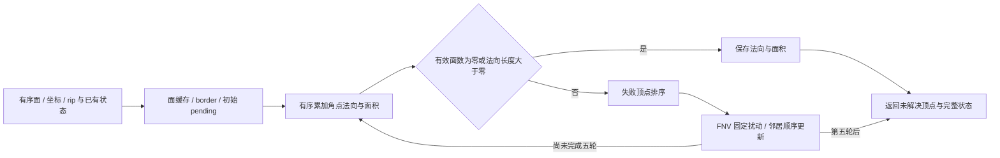

# 顶点法向全抵消时的五轮有序修复

## 1. 功能与边界

`repair_vertex_normals()` 是独立 NumPy/Numba CPU 候选，补齐顶点 incident 角点法向全抵消时的原算法重试规则。它复用已有 `FaceNormalTopology`、有序一环和严格 `d > 0` 单位化，不调用 FreeSurfer 程序或链接原版阶段库。

该步骤会改变失败顶点及邻居坐标。它返回完整法向步骤状态，尚未接入生产；它不是只返回法向的替换函数，也不是完整 `MRIScomputeMetricProperties`。上层接入时必须接受返回坐标并使坐标派生缓存失效，继续完成三角形属性、距离等度量步骤。



本次五个真实冻结状态均未触发全抵消；因此不能将其作为异常球面翻折的原因。当前球面清理循环只计算面符号，没有逐轮消费顶点法向；本次也未检查全部 1001 个清理状态。已有异常输入的 7507 个翻折面仍未通过质量验收。

## 2. Python 调用、输入与输出

```python
import numpy as np
import nibabel.freesurfer.io as surface_io
from fnit.recon_all.normal_pending_python import repair_vertex_normals

surface_positions, ordered_faces = surface_io.read_geometry(
    filepath="/data/subject/surf/lh.sphere",                # FNIT 自产球面，surface RAS/mm
)
normal_state = repair_vertex_normals(
    positions=surface_positions.astype(np.float32),       # (N,3) float32，保留顶点顺序
    faces=ordered_faces,                                 # (F,3) 整数有序三角面
    topology=None,                                       # 不复用缓存时从该有序面构造
    status="sphere",                                     # 球面：失败点 xyz 和有序一环均更新
    unitize=True,                                        # 每个角点贡献单位化
    fix_vertex_area=True,                                # 顶点面面积和除以 3
    ripped=None,                                         # (N,) bool；默认顶点不 ripped
    face_ripped=None,                                    # (F,) bool；默认面不 ripped
    initial_normals=None,                                # (N,3) 旧法向；默认零
    initial_areas=None,                                  # (N,) 旧面积 mm²；默认零
    original_areas=None,                                 # (N,) origarea mm²；默认 -1 表示未赋值
    initial_face_normals=None,                           # (F,3) 原始面叉积 mm²；默认零
    initial_border=None,                                 # (N,) bool；默认 False
)
updated_positions = normal_state.positions               # 必须由调用方接受的共享几何
unresolved_vertices = normal_state.unresolved_vertices   # 五轮后仍未解决的索引，不能隐去
```

全部输入先复制；不原地改输入。坐标必须有限且为 `float32`，不自动降低精度。面必须是同网格有序整数三角面；缓存由成熟接口检查顶点数及有序面身份，不能跨表面版本使用。

| 参数 | 格式、默认值与含义 |
| --- | --- |
| `positions` | 必填 `(N,3)` float32，surface RAS，mm |
| `faces` | 必填 `(F,3)` 整数，索引范围 `[0,N)` |
| `topology` | 默认 `None`；可传同网格 `FaceNormalTopology`，仅缓存整数邻接 |
| `status` | 默认 `sphere`；支持 `sphere/spherical_patch/parameterized_sphere/surface/plane/cut`；后两者只扰动失败点 x/y，不动 z、邻居或面缓存 |
| `unitize` | 默认 `True`；严格零角点保留零，不加 epsilon |
| `fix_vertex_area` | 默认 `True` 面积和除 3；`False` 除 2 |
| `ripped` / `face_ripped` | 默认全 False；严格 bool，分别 `(N,)` / `(F,)`；ripped 顶点不进入 pending，但可作为邻居被移动 |
| `initial_normals` | 默认零，`(N,3)` 有限数值；未解决或 ripped 顶点保留已有值 |
| `initial_areas` | 默认零，`(N,)` mm²；成功顶点更新 |
| `original_areas` | 默认 -1，`(N,)` mm²；仅已有值小于零时赋值 |
| `initial_face_normals` | 默认零，`(F,3)` mm²；保存未单位化叉积，不能传单位面法向冒充 |
| `initial_border` | 默认全 False，`(N,)` bool；ripped 面的三个顶点被标记为 border |

返回 `NormalRepairResult`：`positions/normals` 为 `(N,3)` float32；`areas/original_areas` 为 `(N,)` float32 mm²；`face_normals` 为 `(F,3)` float32 原始叉积 mm²；`border` 为 `(N,)` bool。`pending_counts` 为实际执行轮数 `(T,)`，`pending_history` 为 `(T,N)` bool，`T≤5`；`unresolved_vertices/changed_vertices` 是整数索引；`coordinate_update_count` 统计顶点写入事件，不是坐标轴个数。同一邻居被多个失败点更新会重复计数。

无活跃 incident 面的顶点按原规则成功、法向为零。真正全抵消的失败点排序后逐个扰动，每点的 FNV counter 从零开始并延续到邻居各轴。只重算法向失败点，已成功但被移动的邻居保留该轮旧法向。第 5 轮仍扰动，但不添加第 6 次重算；未解决点明确返回。非法形状、索引、非有限状态、非 float32 坐标、缓存身份错误、未知状态或非小端平台抛 `ValueError`。

## 3. 命令行与复现

内部算子不新增生产 CLI。真实冻结状态诊断使用：

```bash
# 输入只使用声明的公开 T1 派生检查点；新目录保存数值报告，数组仍留私有目录。
PYTHONPATH="$FROZEN_SOURCE/src" python benchmark_real_states.py \
  --fnit-root "$PRIVATE_FNIT_ROOT" \
  --output "$PRIVATE_NEW_RUN/benchmark" \
  --threads 4

# 模拟网格只检查顺序、FNV、rip、第五轮和输入不修改等合同。
PYTHONPATH=src python -m unittest discover \
  -s tests/recon_all -p test_normal_pending_python.py -v

# 只读校验公开报告与当前候选/测试源码 SHA。
python verify_publication.py --report-root "$PUBLIC_REPORT_DIRECTORY"
```

`fnit-root/output` 必填；`threads` 默认 4。诊断脚本要求对照法向模块 SHA 为冻结的 `47107b48…`，现版代码不同会拒绝冒充同输入对照；输入报告保存文件与数组 SHA。该脚本不是整例入口，不能将其墙钟标为 recon-all 耗时。

## 4. 原软件内部步骤

对应固定 `d932c45b7941662ea380a05efef580568b98d41a` 的 `MRIScomputeNormals` / `MRISMP_computeNormals`，属于 `MRIScomputeMetricProperties` 内部，无独立官方 CLI。完整球面参考阶段可在隔离 benchmark 环境使用 `mris_sphere` 或 `mris_register -curv`，本次没有运行这些程序。

原规则包括五轮、pending 排序、FNV 小端三个 uint32、±0.001 mm、共享邻居顺序写入、plane/cut 特例和保留 stale 邻居法向。没有任意随机种子、坐标特例或参考输出修补。慢版与默认 MRIS_MP 分支已核对；`FS_FASTER_MP` 的另一实现不在此次覆盖范围内。原源码只在私有诊断中读取，仓库发布哈希、规则与官方链接。

## 5. 最新真实精度、耗时与资源

完整机器报告见[本轮专属报告](../../validation/recon_all/optimizations/20261010_normal_pending_python/README.md)。候选 SHA 为 `8c4d8c1a…`；对照是当前已修复的 FNIT Torch CPU 法向，不是原版程序。

| 冻结真实状态 | 顶点 / 面 | pending | 坐标变化 | 法向差异 / max / P99 | 首次完整 API / 复测 API / 对照法向（s） |
| --- | --- | --- | --- | --- | --- |
| 真实角点 NaN 首差状态 | 107770 / 215536 | 0 | 0 | 0 / 0 / 0 | 0.410592 / 0.197817 / 0.123862 |
| 真实面 NaN 首差状态 | 107770 / 215536 | 0 | 0 | 0 / 0 / 0 | 0.200279 / 0.202250 / 0.100585 |
| v4 注册末态 | 107770 / 215536 | 0 | 0 | 0 / 0 / 0 | 0.195238 / 0.197557 / 0.092194 |
| 正常 79 球面 | 130679 / 261354 | 0 | 0 | 0 / 0 / 0 | 0.254578 / 0.261057 / 0.119771 |
| v4 球面输入 | 107770 / 215536 | 0 | 0 | 0 / 0 / 0 | 0.195297 / 0.197245 / 0.099602 |

候选 API 含拓扑、面积和缓存状态，对照只计算法向，二者工作量不同；不能用此表宣称提速。首例 API 为合同测试已 JIT 后的首次真实调用。完整五状态诊断墙钟 6.217862 s，含导入、读写、SHA、复测和比较；不是完整阶段或原始 T1 整例。CPU 总 4 线程、亲和性 100–103，共享负载未采样；未初始化 CUDA、未测 GPU 显存或 CPU 内存，不作 20 GB 达标结论。

真实退化角点和零面是前次球面 NaN 修复的同一数据来源，见[真实图及完整质量失败证据](../../validation/recon_all/optimizations/20261010_registration_zero_corner/README.md)。五个快照没有全抵消，因此真实 pending 分支为 `not_triggered`；11 项合同覆盖排序、共享邻居、完整五轮和可恢复退化面，但不替代真实该分支或原版同输入验证。整体指标等效为 `not_assessed`，没有接入生产或整例提速结论。

## 6. 版本与记录

- 本轮完整 normal-step 候选及成熟整数缓存复用；源码/输入/输出哈希由报告绑定。
- 10 项远端合同首先通过，随后补第 11 项多失败点按序共享邻居并在第二轮恢复的合同；两次测试源码哈希分别保留。
- 本地首次有两个测试夹具错误，修正后通过，算法未因此变更。记录见 `unit_attempts.json`；没有删失败尝试。
- 之前两种零角点/零面修复仍承担真实对照作用，未删其失败收据；本函数不改变球面清理停止条件、质量门或现有法向默认。

## 7. 来源与参考

固定源码与 SHA 见[规则收据](../../validation/recon_all/optimizations/20261010_normal_pending_python/source_rules.json)：[慢版法向](https://github.com/freesurfer/freesurfer/blob/d932c45b7941662ea380a05efef580568b98d41a/utils/mrisurf_metricProperties_slow.h)、[MRIS_MP 法向](https://github.com/freesurfer/freesurfer/blob/d932c45b7941662ea380a05efef580568b98d41a/utils/mrisurf_metricProperties_fast.h)、[FNV](https://github.com/freesurfer/freesurfer/blob/d932c45b7941662ea380a05efef580568b98d41a/include/fnv_hash.h)、[度量调度](https://github.com/freesurfer/freesurfer/blob/d932c45b7941662ea380a05efef580568b98d41a/utils/mrisurf_metricProperties.cpp)。

Fischl B. FreeSurfer. *NeuroImage* 2012;62:774–781. [DOI](https://doi.org/10.1016/j.neuroimage.2012.01.021)。
