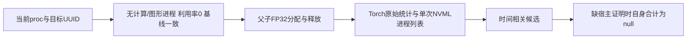

# GPU PID namespace与小型显存诊断

2026-10-11故障修复：当前帧只接收本次forced调用新增的sample；查询失败时合计为null、ownership为unavailable，并保留本次新增错误类型及数量。直接NVML查询与采样器独立查询分别计时。本次只运行CPU故障合同，旧GPU控制报告和源码绑定保持原样。

2026-10-11实测更新：当前3.10内核可从自有 `/proc/<local_pid>/sched` 首行取得全局PID，已通过父子同时占用及两种缓存模式验证。初轮未知和名称API NotFound失败快照保持原样。此更新不证明整例显存<20GB。

## 1. 功能

本工具在空闲检查通过的目标GPU上，依次持有父128 MiB、子256 MiB的FP32张量，记录11个分配、释放、清缓存及子进程退出状态。复用已有NvmlProcessQuery与ProcessTreeDeviceSampler，不改重建代码、共享环境或TF32策略。默认保留未知；显式--sched-mapping在本次3.10内核使用自有sched编号、同卡NVML驱动行、本地名称及启动时间/namespace构建映射。时间相关候选始终不作为可信映射。



## 2. Python与输入输出

```python
from tools.diagnose_recon_nvml_namespace import correlate_snapshots
import json
from pathlib import Path

probe_report = json.loads(Path("/data/probe/report.public.json").read_text())
correlation_candidates = correlate_snapshots(probe_report["snapshots"])
# 仅用于诊断解释，不能把这个字典传给trusted_host_pid_map。
```

snapshots是探针生成的列表，必须包含before_cuda、parent_allocate、child_before_cuda及both_allocate，各项nvml_processes包含整数pid和bytes。输出parent/child候选PID列表及明确的相关性分类。CUDA初始化并不保证驱动进程行已经出现，候选从实际分配阶段派生。

主程序输入GPU UUID、独立新输出目录、分配器策略及两个整数payload。输出report.public.json：源码SHA、当前kernel、local PID/namespace/starttime/NSpid、允许的proc候选结果、11阶段的原始Torch统计与可用性标志、NVML进程PID/字节、整卡字节、查询跨度、精度前后状态及未解决的映射原因。数字均为bytes/秒，payload参数为1024²字节MiB。child.private.log仅留私有输出。无影像输入。

## 3. 命令行与下一轮整例监测

```bash
# 必须先只读核对UUID、进程列表、利用率及精确NVML基线。
target_gpu_uuid="GPU-anonymized-device-009"  # 本次示例，使用前现场核对
python tools/diagnose_recon_nvml_namespace.py \
  --gpu-uuid "${target_gpu_uuid}" --output /data/probe/cache_enabled \
  --allocator enabled --parent-mib 128 --child-mib 256 --sched-mapping \
  --idle-device-baseline-bytes 925302784
```

--gpu-uuid和--output必填；输出目录须不存在。--allocator为existing/enabled/disabled，默认existing；只作用于这个独立进程及它自己的子进程。--parent-mib默认128、--child-mib默认256，均只允许1–256。--idle-device-baseline-bytes默认0，必须来自现场只读观测，不能照抄本次值；计算或图形进程非空、GPU利用率非0、设备查询失败或基线不匹配时，在CUDA初始化前报错。基线不是自身占用。--sched-mapping默认关闭；开启后只接受已独立验证语义的Linux3.10，用自有树proc身份与同UUID行校验。其他内核明确拒绝，须独立验证。--worker仅用于内部子进程IPC，不是完整重建入口。

监测父子合计复用原接口：

```python
import os
from fnit.recon_all.profiling import ProcessTreeDeviceSampler

process_sampler = ProcessTreeDeviceSampler(
    device="cuda:0",  # 当前进程逻辑设备；尊重CUDA_VISIBLE_DEVICES
    parent_pid=os.getpid(),  # 当前重建父PID及其存活子树
    interval=0.5,  # 秒；报告另记录实际间隔及失败
    query_backend="nvml",  # 通用NVML，不调用原软件阶段程序
    trusted_host_pid_map=None,  # 启动时不猜映射；后续用可信来源刷新
)
from fnit.recon_all.nvml_process_memory import NvmlProcessQuery
from tools.diagnose_recon_nvml_namespace import build_owned_sched_pid_map

nvml_query = NvmlProcessQuery()
target_gpu_uuid = "GPU-anonymized-device-009"  # 改为现场实际UUID
try:
    live_owned_pids = process_sampler._tree(os.getpid())  # 仅当前父进程及存活子树
    verified_pid_map, identity_evidence = build_owned_sched_pid_map(
        query=nvml_query,  # 已打开的通用NVML句柄
        gpu_uuid=target_gpu_uuid,  # 同一个目标GPU
        local_pids=live_owned_pids,  # 每轮重新取得，不复用已退出worker
        nvml_rows=None,  # None自行查询该UUID；也可传刚取得的同卡列表
    )
    # 现有采样器显式映射契约；不改其实现，逐轮刷新并复核身份。
    process_sampler.trusted_host_pid_map = process_sampler._validate_pid_map(verified_pid_map)
    from tools.diagnose_recon_nvml_namespace import sample_current_call
    current_sample, current_call = sample_current_call(process_sampler)
    # 失败时current_sample为None；不能读取samples[-1]当作当前测量。
    current_tree_bytes = current_sample["tree_total_bytes"] if current_sample is not None else None
    current_ownership = current_sample["ownership"] if current_sample is not None else "unavailable"
    process_memory_report = process_sampler.report()  # 包含历史，不是当前帧
finally:
    process_sampler.close()
    nvml_query.close()
```

可用来源必须确证host-driver PID和当前local PID对应后，才能传trusted_host_pid_map。当前额外使用已现场核对的Linux3.10自有sched首行；不是用分配差分猜PID。它是整数driver PID→local_pid/starttime_ticks/pid_namespace/source字典；既有采样器每次重新核对本地身份和子树，拒绝退出/复用PID。source要指明真实可信来源，不能仅填相关性标签。数字相同、单个NSpid、整卡占用或分配差分都不足以建立映射。早期未查sched的样本、CPU/context尚未出现在NVML列表的样本以及任何校验失败仍保存null及原因。新映射前的unknown不回填。未改动生产采样器。

CPU合同命令（使用项目Conda环境及其nvidia-ml-py依赖）：

```bash
# 强制CPU测试；不会初始化CUDA或调用NVML设备API。
CUDA_VISIBLE_DEVICES="" PYTEST_DISABLE_PLUGIN_AUTOLOAD=1 \
  python -m pytest tests/recon_all/test_nvml_namespace_failure_contract.py -q -o addopts=
```

### 当前帧、错误与查询跨度

`sample_current_call(sampler)`的输入是现有采样器，须由单个调用者串行采样，调用期间不能由其他线程写入samples/errors。输出为`(current_sample, current_call)`：前者只来自本次新增样本，否则为None；后者记录新增sample数量、错误数量和类型，历史错误不重复算入当前调用。错误类型从生产采样器已有repr提取，无法识别时为unknown_error_type，不导出原错误文本和路径。调用本身向外抛出的异常继续传播。

新增报告字段含义：

| 字段 | 含义及单位 |
|---|---|
| raw_query_start/end_monotonic、raw_query_span_seconds | 直接NVML查询开始、结束及跨度，秒 |
| nvml_processes、same_snapshot_nvml_all_process_sum_bytes | 直接查询的全部进程行及字节和 |
| mapping_span_seconds | 用直接查询行核对自有PID映射的跨度，秒 |
| sampler_call.call_start/end_monotonic、call_span_seconds | 另一次forced采样器调用的开始、结束和跨度，秒 |
| sampler_call.sample_monotonic、sample_query_seconds | 生产采样器新增样本的时间及查询跨度；无新增样本为null |
| sampler_call.same_snapshot_attributed_processes | 采样器自身快照的进程行；无新增样本为空列表 |
| sampler_call.new_sample_count、new_error_count、new_error_types | 本次新增样本数、错误数及类型列表 |
| attributed_tree_total_bytes、sampler_ownership | 本次采样器自身树合计与归属；无新增样本为null/unavailable |
| query_span_seconds | 兼容字段，包含直接查询、映射、采样器查询及父状态读取的总跨度，秒 |

直接查询行与采样器行来自两次独立NVML调用。自身合计对应采样器那次快照，不能声称它与直接查询行在瞬时状态下相等。成功→失败→成功时，中间帧保持不可用，最后一帧取恢复后的新值；不回填中间帧。

## 4. 原软件与依赖

没有FSL/FreeSurfer对应命令。本工具仅做PyTorch CUDA分配、通用NVML与本地proc查询；主页Conda已声明PyTorch和nvidia-ml-py。实际复用已有独立安装包与NVML target，无新增依赖、无共享环境修改，也没有读取凭据或其他人的影像。

## 5. 本轮实际结果

内核3.10.0-1160.el7.x86_64；当前namespace pid:[4026542021]。本地status无NSpid字段，pid1 namespace及/proc/1/root/proc访问被拒绝，其他允许候选host proc目录不存在。仅有本地proc和NVIDIA驱动proc子挂载，不能据此取得host→local身份对应。

GPU物理6、逻辑cuda:0。现场无计算/图形进程、利用率0，NVML整卡基线925,302,784字节；nvidia-smi显示0 MiB，二者不是可互换的精确值。首次严格0字节空闲门停止，未建立CUDA context；修正为明确基线与完整进程/利用率检查后两模式均退出0。

| 模式 | 本地父/子PID | 分配时相关driver候选 | Torch父/子allocated原始字节 | 单次NVML全部进程字节和 | 可信自身父子合计 |
|---|---|---|---:|---:|---|
| cache enabled | 54710 / 54796 | 63907 / 65239 | 134217728 / 268435456 | 1430257664 | null |
| cache disabled | 54889 / 54977 | 67027 / 68070 | 0 / 0 | 1430257664 | null |

两模式均实际持有402,653,184字节FP32 payload。关闭缓存时Torch peak也为0，报告torch_stats_valid_for_peak=False；这些零不代表没有GPU内存。释放张量后缓存和CUDA context另占显存，清缓存不释放全部context。退出后NVML无进程行，整卡回到原基线。matmul TF32=False、cuDNN TF32=True、autocast=False，进入/退出相同，不启半精度。

上表是首次未映射控制的历史结果，保留null。后来新增sched来源并做独立验证，结果如下；任何小型控制都不能证明完整重建<20GB。

机器证据在validation/recon_all/optimizations/20261011_nvml_namespace：原始typed快照、派生analysis、阶段CSV和退出后报告。没有原日志、MRI或私有服务器地址。两种模式的11阶段测量和源码SHA保留；候选分析最初用context阶段得到空列表，现函数按实际allocation阶段派生，并对未改动的22个真实快照验证，未重复或改动测量。

### sched来源验证与新父子门

Linux3.10的proc_sched_show_task首行直接输出p->pid；现场该数字不同于local status PID，并出现在同UUID NVML行。对每个自有PID先后复核starttime与namespace、sched comm与local comm，并用NVML名称API核本地进程名。NVML名称API传宿主PID在本机NotFound，传local PID返回python；名称只核本地身份，不单独证明宿主归属。映射依据为kernel sched全局编号和同卡驱动行。

| 新控制 | 本地父/子 | kernel sched全局父/子 | 父子同时持有的NVML合计bytes |
|---|---|---|---:|
| cache enabled sched | 57757 / 57863 | 29978 / 33767 | 1430257664 |
| cache disabled sched | 57962 / 58039 | 35997 / 36980 | 1430257664 |

两模式both_allocate中的两个身份都verified，现有采样器ownership=resolved，当前树合计等于同一NVML列表的两条行之和，没有把各进程历史峰相加。before_cuda和parent_context仍unknown；含前缀unknown的全序列peak_tree_total_bytes仍null。只单列后续verified快照的观测值，不伪造全程覆盖。11个阶段中9个映射成功；释放张量、缓存、context和子退出按原始快照分别记录，关闭缓存的Torch零值不作峰值依据。两次直接查询与采样器查询的最长整体跨度分别约12.23/23.90 ms，驻留payload在查询期间固定。不是连续峰值保障。

build_owned_sched_pid_map提供query、gpu_uuid、local_pids、nvml_rows四参数，返回map与逐PID证据；只允许调用者自有当前子树，格式/名称/身份/同卡驱动行失败不映射。此函数由已验证诊断体提取，并用8/16 MiB更小父子控制再次实际运行：payload 25,165,824字节，可信同快照树合计1,065,353,216字节，退出0，源码SHA与交付文件相同。不同内核禁止照搬sched语义。

新增原始sched_v3_*记录保留使用host PID查询名称失败，ownership仍null，包装门exit1；sched_v4_*记录新映射门exit0。初轮cache_enabled/disabled、已有failed和NotFound样本不修改。原脚本测量与当前提取helper各有实际源码SHA。

### 本次故障合同

24项CPU故障合同覆盖成功→查询失败→恢复、没有新增样本、直接/采样器行不同、proc权限与退出、空或错误格式/名称、启动时间与namespace变化、非自有树、非3.10内核、可迭代PID输入，以及真实pynvml.NVMLError_NotFound在宿主名称、本地名称及查询层的行为。宿主名称NotFound可以保留映射（另有sched和同卡行证明）；本地名称失败不映射；直接查询异常传播。生产采样器捕获的错误只进入当前typed计数。

这些测试使用CPU故障注入检验诊断契约，不是MRI精度或GPU耗时benchmark。CUDA保持未初始化，TF32前后相同；使用既有独立安装与依赖。12个旧GPU报告、分析和CSV的Git blob与7381dfa63基线相同；JSON字节完全相同，CSV保留原CRLF交付字节（Git内容为LF），未知及失败快照、原执行源码SHA不改。新源码未再次运行GPU探针。第一次补充测试因未加入既有pynvml目录而失败，修正独立任务PYTHONPATH后通过，未安装或修改环境。证据在[故障合同目录](../../validation/recon_all/optimizations/20261011_nvml_failure_contract/)。

## 6. 版本记录

2026-10-11故障修复：新增当前调用sample边界、typed错误计数、分别计时；修复空sched/空NVML名称与生成器输入，补齐24项CPU故障合同。生产监测、MNI、缓存和统计实现未修改。

2026-10-11：先完成未映射控制，再增补自有sched来源、区分名称API的local PID空间，并验证可靠父子同快照合计；共享监测、MNI和统计源码不改。之前阶段监测曾因namespace未解决而返回null；本轮提供现场原因和小型控制证据，不回填为历史整例峰值。

## 7. 参考

[NVML API](https://docs.nvidia.com/deploy/nvml-api/)、[Linux proc_pid_status](https://man7.org/linux/man-pages/man5/proc_pid_status.5.html)、[PyTorch CUDA memory管理](https://docs.pytorch.org/docs/stable/notes/cuda.html#cuda-memory-management)。核心接口为FNIT的profiling.py与nvml_process_memory.py，实际SHA与当前协调仓库现场一致。


内核源码依据：[Linux3.10 proc_sched_show_task](https://github.com/torvalds/linux/blob/v3.10/kernel/sched/debug.c#L463-L467)、[PID namespace helpers](https://github.com/torvalds/linux/blob/v3.10/include/linux/pid.h#L144-L159)。本机RHEL3.10的输出语义另由独立父子NVML控制现场交叉核对，不能外推所有内核。


最终证据：[sched分析](../../validation/recon_all/optimizations/20261011_nvml_namespace/sched_analysis.public.json)、[开启缓存](../../validation/recon_all/optimizations/20261011_nvml_namespace/sched_enabled.public.json)、[关闭缓存](../../validation/recon_all/optimizations/20261011_nvml_namespace/sched_disabled.public.json)、[最终helper实测](../../validation/recon_all/optimizations/20261011_nvml_namespace/helper_v5.public.json)。失败样本在同目录sched_failed_*，原始unknown分析保持analysis.public.json。
