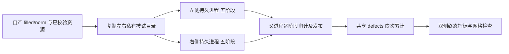

# recon-all 的持久双半球调度

[重建入口](README.md) · [第二轮接线](ROUND2_INTEGRATION.md) · [线程与显存](HEMISPHERE_GPU_MEMORY.md)

## 1. 功能与流程

`hemisphere_execution="persistent"` 在完整 Python 配方内为左右半球各建立一份私有被试副本和一个独立 Python 进程。每侧连续执行 `surface → register → annotation → final_white → pial_surface`，省去逐组重新复制、加载和启动的开销。父进程每阶段审计、发布自产文件，处理共享缺陷体积；全部成功后才串行计算最终指标。左右侧可以独立推进，但 `surface` 的共享写入按左侧清零、右侧累计顺序执行。



## 2. Python 调用、输入与输出

普通调用者使用完整重建入口。它负责建立前段、自有半球操作、`stage_hook` 和最终检查；不要把底层调度器单独返回的成功状态当作重建成功。

```python
from fnit.recon_all.native_free import run_recon_all_python

reconstruction_report = run_recon_all_python(
    t1="/data/public_T1w.nii.gz",  # 原始单幅三维 T1w 影像
    subject_dir="/data/new_subject",  # 新建或空的被试目录
    weights_dir="/data/verified_weights",  # 按大小和 SHA-256 核验的权重
    assets_dir="/data/verified_assets",  # 按大小和 SHA-256 核验的模板与图谱
    backend="python",  # 完整自有 Python/Numba/PyTorch 配方
    device="cuda:0",  # 显式目标 GPU；按 CUDA_VISIBLE_DEVICES 编号
    threads=4,  # 整例 CPU 总预算；每侧 worker 使用两个线程
    hemisphere_execution="persistent",  # 单次私有复制与持续 worker
    profile_stages=False,  # 生产时不额外插入阶段剖析同步
)
pipeline_report = reconstruction_report["hemisphere_scheduling"]["groups"][0]
```

`t1` 为有效 affine 的三维 NIfTI；MRI 中间结果位于 1 mm conformed 体素网格，表面坐标为 surface RAS/mm，顶点图须与对应有序面和顶点次序配对。`subject_dir` 不得与并行任务重叠。被试目录下的 `mri/`、`surf/`、`label/`、`stats/` 是公开文件，`scripts/` 保存审计与阶段报告。各阶段私有目录是临时运行空间，正常完成会清理；文件路径报告经归一化指向已发布的公开路径。

底层 `run_hemisphere_pipeline(...)` 由生产链调用，其参数如下。`operations` 每项为操作名字符串，或仅含 `operation`、`callable_path`、`kwargs` 的字典；操作名在本链内唯一。

| 参数 | 默认值 | 含义与限制 |
| --- | --- | --- |
| `subject` | 必填 | 已有的自产被试目录，必须有 `scripts/`；`mri/surf/label/stats` 复制成两侧私有输入。 |
| `operations` | 必填 | 非空有序列表；生产顺序为 `surface/register/annotation/final_white/pial_surface`。 |
| `device` | 必填 | Torch 设备；生产 Python 配方要求显式 `cuda:N`。半球 worker 不继承父进程的隐式当前设备。 |
| `threads` | 必填 | 整数总线程预算且至少 2；两个 worker 各取 `threads//2`，父回调复用当前半球预算。 |
| `callable_path` | `fnit.recon_all.native_free:_hemisphere_operation` | `module:attribute` 形式的实际操作入口，可被单项规范覆盖。 |
| `kwargs` | `None` | 所有操作共享、可严格 JSON 序列化的命名参数；不能覆盖 `subject/hemi/device/threads/operation`。 |
| `stage_hook` | `None` | 父进程回调 `(operation, hemi, value, row)`；可返回 `None` 或 `{被试相对输入路径: 已发布公共文件路径}`，仅刷新 FNIT 自产输入。生产回调同时处理 `surface.defects.mgz`。 |
| `profile_stages` | `False` | 真时在目标 CUDA 设备上记录阶段同步与细分秒数；生命周期发布屏障始终保留。 |
| `cuda_allocator_cache` | `inherit` | 新 worker 的 `inherit/enabled/disabled` 缓存策略；生产完整链显式用 `enabled`，不改父进程已初始化的分配器。 |
| `startup_wait_seconds` | `90` | 正的有限秒数，只限制两个 worker 启动并报告 READY 的等待，不限制算法运行时间。 |
| `trusted_host_pid_map` | `None` | 可选可信 PID 映射供同一设备进程树显存采样；缺少可信映射时显存归属保留未知。 |

底层返回 JSON 兼容字典：`operations` 为阶段名列表，`stages[操作][lh/rh]` 含阶段状态、实际精度、读写秒数和发布清单；`values` 为已发布阶段返回值；`workers` 为独立进程状态；`published`/`publication_events` 保存公开文件及发布次序；`private_copy_seconds`、`group_wall_seconds`、`device_process_tree` 分别记录复制、整组墙钟与有归属条件的显存采样。底层写 `scripts/pipeline.hemisphere-group.json` 和 `scripts/pipeline.<操作>.<半球>.stage.json`。复制与阶段读写计入整组墙钟，嵌套秒数不可重复相加。进程树采样不是连续显存峰值证明，归属不明记为 `null`。

worker 异常、外部更改公开文件、未声明共享写入、回调写入越界或发布/清理失败抛 `HemisphereGroupError`；异常的 `report` 保留已完成阶段及质量诊断。父进程对每个文件先复制到临时文件再替换；这保证单个文件的替换完整，**不表示整组多文件事务回滚**。只有最终输出完整性与网格检查均通过，完整入口才返回 `status="complete"`。

## 3. 命令行

此调度器没有单独的用户 CLI。完整 Python 重建使用现有入口：

```bash
fnit-recon-all /data/public_T1w.nii.gz /data/new_subject \
  --weights-dir /data/verified_weights --assets-dir /data/verified_assets \
  --backend python --device cuda:0 --threads 4 \
  --hemisphere-execution persistent
```

`--hemisphere-execution` 默认 `groups`。`persistent` 仅接受完整 Python 配方和两个独立 worker；非法组合在创建科学输出前失败。输入、资产安装与其余 CLI 参数见[重建入口](README.md)。

## 4. 原软件对应步骤

持久进程是 FNIT 的调度方式，FreeSurfer 没有与它独立对应的命令。独立参考流程用 `recon-all -i T1w.nii.gz -s subject -sd subjects_dir -all`；其内部的拓扑、球面配准、白质及软脑膜表面阶段与上述五段对应。原版结果仅用于隔离 benchmark，不能作为生产私有副本的输入。

## 5. 真实验证、耗时与显存

目前没有绑定**当前持久调度源码**、相同真实 T1、同硬件和同线程预算的 `groups`/`persistent` 受控整例配对；因此本页不声明整例提速或最终指标无退化。已有[冻结 f016 的两例运行](../../validation/recon_all/optimizations/20261014_gpucw1_f016_partial/README.md)只完成 sub-07，sub-06 在拓扑质量门失败，且未建立可归属的 FNIT 整例显存峰值；它不能证明随后补丁或该调度选项通过。旧[半球进程缓存同输入阶段](HEMISPHERE_GPU_MEMORY.md)属于 `groups` 路径，也不能作为持久链收益。公开验证页记录旧病例最终 Dice、表面距离、脑区误差与私有脑图的边界；当前链须从空目录重新运行两例并完成这些检查。

## 6. 更新与参考

- 2026-10-11 前：逐组双侧 worker 与父进程缓存释放已有独立阶段证据。
- 第二轮接线：新增持久 worker、阶段回执、逐阶段发布、共享缺陷顺序和单独终态指标；本页仅补齐已存在源码的使用约束，没有新增 MRI 实测。

FNIT 实现见 [`hemisphere_pipeline.py`](../../src/fnit/recon_all/hemisphere_pipeline.py)、[`hemisphere_integration.py`](../../src/fnit/recon_all/hemisphere_integration.py)；参考源码见固定 [FreeSurfer recon-all](https://github.com/freesurfer/freesurfer/tree/d932c45b7941662ea380a05efef580568b98d41a)。算法背景：Fischl & Dale, *PNAS* 97:11050–11055 (2000), [DOI:10.1073/pnas.200033797](https://doi.org/10.1073/pnas.200033797)。
