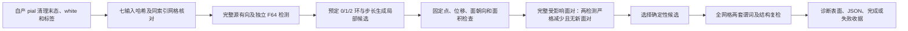

# pial 局部残余相交求解

## 1．功能简介

`resolve_residual_intersections` 是一个显式实验接口，用来处理完整原顺序 SOAP 已经停滞、却仍有相交的 pial。它复用 FNIT 的源有向三角面谓词、MHT 桶和独立双精度谓词，仅尝试局部坐标变化。原 `repair_intersections`、四轮 pial 放置、标签和默认生产策略保持原样。

这不是原算法的逐字节复现，也不是把 pial 换成 white。自产 white 只提供局部移动方向。另一方向使用包含固定边界邻居的均值，避免原 SOAP 排除所有 rip 邻居后留下的固定点。



## 2．Python 调用与输入输出

```python
import numpy as np
from fnit.recon_all.place_surface_residual_cleanup import resolve_residual_intersections

fixed_vertices = ripped_vertices | ~cortex_mask  # 合并 rip 与全部 cortex 外点；不重新 pin 到 white
candidate_vertices, diagnostics = resolve_residual_intersections(
    vertices=pial_vertices,  # 自产清理末态；(N,3) float32，surface RAS，mm
    faces=ordered_faces,  # (F,3) 整数；顶点编号和面顺序不改变
    fixed_vertices=fixed_vertices,  # (N,) bool；冻结在进入函数时的实际坐标
    white_vertices=own_white_vertices,  # 同索引自产 white；仅用作局部方向
    max_displacement_mm=1.0,  # 相对进入函数时坐标的累计位移上限
    minimum_area_ratio=0.2,  # 所有改变的面面积至少为初始值的20%
    max_passes=4,  # 最多四轮；没有合格候选时直接结束
)
```

| 参数 | 类型、结构、默认值与含义 |
| --- | --- |
| `vertices` | 必选 `(N,3)` float32 NumPy 数组，有限的 pial surface RAS/mm。不能传入 scanner RAS 或原始 MRI 体素坐标。 |
| `faces` | 必选 `(F,3)` 整数数组，顶点编号必须位于当前 `N`；一个面不能重复顶点。 |
| `fixed_vertices` | 必选 `(N,)` bool，合并 rip 与 cortex 外点。函数保留这些点进入时的全部 float32 坐标元素，不重新执行 medial-wall pinning。 |
| `white_vertices` | 必选有限 `(N,3)` 浮点数组；必须是相同顶点对应的自产 white，单位与 pial 相同。禁止用官方输出选取方向。 |
| `max_displacement_mm` | 正有限数，默认 1.0 mm；累计位移上限，不能把各轮移动分别理解为 1 mm。 |
| `minimum_area_ratio` | `(0,1]`，默认 0.2；每个受影响面的面积相对进入函数时不能低于此值。 |
| `max_passes` | 正整数，默认 4；bool 不作为整数接受。 |

返回 `candidate_vertices` 为 `(N,3)` float32 新数组，不修改输入。`diagnostics` 是 JSON 可序列化字典，包含参数、全部候选与拒绝原因、接受记录、源有向面对/F64 面对前后数量、全网格面对集合复检、固定点差异、均值/P99/最大位移及函数墙钟。`status="passed_zero_intersections"` 仅表示这两套自相交检查为零；`status="failed_residual"` 表示仍有残余，失败结果保留用于诊断。

候选方向、0/1/2 环、步长比例 `0.05/0.1/0.2/0.35/0.5/0.75/1` 和量化安全因子 `0.9999` 在本轮协议中预先固定。所有改变的面必须与初始法向点积为正。两种阳性面对集合都必须严格减少，且不能出现新的阳性面对；最终重新检查完整网格的集合。局部查询完整覆盖所有坐标改变的面，未改变的面对关系保留。1 mm、20% 和四轮属于候选算法参数，**不是已确认的整例指标等效标准**。

非法 dtype、shape、范围、非有限输入、重复顶点、零面积初始面和非法参数抛 `ValueError`；最终全量复检与局部集合更新不同意或固定点变化时抛 `RuntimeError`。本接口使用 NumPy/SciPy/Numba，CPU 执行，不初始化 CUDA、不更改 TF32，不启用半精度。现有主页 Conda 环境已包含依赖。

## 3．命令行与完整阶段诊断

函数没有生产 CLI。独立 benchmark 读取七个前置和自产末态，保存非标准名称的诊断表面；输入哈希、候选协议和冻结依赖都必须显式提供。

```bash
# 固定总线程预算；运行器还应分配四个CPU核，并保存退出码和日志。
CUDA_VISIBLE_DEVICES='' OMP_NUM_THREADS=4 NUMBA_NUM_THREADS=4 \
OPENBLAS_NUM_THREADS=4 MKL_NUM_THREADS=4 \
python tools/benchmark_recon_pial_residual_solver.py \
  --frozen-source frozen-fnit/src \
  --overlay-source new-overlay/fnit/recon_all \
  --diagnostic-case failed-pial/01-cli-enabled \
  --input-hashes seven-input-hashes.json \
  --protocol fixed-solver-protocol.json \
  --output-directory new-local-solver \
  --distance-module validation/recon_all/accuracy_20261003/task_04/reference_surface_distance.py \
  --reference-run isolated-reference-repeats \
  --threads 4
```

具名 Python 诊断入口：

```python
from pathlib import Path
from tools.benchmark_recon_pial_residual_solver import run  # 从仓库根目录执行

report = run(
    frozen_source=Path("frozen-fnit/src"),  # 原位冻结 FNIT 依赖；不是原软件程序目录
    overlay_source=Path("new-overlay/fnit/recon_all"),  # 本轮独立求解模块
    diagnostic_case=Path("failed-pial/01-cli-enabled"),  # 七前置与自产末态 NPY
    input_hashes=Path("seven-input-hashes.json"),  # 七个相对文件名和SHA-256
    protocol=Path("fixed-solver-protocol.json"),  # 运行前固定的规则和三个算法参数
    output_directory=Path("new-local-solver"),  # 必须不存在，避免覆盖历史结果
    distance_module=Path("reference_surface_distance.py"),  # 已有双向点到三角面距离函数
    reference_run=Path("isolated-reference-repeats"),  # 可选；仅在候选保存及QC后读取
    threads=4,  # 正整数；Numba和四核CPU预算
)
```

七前置是 white、GW 阈值、brain.finalsurfs、WM、aseg.presurf、cortex 和 cortex+hipamyg。体积与阈值文件用于完整阶段输入哈希绑定，求解器不重跑强度放置。`cleanup-result.private.npy` 为 `(N,3)` float32。阶段工具返回聚合 `dict`，并保存 `report.json`、`candidate.private.npy`、`candidate.pial`、`COMPLETE.json`。表面文件保留 white 的原有序面和几何尾部，只写本轮自产坐标。参考目录可省略；提供时七输入必须匹配，且仅候选与质量检查完成后才比较其坐标。

阶段墙钟包含校验、导入、读取、全部候选、全量 QC、距离、候选写入和可选参考读取；API字段在最终JSON写出前取时，外层冷CLI再包含最终报告与收据写出。函数时间与嵌套 QC 时间不能重复相加。CPU 峰值记录为单诊断进程的 `ru_maxrss`，不冒充全流程父子合计。显存未采样时写 `null`，不写 0。

完整冷CLI使用独立新解释器的计时器，只有一次子进程调用：

```python
from tools.time_recon_python_benchmark import time_command

timing_report = time_command(
    command=benchmark_arguments,  # 非空str列表，含解释器与全部具名CLI参数；无shell展开
    log_path=Path("new-driver.log"),  # 不存在的新文件，stdout/stderr合并写入
    report_path=Path("new-cli-time.json"),  # 不存在的新JSON，父目录须存在
)
```

返回子进程退出码、包含导入/计算/读写的墙钟、argv SHA及RUSAGE_CHILDREN峰值RSS字典。RSS属于新计时进程的一次子调用；不能把重复API调用时的历史高水位当作当次峰值，也不是同一时刻父子合计。参数错误或已有文件直接失败；OS启动错误写失败收据后抛异常。退出0仅表示程序完成，必须另外查看质量状态。命令行用`python tools/time_recon_python_benchmark.py --log-path new-driver.log --report-path new-cli-time.json -- python tools/benchmark_recon_pial_residual_solver.py ...`，末尾传上一示例的全部具名参数。

枚举替换的完整配对工具是只读接口，不运行求解器：

```python
from tools.benchmark_recon_pial_residual_pair_csr import run as compare_pair_sets

pair_report = compare_pair_sets(
    frozen_source=Path("frozen-fnit/src"),  # 冻结自产FNIT依赖
    overlay_source=Path("new-overlay/fnit/recon_all"),  # 新helper及成熟CSR marker
    baseline_module=Path("frozen-v1/place_surface_residual_cleanup.py"),  # 必须匹配v1的058edba6完整SHA
    diagnostic_case=Path("failed-pial/01-cli-enabled"),  # 同七输入与自产末态
    input_hashes=Path("seven-input-hashes.json"),  # 七文件的SHA映射
    output_directory=Path("new-pair-regression"),  # 新目录，保留报告与完整面对NPZ
    threads=4,  # 正整数，固定Numba线程预算
)
```

CLI为`python tools/benchmark_recon_pial_residual_pair_csr.py`，随后显式传与上述同名的七个参数（下划线改短横线）；无原软件对应CLI。输出`report.json`与`pair_sets.private.npz`，后者包含两实现的全部source有向/F64无向`(P,2)`int64面对编号。返回报告包含逐数组完全一致结果、SHA、完整调用时间与RSS；输入/SHA/新目录失败抛异常，面对不同则保留失败报告再抛RuntimeError，不能凭计数相同接受。

## 4．对应原软件

原 pial 的完整清理来自固定源码的 `mris_place_surface --pial` 内部 `MRISpinMedialWallToWhite`、`MRISremoveIntersections` 和 `mrisMarkIntersections`。这些内部步骤没有独立等价 CLI。原清理通过 [repair_intersections](PIAL_RESIDUAL_CLEANUP_DIAGNOSTIC.md) 继续保留；本局部策略为 FNIT 独立算法，没有原软件等价调用。

## 5．真实数据与精度、时间

本轮使用已授权公开 T1 的同七前置自产 pial 末态。原完整 SOAP、两次同输入原生参考和独立检测都确认该末态残余 32 面、35 个顶点。这组原算法坐标一致，但网格质量失败，不能归为无实质影响的尾差。

本次前置只读诊断确认：15 个非 rip 异常点全部在 cortex 内，分成 8/7 两组，各点一次真实 float32 SOAP 更新均为零。原均值忽略 rip 邻居。进入局部求解前 rip 坐标与 white 全部相同；cortex 外非 rip 点在原 SOAP 后已有坐标移动，本轮冻结其进入坐标，不再次 pin。

独立候选已完成两轮同七输入阶段验证，质量均失败，未改变默认原算法。完整记录见 [局部候选报告](../../validation/recon_all/optimizations/20261011_pial_local_residual_solver/README.md)。

| 测量 | v1：Python 面对枚举 | v2：复用已成熟编译 CSR 枚举 |
| --- | ---: | ---: |
| 初始→最终源/F64 相交面 | 32→32 / 32→32 | 32→32 / 32→32 |
| 有向 source / 无向 F64 面对 | 80→80 / 40→40 | 80→80 / 40→40 |
| 合格候选 / 改变的坐标元素 | 0 / 0 | 0 / 0 |
| 求解函数墙钟，秒 | 335.526 | 131.461 |
| 阶段 API 墙钟，写最终报告前，秒 | 591.222 | 343.468 |
| 完整冷 CLI 墙钟，秒 | 未测 | 344.771 |
| 单子进程峰值 RSS，字节 | 5,979,979,776 | 5,969,301,504 |

两版都保存全部42个拒绝：38次面朝向失败、3次两检测没有严格减少、1次新增面对。7,890个固定顶点及全部190,086个有序面保留；网格一连通分量、Euler=2、边界/非流形边、非流形顶点链及边朝向冲突均为零。两版均值/P99/最大同索引位移为0，完整双向点到三角面距离最大约`5.17e-17 mm`，两次既有参考坐标也全元素相同。


图保留全网格背景，红色为完整源检测的32个相交面及35个顶点，右侧显示全部异常局部。它是surface RAS的矢状投影，碰撞结论来自完整3D谓词；输入、面对工件和PNG的哈希见[图像收据](../../validation/recon_all/optimizations/20261011_pial_local_residual_solver/residual_failed_figure.json)。

v2在候选运行前，额外比较完整190,086个面：旧 Python 与 CSR 的 source/F64 面对集合与数组SHA完全相同。顺序调用177.687与58.771秒是本次共享节点的阶段观察，未做ABBA，不能据此宣布受控加速。候选完整API包含导入、哈希、读写、全部候选、QC和距离；v2冷CLI再包含外部解释器启动。单子进程RSS不表示同时父子合计；显存未采样为null。white/pial穿越、另一半球、整例及整体指标等效仍未评估。

## 6．版本与记录

- 修复接受行在复制之前缺少 `decision="eligible"` 的报告字段。候选坐标、搜索顺序、固定点和原质量约束不变；报告回归与默认兼容检查见 [white–pial 检查](WHITE_PIAL_CROSSING_QC.md)。新穿越门只属于投影实验，不会自动进入此默认局部方向求解器。

- 原完整清理固定点和两次同输入参考：[20261011 冻结清理诊断](../../validation/recon_all/optimizations/20261011_pial_residual_cleanup/README.md)。
- 本轮 v1：新增独立接口和阶段工具；不替换原源顺序实现。算法和接受规则在执行前固定，不根据结果放宽。合同测试是覆盖和失败检查，不能替代真实 benchmark。
- 本轮 v2：保持候选表及质量门，仅复用既有CSR宽阶段；先完成真实完整面对集合回归，再运行完整候选。旧v1完整失败与慢枚举记录保留，各自绑定实际源码SHA。
- [逐面对约束投影](PIAL_PROJECTED_RESIDUAL_SOLVER.md)已完成固定半空间完整候选与可转动平面诊断。修正初始面对范围接口后减少32→20相交面，仍失败；不作为默认算法或原算法复现结论。
- 全流程默认接入、另一半球/其他被试、完整指标等效、原始 T1 空目录整例和 600 秒目标均不属于本单阶段的已测范围。

## 7．参考与源码

- [FreeSurfer 固定曲面形变源码](https://github.com/freesurfer/freesurfer/blob/d932c45/utils/mrisurf_deform.cpp)。
- [mris_place_surface 源码](https://github.com/freesurfer/freesurfer/tree/d932c45/mris_place_surface)。
- [FNIT 完整 Python pial](PYTHON_PIAL_PLACEMENT.md)。
- Fischl B. FreeSurfer. *NeuroImage* 62, 774–781 (2012). [DOI](https://doi.org/10.1016/j.neuroimage.2012.01.021)。
