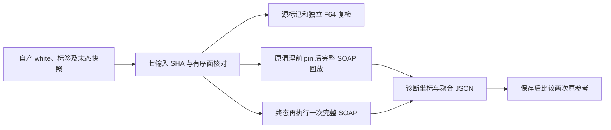
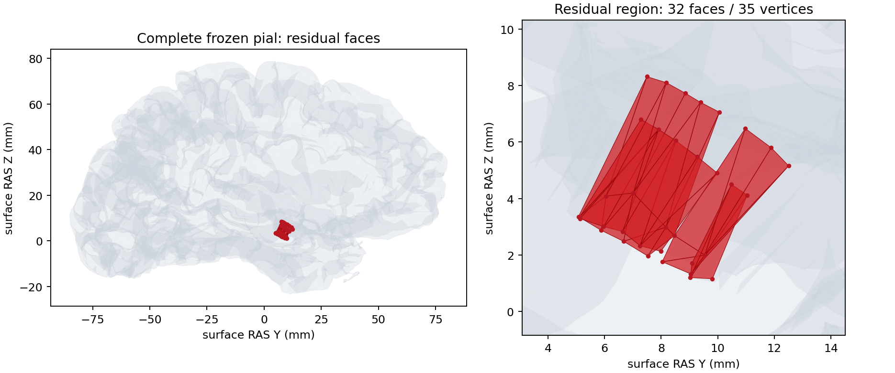

# 冻结 pial 残余相交的完整清理诊断

## 1．功能

本工具读取一次失败的 FNIT pial 放置阶段留下的接受末态和清理末态，完整回放既有 `repair_intersections(marking_backend="source_numba")`。它核对源有向标记、独立双精度三角面检测、冻结顶点和两次同输入原生参考，判断残余来自哪一条路径。四轮优化、标签、medial-wall pinning、100 次 SOAP/轮及停止规则均保持原样。



诊断完成与生产网格通过分别记录。仍有相交时保留 `producer_mesh_quality="failed"`；不会写出标准 `lh.pial.T1`，也不会把额外清理称为原始 T1 连续整例。

## 2．Python 调用、输入和输出

```python
import json
from pathlib import Path
from benchmark_recon_pial_residual_cleanup import diagnose

report = diagnose(
    frozen_source=Path("baseline/src"),  # 已冻结 FNIT Python 包；不是原软件程序目录
    overlay_source=Path("new/overlay/fnit/recon_all"),  # 本次冻结的清理和源标记模块
    diagnostic_case=Path("failed-stage/01-cli-enabled"),  # 七前置和两份自产 NPY 快照
    reference_run=Path("isolated-reference"),  # 两次独立同输入参考，只有诊断读取
    output_directory=Path("new-diagnosis"),  # 新空目录；禁止覆盖历史产物
    expected_input_sha256=json.loads(Path("input_hashes.json").read_text()),  # 七前置哈希
    threads=4,  # 固定 NumBa 线程预算；运行器同时固定 OMP/BLAS 和 CPU 亲和性
)
```

| 参数/输入 | 结构和含义 |
| --- | --- |
| `frozen_source` | `Path`，既有 FNIT `src` 根目录；仅冻结依赖用于同输入诊断。 |
| `overlay_source` | `Path`，新清理和 marker 所在包目录；实际加载各模块 SHA 全部记录。 |
| `diagnostic_case` | 包含 `subject/`、`last-accepted.private.npy`、`cleanup-result.private.npy` 的冻结失败阶段。 |
| 七前置 | `surf/lh.white`、`surf/autodet.gw.stats.lh.dat`、`mri/brain.finalsurfs.mgz`、`mri/wm.mgz`、`mri/aseg.presurf.mgz`、`label/lh.cortex.label`、`label/lh.cortex+hipamyg.label`；MRI 和阈值文件只做完整输入 SHA 核对，清理不重新读取强度求解。 |
| 表面与快照 | `(N,3)` float32 surface RAS，单位 mm；`(F,3)` 有序整数面，顶点对应必须成立。nibabel 从 white 读取有序面。 |
| 标签 | FreeSurfer label 格式的顶点编号。`cortex+hipamyg` 外顶点保持 rip；`cortex` 外点按原流程 pin 到同索引 white。两者不互换。 |
| `reference_run` | `reference-1/subject`、`reference-2/subject` 包含相同七前置和完成的 `lh.pial.T1`。候选前只核输入哈希和有序面，候选保存后才比较参考坐标。 |
| `output_directory` | 必须尚不存在；生成 `report.json` 及两份诊断 NPY，均属于新诊断，不能替代生产输出。 |
| `expected_input_sha256` | 七项 `dict[str,str]`。候选和两次参考的全部输入必须匹配。 |
| `threads` | 正整数，默认 4。NumBa 总预算；本工具使用 CPU，不初始化 CUDA，不修改 TF32 或 dtype。 |

`benchmark_recon_pial_residual_pairs.observe(...)` 另在完整源 `evaluate` 返回时，只读其已计算的双方向谓词和共有 MHT 桶结果，统计阳性面对是否两面均冻结；明细 NPZ 只留服务器。它还对同一前置 white 做源标记，不把 white 当作 pial 清理结果。

```python
from benchmark_recon_pial_residual_pairs import observe
from plot_recon_pial_residual_cleanup import plot

pair_report = observe(
    frozen_source=Path("baseline/src"),  # 与清理回放相同的冻结依赖
    overlay_source=Path("new/overlay/fnit/recon_all"),  # 同一 marker 版本
    diagnostic_case=Path("failed-stage/01-cli-enabled"),  # 原 white、标签和 pial 末态
    output_directory=Path("new-pairs"),  # 新目录；面对明细仅供原位诊断
    threads=4,  # 固定 CPU 线程，不初始化 CUDA
)
figure_report = plot(
    terminal=Path("failed-stage/01-cli-enabled/cleanup-result.private.npy"),  # 原 pial 末态
    white=Path("failed-stage/01-cli-enabled/subject/surf/lh.white"),  # 同索引有序面
    pair_artifact=Path("new-pairs/positive_pairs.npz"),  # 实际完整源面标记
    output=Path("new-figure/residual_surface.png"),  # 新脑图
    receipt=Path("new-figure/figure_receipt.json"),  # 图像和输入 SHA 收据
)
```

`observe` 的四个 `Path` 参数分别为冻结包、overlay、冻结病例和新输出目录；`threads` 默认 4。返回聚合 JSON 字典和 `positive_pairs.npz`：`pairs` 为 `(P,4)` int64 的面号和双方向阳性结果，`face_flags` 为 `(F,)` bool。同一工具返回原 white 的相交计数。错误线程、已有目录、不同 shape/dtype 会失败；它不改变 marker 返回值。

`plot` 的五个参数均为必须显式指定的 `Path`，含义见示例；返回图像收据字典。它读取同一终态、white 有序面及实际源面标记，生成新 PNG 和图像 SHA 收据。所有背景面和所有异常面保留；surface RAS/mm 的 sagittal 投影用于显示异常位置，不能替代三维相交检测。输出存在、非法/非有限快照或无阳性面会失败。

返回 `dict` 包含：实际模块、脚本、输入与快照 SHA；网格数量；每次源/F64 标记计数；被标记顶点的 rip 与 cortex 限制；完整 SOAP 轨迹、循环数与时间；候选/原终态、两次参考的不同坐标数及均值/P99/最大距离；执行状态和原网格质量状态。`gpu_memory_bytes=null` 表示未测，不表示显存为零。

目录存在、七输入不足或 SHA 不同、非法线程、非有限/错误 dtype/shape 快照、不同有序面会明确抛异常。运行中先保存可用诊断，失败不能视作完整回放。原失败文件不修改。

## 3．命令行

```bash
CUDA_VISIBLE_DEVICES='' OMP_NUM_THREADS=4 NUMBA_NUM_THREADS=4 \
MKL_NUM_THREADS=4 OPENBLAS_NUM_THREADS=4 \
python tools/benchmark_recon_pial_residual_cleanup.py \
  --frozen-source baseline/src \
  --overlay-source new/overlay/fnit/recon_all \
  --diagnostic-case failed-stage/01-cli-enabled \
  --reference-run isolated-reference \
  --output-directory new-diagnosis \
  --expected-input-hashes input_hashes.json \
 --threads 4

# 同一冻结输入完整观察面对，不增加清理次数。
CUDA_VISIBLE_DEVICES='' OMP_NUM_THREADS=4 NUMBA_NUM_THREADS=4 \
python tools/benchmark_recon_pial_residual_pairs.py \
  --frozen-source baseline/src \
  --overlay-source new/overlay/fnit/recon_all \
  --diagnostic-case failed-stage/01-cli-enabled \
  --output-directory new-pairs \
  --threads 4

# 使用实际面标记生成可视化；不读取原软件参考坐标。
python tools/plot_recon_pial_residual_cleanup.py \
  --terminal failed-stage/01-cli-enabled/cleanup-result.private.npy \
  --white failed-stage/01-cli-enabled/subject/surf/lh.white \
  --pair-artifact new-pairs/positive_pairs.npz \
  --output new-figure/residual_surface.png \
  --receipt new-figure/figure_receipt.json
```

运行器需固定四个 CPU 核、日志和退出码，并绑定源清单。完整阶段墙钟含校验、加载、候选写入和只读参考比较；源标记、F64 复检与完整清理分别计时，不将嵌套时间相加。

## 4．原软件对应步骤

对应固定 FreeSurfer `d932c45` 的 `mris_place_surface --pial` 内部 `MRISpinMedialWallToWhite`、`MRISremoveIntersections` 和 `mrisMarkIntersections`。这些内部函数没有独立等价 CLI。本轮只复用已经完成的隔离原生参考，不在生产或诊断中重新调用原程序。

## 5．真实数据结果

本次输入是保存下来的公开 T1 同输入 pial 阶段。七前置与两次原生参考逐项 SHA 相同。现存 v4 原始 T1 失败流程未发布 LH white/pial，原临时目录已移除；本次 v3 快照与 v4 终态的直接 SHA 同一性未验证，不能将二者混标。

完整诊断、面对观察和脑图进程均退出 0。源有向标记与独立 F64 检测均为 32 面、35 顶点，标记顶点集合完全相同。35 个顶点中 20 个 rip、15 个可动；32 个残余面全部含至少一个 rip 顶点，8 个面三个顶点均 rip。同一 white 的源检测为 0 面、0 顶点；这只核对前置 white，不代表全部上游通过。

| 本次完整 CPU 回放 | 相交面 | 源循环 / SOAP 次数 | 坐标相对原终态 | 含完整清理墙钟 |
| --- | --- | --- | --- | --- |
| 原接受末态先 pin 后，按原规则清理 | 415→32 | 24 / 2400 | 285135 元素全部逐位相同 | 659.150 秒 |
| 在原终态额外执行一次完整清理 | 32→32 | 16 / 1600 | 285135 元素全部逐位相同 | 66.596 秒 |

第一段 25 次 marker 调用中实际计算 10 次、完全相同几何复用 15 次；第二段 17 次调用中实际计算 1 次、复用 16 次。两段完整轨迹和输出 SHA 均保留。第二段坐标完全不动，所以不能把增加一段清理当作已解决相交。这里的墙钟是额外冻结诊断，不是四轮 pial 优化器时间或整例提速。

实际源查询得到 40 对阳性面对，全部双方向谓词均阳性。以下三类互斥且覆盖全部面对：

| 相交面对的固定状态 | 数量 |
| --- | ---: |
| 两面各自三个顶点均 rip | 0 |
| 恰一面三个顶点均 rip | 15 |
| 两面各含至少一个可移动顶点 | 25 |

因此，这批残余不能归为“两面都固定”。可移动顶点的存在也不保证能按当前有序 SOAP、rip 和停止规则安全消除相交。本轮没有取消固定点、改变 medial-wall pinning 或增加源迭代。

两次隔离原生参考的七个前置 SHA 均与候选相同。两参考之间以及与原 Python 终态之间，285135 个坐标元素逐位相同、有序面相同，顶点距离均值/P99/最大均为 0 mm。参考表面文件 SHA 不同；旧 v3 收据已记录创建时间注释差异，本轮只比较解码几何。终态残余由源与独立检测共同确认，本例没有“legacy 漏检导致误通过”的证据；它是两实现共享的同输入网格质量失败，不能称为无影响尾差或整体等效。

完整诊断总墙钟 1065.000 秒，含七输入校验、加载、两段清理、三次源/F64 复检、候选写入及原参考读取；面对和 white 复检另为 122.861 秒，不能作为四轮 pial 或整例耗时。固定四线程、CPU 核 88–91、NumPy 1.26.4/NumBa 0.67.0/nibabel 5.4.2。运行后核查 CPU 为 Xeon Platinum 8369B、Python 3.11.16；该资产核查不是同期资源采样。CUDA 隐藏，本轮峰值 CPU 内存及显存未测，均保留 `null`。没有新增依赖或干净环境整例验收。



图中红色为所有实际标记的 32 个面和 35 个顶点；背景保留全部 190086 面。表面 RAS/mm 的二维投影仅展示位置，不另推断解剖分区或三维相交。

当前 `surface_placement_python` 适配器在 CPU 显式用 `source_numba`、在 GPU 显式用 `source_torch`；库函数 `place_pial_t1` 的兼容默认 `legacy` 不能代表该 Python profile 的实际策略。本次不修改任何默认。

旧证据：v3 的完整源清理从 415 面降至 32 面、35 个顶点，Python 与同输入两次原生参考坐标/有序面一致；该结果仍为网格质量失败。它不是随机性或结果等效证据。

## 6．版本和验证记录

- 旧 v3：保留原输入、源版本和原参考两重复，不改标为本轮。
- 新 v1：仅两项自有清理/marker overlay 加独立诊断脚本。源 marker 复用已验证候选 CSR 优化；不更改谓词、rip、pin、循环次数和停止规则。工具部署时 Git 快照为 `ebc52ddae64a`，实际六个运行模块各自 SHA 绑定，不称整个冻结包来自该提交。
- [本次聚合报告、面对分类、脑图和复现摘要](../../validation/recon_all/optimizations/20261011_pial_residual_cleanup/README.md)包含实际脚本、六个模块、原生参考程序、七输入、快照和产物 SHA。公开发布聚合数据与脑图；几何快照、面对明细和私有日志留原任务目录。
- 原始 T1整例、white/pial 相互穿越、完整指标等效和全流程提速不属于该冻结清理诊断的已测范围。

## 7．参考与源码

- [FreeSurfer 固定源码的曲面形变](https://github.com/freesurfer/freesurfer/blob/d932c45/utils/mrisurf_deform.cpp)。
- [FreeSurfer mris_place_surface](https://github.com/freesurfer/freesurfer/tree/d932c45/mris_place_surface)。
- Fischl B. FreeSurfer. *NeuroImage* 62, 774–781 (2012). [DOI](https://doi.org/10.1016/j.neuroimage.2012.01.021)。
- FNIT 现有[完整 pial 说明](PYTHON_PIAL_PLACEMENT.md)及[分配器/相交终态验证](SURFACE_CUDA_ALLOCATOR.md)。
