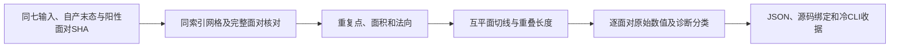

# pial 残余交叉的只读几何诊断

## 1．功能简介

`diagnose_recon_pial_residual_geometry.run`读取冻结自产pial末态与完整阳性面对工件，量化重复点、面面积、共线程度、互平面穿透及交线重叠。它帮助判断异常来自上游网格还是清理算法，不修改坐标或碰撞质量门。



诊断中的近接触标签用于描述几何，不能豁免源/F64已标记的任何面，不能作为新的验收标准。

## 2．Python调用、输入和输出

```python
from pathlib import Path
from tools.diagnose_recon_pial_residual_geometry import run  # 从仓库根目录执行

report = run(
    diagnostic_case=Path("own-terminal/01-cli-enabled"),  # 七前置与float32自产末态
    input_hashes=Path("seven-input-hashes.json"),  # 七个相对文件名与SHA-256
    terminal_sha256=expected_terminal_sha256,  # 原自产末态文件的64字符SHA
    pair_artifact=Path("positive_pairs.npz"),  # 完整source阳性面对及面标志
    pair_artifact_sha256=expected_pair_artifact_sha256,  # 上述工件的64字符SHA
    output=Path("new-geometry-report.json"),  # 新JSON文件，父目录需存在
)
```

| 参数 | 类型、结构及含义 |
| --- | --- |
| `diagnostic_case` | Path。包含`subject/surf/lh.white`、GW阈值、brain.finalsurfs、WM、aseg.presurf、cortex和cortex+hipamyg七前置，以及`cleanup-result.private.npy`。此冻结benchmark接口限定左半球。 |
| `input_hashes` | Path，JSON映射七个相对路径到SHA；禁止绝对路径和`..`，所有文件逐一校验。 |
| `terminal_sha256` | 必选字符串；自产末态NPY的SHA。数据为有限float32`(N,3)`，与white相同有序网格，surface RAS/mm。 |
| `pair_artifact` | Path，NPZ含整数`pairs(P,4)`：两个升序面编号及两个有向source布尔标志；`face_flags(F,)`为bool且必须与完整有向面对推导标志相同。无重复面对。 |
| `pair_artifact_sha256` | 必选字符串；NPZ的SHA，绑定已验证完整源面对工件，不能混用新表面。 |
| `output` | Path，新JSON；函数不覆盖文件，失败抛异常，父目录需存在。 |

返回JSON兼容字典。包含七输入与末态/面对/源码SHA、N/F/标记数、全部逐面对面积(mm²)、无量纲共线比`|cross(edge1,edge2)|/max_edge²`、法向夹角正弦、角点到另一面平面的最小/最大距离(mm)、两侧穿透深度、交线重叠长度(mm)或共面重叠面积(mm²)、精确重复角点数、诊断分类、版本、墙钟和RSS。报告不包含坐标、影像或私人路径。

内部纯计算`pair_geometry(first, second)`接收两个有限`(3,3)`三角面坐标，surface RAS/mm，输出上述单面对字典；零面积或非有限输入抛ValueError。交线端点稳定余量`1e-9mm`、诊断近接触长度`1e-5mm`、平行法向余量`1e-10`和共面面积分类`1e-10mm²`均在执行前固定，原始数值全部保留。它们不改变FNIT质量检测，也不是整例等效阈值。

Hash、网格shape、dtype、面对编号、方向布尔值或完整标志不匹配直接失败。采用NumPy F64，影像/表面优先nibabel；不调用原版程序，不读取官方参考，不改变TF32或使用半精度，无GPU运算。现有主页Conda已包含所需依赖。

## 3．命令行

```bash
# 分配四核并保持四线程；完整冷CLI另由time_recon_python_benchmark记录。
CUDA_VISIBLE_DEVICES='' OMP_NUM_THREADS=4 OPENBLAS_NUM_THREADS=4 MKL_NUM_THREADS=4 \
python tools/diagnose_recon_pial_residual_geometry.py \
  --diagnostic-case own-terminal/01-cli-enabled \
  --input-hashes seven-input-hashes.json \
  --terminal-sha256 "$expected_terminal_sha256" \
  --pair-artifact positive_pairs.npz \
  --pair-artifact-sha256 "$expected_pair_artifact_sha256" \
  --output new-geometry-report.json
```

所有CLI参数与上表同名且必选。仅写JSON与stdout聚合状态，不生成新的标准pial文件。

## 4．对应原软件

本工具为FNIT只读诊断，没有原软件等价CLI。它分析原`mris_place_surface --pial`内部清理之后、既有`mrisMarkIntersections`语义标记的阳性面对。原source/F64检测与完整SOAP仍按[冻结清理诊断](PIAL_RESIDUAL_CLEANUP_DIAGNOSTIC.md)保留。

## 5．真实结果与时间

已完成旧数字拓扑候选网格的95,045顶点、190,086面同七输入诊断。40/40面对都是非共面真实交线重叠；长度0.005004984–1.040136417mm。两侧穿透深度范围0.117694335–1.147011675mm。35个异常顶点无精确重复坐标；全网格零面积面0，所涉三角面积0.123101665–3.673744072mm²，共线比0.013832443–0.637125208，均非精确共线退化。

这些异常不是仅有浮点尾差或点接触。它们发生在旧上游网格；不能据此判断新的独立GA自产网格仍有相同异常，也不能单凭这份诊断判定pial算法有移植bug。两次原程序与原顺序Python同输入坐标一致的历史阶段证据单列。

完整冷CLI2.104223秒、读取/校验/诊断API0.845844秒（最终JSON写出前），子进程峰值RSS101,175,296字节。四核同节点单次只读阶段，无GPU显存采样为null，无整例或速度对照结论。[完整逐面对报告](../../validation/recon_all/optimizations/20261011_pial_local_residual_solver/geometry_report.json)、[冷CLI](../../validation/recon_all/optimizations/20261011_pial_local_residual_solver/geometry_cli_time.json)、[协议](../../validation/recon_all/optimizations/20261011_pial_local_residual_solver/geometry_protocol.json)及[源码绑定](../../validation/recon_all/optimizations/20261011_pial_local_residual_solver/geometry_source_binding.json)保留全部数值，工具SHA`59a276d154e3e392f5a76a5a8a8963f590ace68681be5332bcd1f8fb136538c0`。


完整局部图绑定相同末态与面对工件，3D交叉结论来自上面的完整几何计算，不能凭2D重叠判断。

## 6．版本与benchmark记录

- v1只读几何工具：同时保存完整面对数据、重复点/面积与交线类型，保留原质量失败，不放宽门。
- 原顺序SOAP重复性、独立方向候选v1/v2、固定半空间候选及可变分离平面各自绑定不同源码/协议，不相互替代。
- 新独立GA网格、右半球/其他被试、white/pial穿越、完整脑区指标和空目录整例须由协调流程另测。

## 7．参考与源码

- [FreeSurfer固定曲面形变源码](https://github.com/freesurfer/freesurfer/blob/d932c45/utils/mrisurf_deform.cpp)。
- [FNIT独立局部候选](PIAL_LOCAL_RESIDUAL_SOLVER.md)、[逐面对投影](PIAL_PROJECTED_RESIDUAL_SOLVER.md)。
- Fischl B. FreeSurfer. *NeuroImage* 62,774–781 (2012). [DOI](https://doi.org/10.1016/j.neuroimage.2012.01.021)。
