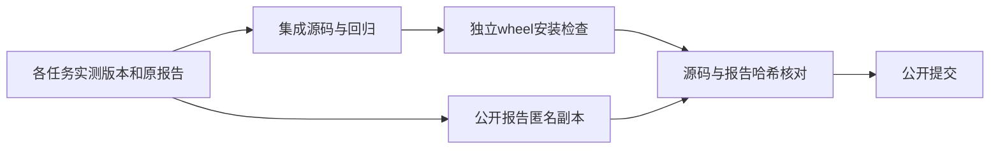

# 本轮公开源码与实测版本

## 1. 功能与流程

本轮将五个任务和根任务的阶段改动汇总为一次公开提交。计算源码、测试及复现工具保留集成版本的字节；公开报告中的真实GPU标识改为稳定匿名别名，原报告保留在私有科学记录中。



## 2. 输入、输出与数据结构

本步骤输入是已提交的计算源码、阶段报告和文件清单，没有影像坐标、体素单位或新的受试者数据。输出是公开源码树及[派生清单](../../validation/recon_all/optimizations/20261011_publication_snapshot/DERIVATION_MANIFEST.json)。

清单逐项记录路径、匿名化前后的SHA-256和字节数、变更角色及检查结果；另有1390项安装源码和元数据的绑定。实际输入影像、权重、程序、参考结果、源代码和原始执行收据的科学哈希保持原值。原报告内的执行哈希是原字节的来源记录，匿名副本的当前校验值使用本页派生清单；两者不能混用。

真实GPU标识的匿名别名只表示报告之间的设备对应关系，不是可供NVML查询的硬件标识。模拟测试中的两个GPU字符串保留原值。匿名化对报告做可逆字节核对，除标识替换外不改变数值、布尔值、空值、数组顺序或失败状态；公开交付清单的大小和当前文件SHA单独更新。

## 3. Python与命令行复现

从本次公开提交导出源码，并用实际安装清单核验，见[最终安装页](../../validation/recon_all/optimizations/20261011_integrated_python_install_v4/README.md)。调用参数为源码目录、1390项清单、新输出目录和已安装主页依赖的Python解释器；所有路径均用显式参数传入。旧影像记录属于其各自实测版本，不应把当前源码运行重标为旧版本复现。

```bash
# 在本次公开提交上执行；安装清单使用仓库中未改动的SOURCE_MANIFEST。
git archive HEAD src pyproject.toml README.md THIRD_PARTY_NOTICES.md > frozen-source.tar
# frozen-source.tar导出到独立新目录后，执行安装页中的具名参数命令。
```

## 4. 原软件对应

公开打包没有独立FreeSurfer命令，也没有新增原软件调用。各计算阶段的参考命令和代码版本见[本轮实测汇总](INTEGRATION_RESULTS_20261011.md)。

## 5. 校验与实测范围

安装核验实际版本为7652b7b06040d93b4831743237ae030af71126ac：34个关键模块源码、wheel及安装内容SHA一致，实际pial默认source_rip；六个fresh CLI和依赖入口成功。这是安装与CPU合同证据，没有新增影像、CUDA前向、整例或隔离环境验证。

公开源码与实际安装清单的1390项逐项比对结果记录于派生清单。N4、GCA、pial和拓扑实验仍绑定各自实际测试提交和程序哈希，公开打包不会产生新的耗时、精度或显存结果。

## 6. 更新与限制

本轮匿名化9个真实设备标识涉及141份报告或文档，并替换一份测试收据中跳过原因的本地工作区前缀。两层历史导出收据和原始执行哈希仍保留；新的公开交付清单记录当前副本。原私有集成历史保留，但本次公开发布不包含这些中间提交，因此历史科学提交号应结合所附源码清单阅读。

当前整例仍有网格相交失败，十分钟目标、十例完整评估、整体指标等效及整例20GB显存尚未通过。本页不改变这些结论，也不将阶段结果升级为整例验收。

## 7. 相关说明

[当前流程](README.md)、[实测汇总](INTEGRATION_RESULTS_20261011.md)、[安装清单](../../validation/recon_all/optimizations/20261011_integrated_python_install_v4/SOURCE_MANIFEST.json)、[项目源码](https://github.com/weikanggong1/Fudan-Neuroimaging-toolkit)。
