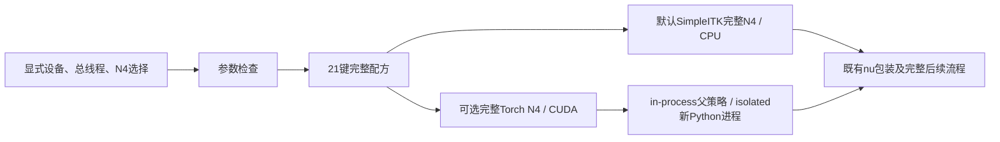

# 独立 Python 配方的 N4 后端选择

## 1．功能与范围

`python_profile_options()` 返回完整独立 Python 配方的调度参数。N4 默认保持 SimpleITK Python API；显式 `torch` 复用仓库已有完整 200 轮 N4。此次仅补齐选择接口，未重写 N4、改变步数、放宽检查或启用半精度。



**21 是调度字典的键数，不是算法阶段数。** 调用链审计覆盖 24 组功能；每组可以包含多个阶段。SimpleITK/ITK、NumPy/SciPy、Numba/LLVM、PyTorch/CUDA/Triton 的通用编译计算库允许使用。生产不调用原版 FreeSurfer 等阶段程序，也不通过链接原版阶段库或包装程序绕过这一边界。

## 2．Python 调用、输入与输出

```python
from fnit.recon_all.python_profile import python_profile_options
from fnit.recon_all.input_n4_chain import run_n4_stage

dispatch_options = python_profile_options(
    device="cuda:0",  # 明确逻辑GPU；仅选择参数，不初始化CUDA
    threads=4,  # 整例CPU总预算，双侧worker各两线程
    n4_backend="torch",  # 显式选择已有完整Torch N4；默认simpleitk
    n4_execution="isolated",  # 新Python进程局部开缓存；默认in-process
)
n4_report = run_n4_stage(
    input_path="subject/mri/orig.mgz",  # 自产conform网格的三维强度图
    output_path="diagnostic/nu0.mgz",  # 新输出；同网格uint8，不是分割标签
    n4_backend=dispatch_options["n4_backend"],  # 保留调用者明确选择
    n4_execution=dispatch_options["n4_execution"],  # 与后端配对检查
    native_binary=None,  # Python后端不读取或执行原版N4程序
    device="cuda:0",  # 与配方相同GPU，不静默回退CPU
    threads=4,  # 子进程线程预算；由调用方保持整例总预算
    profile=False,  # 默认不插入额外剖析同步
    report_path="diagnostic/n4-worker.json",  # isolated必需的新JSON路径
)
```

| 参数 | 格式、默认值、含义和限制 |
| --- | --- |
| `device` | 字符串，默认 `cuda:0`，必须显式 `cuda:N`；目前完整 WM/MNI 需要 CUDA，即使 N4 选 CPU SimpleITK 也保持该约束 |
| `threads` | 整数，默认 4、至少 2；禁止 bool；完整配方双侧各使用 `threads//2`，子阶段线程由调度管理 |
| `n4_backend` | 默认 `simpleitk`；唯一另选值 `torch`；本 helper 拒绝 `native`，不发现原版程序 |
| `n4_execution` | 默认 `in-process`；`isolated` 仅与 `torch` 配对，复用既有 Python exec worker；SimpleITK/isolated 报错 |

返回新 `dict`，无影像、坐标或物理单位，包含原 21 个键；仅 `n4_backend` 和 `n4_execution` 可按本接口改变，其余 19 个键保持既有配方。完整返回值见 [实际捕获报告](../../validation/recon_all/optimizations/20261010_python_profile_n4_selection/capture_v1/audit.json) 中 `default_profile`、`explicit_torch_profiles`。本函数不创建目录，不更改环境、TF32、线程或分配器；非法设备、线程、后端或组合抛 `ValueError`。

本选择接口不执行 N4。实际影像参数、输出结构、200 轮算法及失败行为见 [完整 Torch N4](N4_COMPLETE_TORCH_20261009.md)、[缓存 worker](N4_CACHED_WORKER.md)、[SimpleITK N4](N4_SIMPLEITK.md)。两种后端均生成同网格 `uint8 nu0`，后续 `make_nu()` 再输出 `nu`；不能混称。`input_execution="parallel"` 当前只支持 SimpleITK/in-process 与 SynthSeg 并行，Torch 组合须明确拒绝，不能静默改为串行。

此前公开整例配方会无条件覆盖调用者的 N4 选择。当前单例、batch、CLI 和 benchmark 已统一保留显式 `torch` 请求；历史混合入口的 `native` 缺省仅在 `backend="python"` 映射到 SimpleITK。本 helper 自身仍拒绝 `native`。共享接线与其测试由协调者另外绑定实际源码，不将前次 helper 审核快照重标为新的整例验证。

完整单例和批处理使用相同选项：

```python
from fnit.recon_all.native_free import run_recon_all_python
from fnit.recon_all.batch import run_recon_all_python_batch

subject_report = run_recon_all_python(
    t1="data/sub-06_T1w.nii.gz",  # 原始三维T1，不是冻结官方中间文件
    subject_dir="runs/sub-06-python-torch",  # 必须不存在或为空；输出完整被试目录
    weights_dir="resources/weights",  # 提前核验的声明权重目录
    assets_dir="resources/assets",  # 提前核验的模板和LUT目录
    native_bin_dir=None,  # Python配方不读取原版程序目录
    device="cuda:0",  # 明确目标GPU；网络与Torch N4使用此设备
    threads=4,  # 每个被试CPU总预算，双侧各两线程
    backend="python",  # 完整独立Python候选，保留全部必要阶段及质量检查
    n4_backend="torch",  # 显式选择完整200轮N4；省略时独立配方使用SimpleITK
    n4_execution="isolated",  # 新Python exec局部启用缓存，不改已初始化父CUDA策略
    input_execution="serial",  # Torch不能与当前SimpleITK/SynthSeg并行输入配方混用
    profile_stages=True,  # 明确同步目标GPU，记录含写出的阶段墙钟
    cuda_allocator_cache="auto",  # 保留生产父分配器策略，局部worker另记实际配置
)

batch_reports = run_recon_all_python_batch(
    jobs=[  # 每项只含原始t1与互不重叠的空subject_dir，按此顺序返回报告
        {"t1": "data/sub-06_T1w.nii.gz", "subject_dir": "runs/batch-sub-06"},
        {"t1": "data/sub-07_T1w.nii.gz", "subject_dir": "runs/batch-sub-07"},
    ],
    weights_dir="resources/weights",  # 所有被试复用同一声明权重
    assets_dir="resources/assets",  # 所有被试复用同一模板和LUT
    native_bin_dir=None,  # 不发现原版阶段二进制
    devices=("cuda:0", "cuda:1"),  # 每设备独立进程，设备不得重复
    threads=4,  # 每被试总预算；两个设备同时运行时总计八线程
    backend="python",  # 各CLI保持完整独立配方
    n4_backend="torch",  # 传入每个CLI，不被配方覆盖
    n4_execution="isolated",  # 仅Torch合法；SimpleITK/isolated提前报错
    input_execution="serial",  # 当前Torch前段必须串行
    profile_stages=True,  # 返回实测阶段时钟；不据此自动判断指标等效
    cuda_allocator_cache="auto",  # 父子实际分配器及显存各自记录
)
```

单例返回完整运行 `dict`；批处理按 `jobs` 顺序返回 `list[dict]`。失败抛异常；已写出的失败JSON/中间文件保留，不生成近似或占位标准输出。上述选项不更改输出空间：体积在conform网格，表面为surface RAS/mm，统计体积为mm³。完整输入输出见[主流程说明](PYTHON_SURFACE_PIPELINE.md)，本页仅解释N4选择。

## 3．命令行

helper 没有独立 CLI。完整重建入口已支持显式选择：

```bash
python -m fnit.recon_all.native_free \
  data/sub-06_T1w.nii.gz runs/sub-06-python-torch \
  --weights-dir resources/weights \
  --assets-dir resources/assets \
  --device cuda:0 \
  --threads 4 \
  --backend python \
  --n4-backend torch \
  --n4-execution isolated \
  --input-execution serial \
  --profile-stages
```

两个位置参数依次是原始T1和空输出目录；其余具名选项与Python示例相同。想诊断输入链时，既有完整输入链也可显式测试 Torch N4，以下输出范围仅为原始 T1 到 `nu`：

```bash
python -m fnit.recon_all.input_n4_chain \
  --t1 data/sub-06_T1w.nii.gz \
  --subject-dir runs/sub-06-input \
  --weights-dir resources/weights \
  --assets-dir resources/assets \
  --device cuda:0 \
  --threads 4 \
  --n4-backend torch \
  --n4-execution isolated \
  --report runs/sub-06-input.json
```

`--t1` 是公开原始三维 T1；输出被试目录不存在或为空；资源提前核验；`--report` 是新 JSON。当前完整 benchmark 的 `--n4-backend` 缺省仍是 `native`，不是 `torch`；独立 Python profile 将该历史缺省映射为 SimpleITK。显式 Torch 在 API、CLI、batch 和 benchmark 中原样保留；共享接线的契约与安装收据独立报告，本页前次24项 helper 测试不覆盖这些新增调用点。

复现本次只读审核使用 [build_audit.py](../../validation/recon_all/optimizations/20261010_python_profile_n4_selection/build_audit.py) 的具名参数 `--repository`、`--output`；输出目录必须是新路径，避免覆盖已有证据。

## 4．原软件调用

这是 FNIT 调度内部接口，没有独立的 FreeSurfer CLI。N4 对照使用固定参数的 `N4BiasFieldCorrection`，完整 shrink、样条、50×4 反馈、直方图和量化参数见 [N4 固定配方](N4_ITK_CONDA.md)。参考程序只在隔离 benchmark 中运行；此选择接口及 Python N4 不读取官方输出。SimpleITK 的通用 ITK 库不等于 FreeSurfer 阶段程序。

## 5．本次验证及已有真实影像证据

本轮新增选择参数，没有修改 N4 数学实现。当地 WSL CPU 环境完成 **24 项测试及 15 个子检查**，pytest 14.20 秒；JUnit 边界为 14.163 秒。检查默认与显式 SimpleITK 相同、21 键保持、Torch 仅改两键、非法组合失败、三条既有完整 N4 route 参数、并行输入拒绝 Torch，以及不初始化 CUDA或更改调用方精度/环境。它是接口契约，不是 MRI 速度测试。

扩大测试时，真实 SimpleITK import 的一项因该本地环境未安装 SimpleITK 失败，其余 28 项及 15 子检查通过；[失败收据](../../validation/recon_all/optimizations/20261010_python_profile_n4_selection/contracts.json) 保留。主页 Conda/pip 已声明 `SimpleITK==2.5.6`，本次没有添加依赖或修改该环境。启动审计下，NumPy、SciPy、Numba、Torch、nibabel 实际导入成功；SimpleITK 状态为 `unavailable`，不是政策拦截。

复用以下 **原报告、原版本** 的真实 N4 记录，没有将其改标为本次配方的整例成绩：

| 既有同输入完整 N4 | sub-06 | sub-07 |
| --- | ---: | ---: |
| 缓存 Torch 冷 CLI，含 exec/导入/写出/退出，s | 11.037 | 9.978 |
| 其中完整文件 API，s | 5.106 | 4.317 |
| 缓存相对原同输入 Torch 输出的新增体素差 | 0 | 0 |
| Torch 相对固定 Conda N4 的 `nu0` 差异体素，均 +1 | 4016 | 3259 |
| SimpleITK 相对固定参考的 uint8 差异体素，幅度 1 | 99 | 28 |

本表按原报告的实际病例对应关系重新核对：SimpleITK sub-06 为 99，sub-07 为 28；此前此行两列写反，已修正。数组、完整文件报告均支持这一顺序。Torch 与连续前段的病例顺序原本正确，原始报告未修改；逐病例来源、输入和报告 SHA 见 [病例映射更正收据](../../validation/recon_all/optimizations/20261010_python_profile_n4_selection/case_summary_v2.json)。各行来自自己的冻结输入/版本，不代表这些不同验证批次共享同一输入文件。

Torch 实测子张量 allocated/reserved 为 1,295,297,024 / 1,384,120,320 字节，父子同时占用归属未解决，不能当作整例峰值。[完整 worker 报告](../../validation/recon_all/optimizations/20261009_n4_torch_substages/reports/input_chain_a100_20261009_v2/cached_worker/summary.json) 绑定两例输入、200 次反馈、源码及精度设置。

[既有原始 T1 连续前段](../../validation/recon_all/optimizations/20261010_n4_continuous_prefix/README.md) 的 `filled` 差异分别为 4671 / 2291 体素，最差半球 Dice 为 0.995364106 / 0.997220977，LTA 有 4 / 0 个元素不同；显示量化尾差可能在后续放大。[旧 e34 整例诊断](N4_WHOLE_DIAGNOSTICS_20261010.md) 中 sub06 完成、sub07 最终 white 10 面自相交失败。它们不是当前数字拓扑独立配方的结论。严格复现、整体指标等效、十分钟整例目标均不由本次选择接口证明。

新增显式选择接线之后，两例原始T1空目录已在新冻结版本上用Torch/isolated连续运行到filled：公开API373.256/360.458秒，N4阶段13.687/13.631秒。对照此前SimpleITK串行前段，原始/conform、SynthSeg与33组织CSV完全一致；`nu0`分别4115/3245个体素不同，`filled`分别4592/2289个体素不同，最差半球Dice为0.995470695/0.997227493。最终WM>=5 Dice为0.991752651/0.997255203。这是本次新配方的前段实测，不能用旧N4同输入或e34整例数字替代；严格复现未通过，整体指标等效未判定。两版本、完整19阶段时钟、max/P99、LTA、显存归属及两张真实脑图见[新连续比较](../../validation/recon_all/optimizations/20261010_torch_n4_prefix_compare/README.md)。时间是跨版本/跨时段观察，不据此宣称稳定整例加速。

本次只读检查绑定实际源码 SHA 的 24 组所选调用链，未发现选中原版 FS 程序或原版阶段链接库。CUDA 路径不进入 CPU C++ 平均器、SynthSeg CPU columns 或 SynthMorph CPU Eigen 后端。`nibabel.freesurfer.io` 是格式读写；`nvidia-smi` 是硬件采样。审核不是形式化可达性证明，benchmark 的进程拦截也没有覆盖 OS 动态库或全部文件访问。干净环境隔离状态仍为 `not_verified`。前次选择接口审核没有新MRI/GPU任务；后续新增连续前段及脑图在上述新报告中独立绑定，不回写原审核快照。

## 6．更新与验证记录

- 2026-10-10：只读核对当前配方；确认完整 Torch N4 已存在，公开配方覆盖了显式请求。新增四参数选择契约，默认 SimpleITK/in-process 保持；真实计算函数未改。
- 当前捕获提交 `5cc98494` 加实际工作树，53 文件 SHA、24 组函数位置及 SHA、原报告哈希见 [audit.json](../../validation/recon_all/optimizations/20261010_python_profile_n4_selection/capture_v1/audit.json)。协调者后续共享接线以其新收据为准，不重标这一快照。
- 2026-10-10 病例映射更正：仅修正 SimpleITK 行的 sub-06/sub-07 颠倒；新增逐病例派生收据。首次审核、测试和原 N4 JSON 字节保持，Torch/filled 数值无需更正。
- 既有缓存 worker、两例连续前段和旧整例诊断保留其原代码版本、参考重复性和失败结果。新选择接口不改变已声明误差门槛。

## 7．参考文献与源码

- Tustison 等，N4ITK，*IEEE TMI*，2010，[DOI](https://doi.org/10.1109/TMI.2010.2046908)。
- [ITK 5.4.7 固定 N4 源码](https://github.com/InsightSoftwareConsortium/ITK/blob/v5.4.7/Modules/Filtering/BiasCorrection/include/itkN4BiasFieldCorrectionImageFilter.hxx)。
- [SimpleITK N4 示例](https://simpleitk.readthedocs.io/en/master/link_N4BiasFieldCorrection_docs.html)。
- [FNIT 选择接口](../../src/fnit/recon_all/python_profile.py)、[N4 阶段路由](../../src/fnit/recon_all/input_n4_chain.py)、[完整自有 N4](../../src/fnit/recon_all/n4_itk_torch_experimental.py)。
