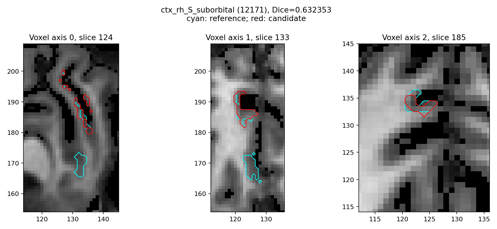

# FNIT_recon_all

> 统一 Python 入口：[`FNIT_recon_all`](../API_REFERENCE.md)，从 `fnit` 导入。下文配置、结果类型和细分算子保留高级兼容接口。

**2026-10-07现存GPU验证**：冻结3a的原始T1执行和生产网格通过9/10，完整官方比较9/10，十例输出各138项齐全。九例FNIT入口中位数2669.520秒、原官方5839.091秒；本次只收集已有结果，不宣称新的受控提速。68区厚度MAE0.0134–0.0397mm，自身同期采样峰6.143–13.571GB；sub-10206左侧自相交仍失败，严格复现与整体指标等效分别未通过/未判定。见[九例完整指标、耗时和局部问题](../../validation/recon_all/accuracy_20261003/runtime/server_refresh_20261007/README.md)及[版本绑定](PRECISION_CANDIDATE_BENCHMARK_20261004.md)。以下CPU与历史GPU记录继续保留原版本。

当前独立Python候选的[2026-10-11合并、真实阶段回归、失败项和最终安装结果](INTEGRATION_RESULTS_20261011.md)单独记录；旧版本证据继续绑定其原源码。[公开源码与实测版本的对应关系](PUBLICATION_SNAPSHOT_20261011.md)说明报告派生哈希和安装源码核对范围。

第二轮候选选项见[接线与验收边界](ROUND2_INTEGRATION.md)、[持久双半球调度](PERSISTENT_HEMISPHERE_PIPELINE.md)和[Triton 编译器选择](TRITON_RUNTIME.md)；[f016 两例部分整例记录](../../validation/recon_all/optimizations/20261014_accelerator-a-1_f016_partial/README.md)单列旧版结果。[cbaffa 两例原始 T1 整例与完成的 v2 事后评估](../../validation/recon_all/optimizations/20261016_accelerator-a-1_cbaffa_two_case/README.md)分别记录执行、138 项输出、网格质量和数值诊断，整体指标等效与同环境提速尚未判定。

本轮按用户要求显式选用[Conda 独立编译表面加速配方](NATIVE_TOPOLOGY_FINISH.md)，切换拓扑 GA、preclean/remesh/postclean 及已有原生 white/pial 路径，同时保留自有 GPU 指标与其他已优化阶段。[阶段回归与整例测评](../../validation/recon_all/optimizations/20261016_native_surface_hotspots/README.md)绑定冻结科学源码 `93affde8`；两例原始 T1 空目录整例与事后评估均已完成，病例外层墙钟为 2,218.68／2,010.32 秒，138 项输出和生产基本网格门通过。严格复现为 14／138、23／138，局部误差及自有显存归属仍需单列，整体指标等效未判定。

[返回首页](../../README.md) · [完整旧文档与更早证据](../../validation/recon_all/readme_archive_20261005.md)

| 项目 | 内容 |
|---|---|
| 输入 | 原始单幅3D T1w、校验权重/图谱；native对照另需个人许可证 |
| 输出 | 138项体积/表面/顶点图/标注/统计及JSON |
| 对应原软件 | FreeSurfer8.2 recon-all单T1默认路径 |
| Python / CLI | fnit.recon_all.native_free.run_recon_all_python；fnit-recon-all |
| CPU / GPU | `backend="python"`为完整独立候选，结合PyTorch GPU、Python/Numba CPU及SimpleITK；默认`native`保留混合对照，严格`python-gpu`尚未开放 |

<a id="流程策略"></a>


当前十分钟目标的热点和五个优化任务见 [2026-10-07 性能热点与任务](HOTSPOT_ACCELERATION_20261007.md)。
当前纯 Python GPU 迁移矩阵和阻断项见 [2026-10-08 迁移状态](PYTHON_GPU_STATUS_20261008.md)。
2026-10-10起以脱离原版阶段程序为目标，允许Python/Numba等CPU计算；`backend="python"`完整独立候选、阶段误差和原始整例结果见[自有Python流程](PYTHON_SURFACE_PIPELINE.md)。数字拓扑与原GA不同，整体指标等效未判定。显式 `topology_backend="python-ga"` 复用[安装包内的完整自有 GA](PYTHON_GENETIC_PROFILE.md)；cbaffa 两例已完成执行、138 项输出和生产网格门，严格逐文件复现未通过，整体指标等效未判定，见[现版整例报告](../../validation/recon_all/optimizations/20261016_accelerator-a-1_cbaffa_two_case/README.md)。
2026-10-10 的独立Python v4两例已退出并失败，当时球面配准和pial相交质量未通过；[该版最终整例收据](../../validation/recon_all/optimizations/20261010_python_profile/README.md)与后续阶段优化分开。
2026-10-11的完整GA有序扫描已接入自有Numba并通过同输入回归，本地与服务器的[该版 wheel 安装](../../validation/recon_all/optimizations/20261011_python_ga_blocker_route/README.md)核对十二模块及依赖；[该版原始T1前段](../../validation/recon_all/optimizations/20261011_python_ga_volume_prefix/README.md)对旧Python前段无新增数组或几何误差。该安装产物的整例、最终质量与整体等效当时尚未验证；后续 cbaffa 源码整例单独报告。

新版有序扫描配方已完成[原始 T1 自产前段回归](../../validation/recon_all/optimizations/20261011_python_ga_raw_v3_prefix/README.md)：新旧 14 张 MRI 的数组、几何、dtype 和 LTA 全同，MRI 文件 SHA 为 8/14 相同；对应旧v2/v3整例已退出并失败，各28/138输出，详见[现场退出核查](../../validation/recon_all/optimizations/20261011_current_whole_preparation/README.md)；尚无本轮最终安装包的完整提速、表面质量或整体等效结论。
后续[查询边向量复用](TOPOLOGY_BLOCKER_QUERY_REUSE.md)通过完整首缺陷、第四候选及直接库入口回归；首缺陷冷CLI观察为1357.057→1217.854秒，短阶段冷启动变慢的结果也保留。该核尚未用于上述冻结整例，不能把阶段观察当作整例提速。
原拓扑算法的独立迁移已完成[候选几何](TOPOLOGY_CANDIDATE_GEOMETRY.md)、[校准先验](TOPOLOGY_DEFECT_CALIBRATION.md)、[候选评分](TOPOLOGY_PATCH_FITNESS.md)、[反馈统计](TOPOLOGY_CANDIDATE_STATISTICS.md)及[状态恢复](TOPOLOGY_CANDIDATE_STATE.md)的真实冻结阶段回归；[自产初始基底](TOPOLOGY_GENETIC_BASE_PREPARE.md)的完整坐标、有序面与K1/K2已通过同输入对照。各报告保留实际版本和比较范围。
[连续候选状态](TOPOLOGY_CANDIDATE_CYCLE.md)、[全局先验](TOPOLOGY_GLOBAL_PRIORS.md)和[最终缺陷写回](TOPOLOGY_GA_FINALIZE.md)保留各自冻结阶段回归；[自产首缺陷完整搜索](TOPOLOGY_GENETIC_SEARCH.md)已完成29轮（轨迹索引0–28）/495次搜索评分及1次最终评分，首候选9组逐位一致，冷子CLI2502.916秒。当时全部9缺陷的[自有premesh控制器](TOPOLOGY_GENETIC_REPAIR.md)继续运行，成功后自动进入[标准remesh与最终orig验证](TOPOLOGY_GENETIC_ORIG.md)；后续原始T1整例见 cbaffa 报告。该阶段完整源赢家及整体指标等效尚未判定，不改生产默认。
2026-10-11的同输入阶段改进见[相交候选过滤](SOURCE_INTERSECTION_CANDIDATE_FILTER.md)与[同候选邻接复用](TOPOLOGY_CANDIDATE_INCIDENT_REUSE.md)：完整清理API缩短41.23%，候选/写回阶段CLI缩短10.58%，输出保持；不能相加或视为整例收益。WM完整路径搜索已接入[CPU及Torch混合入口](WM_REMOVE_PATHS.md)，两例解码体素与固定源参考一致，活跃路径的真实数据覆盖仍有限。最终orig的完成检查也已补修，详见上述功能页。
该阶段记录写成时，完整自产 GA/orig 与原生参考的[全网格比较](GENETIC_MESH_COMPARISON.md)已排队，等待自产完成门；不同网格只报告双向点到三角面距离。[pial 终态诊断](PIAL_RESIDUAL_CLEANUP_DIAGNOSTIC.md)确认同输入两次原生参考与自有结果坐标一致，但均保留32个相交面，网格质量仍失败。
面发现的[不可变保留面索引复用](TOPOLOGY_FACE_DETECTION_CACHE.md)通过同输入完整阶段ABBA，162项状态与控制不变，CLI中位数76.883→72.862秒（本组缩短5.23%）。后续[完整默认首缺陷搜索](TOPOLOGY_GENETIC_FACE_CACHE.md)的全部496评分、29轮、随机流、80字段和三份检查点相同；CLI2263.423→1329.629秒是跨时段观察，不是受控整例提速，该阶段当时未验证全部九缺陷。状态缓存的短阶段冷CLI曾变慢，[默认保持关闭](TOPOLOGY_CANDIDATE_STATE_CACHE.md)；后续[完整首缺陷状态缓存](TOPOLOGY_GENETIC_STATE_CACHE.md)保留输出一致及暖评分略慢的结果，跨时段总耗时另报。原生参考的[同输入重复与控制诊断](../../validation/recon_all/optimizations/20261011_topology_native_repeat/README.md)保留一处六位打印差异。
输入并行接线后的两例原始T1→filled已完成，14图及LTA无新增数值差，完整前段耗时方向不一致；保留串行默认，见[前段回归、耗时、显存与脑图](../../validation/recon_all/optimizations/20261010_input_n4_synthseg_prefix/README.md)。
完整SimpleITK Python N4、参数和两例同输入误差见 [N4独立Python库实现](N4_SIMPLEITK.md)；
完整固定N4 PyTorch实验及真实误差见 [本轮N4](N4_COMPLETE_TORCH_20261009.md)；
显式N4缓存隔离与原始输入链见 [N4输入链](INPUT_N4_CHAIN.md) 和 [阶段worker](N4_CACHED_WORKER.md)；
GCA局部缓存与CLI/API验证见 [GCA阶段隔离](GCA_ISOLATED_TORCH_20261009.md)；
GCA候选评分及新批量求逆见 [GCA说明](MRI_EM_TORCH_BACKEND.md)。
单独逐阶段接口的N4默认仍为native对照；`backend="python"`固定选择SimpleITK，不执行该原版程序。各版本的GCA与N4实测分别记录。

2026-10-09的阶段迁移见 [有序GPU法向](SURFACE_NORMALS_TORCH_20261009.md)、
[white/pial正则项](PYTORCH_PLACEMENT_REGULARIZATION.md)、
[WM/aseg编辑](WM_ASEG_TORCH.md)、[WM直方图](WM_HISTOGRAM_TORCH.md)及[完整缺陷投射](DEFECTS_TORCH.md)。
[固定主曲率的GPU衍生图](CURVATURE_DERIVATIVES_TORCH_20261009.md)单列算子精度，
不替代离散主曲率计算；新的[完整曲率统计](FULL_CURVATURE_STATS_PYTHON_20261010.md)
已完成两例双侧同输入八图及文本逐字节回归；整例接入另测。
[完整配准的当前几何复用](REGISTRATION_CURRENT_STATE_REUSE.md)保留相同算法与GPU平均器，
按完整同输入ABBA检验重复法向和弧距计算的移除；阶段收益与整例结果分开。
原始T1空目录配对采用[整例复现脚本](TORCH_INTEGRATION_20261009.md)。
容器 PID 与 GPU 显存归属的记录规则见[进程显存说明](GPU_PROCESS_MEMORY.md)。
局部内核收益与完整阶段、整例收益分别记录。cbaffa 两例的执行、输出和生产网格门已通过；严格逐文件复现未通过，整体指标等效仍未判定。
## 1. 功能简介

`fnit-recon-all`从一幅原始T1w生成体积分割、双侧white/pial表面、顶点指标、脑区标注与统计。标准单T1入口目前不支持多T1、T2/FLAIR或纵向重建。

`backend="python"`选择完整独立候选：SimpleITK N4、自有WM分割与CPU有序编辑、数字拓扑或显式自有GA、完整white/pial及后续球面、指标和统计。它允许Python/Numba CPU核，当前仍要求显式`cuda:N`和总线程至少2；不读取`native_bin_dir`或执行原版阶段程序。数字拓扑采用不同于FreeSurfer GA的算法；`topology_backend="python-ga"` 将完整有序GA文件接口接入相同配方，并在最终orig质量和SHA检查后发布。两条路径的严格复现和整体指标等效分别验收，整例验证见[自有Python流程](PYTHON_SURFACE_PIPELINE.md)，新接线见[完整GA配方](PYTHON_GENETIC_PROFILE.md)。

函数签名默认`backend="native"`保留既有混合对照，其中部分阶段使用固定FreeSurfer源码在Conda内构建的程序，需要核验程序和个人许可证。它不使用系统预装FreeSurfer。`python-gpu`是历史严格纯Python/CUDA配方，缺少必要替代时提前失败；与允许CPU计算的`python`配方不同。所有配方都检查必要步骤、真实输出和网格质量，缺依赖或阶段失败会报错。

CUDA默认TF32，SynthStrip/SynthSeg/辅助网络及Talairach/MNI相关阶段保留同输入验证的FP32例外，不启用FP16/BF16。CPU入口不改调用方CUDA策略。执行完成、输出完整性、网格质量和数值等价是分别记录的状态。


## 2. Python 调用

```python
from fnit.recon_all.native_free import run_recon_all_python

reconstruction_report = run_recon_all_python(
    t1="/data/sub01_T1w.nii.gz",  # 一幅原始 T1w NIfTI 的路径
    subject_dir="/data/subjects/sub01",  # 空的被试输出目录
    weights_dir="/data/fnit-weights",  # 已校验的模型权重目录
    assets_dir="/data/fnit-assets",  # 已校验的模板和图谱目录
    device="cuda:0",  # PyTorch 阶段的设备；无 GPU 时为 "cpu"
    threads=4,  # 当前被试计算预算；双半球并行时各2线程，报告线程设置与恢复
    hemisphere_workers=2,  # 显式启用左右侧独立进程；默认1，共享缺陷体积仍顺序累计
    native_optimizations="auto",  # auto在CUDA上启用FNIT CUDA候选评分；original为Conda GCA；torch强制启用候选评分
    n4_backend="native",  # 原生N4对照；simpleitk为完整Python库N4，torch实验误差单列
    n4_execution="in-process",  # isolated仅配torch/cuda:N，缓存子exec保持父策略
    input_execution="serial",  # parallel只在总4线程下并行完整N4/SynthSeg；默认串行
    normalization_controls_backend="cpu",  # torch复用两轮同规则GPU邻域；仅显式cuda:N
    normalization_initial_bias_backend="cpu",  # torch复用第二轮初始偏置GPU传播/平滑，保持原除乘精度
    inflate_backend="native",  # torch复用完整标准inflated/sulc；须cuda:N和两个半球worker
    sphere_finish_backend="cpu",  # torch复用完整dense GPU球面收尾；须cuda:N和两个隔离worker
    surface_placement_backend="native",  # 原放置对照；python复用完整preaparc/white/pial
    topology_backend="native",  # 原GA对照；python为完整数字拓扑候选，算法不同
    topology_finish_backend="python",  # 默认自有收尾；conda-cpp仅配backend/native及topology/native
    annotation_gibbs_backend="python",  # numba复用完整有序重分类；GPU几何/随机序列不变
    remesh_scalar_storage="numpy",  # python优化已有CPU remesh双精度存储；拆缩/平滑顺序不变
    mni_execution="in-process",  # parallel-late在末尾将完整MNI与CPU网格检查并行；总线程至少2
    wm_backend="native",  # torch启用FNIT PyTorch/CPU有序混合WM分割
    wm_execution="in-process",  # isolated仅配torch-optimized，子exec局部缓存、父策略保持
    defects_backend="native",  # torch启用完整PyTorch缺陷投射；标签相同，颜色表不同
    wm_edit_backend="native",  # python为完整Numba CPU编辑；torch-hybrid另用静态CUDA编辑
    sphere_normals_backend="numba",  # torch只迁移标准sphere法向；其余算法和finish保留
    gca_inverse_backend="cpu",  # torch显式复用相同公式的批量求逆；完整注册仍需回归
    gca_candidate_chunk=64,  # 完整候选的分块大小；较大块增加显存
    gca_execution="in-process",  # isolated以独立exec复用缓存，不改变父allocator/精度
    fill_backend="python",  # numba为有序CPU堆；torch-numba另把初始边界放到GPU
    backend="native",  # 历史混合对照；执行/网格通过不代表整体指标等效
    native_bin_dir=None,  # native对照使用当前Conda bin；Python配方不读取此项
    profile_stages=False,  # 生产默认不增加阶段 CUDA 同步；True 记录同步等待
    cuda_allocator_cache="auto",  # 首次 CUDA 默认关闭缓存；已初始化 API 保留实际策略
)
# reconstruction_report 是运行报告字典；仅在全部阶段与文件完整性检查通过后返回。
```

完整独立候选的具名调用如下。`backend="python"`固定选择下面列出的后端及双侧worker；不以逐阶段混合默认回退到原版程序。

```python
python_reconstruction_report = run_recon_all_python(
    t1="/data/sub01_T1w.nii.gz",  # 同一幅原始3D T1w
    subject_dir="/data/subjects/sub01-python",  # 新的空输出目录
    weights_dir="/data/fnit-weights",  # 已校验模型权重，遵守资源许可
    assets_dir="/data/fnit-assets",  # 已校验模板/图谱，遵守资源许可
    device="cuda:0",  # 当前独立配方要求明确CUDA编号；有序CPU核仍保留
    threads=4,  # 总CPU预算，至少2；固定双侧worker平分
    backend="python",  # 完整独立候选；严格复现和整体指标等效另行评估
    n4_backend="simpleitk",  # 固定完整N4 Python库，实际CPU计算
    n4_execution="in-process",  # SimpleITK不使用Torch缓存worker
    wm_edit_backend="python",  # 固定完整Numba CPU WM/aseg编辑
    surface_placement_backend="python",  # 固定完整preaparc/white/pial与自有指标
    topology_backend="python",  # 固定数字拓扑算法，不是原GA
    native_bin_dir=None,  # 此配方不读取该参数或发现原版阶段程序
)
```

### 输入数据格式

- `t1`：原始3D `(X,Y,Z)` T1w NIfTI路径，有限值、有效4×4 affine和体素间距，不要求输入orientation固定。无外部脑mask前提；入口生成1mm、256³conform网格。强度无固定物理单位。
- `subject_dir`：不存在或为空的单被试目录；不得与其他并行job目录嵌套或重叠。批量jobs每项只含t1与subject_dir。
- `weights_dir`及`assets_dir`：逐文件大小/SHA通过的外置目录；模型权重与图谱是不同资源，不可混用，均须遵守其许可。native对照的个人许可证通过FS_LICENSE提供，不复制到仓库或报告；SimpleITK N4本身不需要FreeSurfer许可证。
- `native_bin_dir`：native对照使用当前激活Conda bin或已核验的固定源码构建目录；`backend="python"`不读取该参数，也不查找这些程序。原生对照的构建、安装和许可说明见[安装页](CONDA_CPP_BUILD.md)。

### 单被试公开入口

| 参数 | 必需 | 类型 | 默认值 | 含义 |
|---|---|---|---|---|
| `t1` | 是 | `str 或 Path` | `—` | 一幅原始 3D T1w；格式见输入数据格式 |
| `subject_dir` | 是 | `str 或 Path` | `—` | 不存在或为空的单被试重建输出目录 |
| `weights_dir` | 是 | `str 或 Path` | `—` | 已通过大小与 SHA-256 校验的模型权重目录 |
| `assets_dir` | 是 | `str 或 Path` | `—` | 已校验的模板和图谱目录 |
| `device` | 否 | `str` | `'cuda:0'` | native对照可用cpu/cuda:N；python配方要求显式cuda:N，编号遵循CUDA_VISIBLE_DEVICES |
| `threads` | 否 | `int 或 None` | `4` | 正整数CPU线程预算；具体每阶段并行度及恢复见输入说明 |
| `native_bin_dir` | 否 | `str 或 Path 或 None` | `None` | native对照默认当前Conda bin，可指定核验目录；backend=python不读取 |
| `profile_stages` | 否 | `bool` | `False` | 记录阶段 CUDA 同步等待；生产默认不增加同步 |
| `cuda_allocator_cache` | 否 | `str` | `'auto'` | auto、enabled 或 disabled；首次 CUDA 前选择，auto 保留已初始化 API 策略 |
| `hemisphere_workers` | 否 | `int` | `1` | native对照1串行或2独立进程；python配方固定2，总threads至少2并平分 |
| `native_optimizations` | 否 | `str` | `'auto'` | auto在CUDA上使用FNIT CUDA候选评分；original为Conda GCA；torch强制启用候选评分，EM仍为Python FP32 |
| `n4_backend` | 否 | `str` | 'native' | native为原程序对照；simpleitk为完整CPU Python库N4；torch为完整Torch实验。python配方固定simpleitk，误差分别记录 |
| `n4_execution` | 否 | `str` | 'in-process' | isolated仅Torch/cuda:N的缓存子exec；SimpleITK及python配方使用in-process，非法组合提前报错 |
| `input_execution` | 否 | `str` | `'serial'` | parallel以N4 CPU1/SynthSeg GPU+CPU3的独立exec并行；总threads须4、SimpleITK/in-process和显式cuda:N，join后继续自产nu→filled，不重复分割；详见[完整并行组](INPUT_N4_SYNTHSEG_PARALLEL.md) |
| `normalization_controls_backend` | 否 | `str` | `'cpu'` | torch复用两轮的GPU邻域计数/求和与缓冲；显式cuda:N，有序选择/其余偏置步骤不变；python配方固定torch。 |
| `normalization_initial_bias_backend` | 否 | `str` | `'cpu'` | torch只迁移第二轮初始偏置传播/平滑；距离/排序仍CPU，原float64除后乘/float32输出保持，显式cuda:N；python配方固定torch。 |
| `inflate_backend` | 否 | `str` | `'native'` | torch复用完整标准inflated/sulc；须cuda:N与hemisphere_workers=2，仅surface子exec局部启用缓存；nofix和后续球面算法保持 |
| `surface_placement_backend` | 否 | `str` | `'native'` | native为原放置对照；python复用完整四轮preaparc/white/pial及自有指标，允许有序CPU核。python配方固定python |
| `topology_backend` | 否 | `str` | `'native'` | native为原GA对照；python为完整数字拓扑；python-ga为完整自有有序GA。python配方默认数字python并保留显式python-ga；真实缺陷标签编号域分别检查，整体等效未判定 |
| `topology_finish_backend` | 否 | `str` | `'python'` | python保留自有remesh/相交清理；conda-cpp显式使用Conda自编译preclean→三轮remesh→postclean，仅允许backend=native且topology_backend=native；结构与双谓词零相交门通过后发布orig。详见[原生表面配方](NATIVE_TOPOLOGY_FINISH.md) |
| `sphere_finish_backend` | 否 | `str` | `'cpu'` | torch复用完整dense GPU标准sphere收尾，全部设备须cuda:N与hemisphere_workers=2，surface子exec局部缓存；原负面标记/SOAP/全投影/停止保持，不选择实验marked；python配方固定torch。 |
| `remesh_scalar_storage` | 否 | `str` | 'numpy' | python复用已有CPU完整remesh的双精度标量存储；拆缩/堆/平滑保持同序，首次JIT与I/O计入 |
| `annotation_gibbs_backend` | 否 | `str` | `'python'` | numba复用完整有序Gibbs重分类；共用GPU几何缓存，保持随机序列、标签/坐标及总线程，首次JIT/打包计入阶段 |
| `mni_execution` | 否 | `str` | `'in-process'` | parallel-late须cuda:N及整数threads≥2，caller autocast关闭；全部半球写出后，完整MNI与CPU网格检查分配同一线程预算并行，join后检查输出；返回完整mni_mesh_parallel报告；python配方固定parallel-late。 |
| `wm_backend` | 否 | `str` | `'native'` | native调用Conda mri_segment；torch为已有混合分割，torch-optimized另复用Torch直方图和缓存平面几何 |
| `wm_execution` | 否 | `str` | `'in-process'` | isolated只允许torch-optimized，在新exec启用缓存，返回完整阶段报告；父CUDA/TF32保持 |
| `defects_backend` | 否 | `str` | `'native'` | torch使用完整缺陷投射；保持双侧顺序/标签，采用确定性颜色 |
| `wm_edit_backend` | 否 | `str` | `'native'` | native为原编辑对照；python为完整Numba CPU编辑；torch-hybrid为CUDA静态编辑加有序CPU核心。python配方固定python，输入证明失败报错 |
| `sphere_normals_backend` | 否 | `str` | `'numba'` | torch迁移标准sphere法向；要求CUDA，完整优化与CPU finish保持 |
| `gca_inverse_backend` | 否 | `str` | `'cpu'` | torch批量求逆；非默认设置仅允许CUDA的Torch GCA；python配方固定torch。 |
| `gca_candidate_chunk` | 否 | `int` | `64` | 正整数完整候选分块，不删候选；非默认仅用于CUDA Torch GCA；python配方固定1024。 |
| `gca_execution` | 否 | `str` | `'in-process'` | isolated为新exec中的局部CUDA缓存，父策略保持；仅Torch GCA；python配方固定isolated。 |
| `fill_backend` | 否 | `str` | `'python'` | numba为有序CPU堆；torch-numba另用CUDA初始边界，要求CUDA |
| `backend` | 否 | `str` | `'native'` | native保留混合对照；python为完整独立固定配方，允许CPU核/数字拓扑，要求cuda:N与threads至少2，整体等效未判定；python-gpu缺阶段提前失败 |

### 批量公开入口

| 参数 | 必需 | 类型 | 默认值 | 含义 |
|---|---|---|---|---|
| `jobs` | 是 | `list[dict]` | `—` | 顺序job列表，每项仅含t1路径和subject_dir空目录；目录不得重叠 |
| `weights_dir` | 是 | `str 或 Path` | `—` | 已通过大小与 SHA-256 校验的模型权重目录 |
| `assets_dir` | 是 | `str 或 Path` | `—` | 已校验的模板和图谱目录 |
| `devices` | 否 | `tuple[str, ...]` | `('cuda:0',)` | 互不重复的设备tuple，每设备一次一例；native对照可cpu/cuda:N，python配方全部须显式cuda:N |
| `threads` | 否 | `int 或 None` | `4` | 正整数CPU线程预算；具体每阶段并行度及恢复见输入说明 |
| `native_bin_dir` | 否 | `str 或 Path 或 None` | `None` | native对照默认当前Conda bin，可指定核验目录；backend=python不读取 |
| `profile_stages` | 否 | `bool` | `False` | 记录阶段 CUDA 同步等待；生产默认不增加同步 |
| `cuda_allocator_cache` | 否 | `str` | `'auto'` | auto、enabled 或 disabled；首次 CUDA 前选择，auto 保留已初始化 API 策略 |
| `hemisphere_workers` | 否 | `int` | `1` | native对照1串行或2独立进程；python配方固定2，总threads至少2并平分 |
| `native_optimizations` | 否 | `str` | `'auto'` | auto在CUDA上使用FNIT CUDA候选评分；original为Conda GCA；torch强制启用候选评分，EM仍为Python FP32 |
| `n4_backend` | 否 | `str` | 'native' | native为原程序对照；simpleitk为完整CPU Python库N4；torch为完整Torch实验。python配方固定simpleitk，误差分别记录 |
| `n4_execution` | 否 | `str` | 'in-process' | isolated仅Torch/cuda:N的缓存子exec；SimpleITK及python配方使用in-process，非法组合提前报错 |
| `input_execution` | 否 | `str` | `'serial'` | parallel以N4 CPU1/SynthSeg GPU+CPU3的独立exec并行；总threads须4、SimpleITK/in-process和显式cuda:N，join后继续自产nu→filled，不重复分割；详见[完整并行组](INPUT_N4_SYNTHSEG_PARALLEL.md) |
| `normalization_controls_backend` | 否 | `str` | `'cpu'` | torch复用两轮同规则GPU邻域；所有目标设备须为cuda:N，非法组合调度前拒绝；python配方固定torch。 |
| `normalization_initial_bias_backend` | 否 | `str` | `'cpu'` | torch复用第二轮初始偏置GPU算子，所有目标设备须为cuda:N，非法组合调度前拒绝；python配方固定torch。 |
| `inflate_backend` | 否 | `str` | `'native'` | torch使用完整标准inflated/sulc GPU算法；所有设备须cuda:N且hemisphere_workers=2，非法组合调度前拒绝 |
| `surface_placement_backend` | 否 | `str` | `'native'` | native为原放置对照；python复用完整四轮preaparc/white/pial及自有指标，允许有序CPU核。python配方固定python |
| `topology_backend` | 否 | `str` | `'native'` | native为原GA对照；python为完整数字拓扑；python-ga为完整自有有序GA。python配方默认数字python并保留显式python-ga；真实缺陷标签编号域分别检查，整体等效未判定 |
| `topology_finish_backend` | 否 | `str` | `'python'` | python保留自有remesh/相交清理；conda-cpp显式使用Conda自编译preclean→三轮remesh→postclean，仅允许backend=native且topology_backend=native；结构与双谓词零相交门通过后发布orig。详见[原生表面配方](NATIVE_TOPOLOGY_FINISH.md) |
| `sphere_finish_backend` | 否 | `str` | `'cpu'` | torch复用完整dense GPU标准sphere收尾，全部设备须cuda:N与hemisphere_workers=2，surface子exec局部缓存；原负面标记/SOAP/全投影/停止保持，不选择实验marked；python配方固定torch。 |
| `remesh_scalar_storage` | 否 | `str` | 'numpy' | python使用既有完整CPU remesh双精度标量存储，保持有序拆缩；python配方固定python |
| `annotation_gibbs_backend` | 否 | `str` | `'python'` | numba为完整有序Gibbs核，GPU特征/随机序列保持；python配方固定numba |
| `mni_execution` | 否 | `str` | `'in-process'` | parallel-late须cuda:N及整数threads≥2，caller autocast关闭；全部半球写出后，完整MNI与CPU网格检查分配同一线程预算并行，join后检查输出；返回完整mni_mesh_parallel报告；python配方固定parallel-late。 |
| `wm_backend` | 否 | `str` | `'native'` | native调用Conda mri_segment；torch为已有混合分割，torch-optimized另复用Torch直方图和缓存平面几何 |
| `wm_execution` | 否 | `str` | `'in-process'` | isolated只允许torch-optimized，在新exec启用缓存，返回完整阶段报告；父CUDA/TF32保持 |
| `wm_edit_backend` | 否 | `str` | `'native'` | native为原编辑对照；python为完整Numba CPU编辑；torch-hybrid为CUDA静态编辑加有序CPU核心。python配方固定python，输入证明失败报错 |
| `defects_backend` | 否 | `str` | `'native'` | torch完整缺陷投射；半球共享输出仍按左、右顺序 |
| `sphere_normals_backend` | 否 | `str` | `'numba'` | torch仅迁移标准球面法向，要求CUDA |
| `gca_inverse_backend` | 否 | `str` | `'cpu'` | torch批量求逆；非默认设置仅允许CUDA的Torch GCA；python配方固定torch。 |
| `gca_candidate_chunk` | 否 | `int` | `64` | 正整数完整候选分块，不删候选；非默认仅用于CUDA Torch GCA；python配方固定1024。 |
| `gca_execution` | 否 | `str` | `'in-process'` | isolated为新exec中的局部CUDA缓存，父策略保持；仅Torch GCA；python配方固定isolated。 |
| `fill_backend` | 否 | `str` | `'python'` | numba为有序CPU堆；torch-numba另用CUDA初始边界，要求CUDA |
| `backend` | 否 | `str` | `'native'` | native保留混合对照；python为完整独立固定配方，允许CPU核/数字拓扑，要求cuda:N与threads至少2，整体等效未判定；python-gpu缺阶段提前失败 |

`backend="python"`会覆盖配方内的逐阶段选项：`native_optimizations="torch"`、`n4_backend="simpleitk"`、`n4_execution="in-process"`、`wm_backend="torch-optimized"`、`gca_execution="isolated"`、`gca_inverse_backend="torch"`、`gca_candidate_chunk=1024`、`normalization_controls_backend="torch"`、`normalization_initial_bias_backend="torch"`、`sphere_finish_backend="torch"`、`mni_execution="parallel-late"`、`wm_execution="isolated"`、`wm_edit_backend="python"`、`defects_backend="torch"`、`inflate_backend="torch"`、`surface_placement_backend="python"`、`topology_backend="python"`、`annotation_gibbs_backend="numba"`、`remesh_scalar_storage="python"`、`fill_backend="numba"`、`hemisphere_workers=2`。两张表的默认列描述接口签名；其余选项按调用值保留并校验，实际后端写入运行报告。当前配方与已冻结整例结果分别按实际版本记录。

### 输出

```text
subjects/sub01/
├── mri/                 # conform MGZ、分割与辅助图谱网格NIfTI
│   └── transforms/      # Talairach、MNI LTA/非线性变换
├── surf/                # lh/rh white、pial、sphere.reg及顶点指标
├── label/               # lh/rh *.annot及label
├── stats/               # aseg/wmparc及左右皮层*.stats
└── fnit-native-free-run.json
```

### 主要输出路径

```text
subjects/sub01/
├── mri/
│   ├── orig.mgz / rawavg.mgz / T1.mgz
│   ├── synthstrip.mgz / brainmask.mgz / nu.mgz / norm.mgz
│   ├── aseg.mgz / wmparc.mgz / ribbon.mgz
│   ├── aparc+aseg.mgz / aparc.a2009s+aseg.mgz
│   ├── aparc.DKTatlas+aseg.mgz
│   └── transforms/synthmorph.1.0mm.1.0mm/
│       ├── test.nii.gz
│       ├── warp.to.mni152.1.0mm.1.0mm.nii.gz
│       └── warp.to.mni152.1.0mm.1.0mm.inv.nii.gz
├── surf/
│   ├── lh.white / lh.pial / lh.sphere.reg
│   ├── rh.white / rh.pial / rh.sphere.reg
│   └── lh/rh.thickness / area / area.pial / volume / curv / sulc
├── label/
│   └── lh/rh.aparc.annot / aparc.a2009s.annot / aparc.DKTatlas.annot
├── stats/
│   ├── aseg.stats / wmparc.stats / brainvol.stats
│   ├── lh/rh.aparc.stats / aparc.a2009s.stats / aparc.DKTatlas.stats
│   └── synthseg.vol.csv / synthseg.tiv.dat
└── fnit-native-free-run.json
```

`lh/rh`在上图表示左右各一份文件。固定138项输出包含多个辅助体积和顶点曲率，不等于上述简略树的文件数；以固定清单和`output_validation`为准。体积标签编号保留FreeSurfer编码，颜色/名称采用对应资源LUT。

| 路径 | 内容与结构 |
| --- | --- |
| `mri/*.mgz`、`mri/transforms/*` | 体积分割、强度图和配准变换；重建体积主要为 conform 网格，rawavg及原始输入存档可保留原始网格；MNI辅助NIfTI为图谱网格。 |
| `surf/H.white`、`H.pial`、`H.sphere.reg` | 双侧有序三角网格；`H` 为 `lh` 或 `rh`。 |
| `surf/H.thickness`、`H.area`、`H.volume`、`H.curv` 等 | 每顶点标量，顺序与同侧表面一致；厚度与几何位置单位为 mm，面积为 mm²，体积为 mm³。 |
| `label/H.*.annot` | 每顶点脑区编码及颜色表。 |
| `stats/*.stats` | 体积和皮层分区统计。 |

体积图按各自用途保存：conform强度图常为MGH uint8/float32，分割为整数标签；rawavg和mri/orig/001.mgz需读取自身几何；完整138相对路径见[固定清单](../../src/fnit/recon_all/expected_outputs.py)。部分MNI辅助NIfTI在图谱网格，不能与原生/conform图直接按数组重叠。LTA需保留source/target几何；表面为surface-RAS毫米坐标，有序顶点与三角面；指标及annot必须与同侧顶点顺序一致。

返回字典记录outputs路径、output_validation、mesh_validation、numeric_validation、stages和total_seconds。status=complete只表示流程、存在性和生产网格检查通过，数值参考默认not_run。失败抛异常并尽可能写JSON；前置校验失败可能没有报告。阶段时间含内部子步骤，不应重复相加。

### 运行报告字段

| 字段 | 类型 / 单位 | 含义 |
|---|---|---|
| `outputs` | `dict[str,str]` | 138清单中存在的相对名到实际文件路径 |
| `output_validation` | `dict` | expected、present、missing和完整性状态 |
| `mesh_validation` | `dict` | 生产表面质量检查，与数值参考比较分开记录 |
| `numeric_validation` | `dict` | 默认not_run，需要独立参考比较才能判定 |
| `stages` | `list[dict]` | 阶段名称、秒数及阶段报告；父子范围可嵌套 |
| `total_seconds` | `float`，s | 公开API含校验、线程设置/恢复、加载、计算、传输和输出写出 |
| `timing` | `dict`，s | 内部pipeline及wrapper剩余开销；最终公开元数据写出不在API计时内 |
| `precision` | `dict` | 实际CUDA策略、调用方autocast和FP32局部例外 |
| `thread_budget` | `dict` | 当前预算、原值及恢复结果 |
| `n4_configuration` / `n4_runtime` | `dict` | 实际N4后端/执行策略、完整迭代；isolated另含输入输出/源码SHA、父状态、子allocated/reserved；不等于父子同期峰 |
| `normalization_configuration` | `dict` | 两轮控制点邻域后端、请求设备、原有序规则及未迁移步骤；完整子步骤耗时见stages，不把阶段提速相加为整例提速 |
| `hemisphere_scheduling` | `dict` | worker数、总线程预算及各并行组wall |
| `native_optimizations` | `dict` | 选择的原生程序、能力与实现归属 |

`profile_stages=True`增加观察所需同步，不能将该次阶段秒数直接当作默认生产路径耗时。错误时先查看`failed_stage`与`error`；输入前置校验失败可能不创建新报告，不以此前目录中的JSON代表本次运行。

### 多被试入口示例

```python
from fnit.recon_all.batch import run_recon_all_python_batch

reconstruction_jobs = [  # 每项只包含输入和空输出目录
    {"t1": "/data/sub01_T1w.nii.gz", "subject_dir": "/data/subjects/sub01"},
    {"t1": "/data/sub02_T1w.nii.gz", "subject_dir": "/data/subjects/sub02"},
]
reconstruction_reports = run_recon_all_python_batch(
    jobs=reconstruction_jobs,  # 按此顺序返回报告
    weights_dir="/data/fnit-weights",  # 全部已校验权重
    assets_dir="/data/fnit-assets",  # 全部已校验标准资产
    devices=("cuda:0",),  # 每设备一次一例，当前一张GPU顺序处理
    threads=4,  # 每被试总CPU预算
    hemisphere_workers=2,  # 每侧分得2线程，需要总预算至少2
    native_optimizations="auto",  # CUDA上用FNIT GCA候选评分；CPU按已验证能力选择
    backend="native",  # 既有混合对照；完整独立候选改为python，配方固定后端
    normalization_controls_backend="cpu",  # torch仅显式cuda:N；保留原控制点选择与偏置规则
    normalization_initial_bias_backend="cpu",  # torch复用第二轮初始偏置；保留原float64除乘与float32输出
    n4_backend="native",  # 原生N4对照；独立Python配方固定SimpleITK
    n4_execution="in-process",  # SimpleITK保持in-process，isolated仅用于Torch N4
    inflate_backend="native",  # torch仅支持显式CUDA和两个半球worker，标准表面输出同序
    surface_placement_backend="native",  # 原放置对照；python复用完整四轮white/pial
    topology_backend="native",  # 原GA对照；python使用完整数字拓扑，非GA复现
    topology_finish_backend="python",  # 默认自有收尾；conda-cpp仅配backend/native及topology/native
    sphere_finish_backend="cpu",  # torch在表面子exec复用完整GPU收尾；父精度和缓存保持
    annotation_gibbs_backend="python",  # numba原样传给每例CLI，有序反馈不改标签
    remesh_scalar_storage="numpy",  # python原样传入，每侧完整remesh保持原有堆顺序
    mni_execution="in-process",  # parallel-late要求全部cuda:N；完整MNI与末尾网格检查并行
    wm_edit_backend="native",  # python为完整CPU有序编辑；torch-hybrid另迁移静态GPU规则
    defects_backend="native",  # torch保持完整缺陷标签投射；不等于拓扑GA
    sphere_normals_backend="numba",  # torch仅替换标准sphere法向
)
```

完整独立候选可复用上面的job结构，但必须指定新的空输出目录：

```python
python_reconstruction_reports = run_recon_all_python_batch(
    jobs=[  # 两例独立的新输出目录，不能复用已运行的目录
        {"t1": "/data/sub01_T1w.nii.gz", "subject_dir": "/data/subjects/sub01-python"},
        {"t1": "/data/sub02_T1w.nii.gz", "subject_dir": "/data/subjects/sub02-python"},
    ],
    weights_dir="/data/fnit-weights",  # 全部已校验权重
    assets_dir="/data/fnit-assets",  # 全部已校验模板/图谱
    devices=("cuda:0",),  # 每GPU一次一例；当前两例顺序运行
    threads=4,  # 每被试总预算，固定双侧worker各2线程
    backend="python",  # 每例使用上述完整独立固定配方
    native_bin_dir=None,  # 此配方不读取原版程序目录
)
```

批量调用使用独立子进程；完整重建的MNI后处理要求CUDA，设备建议使用显式`cuda:N`，独立Python配方必须如此。CPU设备在启动被试前报错，通用CPU子函数和独立参考验证仍可使用。设备数增多会增加同时运行被试数和总内存/CPU需求。输出目录不得相同、互相嵌套，或与已有运行重叠。

批量入口按jobs顺序返回报告列表；每设备一个独立子进程，每job threads预算，失败汇总抛RuntimeError。示例默认单例；批量的设备数增加时总CPU预算也增加。

## 3. 命令行调用

```bash
export FS_LICENSE=/private/license.txt
fnit-recon-all subject_T1w.nii.gz subjects/sub01 \
  --weights-dir /data/fnit-weights --assets-dir /data/fnit-assets \
  --device cuda:0 --threads 4 --hemisphere-workers 2 --backend native
```

完整独立候选使用同一入口；固定配方自动选择SimpleITK、CPU WM编辑、完整自有放置和数字拓扑，不传原版程序目录：

```bash
fnit-recon-all subject_T1w.nii.gz subjects/sub01-python \
  --weights-dir /data/fnit-weights --assets-dir /data/fnit-assets \
  --device cuda:0 --threads 4 --backend python
```

### fnit-recon-all

| CLI 参数 | Python 参数 / 输出 | 含义 |
|---|---|---|
| `t1` | `t1` | 一幅原始 3D T1w；格式见输入数据格式 |
| `subject_dir` | `subject_dir` | 不存在或为空的单被试重建输出目录 |
| `--weights-dir` | `weights_dir` | 已通过大小与 SHA-256 校验的模型权重目录 |
| `--assets-dir` | `assets_dir` | 已校验的模板和图谱目录 |
| `--device` | `device` | 完整重建使用CUDA，建议显式cuda:N；独立Python配方必须显式指定；编号遵循CUDA_VISIBLE_DEVICES |
| `--threads` | `threads` | 正整数CPU线程预算，默认4；双侧并行平分此预算 |
| `--native-bin-dir` | `native_bin_dir` | native对照使用当前Conda bin或核验目录；backend=python不读取 |
| `--hemisphere-workers` | `hemisphere_workers` | 1串行；2以独立进程运行左右半球，总线程预算平分 |
| `--native-optimizations` | `native_optimizations` | auto在CUDA上使用FNIT CUDA候选评分；original为Conda GCA；torch强制启用候选评分 |
| `--n4-backend` | `n4_backend` | native为混合入口的原程序对照；backend=python仅将该历史缺省映射为simpleitk，显式torch保留；两种Python N4均完整执行，误差另报 |
| `--n4-execution` | `n4_execution` | 默认in-process；isolated仅Torch/cuda:N，独立Python配方保留显式选择；SimpleITK/isolated提前报错，见[N4后端选择](PYTHON_PROFILE_N4_SELECTION.md) |
| `--input-execution` | `input_execution` | serial默认；parallel并行完整N4/SynthSeg，总4线程与明确cuda:N；仅支持SimpleITK/in-process，不改变拟合精度 |
| `--normalization-controls-backend` | `normalization_controls_backend` | cpu保留原邻域；torch复用两轮GPU缓冲，显式cuda:N，其余算法不变；python配方固定torch。 |
| `--normalization-initial-bias-backend` | `normalization_initial_bias_backend` | cpu保留第二轮初始偏置；torch复用GPU传播/平滑，保持算术顺序和精度，显式cuda:N；python配方固定torch。 |
| `--inflate-backend` | `inflate_backend` | 默认native；torch仅替换标准inflated/sulc，须cuda:N和两个半球worker，surface子exec局部启用缓存 |
| `--surface-placement-backend` | `surface_placement_backend` | native为原放置对照；python为完整自有四轮preaparc/white/pial及指标；python配方固定python |
| `--topology-backend` | `topology_backend` | native为原GA对照；python为完整数字拓扑；python-ga为完整自有有序GA，Python配方保留显式选择；整体等效未判定 |
| `--topology-finish-backend` | `topology_finish_backend` | 默认python；conda-cpp只允许backend=native、topology_backend=native，执行独立构建preclean/remesh3/postclean及严格orig发布门 |
| `--sphere-finish-backend` | `sphere_finish_backend` | 默认cpu；torch仅迁移既有完整dense标准sphere收尾，须cuda:N和两个缓存surface worker；注册收尾保持；python配方固定torch。 |
| `--remesh-scalar-storage` | `remesh_scalar_storage` | 默认numpy；python仅优化CPU完整remesh双精度存储，算法及三轮平滑不变 |
| `--annotation-gibbs-backend` | `annotation_gibbs_backend` | 默认python；numba复用完整有序重分类，三图谱共享原特征，首次JIT/打包/读写计入墙钟 |
| `--mni-execution` | `mni_execution` | 默认in-process；parallel-late在末尾并行完整MNI/CPU网格检查，明确cuda:N与至少2个总线程，join后检查138输出；python配方固定parallel-late。 |
| `--wm-backend` | `wm_backend` | native调用Conda mri_segment；torch为已有混合分割，torch-optimized另复用Torch直方图和缓存平面几何 |
| `--wm-execution` | `wm_execution` | in-process保留父缓存；isolated为完整WM缓存worker，须配torch-optimized |
| `--defects-backend` | `defects_backend` | native调用Conda mri_label2vol；torch使用完整PyTorch投射，不要求该原生程序 |
| `--wm-edit-backend` | `wm_edit_backend` | native为原编辑对照；python为完整Numba CPU编辑；torch-hybrid为CUDA静态编辑加有序CPU核心；python配方固定python |
| `--sphere-normals-backend` | `sphere_normals_backend` | numba保留已有标准sphere法向；torch用同设备有序Torch法向 |
| `--gca-inverse-backend` | `gca_inverse_backend` | cpu为原求逆，torch为同公式批量求逆；仅CUDA Torch GCA；python配方固定torch。 |
| `--gca-candidate-chunk` | `gca_candidate_chunk` | 完整候选的正整数分块；默认64；python配方固定1024。 |
| `--gca-execution` | `gca_execution` | in-process保留父缓存；isolated使用新exec局部缓存；python配方固定isolated。 |
| `--fill-backend` | `fill_backend` | python、numba、torch-numba；保留有序距离场和标签规则 |
| `--backend` | `backend` | native为混合对照；python为完整独立候选，允许CPU核/数字拓扑，整体等效未判定；python-gpu缺阶段提前失败 |
| `--profile-stages` | `profile_stages` | 记录阶段 CUDA 同步等待；生产默认不增加同步 |
| `--cuda-allocator-cache` | `cuda_allocator_cache` | auto、enabled 或 disabled；首次 CUDA 前选择，auto 保留已初始化 API 策略 |

CLI与Python接口默认均为backend=native、device=cuda:0、threads=4、hemisphere_workers=1；独立Python配方固定两个半球worker，最低总线程为2。

## 4. 原软件调用

以下命令用于独立原软件参考环境；FNIT生产入口不执行它。

```bash
recon-all -i subject_T1w.nii.gz -s sub01 -sd reference/subjects -all -openmp 4
```

| FNIT参数 / 产物 | 原软件参数 / 产物 |
|---|---|
| t1 / subject_dir | -i / -s配合-sd |
| threads | -openmp（相同预算，具体阶段并行度不同） |
| weights_dir / assets_dir | 原发行版models/average等；FNIT外置核验 |
| hemisphere_workers=2 | FNIT私有半球worker调度，无一对一同名原参数 |
| native_optimizations / profile_stages | FNIT程序能力选择 / 分步观察开关 |

原版命令只在独立参考环境运行；FNIT对应单T1默认路径，不覆盖原命令的所有flag。每阶段官方命令和native/PyTorch归属见[阶段页](CONDA_CPP_STAGES.md)，源码构建程序不因mri_*名称被省略，现阶段实现边界已在功能简介明确。

<a id="运行"></a>
<a id="验证与边界"></a>

## 5. 最新精度和运行时间

**2026-10-16 cbaffa 两例原始 T1／空目录整例**均退出 0，138/138 输出与生产网格门通过；完整外层墙钟为 **19,448.046／12,094.283 秒**。严格逐文件诊断为 **14/138、23/138**，整体指标等效、受控退化和同环境提速均未判定；FNIT 自身显存峰值因进程归属未解析，不能据整卡采样判定 20 GB 预算。两例完成的 v2 事后评估包含分区 Dice、双向表面距离、脑区误差、局部异常和扩展网格检查，见[cbaffa 两例报告](../../validation/recon_all/optimizations/20261016_accelerator-a-1_cbaffa_two_case/README.md)。

2026-10-10 的完整自产配对及实际官方评分冻结为 **79a41cdd**：复用完整有序Numba Gibbs与CPU remesh双精度标量存储后，两例从原始T1/空目录连续完成，CLI **2718.390/2653.001秒**，完整harness **2737.822/2672.439秒**。相对同机同线程e34，本组慢28.0508%/29.0136%，没有整例提速；注释组缩短17.675/13.171秒，多个未改算法阶段也变慢，因果原因尚未隔离。138输出、生产网格、16张同序表面、七分割及68区统计保持，20/44顶点图有零容差尾差。实际官方严格复现仍6/138、7/138，厚度MAE **0.044824/0.050676mm**，整体等效未判定。完整阶段、544条逐区误差、实际官方距离/脑图、显存归属未知和安装范围见[该版两例完整报告](../../validation/recon_all/optimizations/20261010_whole_gcsa_remesh_a100_79a41cdd/README.md)，[变慢分解](../../validation/recon_all/optimizations/20261010_gcsa_remesh_runtime_diagnostics/README.md)保留全部观察。该版默认仍为旧Gibbs/remesh后端，十分钟与纯PyTorch目标尚未达到。

后续完整Torch N4的原始连续链已检查到filled：少量N4量化差异在注册/归一化与WM链放大，该实验未改变native对照的N4默认；完整结果见[本次前段诊断](../../validation/recon_all/optimizations/20261010_n4_continuous_prefix/README.md)。 新增[两例四输入交叉归因](../../validation/recon_all/optimizations/20261010_n4_gca_cross_inputs/README.md)及[完整下游/失败形状诊断](N4_WHOLE_DIAGNOSTICS_20261010.md)：sub07仍因RH white自相交10面失败，诊断恢复不改变生产失败状态。[最终white实验接口](PYTHON_FINAL_WHITE.md)四侧匹配当前生产程序，但原始整例替换尚未测。

新的[完整SimpleITK N4同输入验证](N4_SIMPLEITK.md)中，sub07/sub06量化输出分别有28/99个体素相差1，P99为0；原生重复运行相同。完整文件API为186.382/185.290秒，这些是阶段结果，不能代替独立Python配方的原始T1整例、网格和最终指标验收。

独立Python配方现已保留显式Torch N4与isolated选择，默认SimpleITK保持。[两例新原始T1→filled对照](../../validation/recon_all/optimizations/20261010_torch_n4_prefix_compare/README.md)记录完整19步、14图误差、WM/filled Dice、LTA、显存与脑图；两例前段完成，但下游已有数值差异，整体等效未判定。跨时段墙钟观察不当作受控整例提速。

2026-10-09 A100 整例冻结 `803aec50`：两例原始T1空目录控制/候选均完成，CLI **6137.234→2255.064秒、6040.677→2281.571秒**，同硬件/四线程配对提速 **2.72×、2.65×**。四次138输出与生产网格完整；新旧138项容差比较通过，有序面、表面坐标、分割及68区统计相同，零容差顶点图尾差仍完整保留。与官方严格复现为6/138、7/138，整体指标等效未判定。全部阶段、官方误差、局部质量、显存限制和脑图见[两例完整配对结果](../../validation/recon_all/optimizations/20261009_whole_pair_a100_803aec50/README.md)。该整例未包含后续N4、WM和GPU归一化实验；新接线的整例另行验证，十分钟目标尚未达到。

2026-10-04 的正式CPU全链为冻结v3（e91dd25，实际归档/逐文件SHA见[身份](../../validation/smri_cpu/task5/recon_complete_cpu_v3/manifest.public.json)），公开CC0 OpenNeuro ds000114 snapshot1.0.2一例原始T1。参考FreeSurfer8.2.0-1默认-all-openmp8；CPU评测节点 Xeon Gold6418H同8物理核预算、8线程，CPU未启用CUDA。完整wall含新进程、校验、读写和全部计算，排除锁等待及事后评分；非ABBA且共享负载。

### 端到端 benchmark

| 指标 | FNIT | 原软件 | 差异 |
|---|---|---|---|
| 完整进程wall | 4829.697 s | 4600.035 s | FNIT本例慢4.99% |
| 采样进程树RSS | 20.183 GB | 28.066 GB | 采样峰值非连续测量 |
| 138输出完整性 | 138/138 | 参考目录 | 严格文件诊断3/138；整体等价未判定 |
| 68区厚度/面积/GM体积MAE | 0.017mm /30.559mm² /75.529mm³ | 同名统计参考 | 局部边界与表面仍有差异 |

### 分步骤 benchmark

| 阶段 | FNIT | 原软件 |
|---|---|---|
| 左右球面配准父阶段 | 977.904 /779.323 s | 原命令165.880 /255.980 s；范围不同 |
| 左右初始表面链 | 546.834 /496.518 s | FSTIME嵌套子命令，不累加 |
| 左右最终white/pial和指标 | 319.185 /340.307 s | 未生成相同父阶段 |
| MNI完整非线性 / SynthSeg / N4 | 205.866 /202.935 /118.109 s | 实际FSTIME见CSV；非同边界 |

44份顶点图和12份annotation因两端顶点/有序面不对应，逐点差异记NA；另报告全顶点到完整三角面双向距离。七张标签图含601条非背景记录，小区不剔除；a2009s最低Dice0.632353。生产自相交门通过，独立扫描仍有white↔pial穿越，见[完整几何和脑图](../../validation/smri_cpu/task5/recon_complete_cpu_v3/README.md)。本次不重标为后续main。此前GPU冻结3a九例及8d750e2两例仍为各版本的历史证据；8d750e2父子采样峰8.75/10.90GB见第6节。



<a id="最近版本与-benchmark"></a>


<!-- FNIT-UNIFIED-BENCHMARK-20261008 -->
### 本轮统一 benchmark 摘要（2026-10-08）

完整 T1 链 CPU：官方 **76.67 min**，FNIT **80.50 min**；68 个皮层区平均厚度绝对差 **0.017 mm**，顶点网格未建立有效对应，不能写成表面逐点等价。原始 T1 全亚区 FNIT **104.02 min**，原网格 4/105、高分辨率 5/105 分区通过；GCSA cache 优化本轮没有新的端到端 H100 时钟。见 [统一 benchmark 索引](../BENCHMARK_INDEX.md)。

## 6. 最近版本和 benchmark

| 日期 | commit / version | 变化 | benchmark |
|---|---|---|---|
| 2026-10-16 | cbaffa99 / 独立 Python 配方 | 两例原始 T1 空目录完整执行；GA 双侧并行 | [两例整例和 v2 事后评估](../../validation/recon_all/optimizations/20261016_accelerator-a-1_cbaffa_two_case/README.md)：两例各 138/138 输出、生产网格门通过；严格诊断 14/138、23/138，整体指标等效与同环境提速未判定 |
| 2026-10-10 | 79a41cdd / A100 | 完整有序Gibbs与remesh容器候选；默认不变 | [两例真实完整对照/官方评分](../../validation/recon_all/optimizations/20261010_whole_gcsa_remesh_a100_79a41cdd/README.md)：2718.390/2653.001秒，本组慢28–29%，同序几何/分区/统计保持，因果未隔离 |
| 2026-10-10 | e34a1829 / A100 | 完整dense GPU球面收尾；其余规则保持 | [两例原始T1完整对照与实际官方评分](../../validation/recon_all/optimizations/20261010_whole_sphere_finish_a100_e34a1829/README.md)：2122.900/2056.372秒，无可靠整例提速，指标/有序几何保持 |
| 2026-10-09 | 765c0fe9 / A100 | 完整MNI与末尾CPU网格检查并行 | [两例原始T1完整结果](../../validation/recon_all/optimizations/20261009_whole_late_mni_a100_765c0fe9/README.md)：2117.283/2061.494秒，相对589缩短1.148%/2.344% |
| 2026-10-09 | 589e2749 / A100 | 完整PyTorch标准inflation接入、只启用surface worker缓存；nofix和后续算法保持 | [两例原始T1整例与官方回归](../../validation/recon_all/optimizations/20261009_whole_inflate_a100_589e2749/README.md)：2141.872/2110.975秒，比0cd9缩短0.464%/0.859%；16表面/标签/脑区统计相同，局部质量问题保留 |
| 2026-10-09 | 0cd9cbd5 / A100 | 两轮GPU邻域和第二轮初始偏置显式接入；其余链保持 | [两例原始T1整例回归](../../validation/recon_all/optimizations/20261009_whole_normalization_a100_0cd9cbd5/README.md)：2151.856/2129.266秒，相对上一候选缩短4.58%/6.68%；表面、标签和脑区统计相同，整体等效未判定 |
| 2026-10-09 | 803aec50 / A100 | GCA独立缓存、分块GPU求逆与有序fill；未包含后续阶段实验 | [两例原始T1完整配对与官方比较](../../validation/recon_all/optimizations/20261009_whole_pair_a100_803aec50/README.md)，配对2.72×/2.65×，整体等效未判定 |
| 2026-10-07 | raw3a / API比较工具ed16 | 取回九例完整比较，未重跑原始T1 | [九例精度、耗时、显存与局部问题](../../validation/recon_all/accuracy_20261003/runtime/server_refresh_20261007/README.md) |
| 2026-10-04 | e91dd25/v3 | CPU完整链、异常报告与缺失依赖补测 | 138输出与完整表面/统计评分；本例慢4.99% |
| 2026-10-02 | 8d750e2 | 半球独立进程、WM/MNI/几何热点整合 | [两例完整GPU三方比较](../../validation/recon_all/optimizations/20261002_parallel/FINAL_RESULTS.md) |
| 2026-10-01 | ff372d7 | 串行优化及辅助网络精度整合 | [两例完整结果](../../validation/recon_all/optimizations/20261001_serial/FINAL_RESULTS.md) |
| 2026-10-01 | 3faa938 | 辅助卷积精度修复 | [版本绑定整例报告](../../validation/recon_all/optimizations/20261001_serial/whole/precision_policy/whole_reports/) |

每条记录保留真实冻结源码、输入与时间边界；逐例、debug/profiling和更早脑图见[完整归档](../../validation/recon_all/readme_archive_20261005.md)。文档整理不重跑MRI，不把执行成功或--help核验作为精度benchmark。

<a id="安装"></a>
<a id="参考文献与原实现"></a>

本轮缓存策略、WM隔离接入及内部计时说明见[阶段执行说明](PIPELINE_STAGE_EXECUTION_20261009.md)。整例优化前后仍按实际源码和原始T1新目录分别测量。

标准inflation可显式选择`inflate_backend="torch"`，复用[完整inflated/sulc GPU算法](INFLATE_TORCH_20261009.md)。要求明确cuda:N与两个半球worker，只在surface组子exec启用缓存；nofix和后续球面/配准算法保持。非法组合在创建输出前失败；默认仍native。该选项的同输入完整链与589整例分别记录，不能叠加阶段收益。

完整MNI与末尾CPU网格检查可选`mni_execution="parallel-late"`，算法与输出语义见[MNI并行说明](MNI_MESH_PARALLEL.md)。在所有表面/统计写出后使用独立GPU进程，父子分配同一线程预算，join后才检查138输出。两例同输入完整组ABBA为160.421→94.287秒和142.240→72.892秒；同输入组与765两例原始T1整例分别验证，不能相加；默认in-process保持。

## 7. 参考文献、原软件和资源

- Fischl B. FreeSurfer. *NeuroImage*. 2012;62(2):774–781. [doi:10.1016/j.neuroimage.2012.01.021](https://doi.org/10.1016/j.neuroimage.2012.01.021)。
- [FreeSurfer 官方 recon-all 说明](https://www.freesurfer.net/fswiki/recon-all)。
- [FreeSurfer 原实现代码库](https://github.com/freesurfer/freesurfer/tree/d932c45b7941662ea380a05efef580568b98d41a)。

模型使用下列官方原始文件，Git/wheel不包含。固定[assets-v1 Release](https://github.com/weikanggong1/Fudan-Neuroimaging-toolkit/releases/tag/assets-v1)及公开asset-manifest与当前weights.py逐项大小/SHA记录一致；本轮未重新下载所有大文件。安装器先Release再原站；完整清单见[资源文件清单](../RESOURCE_MANIFEST.md)。

```bash
fnit-setup-weights --model recon-all --dest /data/fnit-weights
fnit-setup-weights --model recon-all --dest /data/fnit-weights --verify-only
```

| 资源 | 用途 | 官方来源 | 大小 | SHA-256 | 是否允许 FNIT 再分发 |
|---|---|---|---|---|---|
| `synthstrip.1.pt` | 官方推理权重 / 标签数组 | [原站](https://surfer.nmr.mgh.harvard.edu/docs/synthstrip/requirements/synthstrip.1.pt) | 30,851,709 B | `37417f802196186441aae3e7f385d94f8a98c64a88acaeaa2723af995c653e33` | 允许；CC BY 4.0，保留归属 |
| `synthmorph.affine.2.h5` | 官方推理权重 / 标签数组 | [原站](https://surfer.nmr.mgh.harvard.edu/docs/synthmorph/synthmorph.affine.2.h5) | 51,455,312 B | `1ac5304b683036e5177f5b4ad38fa09fcbbe7883e742d6fa5bdaedd0e619ced6` | 允许；CC BY 4.0，保留归属 |
| `synthmorph.deform.3.h5` | 官方推理权重 / 标签数组 | [原站](https://surfer.nmr.mgh.harvard.edu/docs/synthmorph/synthmorph.deform.3.h5) | 3,508,630,424 B | `95b367cd30788cc647e4704b650642fc1d70d7e419c20c04f1ba1b2902bc6536` | 允许；CC BY 4.0，保留归属 |
| `synthseg_2.0.h5` | 官方推理权重 / 标签数组 | [原站](https://surfer.nmr.mgh.harvard.edu/pub/dist/freesurfer/repo/annex.git/annex/objects/bee/241/SHA256E-s53079152--f190bfd742f450ef3ca2c9df9ed4d2e0232b3a74471da5e51b7770bacdf80c3e.0.h5/SHA256E-s53079152--f190bfd742f450ef3ca2c9df9ed4d2e0232b3a74471da5e51b7770bacdf80c3e.0.h5) | 53,079,152 B | `f190bfd742f450ef3ca2c9df9ed4d2e0232b3a74471da5e51b7770bacdf80c3e` | 允许；FreeSurfer许可，保留条款与归属 |
| `synthseg_segmentation_labels_2.0.npy` | 官方推理权重 / 标签数组 | [原站](https://raw.githubusercontent.com/freesurfer/freesurfer/v8.2.0/mri_synthseg/synthseg_segmentation_labels_2.0.npy) | 348 B | `5ef25ec33fe917ac99f30b8f2185b2d77121136ee411b9c4970c0b59be615ed8` | 允许；FreeSurfer许可，保留条款与归属 |
| `synthseg_segmentation_names_2.0.npy` | 官方推理权重 / 标签数组 | [原站](https://raw.githubusercontent.com/freesurfer/freesurfer/v8.2.0/mri_synthseg/synthseg_segmentation_names_2.0.npy) | 7,168 B | `234eb6d514e10d6ebd748a8b30a1d12d9426fd874c607e37852406fae8f290fc` | 允许；FreeSurfer许可，保留条款与归属 |
| `synthseg_topological_classes_2.0.npy` | 官方推理权重 / 标签数组 | [原站](https://raw.githubusercontent.com/freesurfer/freesurfer/v8.2.0/mri_synthseg/synthseg_topological_classes_2.0.npy) | 348 B | `650b4b96834485c1e6d7421de4af74da80d861e6b2a39ef1164389bde3a5e14a` | 允许；FreeSurfer许可，保留条款与归属 |
| `entowm.fsm31.t1.nstd00-30.nstd21-108.h5` | 官方推理权重 / 标签数组 | [原站](https://raw.githubusercontent.com/freesurfer/freesurfer/v8.2.0/mri_sclimbic_seg/entowm.fsm31.t1.nstd00-30.nstd21-108.h5) | 3,296,904 B | `9be55798498331f655acd75d4f0cd5036463e0f497bbb239be0167d6a9129a07` | 允许；FreeSurfer许可，保留条款与归属 |
| `entowm.ctab` | 官方推理权重 / 标签数组 | [原站](https://raw.githubusercontent.com/freesurfer/freesurfer/v8.2.0/mri_sclimbic_seg/entowm.ctab) | 318 B | `fa46a74e7c5385b6e474553acbb34f536dac640c52586ec4193a0ea9739948f1` | 允许；FreeSurfer许可，保留条款与归属 |
| `mca-dura.both-lh.nstd21.fhs.h5` | 官方推理权重 / 标签数组 | [原站](https://raw.githubusercontent.com/freesurfer/freesurfer/v8.2.0/mri_sclimbic_seg/mca-dura.both-lh.nstd21.fhs.h5) | 3,294,856 B | `da6a7b994e3e804cc3dc0e98e965c28a802ddcd38fd9b5c680d75cef285657b0` | 允许；FreeSurfer许可，保留条款与归属 |
| `vsinus.no-sp.m.all.nstd10-070.h5` | 官方推理权重 / 标签数组 | [原站](https://raw.githubusercontent.com/freesurfer/freesurfer/v8.2.0/mri_sclimbic_seg/vsinus.no-sp.m.all.nstd10-070.h5) | 3,296,904 B | `3d78948741306a31337468c86be55821913edb73855116fcb063b61135b90f12` | 允许；FreeSurfer许可，保留条款与归属 |

本页列出的模型/数组共11个，3,653,913,443 B。原始文件许可及归属见[统一资源规则](../WEIGHTS.md#权重许可与归属)。模型推理从本地加载已准备资源。

重建还需98项标准资产。逐文件大小/SHA及原作者来源见[assets.py](../../src/fnit/recon_all/assets.py)；安装器对已发布并收录[发布目录](../../src/fnit/_release_asset_catalog.json)的资源优先使用固定Release，保留固定来源回退。17项VPNL资源也已补充Release，来源与适用条款见[统一安装说明](../ASSETS.md)。图谱和权重保留各自许可及归属。

`backend="python"`使用主页Conda环境中的Python依赖及这些资源，不需要构建原版阶段程序或提供其运行许可证。该候选的当前网格质量限制和整例结果见[自有Python流程](PYTHON_SURFACE_PIPELINE.md)；安装完成不代表重建验收通过。

```bash
fnit-setup-recon-all-assets --dest /data/fnit-assets
fnit-setup-recon-all-assets --dest /data/fnit-assets --verify-only
```

当前默认的`backend="native"`对照配方还需要独立源码构建程序和用户提供的个人FreeSurfer运行许可证，许可证不上传Release。其安装命令如下；选择Python候选时不执行此构建步骤。

```bash
bash tools/setup_recon_all_native_conda.sh
```

对照源码固定d932c45b7941662ea380a05efef580568b98d41a；构建安装器优先使用核验过的Release源码归档，未命中或下载失败时回退固定上游源码。[构建说明](CONDA_CPP_BUILD.md)列程序、源码归档校验和安装哈希；所需C/C++/Fortran工具链与tifffile按主页Conda环境安装。
