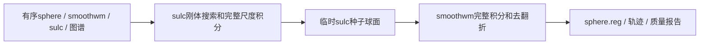
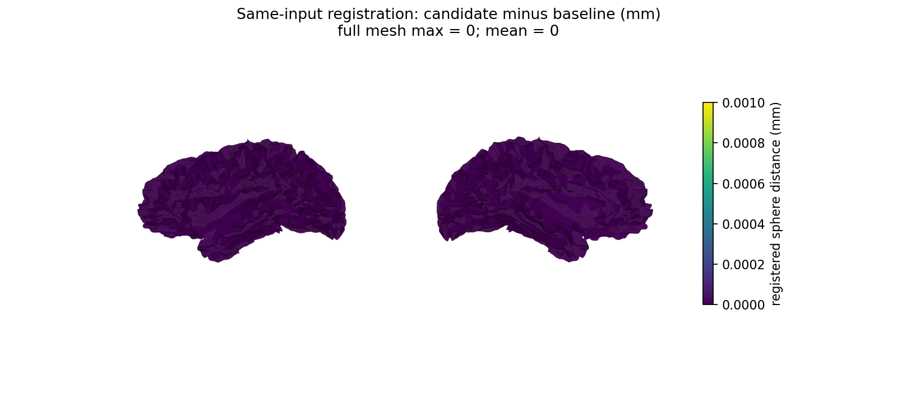

# 完整球面配准：复用当前迭代的几何量

## 1. 功能简介

`run_register_sulc` 与 `run_register_smoothwm` 已用 FNIT 的 PyTorch/Numba 实现完整球面配准；有序梯度平均可以放到指定 GPU。此次修改复用已有 `distance_gradient`，省去每轮距离力内部重复生成法向与弧距，不增加新算法或原版程序依赖。

两个阶段在生成相关力之前已经为当前 `projected` 算过法向和弧距。原距离力包装器再次计算这两项。现在直接传入同一坐标状态的结果；每次坐标更新后仍重新计算。静态有序邻接与原始距离继续由已有 `RegistrationForceCache` 管理，动态几何不跨轮次或试步复用。smoothwm 首次积分保留原有重复投影分支，避免改变 FP32 舍入。



主体力、目标函数和步长搜索仍在 CPU 上按原顺序执行；指定 CUDA 只迁移已有有序平均器和可选末段清理。这里没有把整条算法称为 GPU 运算。

## 2. Python 调用、输入与输出

完整调用：

```python
from fnit.recon_all.mris_register_run import run_register_sphere

registration_report = run_register_sphere(
    sphere="subject/surf/lh.sphere",  # 完整标准球面；surface RAS，mm
    smoothwm="subject/surf/lh.smoothwm",  # 个体形状约束；与球面同顶点及有序面
    sulc="subject/surf/lh.sulc",  # (N,) float32顶点图，与球面顶点一一对应
    atlas="assets/average/lh.folding.atlas.acfb40.noaparc.i12.2016-08-02.tif",  # 已校验左侧TIFF图谱
    output="output/lh.sphere.reg",  # 已存在父目录中的新表面路径
    overlap_device="cpu",  # 完整去翻折计算设备，默认CPU
    averaging_device="cuda:0",  # 有序梯度平均的目标GPU，默认CPU
    require_unfolded=True,  # 最终FP32及双精度径向翻折必须均为零，默认False
    overlap_diagnostics=True,  # 保存真实清理停止原因和末态，默认False
)
```

`sphere`、`smoothwm` 和输出采用 nibabel 支持的 FreeSurfer 三角表面格式，坐标 `(N,3)` 为 surface RAS/mm，面 `(F,3)` 为整数顶点索引。读取后计算坐标为 FP32，有序面不改变。`sulc` 是 FreeSurfer 顶点图，不是体素影像。图谱需使用声明的同侧固定 TIFF，读取其 FP32 数据帧；不能换成普通彩色图片。初始球面采用标准约 100 mm 半径。

两个被修改函数也可单独调用：

```python
from fnit.recon_all.mris_register_sulc_run import run_register_sulc
from fnit.recon_all.mris_register_smoothwm_run import run_register_smoothwm

sulc_report = run_register_sulc(
    sphere="subject/surf/lh.sphere",  # 同序标准球面
    smoothwm="subject/surf/lh.smoothwm",  # 原始形状约束
    sulc="subject/surf/lh.sulc",  # 相同顶点顺序的sulc
    atlas_file="assets/average/lh.folding.atlas.acfb40.noaparc.i12.2016-08-02.tif",  # 半球图谱
    output="output/lh.sulc-seed",  # 完整sulc积分输出
    max_updates=1024,  # 未收敛报错上限，不减少实际尺度或正常积分轮次
    averaging_device="cuda:0",  # 有序平均器执行设备，默认CPU
)
smoothwm_report = run_register_smoothwm(
    sphere="subject/surf/lh.sphere",  # 同一原始球面，不能改为种子文件
    smoothwm="subject/surf/lh.smoothwm",  # 同一形状约束
    sulc_seed="output/lh.sulc-seed",  # 上一步完整自产种子
    atlas_file="assets/average/lh.folding.atlas.acfb40.noaparc.i12.2016-08-02.tif",  # 同一图谱
    output="output/lh.sphere.reg",  # 最终有序注册球面
    seed_iteration=sulc_report["last_iteration"],  # 必填，传递实际源迭代计数
    overlap_device="cpu",  # 默认CPU，可单独指定CUDA
    max_updates=1024,  # 默认1024，未收敛直接报错
    averaging_device="cuda:0",  # 默认CPU，保持完整FP32平均顺序
    require_unfolded=True,  # 默认False；生产Python流程采用严格质量门
    overlap_diagnostics=True,  # 默认False；严格门也会生成摘要
)
```

返回值都是 `dict`，不返回另一种空间的影像：

| 返回结构 | 字段与意义 |
| --- | --- |
| 公共路径 | `sphere`、`smoothwm`、`atlas`、`output`；sulc阶段另有`sulc`，smoothwm阶段另有`sulc_seed` |
| sulc刚体搜索 | `rigid_angles`、`rigid_score`、`rigid_evaluations`、`rigid_seconds`，原完整搜索结果和耗时 |
| 完整积分 | `updates` 为每次实际更新的列表，记录iteration、stage、sigma、averages、dt、next_state和seconds；sulc另返回`last_iteration` |
| 子阶段计时 | sulc的`setup_seconds`；smoothwm的`setup_seconds_including_raw_fit`、`integration_seconds`、`repair_seconds`；两者的`total_seconds_including_io`均含本函数读写 |
| smoothwm末段 | `seed_iteration`、`negative_counts`（更新前轨迹）、`overlap_diagnostics`（真实末态）、`require_unfolded`、`overlap_device` |
| 执行设备 | 两者的`averaging_device`为平均器实际设备 |
| 完整wrapper | 输入/输出路径及SHA、`sulc_seed_sha256`、`sulc_pass`、`smoothwm_pass`、设备/质量策略与完整`total_seconds_including_io`；临时种子自动删除，报告路径改为临时标识 |

以上计时是嵌套字段，不能相加冒充整例时间。普通 API 不额外同步所有 GPU 阶段；本页回归在目标 GPU 上同步后记录完整阶段墙钟。CUDA 不可用、I/O失败、面序或sulc长度不对应、超过积分上限会抛异常。严格末态失败抛带 `.diagnostics` 的 `SphereOverlapQualityError`，写出前失败；默认不复制参考或回退原版程序。

## 3. 命令行调用与复现

```bash
# 五个位置参数依次为sphere、smoothwm、sulc、图谱和输出；报告另写JSON。
python -m fnit.recon_all.mris_register_run \
  subject/surf/lh.sphere subject/surf/lh.smoothwm subject/surf/lh.sulc \
  assets/average/lh.folding.atlas.acfb40.noaparc.i12.2016-08-02.tif \
  output/lh.sphere.reg \
  --averaging-device cuda:0 --overlap-device cpu \
  --require-unfolded --overlap-diagnostics --report output/lh.registration.json
```

完整 ABBA 使用 [`benchmark_recon_registration_geometry.py`](../../tools/benchmark_recon_registration_geometry.py)。`--baseline-source`、`--candidate-source` 为含 `src/` 和 `STAGE_SOURCE_BINDING.json` 的不可变源目录；`--subject` 含已有三项同序自产表面，`--atlas` 为图谱，`--stage-driver` 指向本仓库既有完整注册回归脚本，`--output-dir` 必须不存在。`--threads=4`、`--device=cuda:0`、`--hemi=lh` 是默认值，线程必须正数且设备必须显式 CUDA。工具执行四次 fresh child，顺序为旧、新、新、旧，每次使用独立 JIT 缓存，输出完整阶段、精确比较、启动审计和墙钟JSON。调用失败或回归失败保留原报告并抛异常。

```bash
python tools/benchmark_recon_registration_geometry.py \
  --baseline-source /work/frozen-before \
  --candidate-source /work/frozen-after \
  --subject /runs/own-upstream/subject \
  --atlas /assets/average/lh.folding.atlas.acfb40.noaparc.i12.2016-08-02.tif \
  --stage-driver validation/recon_all/optimizations/20261010_registration_zero_corner/benchmark_registration_v2.py \
  --output-dir /runs/registration-abba \
  --threads 4 --device cuda:0 --hemi lh
```

这里的冻结自产上游是阶段测试输入，不能将该命令称为原始T1连续整例。缓存只在 fresh child 中开启，不修改已初始化 CUDA 调用者的环境或精度。Torch/Numba/tifffile/nibabel及可视化matplotlib均为现有主页依赖，无新增安装包。

## 4. 原软件调用

两套积分均属于固定 FreeSurfer `mris_register -curv` 的内部阶段，没有各自独立的官方 CLI。独立 benchmark 的完整参考命令形式为：

```bash
# 仅在独立参考目录使用固定源码Conda构建程序；生产不执行此命令。
mris_register -curv \
  subject/surf/lh.sphere \
  assets/average/lh.folding.atlas.acfb40.noaparc.i12.2016-08-02.tif \
  reference/lh.sphere.reg
```

对应smoothwm/sulc由原命令按被试目录语义读取。本次性能配对比较当前 FNIT 与修改前 FNIT，没有把历史官方耗时当作本轮同机新参考；原官方重复性和新球面参考的不同验证范围见[球面诊断](SPHERE_OVERLAP_FULL_STOP_20261010.md)。

## 5. 最新真实数据、精度、耗时与脑图

本轮首组使用公开 ds000114 的 sub06 左侧，输入为已完成的 FNIT 79a41cdd 自产 sphere/smoothwm/sulc；一台8×A100 80GB主机，固定同一卡和4个CPU核，Torch 2.5.1/cu11.8，TF32启用，无FP16/BF16。基线从 Git `86ae36bde8c0ec5960fbb9142af2b060c24d1d25` 导出603文件；候选只有本页两个积分文件不同，逐文件SHA绑定，不包含其他未提交修改。

| 完整左侧注册sub06，旧/新/新/旧 | 修改前 | 修改后 |
| --- | ---: | ---: |
| 目标GPU同步后的完整API，两个重复 | 131.793 / 129.788 s | 124.027 / 122.963 s |
| API中位数 | 130.790 s | 123.495 s |
| fresh进程墙钟，含加载/JIT/传输/读写/检查的中位数 | 144.758 s | 138.037 s |
| 全部有序面、坐标元素、完整文件与已记录更新决策 | 四次相同 | 四次相同 |
| 顶点/面数 | 130,679 / 261,354 | 相同 |
| 非流形/边界/零面积/径向负面 | 均0 | 均0 |
| Torch allocated / reserved峰值 | 14,113,792 / 23,068,672 B | 相同 |

完整阶段 API 中位缩短 **5.58%**，fresh进程墙钟缩短 **4.64%**。坐标距离mean/P99/max均0；57次sulc与52次smoothwm更新的已记录状态、dt、seed及输出SHA均保持一致。四份报告、603文件源绑定及Python启动审计见[完整机器收据](../../validation/recon_all/optimizations/20261010_registration_current_state/sub06/ABBA/summary.public.json)。公开副本已替换私有路径和主机，使用public命名；原文件名、原字节SHA与公开SHA分别记录。

第二例使用同主机、同GPU、同4核资源和同一两版源码；八次完整阶段计算全部退出0：

| sub07完整左侧注册 | 修改前 | 修改后 |
| --- | ---: | ---: |
| 同步完整API，两个重复 | 142.588 / 143.388 s | 136.903 / 136.009 s |
| API中位数 | 142.988 s | 136.456 s |
| fresh进程墙钟中位数 | 155.129 s | 150.608 s |
| 坐标、有序面、字节、已记录更新决策与seed差异 | 四次均0 | 四次均0 |
| 顶点/面数 | 114,247 / 228,490 | 相同 |
| 最终局部径向翻折 | 两次均42 | 两次均42 |
| Torch allocated / reserved峰值 | 13,254,144 / 23,068,672 B | 相同 |

第二例阶段中位缩短 **4.57%**，fresh进程墙钟缩短 **2.91%**；所有旧新几何、输入SHA和已记录轨迹一致。原基线本身存在42个局部翻折，严格质量门保留失败。第一版父比较在第一行质量失败时停止；之后的[独立只读全行复核](../../validation/recon_all/optimizations/20261010_registration_current_state/sub07/reevaluation.public.json)比较四份已经完成的输出，保留原失败、原报告SHA和`failed_mesh_quality`状态，不重跑或覆盖原报告。它证明本次替换没有增加已有缺陷，不能证明该网格可交付。



图使用真实同序smoothwm展示全部261,354个面，颜色表示完整sphere.reg逐顶点距离；误差全为0。0.001 mm仅是色条显示上限，不是指标等效门槛。光照帮助展示脑形状，不参与误差或验收；此图也不替代局部翻折检查。生成脚本、全部输入和图像SHA见同目录的`figure.json`。

采样设定0.5 s，实际最大间隔3.681–5.940 s及每次查询时间在完整报告保留。容器PID归属未解析，`peak_tree_total_bytes=null`，不能当成零显存；八次目标卡采样占用上界均为466,616,320 B，是包含其他任务的另一个观察值，不能认定整例低于20 GB。Python启动审计0次禁用程序尝试，只证明此层调用记录，不代表无预装软件的OS隔离验收。

严格复现（本次同输入替换）两例已通过，优化未引入退化的证据限于这八次完整阶段。输出完整性两例通过，网格质量sub06通过、sub07未通过；整体脑区指标等效仍 `not_assessed`，整例没有新的完成结果，600 s/subj未验证。历史原始T1 Python候选存在球面/网格质量失败，本次重复几何优化不会修复那些既有误差。CPU上的18项既有几何/严格接线合同也通过，不能代替本节真实数据。

## 6. 版本与 benchmark 记录

- 修改前：两个完整积分函数通过距离包装器再次计算同一动态几何。
- 本轮候选：保持函数签名、完整迭代、首轮投影、接受规则及默认精度，复用本轮已有法向和弧距。
- 第一组工具版本：原始完整ABBA及QC字段全部保留；第二组工具增加已有严格网格门的显式拒绝，计算实现相同。最终工具将全部行质量与替换退化分开记录，仍拒绝质量失败；另提供只读复核。各实际工具SHA分别绑定，不能把已运行组重标为后一个脚本版本。
- 既有[零长向量诊断](../../validation/recon_all/optimizations/20261010_registration_zero_corner/README.md)与[五轮零法向修复候选](NORMAL_PENDING_PYTHON.md)承担不同任务。本轮不改变零法向异常分支，也不把尚未接入的候选说成已解决。

旧基线源、脚本、失败记录和新报告按各自版本保留。生产中的重复调用已删除，基准源仅用于独立参考，其他人的未提交修改不进入此次冻结包。

## 7. 参考文献与原实现

- [固定原配准入口](https://github.com/freesurfer/freesurfer/blob/d932c45b7941662ea380a05efef580568b98d41a/mris_register/mris_register.cpp)。
- [固定几何优化实现](https://github.com/freesurfer/freesurfer/blob/d932c45b7941662ea380a05efef580568b98d41a/utils/mrisurf_deform.cpp)、[FreeSurfer源码库](https://github.com/freesurfer/freesurfer)。
- Fischl B, Sereno MI, Dale AM. Cortical surface-based analysis. II: Inflation, flattening, and a surface-based coordinate system. NeuroImage, 1999, 9:195–207。
- Fischl B, Sereno MI, Tootell RBH, Dale AM. High-resolution intersubject averaging and a coordinate system for the cortical surface. Human Brain Mapping, 1999, 8:272–284。
