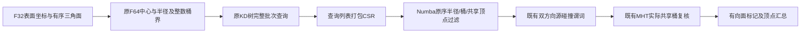

# 源相交标记的完整候选过滤

## 1. 功能与流程

`mark_source_intersections()` 对每个三角面按固定源规则标记自相交，再汇总
相关顶点。它复用既有双方向 Möller 谓词和实际 1 mm MHT 采样桶。
本次只将 CPU 路径逐面 NumPy 候选过滤编译为 Numba；判定、参数和返回
结构不变，不调用原软件程序，不新增依赖。



编译过滤没有 `fastmath`、并行归约、候选上限或新的碰撞判断。
半径查询余量仍为4 mm；整数桶允许边界接触；共享顶点、冻结面和重复
方向排除仍按原规则。第一次 JIT 成本计入首次 API。

## 2. Python 调用、输入与输出

```python
from pathlib import Path
import numpy as np
import nibabel.freesurfer.io as surface_io
from fnit.recon_all.place_surface_intersection_marking import mark_source_intersections

input_surface = Path("/data/own/lh.compact-current.surface")
surface_vertices, surface_faces = surface_io.read_geometry(input_surface)
marked_vertices, intersecting_face_count = mark_source_intersections(
    vertices=np.asarray(surface_vertices, dtype=np.float32),  # (N,3)，surface RAS/mm
    faces=np.asarray(surface_faces, dtype=np.int32),  # (F,3)，保留顶点编号和有序面
    face_ripped=None,  # 没有冻结面；可显式传(F,)bool
    predicate_backend="numba",  # 完整CPU源判据；候选过滤本次编译
    device=None,  # CPU无GPU初始化；torch后端须明确设备
    block_faces=256,  # 每次完整KD查询行数，不裁剪候选
    block_pairs=65536,  # 原有向谓词的内存批次，不裁剪候选
    candidate_grid_cells_per_axis=2,  # CPU保持原规则；3仅允许torch候选
)
```

| 参数 | 输入、默认值与限制 |
|---|---|
| `vertices` | 必填有限浮点 `(N,3)`，surface RAS/mm；按源顶点存储转F32 |
| `faces` | 必填整数 `(F,3)`，编号位于 `[0,N)`；内部转int32，保留面顺序 |
| `face_ripped` | 默认None，等价全False；可传 `(F,)` bool面冻结标记，区别于顶点rip |
| `predicate_backend` | 默认`numba`；`torch`复用成熟GPU候选与源边界复核，本次不改该路径 |
| `device` | 默认None；torch须明确`cpu`或`cuda:N`，不静默回退 |
| `block_faces` | 默认256，正整数；CPU树查询批次大小 |
| `block_pairs` | 默认65536，正整数；完整源谓词批次大小 |
| `candidate_grid_cells_per_axis` | 默认2；3仅允许torch路径，不改阈值或候选完整性 |

返回二元组：`marked_vertices` 为 `(N,)` bool；`intersecting_face_count` 为
有向相交面数的Python整数。输入数组不修改，异常传播。只有反向源谓词
为阳性时只标反向面；没有实际共享MHT桶的面对不能标记。

私有 `_candidate_pairs_from_csr()` 只处理一次树批次，不是替代的碰撞
判定接口。它返回按KD树原顺序保留的两个int64面对编号数组。

## 3. 命令行与可执行验证

生产文件 API 仍由现有相交清理入口调用；本次不增加生产 CLI 参数。
完整清理示例见 [有序CSR接口](TOPOLOGY_FINAL_INTERSECTION_CSR.md)。

```bash
# 同一真实自产表面：原样调用及同输入cProfile，剖析开销单列。
CUDA_VISIBLE_DEVICES='' OMP_NUM_THREADS=4 NUMBA_NUM_THREADS=4 \
python tools/benchmark_recon_intersection_marking_profile.py \
  --input-surface /data/own/compact-original.surface \
  --output /data/new-runs/marker-profile \
  --threads 4

# 新目录完整ABBA；baseline-marker是冻结的旧FNIT Python模块，不是FS程序。
CUDA_VISIBLE_DEVICES='' OMP_NUM_THREADS=4 NUMBA_NUM_THREADS=4 \
python tools/benchmark_recon_intersection_marking.py \
  --input-surface /data/own/compact-original.surface \
  --compact-state /data/own/compact-state.npz \
  --baseline-marker /data/frozen-fnit/place_surface_intersection_marking.py \
  --source-manifest /data/frozen-fnit/SOURCE_MANIFEST.json \
  --output /data/new-runs/marker-abba \
  --threads 4
```

剖析工具的必填 `input-surface` 是真实三角表面；`output` 必须不存在，
`threads` 默认4。它保存初次/剖析重复的标记 SHA、完整函数耗时和私有
`pstats`，不执行修复。ABBA工具另需要同一compact NPZ中的ORIGINAL与
完整有序一环CSR、未改的旧FNIT模块和冻结清单；每次均调用既有完整文件
API，执行100SOAP/周期、停止/最佳恢复及源/F64独立双复检。

ABBA输出包括各次表面、私有末态NPZ、各次API报告、完整候选双方向
谓词输入/输出顺序SHA、轨迹和整文件比较，最终只有全部门通过才写
`COMPLETE.json`。透明哈希观察开销计入完整API并另列。

## 4. 对应原软件调用

```bash
# 仅在隔离参考目录使用；FNIT运行时不执行它。
mris_remove_intersection lh.input lh.cleaned
```

标记器对应固定 FreeSurfer 源码中的 `mrisMarkIntersections()`，过滤是
FNIT 已有完整树候选的实现优化；源实际桶检查和 `tritri.cpp` 谓词复用
既有实现。本轮旧/新参照都是FNIT，未补测同输入原软件程序。

## 5. 真实数据精度、耗时与脑图

输入是公开 ds000114 历史3a左半球自产pre-GA compact ORIGINAL，
124,723顶点、246,985面、有序邻接741,916条。source及独立F64检测均为
2相交面、6标记顶点。它不是完成全部缺陷搜索后的标准生产中间态。

同一Xeon四线程CPU8–11、CUDA隐藏：原样初次标记42.611秒，带cProfile的
同输入重复48.609秒；全部标记与面数相同。后者包含剖析额外开销。
在48.603秒累计剖析中，源有向谓词累计仅1.232秒；逐面
`np.asarray`246,997次耗7.293秒，`np.all`740,856次累计5.154秒，
`np.sum`246,952次累计2.205秒。主要问题在逐面查询/数组过滤组织。

随后在同一解释器、同输入/CSR/四线程预算完成全部四次API ABBA：

| 顺序 | 旧/新 | 完整API含读写及观察 | 计算 | 独立双复检 |
|---|---|---:|---:|---:|
| A1 | 旧逐面过滤 | 121.591 s | 85.006 s | 36.178 s |
| B1 | 新编译过滤 | 75.028 s | 48.608 s | 26.284 s |
| B2 | 新编译过滤 | 72.844 s | 47.530 s | 25.120 s |
| A2 | 旧逐面过滤 | 130.002 s | 81.900 s | 47.976 s |

完整文件API中位数125.796733→73.935804秒，快1.701432倍，缩短41.226%。
首次JIT与哈希观察计入各次API，未扣除；新调用的谓词哈希观察约
0.47秒。实验冷CLI405.944777秒是四调用、解释器启动和加载的总墙钟，
不能当作单次CLI或recon-all耗时。峰RSS1,029,572 KiB。

每次实际5,790个有向谓词批次、4,604,838个三角对：完整有序输入和输出
序列SHA均相同。四次均执行一周期100SOAP，轨迹2→0，source与独立F64
残余均0；完整坐标/轨迹/输出文件SHA、有序面、几何头和全部非坐标字节
均通过。图链接的旧版完整输出SHA与本次四个输出全部相同，因此复用
同一真实T1叠加图。图中6顶点最大0.665353 mm为自产修复运动，不是
官方误差。


节点仍有共享负载。一次实验中快照load average为47.03/56.66/59.58；
对应cgroup字段在该入口不可读，不能从这张快照定位过去限流。
CUDA隐藏；GPU峰值、allocated/reserved未测，记录null而非0。
运行库隔离、同输入原软件补测、完整GA与整例指标等效未判定。
完整机器指标见 [本轮报告](../../validation/recon_all/optimizations/20261011_source_intersection_filter/README.md)。

## 6. 更新与验证记录

- 原完整source标记器：固定逐方向谓词/MHT共享桶，CPU/GPU成熟路径。
- 本次剖析v1：真实同输入两调用，42.611/48.609秒；输出完全相同。
- 编译过滤候选：19项focused契约通过6.16秒，覆盖原NumPy半径等值/
  ±1ULP、整数桶接触、冻结面、共享顶点、批次起点、原有向谓词和MHT门。
- 完整非零修复ABBA：退出0，所有双方向调用序列、坐标/轨迹/文件和
  源/F64残余门通过；125.797→73.936秒是完整相交文件API的收益。

整体指标等效、完整GA与整例10分钟目标均未由本阶段判定。

## 7. 原实现与参考文献

- [FreeSurfer固定源仓库](https://github.com/freesurfer/freesurfer/tree/d932c45b7941662ea380a05efef580568b98d41a)，
  [逐面标记](https://github.com/freesurfer/freesurfer/blob/d932c45b7941662ea380a05efef580568b98d41a/utils/mrisurf_metricProperties.cpp)、
  [MHT桶查询](https://github.com/freesurfer/freesurfer/blob/d932c45b7941662ea380a05efef580568b98d41a/utils/mrishash.cpp)、
  `utils/tritri.cpp`；原软件许可证随项目通知管理。
- Möller T. A fast triangle-triangle intersection test. *Journal of Graphics Tools*, 1997.
- [FNIT源清理说明](SOURCE_INTERSECTION_CLEANUP.md)与
  [相交文件API](INTERSECTION_REPAIR.md)。
