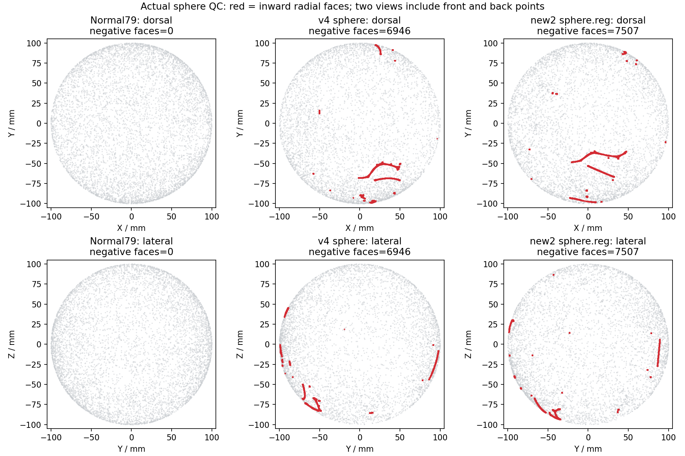

# 球面去翻折：完整停止规则与末态质量

## 1．功能简介

`remove_overlap_sphere` 与显式 `marked` 后端按固定 FreeSurfer 源码完成负面积面附近的平滑与径向投影。它们属于标准球面和球面配准的末段，复用现有 PyTorch 实现；本次新增透明末态报告和显式零翻折检查，保持坐标更新、邻域、步长和默认迭代次数。

核对发现，1000 不是 FNIT 额外增加的上限：固定源码中 `mris_sphere` 和 `mris_register` 都设置 `niterations=1000`，内部采用严格大于比较，最多允许 1001 次更新。源码同时保留长期无进展停止条件。停止执行不能表示网格通过质量检查。本次修复的是末态诊断缺失：原 `history[-1]` 是最后一次更新**之前**的计数，不是最终保存球面的计数。

## 2．Python 调用、输入和输出

```python
import nibabel.freesurfer.io as freesurfer_io
from fnit.recon_all.sphere_standard_finish import finish_standard_sphere

sphere_vertices, sphere_faces = freesurfer_io.read_geometry(
    filepath="subject/surf/lh.sphere",  # 有序三角球面，surface RAS，mm
)
overlap_report = {}  # 接收末态，不会修改输入网格
finished_vertices, negative_counts = finish_standard_sphere(
    vertices=sphere_vertices,  # (N,3) 浮点坐标，内部转换FP32
    faces=sphere_faces,  # (F,3) 整数顶点索引，面序保持不变
    start_iteration=0,  # 完整上游积分已经完成的计数
    device="cuda:0",  # 显式目标GPU；也允许CPU
    overlap_backend="dense",  # 默认原实现；marked省去未标记行的位移
    diagnostics=overlap_report,  # 默认None，显式字典才计算末态摘要
    require_unfolded=True,  # 残余FP32或双精度径向翻折时抛异常
)
```

输入坐标为 surface RAS，单位 mm；面必须与坐标顶点顺序对应。低层 Torch 接口要求坐标与整数面在同一设备，不修改原输入。`start_iteration` 默认 0。低层 `max_iterations` 默认 1000，对应原 `niterations`；本次没有增加迭代次数。整数拓扑缓存必须匹配顶点数、设备和完整有序面。

| 接口参数 | 默认与含义 |
| --- | --- |
| `positions` / `vertices` | 必需，`(N,3)`浮点坐标，surface RAS/mm |
| `faces` | 必需，`(F,3)`整数有序面，索引必须在0到N−1 |
| `start_iteration` | 低层默认0；`finish_standard_sphere`必须显式给定上游计数 |
| `max_iterations` | 低层默认1000，保持固定源主调用；标准finish不暴露任意更改 |
| `device` / `finish_device` | NumPy finish/完整标准入口默认CPU，指定实际执行清理的设备 |
| `overlap_backend` | finish默认`dense`；`marked`仅是显式已有候选 |
| `topology` | marked低层默认None；可复用完整同序面的`OverlapTopology`整数缓存 |
| `diagnostics` | 低层/finish默认None；传可写dict补充末态摘要 |
| `require_unfolded` | 默认False；True时径向负面严格为零，否则抛质量异常 |
| `inflated`、`smoothwm`、`output` | 完整标准入口必需的两个同面序表面路径与输出路径 |
| `averaging_device` | 完整标准/注册入口默认CPU；迁移已有有序平均，不改变清理步骤 |
| `normals_device` | 完整标准入口默认None，保留Numba法向；显式CPU/CUDA选已有Torch候选 |
| `bbox_mode` | 完整标准入口默认`source_float`保留固定Conda源码的浮点包围盒跨度；`legacy_integer`仅供历史截断对照，quick默认保持独立 |
| `overlap_diagnostics` | 完整入口默认False；True返回末态，严格门自动启用同样摘要 |


返回值仍是二元组：新 FP32 坐标（Torch 低层保留设备；`finish_standard_sphere` 返回 CPU NumPy `(N,3)`）及 Python 整数列表 `negative_counts`。列表记录每次更新前计数；无需再把其末值当最终质量。

`diagnostics=None` 保持原数值计算路径；字典包含：

| 字段 | 意义 |
| --- | --- |
| `updates`、`start_iteration`、`final_iteration` | 实际更新数及源计数 |
| `stop_reason` | 无负面、源迭代上限或源无进展门 |
| `initial_negative_float32`、`last_pre_step_negative_float32` | 初始及最后更新前计数 |
| `final_negative_float32`、`final_negative_double` | 最终源FP32与双精度径向负面计数 |
| `negative_area_mm2_sum/max/p99` | 双精度负面积的总量、最大值及P99，mm² |
| `minimum_negative_float32`、`minimum_iteration` | 轨迹中最少负面及对应迭代 |
| `final_dt`、`marked_expansion_rings` | 实际步长及扩张圈数 |
| `finite`、`zero_area_double`、`quality_status` | 有限性、零面积计数与零翻折门状态 |

非法形状、非有限坐标、越界索引和负计数会抛 `ValueError`。`require_unfolded=False` 默认保留通用原接口；True 时残余翻折抛 `SphereOverlapQualityError`，异常的 `.diagnostics` 携带完整摘要。标准球面完整入口在写表面之前执行此门，失败时不会写一个伪正常新输出。该门只评价径向翻折，其他网格连通性、非流形及退化面仍由整例质量检查分别报告。

完整注册入口 `mris_register_run.run_register_sphere` 及内部完整 `mris_register_smoothwm_run.run_register_smoothwm` 由协调者接入同样的 `require_unfolded=False`、`overlap_diagnostics=False` 参数。配准输入另需与球面相同顶点顺序的 `smoothwm` 与 `(N,)` sulc 顶点图，以及对应半球 TIFF 图谱。完整返回结构的 `smoothwm_pass.overlap_diagnostics` 包含上述末态；内部阶段返回直接 `overlap_diagnostics`。开启严格门时在球面文件写出前抛质量异常。本页实际回放使用原冻结注册 wrapper 和新增清理函数，不将协调者新 wrapper 的接线测试写成本页实测。

```python
from fnit.recon_all.mris_register_run import run_register_sphere

registration_report = run_register_sphere(
    sphere="subject/surf/lh.sphere",  # 已完成的有序球面，surface RAS/mm
    smoothwm="subject/surf/lh.smoothwm",  # 相同面序的个体形状约束
    sulc="subject/surf/lh.sulc",  # 与球面一一对应的顶点图
    atlas="assets/average/lh.folding.atlas.acfb40.noaparc.i12.2016-08-02.tif",  # 声明半球图谱
    output="output/lh.sphere.reg",  # 新注册表面路径
    overlap_device="cpu",  # 完整末段执行设备，不修改原算法
    averaging_device="cuda:0",  # 有序梯度平均的目标GPU
    require_unfolded=True,  # 最终径向翻折严格为零
    overlap_diagnostics=True,  # 记录真实停止与末态
)
```

## 3．命令行调用

去翻折是内部步骤，没有独立 FNIT CLI。标准球面完整入口支持：

```bash
python -m fnit.recon_all.sphere_standard_run \
  subject/surf/lh.inflated subject/surf/lh.smoothwm output/lh.sphere \
  --finish-device cuda:0 \
  --averaging-device cuda:0 \
  --require-unfolded \
  --overlap-diagnostics \
  --report output/lh.sphere.json
```

完整函数 `run_standard_sphere` 的新增参数为 `require_unfolded=False`、`overlap_diagnostics=False`。前者启用严格末态门，后者启用报告；严格门开启时也自动报告。默认行为和原输入参数保持兼容，完整计时包含诊断及读写。

完整注册 CLI 同样支持两旗标：

```bash
python -m fnit.recon_all.mris_register_run \
  subject/surf/lh.sphere subject/surf/lh.smoothwm subject/surf/lh.sulc \
  assets/average/lh.folding.atlas.acfb40.noaparc.i12.2016-08-02.tif output/lh.sphere.reg \
  --overlap-device cpu --averaging-device cuda:0 \
  --require-unfolded --overlap-diagnostics --report output/lh.sphere.reg.json
```

## 4．原软件调用与源码规则

对应参考命令为标准 `mris_sphere`、`mris_register -curv`。独立的 `MRISremoveOverlapWithSmoothing` 是它们内部步骤，没有可单独运行的官方 CLI。当前固定版本没有在已核对文件中找到 `MRISremoveNegativeArea` 的函数名，故本页按实际调用命名。

固定源码版本为 `d932c45b7941662ea380a05efef580568b98d41a`。两个主命令都指定 1000；同一平滑内部另有更短上限的调用，不应用末段默认值去替换这些其他分支。位移采用 double 中心/累加、float 位移保存、double 步长，最后回写 float 坐标。扩张采用完整一环快照，不是有序扩张到更远邻域。源码核对的文件 SHA 与规则见 [source_rules.json](../../validation/recon_all/optimizations/20261010_sphere_overlap_full_stop/source_rules.json)。原C++文件未复制到本报告。

## 5．最新版真实精度、时间和可视化

本次运行范围是冻结同输入球面末段及透明观察的完整注册；不是原始 T1 整例，不据此宣称整例提速或整体指标等效。

只读核对的当前真实网格：

| 网格 | 顶点/面 | 双精度负面 | 负面积总量/mm² | 最大/mm² | P99/mm² |
| --- | --- | ---: | ---: | ---: | ---: |
| 新2完整配准输出 | 107770/215536 | 7507 | 51.517545 | 0.413423 | 0.116918 |
| v4自产标准球面 | 107770/215536 | 6946 | 65.134643 | 0.452283 | 0.137324 |
| 正常79自产标准球面 | 130679/261354 | 0 | 0 | 0 | 0 |

三个网格均 Euler=2、边界边=0、非流形边=0。源单位法向FP32判负与现raw-cross FP32判负掩膜相同；这些残余不能归因为这条符号表达式的尾差。新2原报告的最后更新前计数为7501，而保存结果确实为7507，二者描述不同时间点。最终7千余负面属于质量失败；不能用增加迭代次数或修改阈值掩盖。

透明观察一次完整新2注册，包含读写耗时249.972秒；在实际进入清理时冻结输入（SHA-256 `22ba72454be1713f8b78a87e68e4209faa449b392b87afb34ce4bdcd7729783f`），计数从219开始。旧Python清理25.503秒，新CPU含末态诊断25.870秒：1001步历史和最终坐标逐元素相同。源上限结束时最后更新前为7501，最终为7507；最低为7496（迭代1117）。显式严格门正确抛质量异常。

同一输入GPU2缓存关闭回放552.189秒、GPU5新进程缓存开启3.160秒，两者1001步历史、最终坐标及末态摘要均与旧CPU相同。它们是不同GPU窗口的共享负载诊断，不构成ABBA性能比较，也不表示整例提速。默认清理设备和全局缓存策略没有改变。GPU5完整启动、导入、加载、传输、计算和报告墙钟13.730秒；allocated峰值50,888,192字节、reserved峰值71,303,168字节。其进程采样UUID遗漏`GPU-`前缀，无匹配时错误产生0；本报告明确将进程合计峰值记为不可用，不将0作为显存证据。复现脚本已修正前缀，原始无效收据保留。随后GPU2新进程v3完整回放2.986秒（完整harness13.067秒），坐标/历史仍0差。正确UUID采样返回`ownership_unresolved`，进程树峰值为null；同期目标compute进程合计585,105,408字节、整卡594,542,592字节只作为上界。请求采样间隔0.2秒、实际最大2.367秒；allocated/reserved与GPU5相同。这些低显存证据仅覆盖本次模型外清理，不代表整例显存。见 [v3完整收据](../../validation/recon_all/optimizations/20261010_sphere_overlap_full_stop/cacheon_gpu2_v3.json)。

正常79自产球面及冻结官方正常球面的旧/新坐标和历史均相同，严格门通过、无需更新，含诊断API分别0.084和0.082秒。完整新2注册输出文件SHA与既有冻结新2输出相同，证明该FNIT冻结路径的重复性；这不是官方命令的重复性证明。实际清理初态和末态的顶点法向均有限且无零和，尚未证明所有1001步都不触发原完整法向重试分支。

机器收据、完整轨迹、代码和输入哈希见 [report.json](../../validation/recon_all/optimizations/20261010_sphere_overlap_full_stop/report.json)、[正常球面门](../../validation/recon_all/optimizations/20261010_sphere_overlap_full_stop/normal_gates.json)和[GPU5独立收据](../../validation/recon_all/optimizations/20261010_sphere_overlap_full_stop/cacheon_gpu5_v2.json)。上述冻结运行时，声明的独立原生程序包缺少 `mris_sphere`/`mris_register`。后续已从相同固定源码和Conda构建档案独立补建两程序，仅供benchmark，完成两组标准球面的原程序双重复与只观察检查点。新参考的输入、程序与构建版本单独绑定，见[标准球面精度定位](SPHERE_STANDARD_PRECISION_20261010.md)；没有追改旧收据或接入生产。整体指标等效未评价。



灰点仅显示每20个顶点中的1个，红点显示全部负面的面心；质量计数来自完整有序网格，不来自显示子集。图像输入和当次绘图程序哈希见配套JSON；[通用参数绘图脚本](../../validation/recon_all/optimizations/20261010_sphere_overlap_full_stop/plot_sphere_folds.py)保留同样绘图计算，原实际运行脚本哈希保持单列，不追改。

## 6．最近版本与 benchmark

- 原版本：完整默认1000上限/无进展门，返回更新前列表；保留冻结输出作为对照。
- 本次：新增末态摘要、显式质量异常及标准入口写出前检查；不改默认次数、步长、邻域及坐标算法。
- 本次本地合同：18项通过、2项CUDA跳过。随后A100新进程20项全部通过，包括两项CUDA；四模块SHA与真实回放相同。
- GPU回放v1：数值逐行结果已保存，最终封装因Torch UUID对象无法JSON序列化而失败；GPU5初版同类失败保留。新GPU5 v2完成数值回放，采样UUID前缀缺失仍单独记为无效，不归因为OOM。
- 先前完整球面/配准结果继续绑定各自源码和输入；正常79网格与本轮v4数字网格不同，不能用正常例外推本轮质量通过。

## 7．参考文献与原实现

- Fischl B, Sereno MI, Dale AM. Cortical surface-based analysis II: Inflation, flattening, and a surface-based coordinate system. *NeuroImage* 1999;9:195–207.
- Fischl B, Sereno MI, Tootell RBH, Dale AM. High-resolution intersubject averaging and a coordinate system for the cortical surface. *Human Brain Mapping* 1999;8:272–284.
- [固定原球面入口](https://github.com/freesurfer/freesurfer/blob/d932c45b7941662ea380a05efef580568b98d41a/mris_sphere/mris_sphere.cpp)、[固定原配准入口](https://github.com/freesurfer/freesurfer/blob/d932c45b7941662ea380a05efef580568b98d41a/mris_register/mris_register.cpp)、[原平滑停止规则](https://github.com/freesurfer/freesurfer/blob/d932c45b7941662ea380a05efef580568b98d41a/utils/mrisurf_timeStep.cpp)、[FreeSurfer 源码库](https://github.com/freesurfer/freesurfer)。
