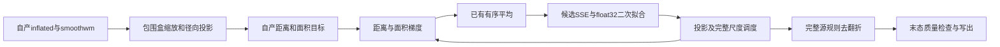
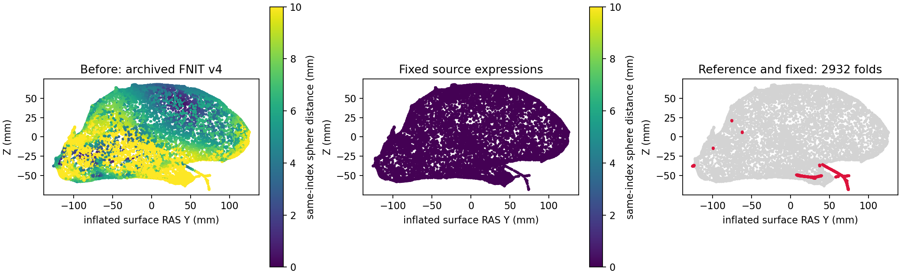

# 标准球面：初始化与目标函数精度

## 1．功能简介

标准球面使用已有FNIT采样、距离与面积梯度、有序平均、步长搜索及末段去翻折实现。本次定位了两个具体表达式差异：初始化曾将包围盒跨度截断成整数；距离目标函数曾将原`float`平方根改成`double`平方根。后者会改变float32二次拟合的系数，随后放大为几何差异，不属于可以忽略的最终坐标尾差。

两组完整同输入回归通过后，标准球面默认改用`source_float`，quick球面的历史规则保持独立。原C++程序只在隔离参考目录运行，不参与FNIT生产计算，参考检查点仅由观察器比较，不反馈给优化器。



## 2．Python调用、输入与输出

```python
from fnit.recon_all.sphere_standard_run import run_standard_sphere

sphere_report = run_standard_sphere(
    inflated="subject/surf/lh.inflated",  # 自产膨胀表面，surface RAS/mm
    smoothwm="subject/surf/lh.smoothwm",  # 同顶点及有序面的个体度量表面
    output="output/lh.sphere",  # 新标准球面路径
    finish_device="cuda:0",  # 完整源规则末段的目标设备；默认CPU
    averaging_device="cuda:0",  # 复用已有有序梯度平均；默认CPU
    normals_device=None,  # 默认已有Numba法向，不增加近似法向
    bbox_mode="source_float",  # 默认值，固定Conda源码的float包围盒跨度
    require_unfolded=True,  # 保存前要求FP32及double径向翻折均为零
    overlap_diagnostics=True,  # 记录真正末态、源停止原因和负面积
)
```

| 参数 | 格式、默认与含义 |
| --- | --- |
| `inflated` | 必需表面路径；坐标`(N,3)`，surface RAS/mm，面`(F,3)`整数索引 |
| `smoothwm` | 必需表面路径；与inflated完全相同的有序面及顶点对应，用于原距离/面积目标 |
| `output` | 必需新表面路径，保留有序面；严格质量失败时不写新表面 |
| `finish_device` | 默认`cpu`，完整末段PyTorch执行设备，允许显式`cuda:N` |
| `averaging_device` | 默认`cpu`，已有有序平均的设备，含必要数据传输 |
| `normals_device` | 默认`None`，沿用Numba法向；已有显式Torch候选见标准接口 |
| `bbox_mode` | 默认`source_float`，以float32完整跨度决定75 mm初始尺寸上限；`legacy_integer`保留历史截断，仅供对照 |
| `require_unfolded` | 默认`False`保留源命令停止后返回；`True`要求最终径向负面严格为零 |
| `overlap_diagnostics` | 默认`False`；开启或严格门开启时返回末态完整摘要 |

底层`initial_scale(vertices, bbox_mode=...)`和`project_before_standard_unfold(vertices, bbox_mode=...)`只接收非空有限`(N,3)`坐标，非法形状、非有限输入或未知模式抛`ValueError`。前者返回float32缩放坐标，后者增加径向投影。默认quick调用保持旧行为。

`first_epoch_sse`是内部目标函数：输入float32`(N,3)`坐标、有序int32`(F,3)`面、同顶点序CSR偏移/邻居、float32原毫米距离、float32`(F,)`原mm²面积、float32原总mm²面积及默认0.1的距离权重。CSR偏移长度`N+1`，邻居和原距离均长`M`。返回字典包含float64总SSE、加权距离项（mm²）、负面积平方项（mm⁴）、负面数、mm²负面积及两个无量纲尺度；总SSE保留原加权目标定义，不解释成单一物理单位。源`float`除法和`sqrt(float)`先舍入float32，之后提升double累加；没有改变TF32、启用半精度或减少候选。CSR必须由既有完整采样生成；非法索引不能通过裁剪掩盖。

`nonlinear_epoch_sse`复用同一个尺度函数，输入同序坐标/面、CSR、原距离和原总面积；没有`original_face_area`参数。`distance_weight=1e-6`、`nonlinear_weight=1.0`和`k=10.0`保留原非线性面积目标与参数舍入。返回`total`、`weighted_distance`、`weighted_nonlinear_area`、`negative_faces`、`distance_scale`和`area_scale`字典。它属于原命令内部步骤，没有独立CLI。错误网格、CSR或非有限输入沿既有NumPy/Numba异常暴露，不以裁剪输入代替校验。

使用已有阶段数组做内部诊断时，各参数名如下；这些数组必须来自同一完整采样及同一网格版本。

```python
from fnit.recon_all.sphere_python import initial_scale
from fnit.recon_all.sphere_standard_line_search import first_epoch_sse
from fnit.recon_all.sphere_standard_nonlinear import nonlinear_epoch_sse

scaled_vertices = initial_scale(
    vertices=inflated_vertices,  # 有限(N,3)surface RAS/mm坐标
    bbox_mode="source_float",  # 标准初始化；quick内部仍用其历史默认
)
linear_objective = first_epoch_sse(
    vertices=sphere_vertices,  # 当前float32球面坐标，mm
    faces=triangle_faces,  # 与原始网格同序int32(F,3)
    offsets=sample_offsets,  # 完整采样CSR偏移，int64(N+1)
    neighbors=sample_neighbors,  # CSR邻居索引，int32(M)
    original_distances=sample_distances,  # 同采样float32(M)原毫米距离
    original_face_area=original_areas,  # 同面序float32(F)原mm²面积
    original_total_area=total_original_area,  # float32原总面积，mm²
    distance_weight=0.1,  # 原线性距离权重
)
nonlinear_objective = nonlinear_epoch_sse(
    vertices=sphere_vertices,  # 当前float32坐标，mm
    faces=triangle_faces,  # 同序三角面
    offsets=one_ring_offsets,  # 非线性阶段完整一圈CSR偏移
    neighbors=one_ring_neighbors,  # 对应一圈邻居
    original_distances=one_ring_distances,  # 对应原毫米距离
    original_total_area=total_original_area,  # 原总面积，mm²
    distance_weight=1e-6,  # 原非线性阶段距离权重
    nonlinear_weight=1.0,  # 原非线性面积权重
    k=10.0,  # 原面积目标函数参数
)
```

完整返回字典包括输入/输出路径、模式、执行设备、初始化/度量/拓扑准备/末段/完整含I/O耗时、全部`updates`记录以及`overlap_diagnostics`。严格门失败抛`SphereOverlapQualityError`，其`.diagnostics`保留末态。文件读写和非法同面序输入沿现有异常规则处理。

## 3．命令行调用

```bash
python -m fnit.recon_all.sphere_standard_run \
  subject/surf/lh.inflated subject/surf/lh.smoothwm output/lh.sphere \
  --averaging-device cuda:0 --finish-device cuda:0 \
  --bbox-mode source_float --require-unfolded --overlap-diagnostics \
  --report output/lh.sphere.json
```

内部SSE和初始化函数没有独立官方CLI。隔离只观察工具可逐步绑定全部源码/输入SHA、平均后梯度、候选SSE和坐标；`--stop-after-updates`明确返回`diagnostic_prefix_complete`，不生成最终球面，也不冒称完整阶段完成。新观察器彻底移除`PYTORCH_NO_CUDA_MEMORY_CACHING`变量；设成字符串`0`仍会关闭PyTorch 2.5.1缓存。

## 4．原软件调用与固定参考

参考命令只在独立benchmark目录使用：

```bash
mris_sphere -seed 1234 -threads 4 subject/surf/lh.inflated benchmark/lh.sphere
# -w 1仅用于只观察逐步快照；终态另与无观察的双重复比较。
```

固定源为`d932c45b7941662ea380a05efef580568b98d41a`。新独立构建复用已核验该源码的12个Conda archive，重新编译两个主入口；没有从系统安装复制程序，也没有重新编译全部utils。本轮补建`mris_sphere`和`mris_register`只作为参考，生产实现仍为FNIT。

编译器SHA、archive SHA、源码档案、主入口编译与链接参数、RPATH重定位后的程序SHA和动态库见[构建收据](../../validation/recon_all/optimizations/20261010_sphere_overlap_full_stop/reference_d932c45_v1/build.json)和[运行收据](../../validation/recon_all/optimizations/20261010_sphere_overlap_full_stop/reference_d932c45_v1/runtime.json)。不发布原C++主体、二进制、影像或许可证。

## 5．最新真实精度、耗时与局部定位

使用已授权公开ds000114真实T1及其冻结阶段输入，当前同机四线程原程序各运行两次。参考重复稳定；历史另一环境的官方归档作为单独对照，不能用跨环境差异宣称随机性。

| 完整同输入标准球面 | 当前独立参考两次完整墙钟/s | 重复坐标/有序面差异 | 参考最终double径向负面 |
| --- | --- | --- | ---: |
| sub07 LH，v4自产inflated/smoothwm，95045/190086 | 379.611 / 379.497 | 0 / 0 | 2932 |
| 旧公开正常LH冻结inflated/smoothwm，106622/213240 | 185.021 / 185.486 | 0 / 0 | 0 |

原参考在本轮自产网格上也未消除全部翻折；FNIT初始版本最终为4514负面，与当前参考平均/P99/最大有序顶点距离9.331/44.373/84.821 mm。不能全部归咎上游，也不能因为原参考失败就接受FNIT的新增形状误差。旧正常输入的当前参考与历史安装版官方归档仍有平均3.415、最大7.484 mm差异；这是跨环境/参考产物差异，尚未完成其全部原因归因。

初始化分阶段探针与固定原程序核对：97.402/251.435/135.615 mm浮点跨度中的最大值原为251.4348907，历史FNIT截断成251。显式`source_float`后，从读入、原度量、尺寸上限、投影前后到首次梯度前五个检查点坐标全部0差；精确原初态输入的FNIT首步285135坐标元素也全部0差。

仅修浮点跨度的早期完整候选仍失败：sub07最终4872负面，平均/P99/最大距离7.790/66.051/79.569 mm；旧正常输入0负面但平均/最大1.251/8.604 mm。当时未改默认，没有按平均变小宣布通过。

后续实际第39步：更新前坐标、法向、当前面积、距离梯度、加面积后的梯度、1024次平均后的梯度均逐元素0差，mean_delta与min_dt逐位相同。差异首次在目标函数平方根：固定头文件/同编译器独立表达式证明`float/float`及`sqrt(float)`均返回float。原double sqrt使SSE约1e-4差异，在float32二次拟合中改变系数；按源float sqrt隔离回放后系数恢复一致，该步最终285135坐标元素0差。只修线性目标的v5在第420步非线性目标再次分叉。两个目标统一复用源精度尺度后，v6完整门如下；没有改变梯度、logistic、步长接受、清理上限或候选范围。

| 完整同输入FNIT阶段 | 原参数规则 | 更新数 | 全部更新坐标/最终有序面 | 最终平均/P99/最大距离/mm | 完整API / 含导入观察墙钟/s | 最终double负面 |
| --- | --- | ---: | --- | --- | --- | ---: |
| sub07 v6 | source_float＋两处SSE修复 | 446 | 全部0差 / 0差 | 0 / 0 / 0 | 168.462 / 169.784 | 2932，质量失败 |
| 正常冻结输入v6 | source_float＋两处SSE修复 | 232 | 全部0差 / 0差 | 0 / 0 / 0 | 108.057 / 109.705 | 0，通过 |
| sub07 v7控制 | legacy_integer＋相同SSE修复 | 427 | 不同 / 同有序面 | 7.984 / 33.867 / 49.244 | 158.868 / 160.245 | 4229，质量失败 |
| 正常冻结输入v7控制 | legacy_integer＋相同SSE修复 | 274 | 不同 / 同有序面 | 3.143 / 4.601 / 6.991 | 120.113 / 129.589 | 0，通过 |

v6两组写出坐标均与本轮原参考的两个重复完全相同。原文件创建注释/时间不同，不能将解码几何0差称作整个文件逐字节复现。正常输入严格几何复现与网格质量都通过；sub07原参考及FNIT均残留2932翻折、负面积总37.8214 mm²、最大0.44336/P99 0.17965 mm²，源1001次清理已完整执行，结构质量仍失败。严格生产调用抛异常且不写伪正常结果。当前修复没有新增几何误差，整例指标等效未判定。

四次候选使用同一A100 80 GB、四线程、CPU116–119，TF32开启，不用半精度，缓存变量完全unset；两次参考各用同节点CPU88–91四线程及seed1234。共享节点、复用Numba缓存、两组不同冻结上游和观察器I/O均单列；这些不是ABBA速度门，也不构成原始T1整例提速。PyTorch allocated/reserved峰值分别为sub07 58,234,368/83,886,080字节、正常56,478,208/71,303,168字节。本组没有父子进程合计显存采样，不能据此证明整例低于20,000,000,000字节。

机器可读[完整汇总](../../validation/recon_all/optimizations/20261010_sphere_overlap_full_stop/standard_precision_v6/summary.json)、[sub07全部446步](../../validation/recon_all/optimizations/20261010_sphere_overlap_full_stop/standard_precision_v6/sub07-sse-float-full-v6/trace.json)、[正常全部232步](../../validation/recon_all/optimizations/20261010_sphere_overlap_full_stop/standard_precision_v6/normal-sse-float-full-v6/trace.json)、[第39步精确状态](../../validation/recon_all/optimizations/20261010_sphere_overlap_full_stop/standard_precision_v6/sub07-native-gradient-prefix-v4/comparison_v1.json)与[表达式探针](../../validation/recon_all/optimizations/20261010_sphere_overlap_full_stop/standard_precision_v6/expression/output_v2.json)保留实际代码、输入、程序、观察器SHA及原收据SHA。v6完整运行显式传`source_float`；当前仅将默认值别名切到该已测分支，新的wrapper/doc SHA由[39项合同收据](../../validation/recon_all/optimizations/20261010_sphere_overlap_full_stop/standard_precision_v6/default_contracts.json)单列，不追改冻结版本。

冻结v6与当前工作树的已加载模块差异见[版本核对](../../validation/recon_all/optimizations/20261010_sphere_overlap_full_stop/standard_precision_v6/current_source_delta.json)：除两个默认值/说明wrapper外，共享`mris_register_nonlinear`已另有源法向规则更新。完整实测仍绑定v6实际SHA，不能外推整个当前工作树已经重复运行。



图将完整同索引球面距离映射到自产inflated的surface RAS Y/Z；显示每8个顶点中的1个，所有误差与翻折计数使用完整网格。红色为原参考与修复候选共同的全部2932个负面，不是新增差异。显示色标截断在10 mm，实际最大值仍保存在完整报告；[图像与输入SHA](../../validation/recon_all/optimizations/20261010_sphere_overlap_full_stop/standard_precision_v6/sub07-sse-float-full-v6/sphere_error.json)及[复现绘图程序](../../validation/recon_all/optimizations/20261010_sphere_overlap_full_stop/plot_standard_sphere_error.py)可核对。

旧GPU观察器曾把缓存环境写成`0`，实际是cacheoff：758.009秒完整观察墙钟、591.837秒末段不能标作常规GPU耗时。新freeze彻底unset该变量。观察器含逐步SHA/JSON/检查点写入，其墙钟不用于宣布整例提速；本页不是原始T1整例，也未判整体指标等效。局部翻折图见[末态质量页](SPHERE_OVERLAP_FULL_STOP_20261010.md)。

## 6．最近版本和benchmark记录

- 原末段审计：确认原主调用1000上限、最多1001更新，增加真正末态与严格门；旧/新同输入轨迹及坐标0差。
- 新独立参考：两组完整标准球面均双重复稳定；native逐步观察终态与未观察参考0差，旧归档跨环境对照单列。
- 包围盒诊断：显式浮点模式初始化与首步0差，但仅此修复完整候选未通过，当时历史默认保留。
- 目标函数定位：第39步全部力/metric状态0差，sqrt返回精度影响SSE→二次拟合→实际步长；v5只修线性目标，在非线性第420步再次分叉，完整失败记录保留。
- v6：线性/非线性共用源精度尺度，两组完整446/232更新及最终有序几何全部0差；正常质量通过，sub07与原参考同样2932翻折严格失败。
- v7：在相同SSE修复下，历史整数初始化两组仍有49.244/6.991 mm局部偏移，因此标准默认改`source_float`；quick默认与显式历史对照保留。39项CPU合同通过，无新增依赖。
- 构建v1路径匹配失败、v2 sibling-header失败、v3已移到FaceNormCache的orig_area字段失败，以及旧新finish接口混合的完整观察器封装失败均保留。它们是诊断工具构建/封装问题，没有作为GPU或算法失败改写。

## 7．参考文献和原实现

- Fischl B, Sereno MI, Dale AM. Cortical surface-based analysis II: Inflation, flattening, and a surface-based coordinate system. *NeuroImage* 1999;9:195–207.
- [固定球面主入口](https://github.com/freesurfer/freesurfer/blob/d932c45b7941662ea380a05efef580568b98d41a/mris_sphere/mris_sphere.cpp)。
- [固定积分及线搜索](https://github.com/freesurfer/freesurfer/blob/d932c45b7941662ea380a05efef580568b98d41a/utils/mrisurf_integrate.cpp)。
- [固定SSE目标函数](https://github.com/freesurfer/freesurfer/blob/d932c45b7941662ea380a05efef580568b98d41a/utils/mrisurf_sseTerms.cpp)。
- [PyTorch 2.5.1缓存环境语义](https://github.com/pytorch/pytorch/blob/v2.5.1/c10/cuda/CUDACachingAllocator.cpp)。
