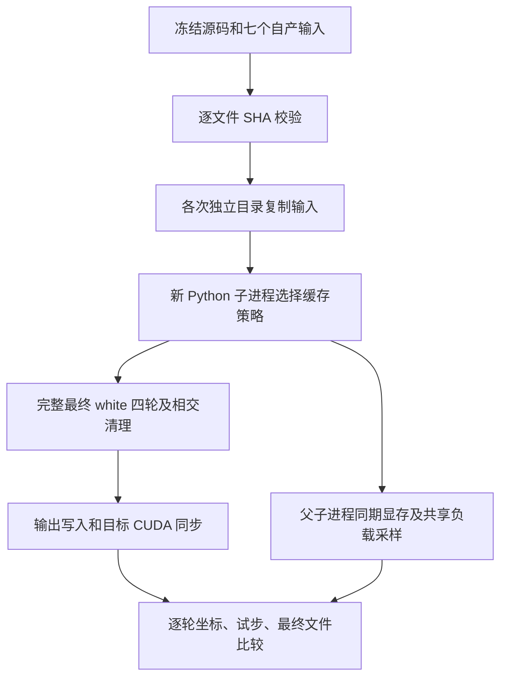
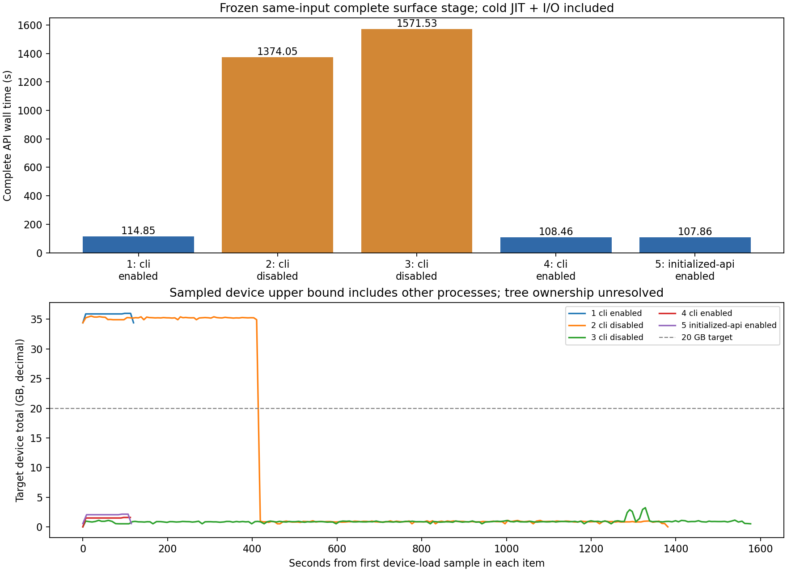

# 表面放置的 CUDA 分配缓存对照

## 1. 功能简介

`tools/benchmark_recon_surface_allocator.py` 用相同自产 MRI、网格、标签和阈值，比较完整最终 white 或 pial 在两个新子进程策略下的输出与资源：关闭 CUDA 分配缓存，或仅对子进程开启缓存。复用完整 FNIT white/pial 优化器和已有 `worker_cuda_cache_environment`，不重新实现放置算法、不调用 FreeSurfer 程序，也不修改生产默认或父进程分配策略。



性能统计与算法轨迹分开。输出一致和阶段提速不能代替原始 T1 整例验收。全流程指标等效仍为 `not_assessed`。

## 2. Python 调用、输入和输出

脚本的正式接口是命令行。它调用的已有生产候选接口如下；这里只说明缓存实验如何复用它，不新增优化器参数。

```python
import os
import subprocess
import sys

from fnit.recon_all.hemisphere_parallel import worker_cuda_cache_environment

child_environment, allocator_report = worker_cuda_cache_environment(
    environ=os.environ,               # 完整父环境；函数返回副本，不写父环境
    cuda_allocator_cache="enabled",   # 仅新 exec 子进程启用分配缓存
)
subprocess.run(
    args=[sys.executable, "/work/benchmark_recon_surface_allocator.py",
          "--child-request", "/runs/white-cache/request.private.json"],
    env=child_environment,            # 策略在子进程第一次 CUDA 分配前生效
    check=True,                      # 完整阶段失败向调用方传播
)
```

`worker_cuda_cache_environment` 的 `inherit`、`enabled`、`disabled` 含义与原接口一致：保留父变量、移除子变量、或在子变量中设置 `1`。已初始化父 CUDA 的 live tensor、环境和分配器不受影响。环境变量只能说明新进程的选择，不能反推已经初始化父进程的有效策略。

### 输入

| 输入 | 数据结构、空间及意义 |
| --- | --- |
| `source_root` | 冻结源码的 `src` 目录，含 `fnit/recon_all`；报告记录全部 Python 文件 SHA，不导入当前工作树的替代算法 |
| `subject` | 已完成上游的自产被试目录；本实验不是原始 T1 整例 |
| `surf/H.white.preaparc` | 有序三角网格，surface RAS 坐标、单位 mm；保留原面顺序及尾部几何 |
| `surf/autodet.gw.stats.H.dat` | 已自产的灰白阈值表，原强度单位；固定文件内容，不重新估计阈值 |
| `mri/brain.finalsurfs.mgz` | 强度图，conformed 体素网格 |
| `mri/wm.mgz` | WM 强度/编辑结果，与强度图 shape 和 affine 相同 |
| `mri/aseg.presurf.mgz` | 离散分区标签，与强度图相同网格；标签语义不变 |
| `label/H.cortex.label` | 与输入网格同序的 cortex 顶点标签 |
| `label/H.aparc.annot` | 与输入网格同序的分区注释；用于最终 white 的 rip 状态 |

`--stage pial` 将 `surf/H.white.preaparc` 换为自产最终 `surf/H.white`，将 `label/H.aparc.annot` 换为 `label/H.cortex+hipamyg.label`；仍是七项输入。pial 从最终 white 开始，在相同空间优化并固定内侧壁，不读取 preaparc 或注释作为替代。

每个输入先校验文件 SHA，复制到各次独立目录后再次校验。算法只读取这些自产输入，不读取原生或官方输出来修补结果。原完整放置器检查 MRI 的 shape/affine，不允许覆盖输入。

### 参数

| 参数 | 默认值 | 作用和限制 |
| --- | --- | --- |
| `--source-root` | 必填 | 冻结 FNIT `src` 路径 |
| `--subject` | 必填 | 七个前置文件所在的自产目录 |
| `--output-dir` | 必填 | 新运行目录；已存在则失败，保护旧报告 |
| `--hemi` | `lh` | `lh` 或 `rh`；H 指该半球 |
| `--stage` | `white` | `white` 或 `pial`；复用对应完整四轮函数，不互换两种输入网格 |
| `--device` | `cuda:0` | 显式逻辑 CUDA 设备；尊重 `CUDA_VISIBLE_DEVICES` |
| `--threads` | `4` | Torch、Numba 和子进程 BLAS/OpenMP 预算；CPU 亲和性由外部 `taskset` 固定 |
| `--interval` | `0.5` s | 进程树显存采样目标间隔；实际最大间隔和查询失败另计 |
| `--order` | `enabled,disabled,disabled,enabled` | 四次新子进程的 ABBA 顺序；可指定其他已记录顺序，不复用进程或 JIT 缓存 |
| `--api-policy` | 不执行 | `enabled` 或 `disabled`；增加一次已初始化父 CUDA 的完整子进程调用 |
| `--prepare-only` | `False` | 只校验输入、源码和资源；不是完整阶段验证 |
| `--child-request` | 无 | 驱动内部使用的 JSON 路径；与外层实验参数分开 |
| `--capture-cleanup` | `False` | 仅 pial 诊断：只读保存最后接受步和原清理返回值，仍由原残余门拒绝；坐标数组只保留在私有运行目录 |

固定配方使用四轮、最多 400 步保护上限，CPU 有序正则及强度采样、Torch 完整碰撞候选、编译有序接受、源语义相交标记和清理。候选及清理网格参数固定为 3。本实验开启诊断计时和只读 accepted-step 回调，两种缓存模式使用完全相同的观察器；未捕获拒绝试步的坐标，记录全部标量接受/拒绝判定。

### 输出及失败

- `manifest.private.json`：七输入 SHA、全部源码 SHA、脚本 SHA、设备、亲和性、共享负载和 cgroup 快照。
- white 的各次 `subject/surf/H.white`：完整优化及相交清理后的同序表面，surface RAS/mm。
- white 的各次 `subject/mri/mrisps.white.mgz`：优化器自产 uint8 预处理 MRI，保留 conformed 几何。
- pial 的各次 `subject/surf/H.pial.T1`：保留输入 white 的全部有序面、几何头和尾部；现有完整函数只写表面，不额外生成 MRI。三个输入 MRI 的文件和数值 SHA、几何在只读评价中核对。
- `accepted-steps.private.jsonl`：每次接受后的坐标 SHA、dtype、shape、四轮索引和全部试步标量判定。
- `child.private.json`：完整优化器结果、加载/准备/梯度/碰撞/边界/清理/写出秒数、目标 CUDA 首尾同步、输出 SHA 和 Torch 统计。
- `benchmark.private.json`：包含复制校验、fresh exec、导入/JIT 和读写的完整阶段墙钟；0.5 s 同期显存、5 s 全卡负载、进程 I/O/wchan、CPU 时间及亲和性。
- `summary.private.json`：逐元素坐标、P99/最大距离、面顺序、完整轨迹和输出字节比较；父 live tensor 和环境是否保持。

`tools/evaluate_recon_surface_allocator.py` 提供只读复核。`compare(run_dir=..., baseline_subject=..., hemi=..., source_manifest=...)` 返回 MRI 数值/几何及 dtype、阈值和标签数值 SHA，检查已完成阶段对原 v4 自产结果的坐标、试步及预处理 MRI；不修改影像或启动 CUDA。CLI 参数 `--run-dir` 为上述实验目录，`--baseline-subject` 为旧 FNIT 自产目录，`--source-manifest` 为冻结源码清单，`--hemi` 默认 `lh`，`--output-json` 为不存在的新 JSON 路径；其他路径均必填。它也记录实际 Python 程序、评价脚本和原阶段报告 SHA；未完成目录单列，不计为成功。

隔离参考脚本 `benchmark_pial_reference.py` 的 `--source-root`、`--subject`、`--binary`、`--assets-dir` 和 `--output-dir` 均必填，依次指定冻结 FNIT 源码、自产输入、固定源码 Conda 程序、声明资产和新参考目录；`--hemi=lh`、`--threads=4` 与主实验一致，`--child-request` 仅供内部 fresh exec 使用。参考在七项 pial 输入之外还需要同网格 `label/H.aparc.annot`，共八项，逐项 SHA 绑定。它复用 `pial_t1_conda.run_pial_t1`，执行两次完整参考、分别写 `reference-1/2/subject/surf/H.pial.T1`，输出程序/输入 SHA、exec 与优化器墙钟、有序网格和源质量统计。程序退出成功与源相交 QC 是两个字段，失败不补输出。

`evaluate_pial_cleanup.compare(source_root=..., diagnostic_run=..., reference_run=..., output_json=..., hemi="lh", threads=4)` 只读使用失败观察器留下的私有末态 NPY、原 white 面索引及两次已完成参考；这些路径参数必填，输出 JSON 必须不存在。先核对全部共同输入 SHA 和面对应，再报告逐元素坐标差异、mm 距离、几何头及原生文件注释差异。它复用冻结源标记器并只读捕获原面标记，输出残余面/顶点编号和 QC 秒数，不写标准表面或改变失败状态；非有限/非法网格仍按原检查失败。NPY 坐标只留服务器，公共报告只含哈希和统计。

缺失输入、SHA 改变、无效参数、CUDA 错误、四轮不收敛或最终残余相交均失败。v3 在失败时也保留实际 allocated/reserved、未完成 API 的经过秒数和已接受轨迹；这些字段不能称作成功 API 耗时。清理观察器在独立子进程保存原返回诊断和私有坐标数组，原返回对象原样传回、退出时恢复入口，不改变 SOAP 或质量判断。子进程错误保留收据并停止后续完整阶段；不回退原生程序，不复制或写占位表面。公共收据需由现有 exporter 在服务器脱敏，原始报告、影像和许可证不进入 Git。

## 3. 命令行调用

```bash
CUDA_VISIBLE_DEVICES=0 OMP_NUM_THREADS=4 MKL_NUM_THREADS=4 \
OPENBLAS_NUM_THREADS=4 NUMBA_NUM_THREADS=4 \
taskset -c 0-3 python tools/benchmark_recon_surface_allocator.py \
  --source-root /work/frozen-fnit/src \
  --subject /data/fnit-produced/sub07 \
  --output-dir /runs/white-cache-abba \
  --hemi lh \
  --stage white \
  --device cuda:0 \
  --threads 4 \
  --interval 0.5 \
  --order enabled,disabled,disabled,enabled \
  --api-policy enabled
```

示例显式指定冻结源码、自产输入、空输出目录、左半球、目标 GPU、总线程和采样间隔。四次 CLI 父进程不预先初始化 CUDA；最后一次 API 对照在父进程关闭缓存的前提下保留一个 32 MiB float32 live tensor，仅对子进程开启缓存。父 tensor 指针、值和完整环境前后比较，报告只保存策略相关环境变量，不保存凭据或许可证环境。

```bash
CUDA_VISIBLE_DEVICES='' python tools/evaluate_recon_surface_allocator.py \
  --run-dir /runs/white-cache-abba \
  --baseline-subject /data/fnit-produced/sub07 \
  --source-manifest /work/frozen-fnit/SOURCE_MANIFEST.json \
  --hemi lh \
  --output-json /runs/white-cache-evaluation.private.json
```

pial 可用相同命令的 `--stage pial --order enabled --api-policy enabled` 做完整新 CLI 和已初始化父 API 回归；若旧 pial 尚未写出，先保存候选报告，不能宣布对旧路径一致。旧 pial 未保存逐轮 trace 时，评价的旧试步比较字段为 `null`；新 CLI/API 之间仍比较每步坐标与全部判定。

```bash
CUDA_VISIBLE_DEVICES='' taskset -c 0-3 python \
  validation/recon_all/optimizations/20261010_surface_allocator/benchmark_pial_reference.py \
  --source-root /work/frozen-fnit/src \
  --subject /data/fnit-produced/sub07 \
  --binary /benchmark/native/bin/mris_place_surface \
  --assets-dir /data/declared-assets \
  --output-dir /runs/pial-reference-repeat \
  --hemi lh \
  --threads 4
```

此参考命令仅使用固定源码独立构建的 benchmark 程序；输入是自产最终 white 与八项前置文件。它与生产目录完全分开，不将参考写回。`--capture-cleanup` 的失败观察器报告可按下例只读复核：

```python
from pathlib import Path
from evaluate_pial_cleanup import compare

diagnostic_report = compare(
    source_root=Path("/work/frozen-fnit/src"),          # 冻结源标记器，不导入当前工作树
    diagnostic_run=Path("/runs/pial-failed-observed"), # 原失败目录，含私有末态 NPY
    reference_run=Path("/runs/pial-reference-repeat"), # 已完成的两次隔离源码参考
    output_json=Path("/runs/pial-cleanup-check.json"),  # 新 JSON，不覆盖原收据
    hemi="lh",                                       # 左半球，与输入有序网格一致
    threads=4,                                       # 四线程；另用 taskset 固定亲和性
)
```

模块位于本次验证目录，需将该目录加入 `PYTHONPATH` 或从该目录运行。等价 CLI 的 `--source-root`、`--diagnostic-run`、`--reference-run`、`--output-json` 均为必填路径，`--hemi` 默认 `lh`、`--threads` 默认 `4`。两个私有 NPY 只在服务器读入，不复制到公共报告。

这里的旧自产目录只用于事后诊断，不传入 white 子进程作为参考。复核会记录尚在运行的目录，不能把阶段检查点或部分结果称作完整 ABBA。

## 4. 原软件调用

本工具比较 FNIT 分配策略，CUDA 缓存没有对应 FreeSurfer CLI。完整最终 white 对应固定源码中的下列阶段语义；命令只能在独立 benchmark 路径运行，white 缓存对照不调用它。后续 pial 排错只在隔离参考目录使用固定源码 Conda 程序，两次重复运行不写回生产输入。

```bash
mris_place_surface \
  --adgws-in surf/autodet.gw.stats.lh.dat \
  --seg mri/aseg.presurf.mgz \
  --wm mri/wm.mgz \
  --invol mri/brain.finalsurfs.mgz \
  --lh --threads 4 \
  --i surf/lh.white.preaparc \
  --o surf/lh.white \
  --white --nsmooth 0 \
  --rip-label label/lh.cortex.label \
  --rip-surf surf/lh.white.preaparc \
  --aparc label/lh.aparc.annot \
  --rip-bg --rip-bg-lof \
  --restore-255 --restore-255 \
  --outvol mri/mrisps.white.mgz
```

## 5. 当前真实数据结果与计时范围

本次使用公开 ds000114 的 sub07 左半球自产 v4 输入和未修改的 v4 冻结源码。源 `place_white_preaparc_python.py` SHA 为 `dadb073acd885e80e758b0bddd1db10d2c50c8ff906dad910abef09be2669e08`，边界搜索为 `199cfd527493a31a8888df47622492a4faf68ee88ce41e57ae75e9c996640bd4`，不是后续并行边界候选。

此前 v4 最终 white 的实际记录为左侧 22 步、1387.869 s，其中碰撞 1108.293 s、清理 138.534 s；它用于定位，不作为本次四线程配对的同条件控制。原 v4 使用两侧各两线程、另一 GPU 和不同并发负载。四次四线程完整 ABBA 和一次已初始化父 CUDA 的 API 均已完成，五个阶段子进程实际退出码都是 0。五次均为四轮、22 个接受步；每步坐标 SHA、所有试步判定、最终有序网格、white 和预处理 MRI 文件字节完全相同，对同输入旧 v4 自产结果也全部相同。完整 API 的 ABBA 中位数为 1472.791→111.653 s，观察比为 13.191 倍、秒数缩短 92.419%；fresh exec 中位数为 1483.426→121.098 s。这是共享节点的同输入阶段对照，不是原始 T1 整例提速。

| 顺序与调用方式 | 子进程缓存 | 完整 API (s) | fresh exec (s) |
| --- | --- | ---: | ---: |
| 1：CLI | enabled | 114.846 | 122.367 |
| 2：CLI | disabled | 1374.054 | 1383.347 |
| 3：CLI | disabled | 1571.527 | 1583.506 |
| 4：CLI | enabled | 108.461 | 119.829 |
| 5：父 CUDA 已初始化 API | enabled | 107.864 | 117.953 |

第五次父进程保留 32 MiB float32 张量，父缓存仍关闭。子进程调用前后张量值、指针及完整父环境不变。所有缓存开启项的 Torch peak allocated/reserved 均为 690,560,000 / 1,069,547,520 字节；父已初始化项整卡采样上界为 2,145,386,496 字节，但进程树归属仍不明，不能称精确父子峰值。



[完整数字收据](../../validation/recon_all/optimizations/20261010_surface_allocator/README.md)保留 58,380 个数值、布尔及 null 叶，服务器导出前后类型和值一致。实际 v1 driver SHA 为 `1afcb5df8fe7d47e14c0d422580c2c399c2d6fd1627dd364daf4394949bd1732`，冻结复现脚本与当前 v3 诊断入口分开。最初 shell 启动器的 `printf` 格式转义错误使两个退出标记文件为空；保留原记录，外层退出码未捕获，不能将空标记视为 0。上述阶段退出码来自五个真实 `Popen.returncode`；完整 summary、逐步对照和独立只读核验均完成，不依赖空标记。

| 首组完整阶段 | 缓存开启 (s) | 缓存关闭 (s) |
| --- | ---: | ---: |
| 完整 API，含输出与目标 GPU 同步 | 114.846 | 1374.054 |
| fresh exec，含启动、导入/JIT 和读写 | 122.367 | 1383.347 |
| MRI / 网格准备 | 27.486 | 87.100 |
| 碰撞候选及有序接受 | 52.104 | 1148.240 |
| 最终相交清理 | 1.561 | 105.856 |
| 边界更新 | 21.391 | 21.170 |
| 梯度 | 8.989 | 8.556 |
| 输出写入 | 0.185 | 0.191 |
| 进程 user CPU | 115.274 | 130.238 |
| 进程 system CPU | 6.031 | 387.056 |

源码中每次碰撞候选构建会分块生成排序、索引、前缀和及筛选张量，清理也调用该过程；它在关闭分配缓存时反复分配临时缓冲。本组 24 个试步的候选构建总计 16.439→1112.555 s，有序 CPU 接受为 29.543→29.874 s；两种模式的每次候选计数、运动范围、自适应分块及不截断标记完全相同。因此慢处位于完整 Torch 空间候选构建路径，并未改变候选或有序接受算法。上述同输入观察支持把分配策略作为局部阶段优化方向，未采集 `cudaMalloc/cudaFree` 调用轨迹，不能据此断言唯一驱动根因。两次进程 `read_bytes/write_bytes` 均为 0，持续接受步证明没有停止；`wchan` 不能单独解释为磁盘死锁。共享背景 GPU 占用在实验期间变化，完整负载曲线和实际采样间隔保留。

pial v2 使用同一自产最终 white 和七项输入，完整走完四轮 47 步后在源清理残余门失败，未写 pial.T1；子进程墙钟 254.506 s 是失败诊断时间，不是成功阶段耗时，也不是 OOM。初始化父 pial API 因保护规则未执行。v3 只读末态诊断仍经过同样 47 步，清理从 415 面降至 32 面后停滞，API 未完成经过时间 245.518 s；Torch peak allocated/reserved 为 689,376,256 / 2,650,800,128 字节。两个版本的失败收据分别保留，不能用 v3 显存冒充 v2 统计。

同主机、相同八项自产输入的两次固定源码 Conda 参考都退出 0，完整优化器耗时 164.174 / 162.559 s，fresh exec 为 164.252 / 162.666 s。两次均为 95,045 顶点、190,086 面，源质量复核均剩余 **32 个相交面、35 个标记顶点**。两次参考坐标逐元素相同，Python 清理返回的终态也与两次参考坐标、有序面完全相同，mean/P99/max 距离均为 0。原生写出并不证明当前自产网格质量通过；Python 失败门保留。原生完整文件 SHA 不同，差异只位于 `created by` 注释的生成时间，注释之后全部字节相同，不能将它归为几何随机性。

这一同输入结果说明当前失败不是 Python 清理几何偏离原生终态；尚不能据此断言唯一上游原因或缓存开关导致失败。旧 v4 cacheoff pial 的完成/末态仍需其自身收据，不改写或等待它来宣布本例成功。本版本不宣布 pial 质量通过、指标等效或成功提速。

缓存关闭时 Torch allocated/reserved 不可用，报告 `null`，不将零计数称为零显存。进程树显存可能受宿主与容器 PID 名空间影响，无法归属时 `peak_tree_total_bytes=null`；整卡及全进程占用仅是包含其他任务的上界，不能替代本任务精确峰值。所有计时包括真实读写和必要 GPU 首尾同步；初始父解释器导入另计，不能宣称整例已经达到 600 秒。

## 6. 更新与 benchmark 记录

- v3：失败阶段也记录有效显存和未完成经过时间；显式只读清理观察器保存末态供独立参考核验，失败门保持。隔离 Conda 参考复用 `pial_t1_conda.run_pial_t1`，仅用于 benchmark。
- v2：新增显式 `--stage pial`，复用相同冻结 v4 的完整 pial；另用四核与 GPU 验证 CLI/API，不改正在执行的 v1。完整 white ABBA 与 pial 验证同时运行时两个任务总预算为八核，不能称整节点四线程。
- v1：冻结 v4 算法与七个自产输入；启用／关闭／关闭／启用的完整 fresh-child 对照，加已初始化父 API 调用。保留现有全局低显存措施，不接生产默认。
- 既有 half-sphere worker 已提供显式新子进程缓存选择。本轮直接复用，未新增分配器实现或修改优化器。
- 固定源码参考重复性和 FNIT 原始 T1 整例精度分别报告；本工具评估同输入完整 white 分配策略和 pial 失败末态，不把旧整例结果重标为本轮实测。

## 7. 参考文献与源码

- [固定版本表面放置入口](https://github.com/freesurfer/freesurfer/blob/d932c45b7941662ea380a05efef580568b98d41a/mris_make_surfaces/mris_place_surface.cpp)。
- [固定版本放置及相交处理](https://github.com/freesurfer/freesurfer/blob/d932c45b7941662ea380a05efef580568b98d41a/utils/mrisurf_deform.cpp)。
- [FNIT 完整 white 输入与算法说明](PYTHON_WHITE_PREAPARC.md)。
- Dale, Fischl and Sereno. Cortical surface-based analysis. I. Segmentation and surface reconstruction. *NeuroImage* 9, 179–194 (1999). [DOI](https://doi.org/10.1006/nimg.1998.0395)。
