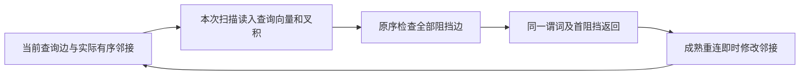
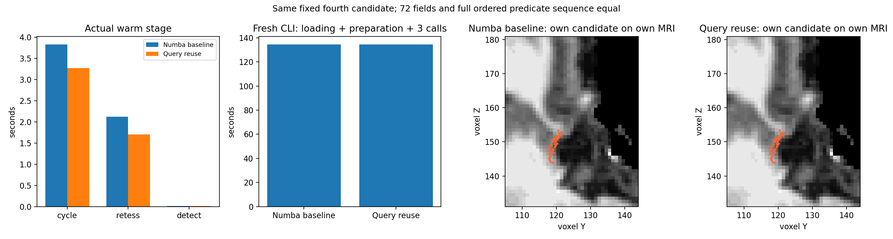
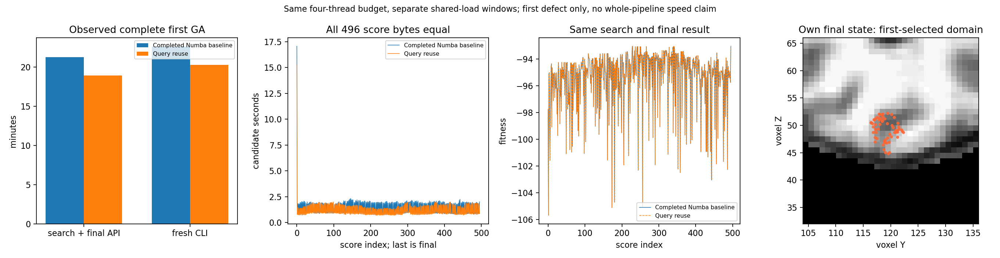

# 拓扑阻挡扫描的查询端复用

## 1. 功能简介

`OrderedBlockerScan` 在每次完整扫描开始时，将查询边的两个 float32
向量转为 float64，并计算一次叉积。随后仍按原顺序检查全部阻挡边。
其余点积、乘法、首阻挡返回、加删邻接与重试顺序不变。near-zero、
共线和退化分支继续调用成熟 `_edge_intersects` 完整谓词。



复用只在一次扫描内有效。下一次重新读取坐标；没有跨坐标缓存、
相交结果缓存、候选裁剪或额外线程。库默认 `blocker_scan_backend="python"`
保持不变；显式 `"numba"` 使用编译扫描。生产运行不启动原 FreeSurfer
阶段程序。完整 GA 和原始 T1 整例的完成门另行评估。

## 2. Python 调用、输入与输出

```python
from fnit.recon_all.topology_edge_blocker_scan import OrderedBlockerScan

# 以下输入来自自产缺陷准备和当前重连状态，不能用参考after初始化。
# source_query_vertices: int32 (Q,)，完整inside+hull访问顺序；允许重复。
# live_ordered_neighbors: N行整数一环，保留原序及未由面支撑的边。
ordered_scan = OrderedBlockerScan(
    scan_vertices=source_query_vertices,
    neighbor_rows=live_ordered_neighbors,
    audit=False,  # True记录每次实际谓词的五列序列和SHA，不作普通计时。
)
first_blocking_edge = ordered_scan.first_blocker(
    xyz=current_canonical_vertices,      # 有限float32 (N,3)，当前canonical坐标。
    a=query_edge_vertex_a,               # 查询边第一个有效顶点编号。
    b=query_edge_vertex_b,               # 查询边第二个有效顶点编号。
    scan_vertices=source_query_vertices, # 完整当前查询序列，必须属于准备域。
    valid=source_mapping_validity,       # bool (N,)，仅约束邻接端点w。
)
# 返回首个(v,w)或None；不排序、不去重、不移动坐标。
# 成熟重连接口每次加删邻接后，用完整当前行立即同步。
ordered_scan.sync_vertex(
    vertex=changed_neighbor_vertex,
    row=live_ordered_neighbors[changed_neighbor_vertex],
)
```

`scan_vertices`、`neighbor_rows` 和 `audit` 是构造参数；输入行复制到
独立 typed 缓冲。`first_blocker` 的 `xyz/a/b/scan_vertices/valid` 是当次
坐标、查询边、访问顺序与有效域；有效域不能额外排除查询顶点。
`sync_vertex(vertex,row)` 更新该顶点完整当前行。输入不原地修改；
非法整数域在 int32 转换前拒绝。

生产调用使用现有
[有序扫描完整接口](TOPOLOGY_ORDERED_BLOCKER_SCAN.md#完整自有库入口)，
显式传 `blocker_scan_backend="numba"`，搜索、最终评分和最终几何使用
同一选择。没有新增参数或依赖。canonical仍为float32，谓词的既有
float64计算顺序保持；未启用fastmath、half或TF32。本项无CUDA分配。

## 3. 命令行调用

```bash
# 使用同一冻结初态，各版本都执行完整cold/warm/audit，不截短25/40轮。
python tools/benchmark_recon_topology_fourth_candidate_profile.py \
  --input-surface /workspace/own_subject/surf/lh.orig.nofix \
  --input-qsphere /workspace/own_subject/surf/lh.qsphere.nofix \
  --brain /workspace/own_subject/mri/brain.mgz \
  --state-checkpoint /workspace/own_run/defect-002.npz \
  --producer-progress /workspace/own_run/progress.jsonl \
  --frozen-source-manifest /workspace/query_source/SOURCE_MANIFEST.json \
  --expected-source-manifest-sha256 "$frozen_source_sha256" \
  --expected-checkpoint-sha256 "$previous_checkpoint_sha256" \
  --defect-number 3 --threads 4 --blocker-scan-backend numba \
  --audit-sequence --skip-profile --output /workspace/new_fourth/candidate

# 独立fresh进程直接调用库prepare/search/finalize：初始5评分+最终1评分。
python tools/benchmark_recon_topology_genetic_blocker_wiring.py \
  --frozen-source /workspace/own_frozen_source \
  --input-surface /workspace/own_subject/surf/lh.orig.nofix \
  --input-qsphere /workspace/own_subject/surf/lh.qsphere.nofix \
  --brain /workspace/own_subject/mri/brain.mgz \
  --hemisphere lh --threads 4 --seed 1234 --output /workspace/new_pair
```

SHA参数是实际文件绑定，不是跳过校验的开关。第四诊断的两个版本
都选Numba，只改变查询端复用；六评分则核Python与本版Numba的真实
库参数贯通。`population_size=5,niters=0`是阶段协议，不能称默认全GA。
完整首缺陷另用默认10个体、停滞10、niters−1、seed1234；旧结果仅在
新产物保存后用于比较。

## 4. 原软件对应步骤

对应 `mris_fix_topology -ga` 内部 `retessellateDefect_wkr` 的有序相交
扫描，没有原软件独立命令。原程序仅在隔离benchmark中作为参考：

```bash
mris_fix_topology -mgz -sphere qsphere.nofix -inflated inflated.nofix \
  -orig orig.nofix -out diagnostic.orig.premesh -ga -seed 1234 \
  -threads 4 subject lh
```

本轮直接比较FNIT既有Numba扫描与本版扫描；没有重复原程序整例，
没有把内部谓词的时间当作原程序全GA时间。

## 5. 真实精度、计时与脑图

公开ds000114 sub07 ses-test LH的79a41cdd自产输入；第四首候选由自身
第三缺陷完整检查点恢复。两个fresh子进程顺序运行，CPU84–87、各4线程、
CUDA隐藏，共享负载存在。helper实测SHA为 `1a9cc1f9…`，动态接口仍为
`74c381ac…`；两个冻结源只helper不同。表内均为完整实测墙钟。

| 范围 | 既有Numba | 查询端复用 |
|---|---:|---:|
| fresh CLI：加载、准备、三次调用、写出 | 134.428856s | 134.494223s |
| cold完整候选闭环，含首次JIT | 19.219048s | 20.654912s |
| warm完整候选闭环 | 3.826088s | 3.263971s |
| warm重连 | 2.119833s | 1.703517s |
| warm面发现 | 0.012013s | 0.011157s |
| warm25次smooth | 0.057395s | 0.048850s |
| warm40次match | 0.091913s | 0.083428s |
| audit完整闭环，含序列缓冲与哈希 | 4.980915s | 5.469966s |
| peak child RSS | 2,081,088KiB | 2,085,252KiB |

热调用观察较快，冷调用、审计调用和fresh CLI均未提速。独立evaluator
热准备为8.391705/6.416852s，已包含在CLI；不能扣除准备后称完整收益。
全部cold/warm/audit各72字段的shape、dtype、bytes及控制都一致。
17,123次首阻挡扫描、2,656,862次有向谓词调用的完整五列序列SHA均为
`9acfa671…`。没有缩小扫描范围或跳过退化分支。

直接库六评分81字段、4个NPZ完整文件SHA及全部控制一致；两边20,877次
RNG bounds/value序列SHA均为 `39b81ccb…`。Python/本版Numba的CLI为
115.622033/119.246340s，search+final API为37.881616/39.917858s。
这也是冷进程观察，未显示完整阶段提速。



图中190个顶点是自产候选终态，两个版本逐位相同；它不是官方误差图。

完整默认首缺陷也已退出0。默认10个体、停滞10、niters−1、seed1234、
CPU84–87各4线程，执行495次搜索评分加最终1次、497次重连及29条代际
轨迹（零基编号0–28）。80字段的shape/dtype/bytes、3个NPZ完整文件SHA、
全部496个double分数和搜索控制都与既有完整Numba结果一致；坐标和有序
面最大/P99差均为0。最终fitness为−93.04168701171875。

| 完整首缺陷范围 | 已完成Numba基准 | 查询端复用 |
|---|---:|---:|
| fresh CLI，含加载、准备、写出和检查 | 1357.057126s | 1217.853505s |
| 全部准备与搜索的API，报告前 | 1349.788190s | 1208.901601s |
| search+final连通阶段 | 1277.391707s | 1134.773795s |
| 其中evaluator一次准备 | 6.594984s | 5.812791s |
| 其中完整search | 1265.888494s | 1124.099519s |
| 其中finalization | 4.816015s | 4.763964s |
| peak child RSS | 1,703,964KiB | 1,695,568KiB |

两次完整首缺陷使用同四线程预算，但属于不同共享负载窗口，未执行ABBA；
表格记录实际较短的本次墙钟，不作稳定吞吐或整个半球收益归因。完整工具
记录RNG调用数1,362,381和29条控制轨迹，与基准一致；它未捕获逐次draw
bounds/value。逐draw序列严格检查仅属于上述直接六评分门。



完整首缺陷图展示全部496个评分及首候选选中域的99个自产最终顶点；
它不是官方误差或完整半球质量图。新完整manifest为`5bd768f2…`，只将已
完成Numba基准`7435adf4…`的helper `33a919df…`换成本版`1a9cc1f9…`；
第四配对中的旧helper实际为`6cc1e3d6…`，分别保留各自运行绑定。
完整首缺陷的诊断包装并非新生产整例。九缺陷、orig与原始T1整例未由
本项验收，既有冻结运行继续使用其原版本，不外推600秒目标。
机器报告见[本轮验证目录](../../validation/recon_all/optimizations/20261011_topology_query_half/README.md)。

## 6. 更新与benchmark记录

- 前版完整有序Numba扫描及全first默认GA门见
  [原扫描文档](TOPOLOGY_ORDERED_BLOCKER_SCAN.md)；原负速度观察保留。
- 本版将查询端两个转换和叉积移到单次完整扫描外层，保留成熟谓词
  的near-zero和退化分支。11项契约通过；通用朝向、阈值两侧、极小/大
  坐标尺度和相邻扫描坐标变化都有覆盖。契约不是MRI benchmark。
- 第四真实配对、直接六评分和完整默认首缺陷都已完成；三个协议与源码
  manifest分别绑定，不将六评分称默认完整GA，也不将第一缺陷称整个半球。
- 安全导出核实际父/子COMPLETE、EXIT、report和process、输入及源码SHA；
  图另外核同run、实际MRI变换模块路径/SHA。选中数值和类型保持原样。
- 种群评分含跨候选持久K/E/fx/curvbak、RP更新和fitness驱动RNG分支。
  复制输入不使评分独立；本版没有增加候选并行或改变四线程预算。
- 完整安全导出另外核既有基准的report/process/source/protocol与已公开
  timing记录。第四/六评分导出工具实际为`61537d41…`，完整首缺陷为
  `eacdec74…`；工具新增full-cli基准结构支持，不重标此前执行SHA。

## 7. 参考文献与代码

- Ségonne F, Grimson E, Fischl B. *A Genetic Algorithm for the Topology
  Correction of Cortical Surfaces*. IPMI 2005, 393–405.
  [作者公开论文](https://surfer.nmr.mgh.harvard.edu/ftp/articles/2005/2005_-_Segonne%2C_Grimson%2C_Fischl_-_Information_processing_in_medical_imaging_proceedings_of_the_conference.pdf)
- [固定FreeSurfer拓扑实现](https://github.com/freesurfer/freesurfer/blob/d932c45b7941662ea380a05efef580568b98d41a/utils/mrisurf_defect.cpp)
- [FNIT](https://github.com/weikanggong1/Fudan-Neuroimaging-toolkit)
- [动态重连](TOPOLOGY_DYNAMIC_RETESS.md)、[保留面缓存](TOPOLOGY_FACE_DETECTION_CACHE.md)、[有序Numba扫描](TOPOLOGY_ORDERED_BLOCKER_SCAN.md)

项目主页Conda环境已有NumPy/Numba/nibabel，不新增网格依赖。原始MRI、
完整状态NPZ、日志和内部路径留在授权私有目录；公开仅含数值白名单、
输入/程序SHA和自产派生图。
