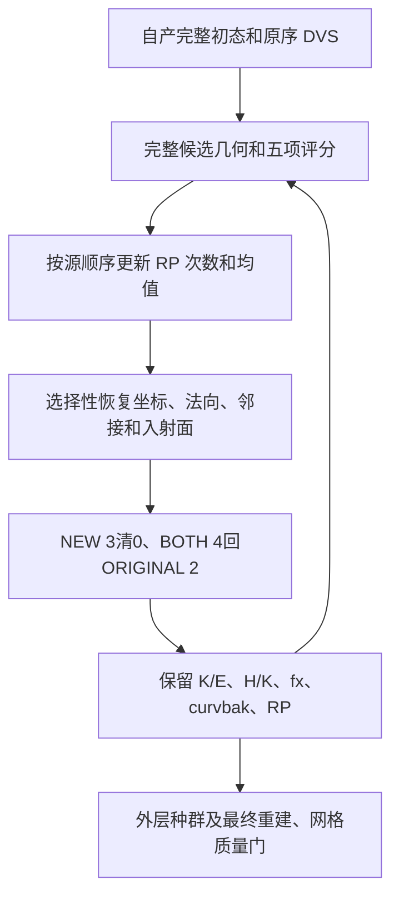

# 拓扑候选：评分、统计、恢复和状态传递

## 1. 功能简介

`evaluate_candidate_cycle()` 在已有完整初态上运行一次候选：重连与 MRI 匹配、完整评分、RP 统计更新、选择性 DVS 恢复及边标志复位。几何、似然、统计和恢复分别复用 FNIT 的成熟接口，运行时不调用原版 FreeSurfer 阶段程序。

`CandidateCycleEvaluator` 将闭环适配为外层种群的串行回调。几何恢复与评分反馈是不同状态：K/E、H/K、fx/fy/fz、curvbak 和 RP 均值继续传给下一候选。这个闭环不生成基底或全局先验，不代表完整 GA 或最终表面通过质量检查。



## 2. Python 调用、输入和输出

```python
import numpy as np
from fnit.recon_all.topology_candidate_cycle import CandidateCycleEvaluator
from fnit.recon_all.topology_candidate_state import record_candidate_state

candidate_snapshot = record_candidate_state(
    surface_state=own_base_state,  # 同一版本的完整自产基底字段
    defect_vertices=original_defect_vertices,  # 原有序全部缺陷点，不只保留活动点
    convex_hull_vertices=original_defect_hull,  # 源完整 chull，含边界和额外一环
    border_vertices=original_defect_border,  # 原有序边界
    vertex_translation=own_vertex_translation,  # 原网格→corrected 索引
    profile="chull",  # 固定源 error-profile 的保存范围
)
candidate_evaluator = CandidateCycleEvaluator(
    surface_state=own_base_state,  # 下表列出的完整字段；不从参考 after 填入
    snapshot=candidate_snapshot,  # 本链自身记录的同网格快照
    retessellation_inputs=own_retessellation_inputs,  # 完整有序基底、边、映射和重叠表
    candidate_inputs=own_candidate_inputs,  # 同 MRI 的矩阵、局部/全局先验及权重
)
candidate_feedback = candidate_evaluator(
    ordering=next_candidate_ordering,  # 完整整数(E,)排列，由外层生成
    discarded_defect_vertices=next_discarded_vertices,  # 原序 bool(K,) DISCARD
    vertex_rip=current_vertex_rip,  # int32(N,) 原 signed-char 标记，保留负值及非二值
    use_counts=current_use_counts,  # int32(K,)累计次数，非负
    vertex_fitness=current_vertex_fitness,  # float32(K,)已有反馈均值
)
# 下一候选传入 candidate_feedback 的 rip/use_counts/vertex_fitness；
# 几何、K/E、H/K、fx 和 curvbak 由 candidate_evaluator 持有并继续传递。
```

### 全部状态字段

所有顶点属性采用同一 corrected 顶点顺序。原坐标为 surface RAS/mm；MRI 采样矩阵采用拓扑 MRI-only tkregister RAS→连续体素定义，不能改用 placement 的 footer→scanner 桥。

| 字段 | 类型、结构和意义 |
| --- | --- |
| `original_vertices`、`vertex_normals` | `float32(N,3)`，原坐标 mm 与当前法向 |
| `vertex_rip`、`vertex_marks` | `(N,)` 整数标记；rip 保留 signed-char −128…127，不用 bool 返回替代原值 |
| `vertex_topology` | `int32(N,7)`，列序 nsizeCur/nsizeMax/vtotal/vnum/v2num/v3num/num；当前仅接受源一环 0/1 状态、vtotal=vnum |
| `neighbor_storage` | N 条原有序整数邻接存储，至少到源 nsizeMax 所需容量；不能从面重建后重新排序 |
| `incident_faces`、`incident_corners` | N 条原有序入射面及对应角点行，num 指定有效长度 |
| `faces`、`nfaces` | 整数 `(capacity,3)` 与独立逻辑面数；恢复只回缩 nfaces，保留追加面容量和内容 |
| `face_area`、`vertex_area` | `float32(capacity,)`/`float32(N,)`，mm²；保留源有向或零面积，不以法向缓存面积替代 |
| `k1`、`k2`、`tangent_e1`、`tangent_e2` | `float32(N,)`/`float32(N,3)`，主曲率 mm⁻¹ 与切向基；DVS 不恢复这些字段 |
| `flattened_vertices`、`curvbak` | `float32(N,3)`/`float32(N,)`，fx/fy/fz 采样位置 mm 与累计反馈状态 |
| 可选 `H`、`K` | 已有 `float32(N,)`，平均/高斯曲率 mm⁻¹/mm⁻²；仅本次非空 SFF fit 行更新，未提供不伪造，空邻域保留 |
| 可选 `face_rip`、`face_normals` | 旧面标记保留、新面标记为0；计算面法向缓存单列，不写回 FACE.area |

`retessellation_inputs` 见 [动态重连](TOPOLOGY_DYNAMIC_RETESS.md)；当前闭环只支持完整 `mode="all"`，不接受尚未验证的动态删除或多环存储。`candidate_inputs` 为 [完整候选](TOPOLOGY_CANDIDATE_PIPELINE.md) 的全部关键字，除两个 state 参数：原 uint8 MRI、4×4采样矩阵、每缺陷一次自产局部先验、自产白灰联合 PDF、k1/k2 均值、法向/曲率直方图和联合曲率 PDF、四个源 double 权重。权重默认沿用该接口 1/10/1/1，不由闭环修改。

`evaluate_candidate_cycle()` 另直接接受上述 state/snapshot/两参数字典和 `use_counts`/`vertex_fitness`，返回完整新 `surface_state`、`edge_used`、两 RP 数组、实际 `fitness`、完整 `candidate`、`statistics`/`restore` 报告和分步骤 `seconds`。`CandidateCycleEvaluator` 返回五参数回调需要的 fitness/rip/RP，完整末态在 `.surface_state` 与 `.last_result`。

`materialize_candidate_state(initial=..., result=...)` 只复用同一状态装配，不重新评分、统计或恢复；最终第二次几何重建没有 SFF fit 标记时，保留真实持久 H/K。它检查有序 base 面前缀及 append-only 邻接/入射顺序。

闭环在评分前完整校验当前一环状态；普通装配复用本次已验证的 `(顶点数, topology, 逻辑面数)`，省去对同一初态三组行容量的第二次遍历。私有 `_candidate_state_validated(initial=..., result=..., validated=...)` 只在本模块内使用，仍检查全部候选面及有序追加前缀；它没有文件输出、坐标计算或跨候选缓存。独立 `materialize_candidate_state()` 及显式 `state_context` 路径保留完整预检，下一候选重新校验实际状态。公开参数和失败行为不变。

DVS恢复改变坐标和邻接后，上一候选的面法向缓存必须失效；返回的`restore.topology_cache_invalidation_required=True`明确提示这一边界。下一候选会按新坐标重算，不使用旧`face_normals`作为当前几何。不可变base缓存只覆盖原canonical/面/邻接版本，不缓存迭代MRI坐标。

输入不修改，异常时不发布新回调状态。缺字段、容量、形状、类型、索引或版本错误为 `ValueError`/`KeyError`；成熟子函数异常原样传播。回调限单线程顺序执行，不支持多个候选并行访问同一实例，不修改全局线程、CUDA、TF32或精度策略。

## 3. 命令行和复现

这是原软件内部步骤，没有独立公共 CLI。冻结同输入诊断工具使用显式参数：

```bash
PYTHONPATH=src:tools python tools/benchmark_recon_topology_candidate_cycle.py \
  --before-retess diagnosis/retess.before.bin \
  --initial-attributes diagnosis/match.before.bin \
  --initial-global-priors diagnosis/statistics.bin \
  --input-surface own-subject/surf/lh.orig.nofix \
  --input-qsphere own-subject/surf/lh.qsphere.nofix \
  --brain own-subject/mri/brain.mgz \
  --after-statistics-reference benchmark-only/patch_statistics.bin \
  --after-volume-reference benchmark-only/volume.bin \
  --fitness-reference benchmark-only/fitness.json \
  --output diagnosis/new-cycle-run \
  --threads 4
```

前三项是带哈希、相位明确的诊断 before/global 状态，不是生产输入。三个原 nofix/qsphere/MRI 文件用于独立校准和局部先验。后三个 reference 只在全部自产候选 NPZ 写出后打开；不能用于初始化下一候选。`output` 必须不存在，`threads` 为正整数固定预算。工具运行 A0→A1、B0→B1 两条串行序列，首候选可对参考，第二候选只验自身连续性及重复性。

工具的 `build_frozen_cycle(surface_state=..., retessellation_inputs=..., vertex_marks=..., candidate_inputs=...)` 是诊断准备 helper：明确按源 calloc/加边构造一环计数、记录 DVS、一次构建不可变 base 缓存。它不声称完整 raw base producer，不能接到生产读冻结参考。完整数组/收据留在授权私有诊断目录；公开仅发布指标与程序哈希。

## 4. 原软件步骤

对应 `mrisDefectPatchFitness()` 完整候选评分，`updateVertexStatistics()` 更新反馈，`mrisRestoreVertexState()` 全恢复，以及 NEW/BOTH 边标记复位。入口仍为原 `mris_fix_topology -ga`；这些函数没有独立 CLI。固定源码为 `d932c45b7941662ea380a05efef580568b98d41a`，C++ 观察器只在隔离 benchmark 使用。

源 DVS 恢复 orig/normal/有序拓扑与入射面，不恢复 K/E、H/K、fx、curvbak/RP/rip/marks。新面 FACE.area 仍为源零初始化；中间加权诊断的 IEEE NaN 与最终质量门分开，不能据其存在跳过核心 fitness 或发布失败表面。

## 5. 最新真实数据和计时

2026-10-11 的同次预检复用已通过[第四缺陷真实候选回归](../../validation/recon_all/optimizations/20261011_topology_distance_slabs_fourth/README.md)。五组共15次冷/暖/审计重放的78项完整字段和全部控制逐字节相同；本修改单独使用原距离核，未与距离并行混合。暖候选外层调用（含诊断包装）为3.772341→3.496588秒，函数内部完整闭环为3.765642→3.491810秒；诊断CLI为148.295691→128.591002秒，含加载、自产前置、三次候选、完整NPZ写出和退出，不是一次生产候选或整例时间。未改动的重连也从2.092180变到1.966245秒，因此不能把全部下降归因于省去一次预检。CPU80–83、总四线程、CUDA隐藏，无新增依赖或精度设置。

此前第四缺陷 cProfile 中两次一环校验共0.338628秒；该值包含剖析开销，只用于定位重复遍历。下面是2026-10-10闭环版本的实测记录，不作为本次修改的运行结果。当前完整GA与原始T1整例的收益尚未验证。

当前真实同输入回归使用公开 ds000114 sub-07 ses-test LH、FNIT 79a41cdd 自产上游，固定四核 CPU、GPU隐藏。初始全属性及全局曲率/法向先验明确冻结；原 MRI→白灰校准/局部场由本链重新生成。

v2 从新目录完整退出0，两条序列分别 A0→A1、B0→B1。每轮 110,534 顶点，完整候选有序面216,860（追加138面），恢复后逻辑面数216,722；163条 DVS 记录恢复，38个活动 RP 条目次数从1增长到2，其余DISCARD条目保留0。两个序列对应的 **47项完整数值字段与全部控制决策均0 bit差异**，包括完整坐标/面/CSR、K/E、fx、curvbak、评分、RP与恢复后的状态。首候选仍通过已有完整参考门，最大/P99坐标误差0；第二候选未捕获原版连续轨迹，只有自产连续性和重复门。

| 完整边界 | A0 / A1 | B0 / B1 |
| --- | --- | --- |
| 候选闭环API，含装配、评分、统计、恢复 | 17.129899 / 4.448711 s | 4.467959 / 4.193901 s |
| 其中完整几何/SFF/五项候选API | 15.795269 / 3.157796 s | 3.144905 / 2.905746 s |
| 其中RP更新 | 0.000752 / 0.000547 s | 0.000517 / 0.000513 s |
| 其中选择性DVS恢复 | 0.015981 / 0.010477 s | 0.011340 / 0.010403 s |
| 两份完整NPZ写出，另计 | 2.693274 / 2.405950 s | 2.409202 / 2.404885 s |
| 每序列不可变base准备一次，另计 | 2.917184 s | 2.731269 s |

A0 包含首次 JIT；B0 是新序列的首次API，但同进程编译已热。共享节点、四核亲和性8–11/总4线程，不能称独占吞吐。全N状态校验和装配每轮还约1.3s，是本次记录的新开销；统计和DVS本身不是主要热点。完整fresh CLI **100.403115s**，含导入、初态/MRI加载、校准/缓存、四次完整循环、全部读写及事后参考检查；子进程峰值RSS **1,465,260 KiB**。没有CUDA运行或20GB显存结论，没有原版相同范围的冷/热计时，未计算性能倍率。

初态/MRI加载1.803202s，原 nofix/MRI识别、白灰校准及局部先验准备46.268819s，已包含在完整CLI中；该准备每缺陷一次，不应每个候选重复执行。

模块SHA `c91d7bd4…`，工具SHA `c660cf7b…`；同环境8契约全部通过，含解释器导入的进程墙钟2.020368s。完整[机器报告](../../validation/recon_all/optimizations/20261010_topology_candidate_cycle/README.md)保留全部严格误差和实际输入/参考/程序哈希。原参考复用既有完全相同捕获，原程序重复性记录逐字节一致，本次没有重新调用原版。

初始冻结属性实际不含H/K，因此 **H/K源公式与空邻域保留本轮只由契约覆盖，不声称真实全数组bit门**。完整 base/global priors producer、种群随机序列、最终网格质量与整体指标等效仍为 `not_assessed`。


图使用本次A0/A1自产NPZ。显示99个追加面关联点、38个活动RP条目；首候选参考误差及第二对首候选形变均0。这里固定相同排列产生相同几何，同时累积RP次数，不能据此推断换排列、剔除或完整随机种群也通过。

## 6. 更新和 benchmark 记录

- 2026-10-11：普通闭环只遍历一次当前初态的三组行容量，保持评分、状态装配、RP/DVS 和候选间顺序；独立公开装配入口不省略校验。真实同输入回归与完整运行结论分别记录，未据历史时间宣布加速。
- 本地闭环/缓存/新校验合同共21项测试、9项子测试通过，pytest报告24.33秒；新增检查覆盖下一候选修改后的拒绝、失败时不发布反馈、独立装配仍完整校验及候选有序前缀。小网格合同不替代上述真实MRI回归。
- 2026-10-10：新增串行候选闭环，复用成熟评分/统计/DVS，不重复实现数值算法。八项本地契约覆盖跨候选反馈、有符号 rip、失败事务、H/K空邻域保留及有向 FACE.area。
- v1 诊断 overlay 缺既有 DVS 解析工具，导入失败且算法未运行；原收据保留。v2只补齐成熟解析依赖，算法及 helper 字节不变，从新目录完整重跑通过。
- 已有[完整首候选](TOPOLOGY_CANDIDATE_PIPELINE.md)和[不可变基底缓存](TOPOLOGY_PREPARED_BASE_CACHE.md)分别提供同输入证据；不能把它们当作本闭环、完整 GA 或原始 T1 整例的验收结果。

## 7. 参考文献和代码

- [固定 FreeSurfer 拓扑源码](https://github.com/freesurfer/freesurfer/blob/d932c45b7941662ea380a05efef580568b98d41a/utils/mrisurf_defect.cpp)。
- [FNIT 闭环](../../src/fnit/recon_all/topology_candidate_cycle.py)、[DVS](TOPOLOGY_CANDIDATE_STATE.md)、[RP 统计](TOPOLOGY_CANDIDATE_STATISTICS.md)、[完整候选](TOPOLOGY_CANDIDATE_PIPELINE.md)。
- Fischl, B., Liu, A. & Dale, A. M. (2001). Automated manifold surgery: constructing geometrically accurate and topologically correct models of the human cerebral cortex. IEEE TMI 20, 70–80。[原作者论文](https://surfer.nmr.mgh.harvard.edu/pub/articles/fischl01-topology-fixing.pdf)。
