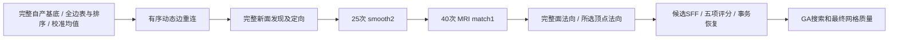
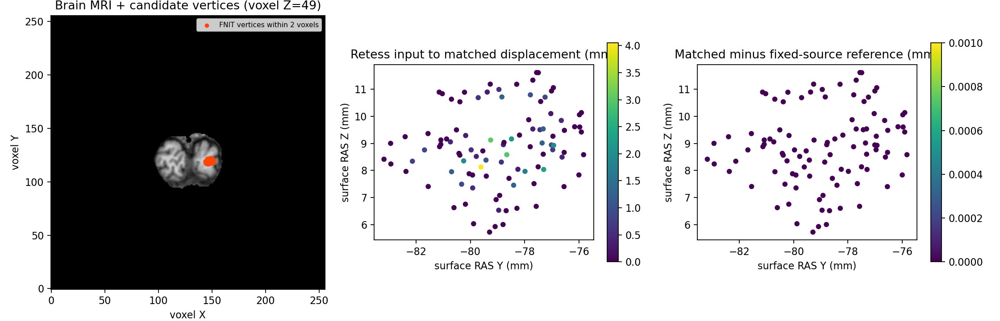

# 一个拓扑候选的连续重连与 MRI 几何优化

## 1. 功能简介

`candidate_geometry` 将项目已有的有序重连、面发现与定向、25次曲率自适应
平滑、40次MRI边界匹配和源顺序法向组成一个可调用函数。计算使用自有
Python/Numba，读写由调用者用 nibabel 完成；不运行 FreeSurfer 阶段程序。



本接口完成 B–F；A 由上游提供，G–H 不在本接口内。当前真实回归使用唯一
重连前状态和明确冻结的校准均值，不把它称为原始 T1 整例或完整 GA。
中间候选的相交或翻折必须在搜索及最终质量检查中继续处理。

## 2. Python 调用、输入与输出

```python
from fnit.recon_all.topology_candidate_geometry import candidate_geometry

candidate = candidate_geometry(
    original_vertices=base_original_vertices,  # float32(N,3)，基底 orig surface RAS/mm
    volume=brain_volume_uint8,  # uint8(X,Y,Z)，归一化脑MRI；不读参考局部场
    ras_to_voxel=mri_only_surface_ras_to_voxel,  # 4×4浮点，MRI tkregister RAS到体素
    white_mean=calibrated_white_mean,  # 校准白质均值，强度无单位
    gray_mean=calibrated_gray_mean,  # 校准灰质均值，强度无单位
    k1_mean=calibrated_k1_mean,  # 校准主曲率均值，mm^-1，有限非零
    k2_mean=calibrated_k2_mean,  # 第二主曲率均值，mm^-1，有限非零
    retessellation_inputs={
        "canonical": base_canonical_vertices,  # float32(N,3)，同一顶点顺序
        "base_faces": retained_base_faces,  # 整数(F,3)，全部缺陷面已移除
        "neighbors": ordered_base_neighbors,  # N行一环，保留没有面支撑的原边
        "candidate_edges": ordered_mri_edge_table,  # 整数(E,2)，完整自产表
        "edge_used": initial_edge_states,  # 整数(E,)，原0…6状态
        "ordering": candidate_edge_order,  # 整数(E,)，完整原边编号排列
        "inside_vertices": mapped_inside_vertices,  # 整数(I,)，完整原inside顺序
        "inside_discarded": discarded_inside_flags,  # bool(I,)，原DISCARD状态
        "border_vertices": mapped_border_vertices,  # 整数(B,)，原完整border
        "hull_vertices": mapped_convex_hull_vertices,  # 整数(H,)，前B项是border
        "vertex_rip": initial_vertex_rip_flags,  # bool(N,)，原rip，不重判组织
        "fixed_mapping": None,  # 缺省全true；实验映射可显式给bool(N,)
        "mode": "all",  # all默认；some有动态顶点分类，不改变迭代数
        "overlaps": None,  # 默认逐边完整检查；可给E行有序原边编号
        "overlap_complete": None,  # 有overlaps时必需bool(E,)，表完整标志
    },
)
matched_vertices = candidate["original_vertices"]  # float32(N,3)，匹配后坐标
candidate_triangles = candidate["faces"]  # 原保留面顺序后追加新面
```

外层八项参数全部必填。MRI矩阵采用 **volume-only tkregister** 路径，与
placement 的 surface-footer→scanner 映射不是同一语义；不能全局改后者。
平滑和匹配只更新本次实际选择的 inside，border和外部点固定。没有减少
轮数或近似算法开关。`retessellation_inputs` 的状态编号、overlap规则、
失败条件和其余返回字段见[动态重连](TOPOLOGY_DYNAMIC_RETESS.md)。

| 增加的返回字段 | 结构、单位及语义 |
|---|---|
| `original_vertices` | float32(N,3)，匹配后的 orig surface RAS/mm |
| `smoothed_original_vertices` | float32(N,3)，25次平滑后坐标 |
| `face_normals` | float32(F,3)，当前完整面序的单位法向 |
| `selected_vertex_normals` | float32(K,3)，所选 inside+border 顺序的单位法向 |
| `cached_original_face_area_mm2` | float32(F,)，FaceNormCache original_area；不替代 FACE/VERTEX.area |
| `incident_offsets/faces/corners` | int32(N+1)/int32(3F)/int32(3F)，有序入射面及其0…2角点 |
| `neighbor_offsets/ordered_neighbors` | int32(N+1)/int32(Eadj)，当前有序一环CSR |
| `stage_seconds` | 各完整内部调用及完整API秒数；不含调用者导入和读写 |

返回状态独立，不修改输入，不重写外部顶点法向、K/E、curvbak、RP或DVS。
`candidate_incidents(faces=..., vertex_count=..., base_context=None)` 按完整有序面表构造CSR，
保留重复面；不能假设任意外来网格都按这个原基底/追加面顺序建邻接。
显式使用不可变context时，要求完整基底面前缀逐元素同序；仅追加新面
入射且保留全N行的face/corner顺序。`candidate_geometry()`通过
`retessellation_inputs`传入同一context，普通完整调用保持不变。
接口和完整候选ABBA见[不可变基底缓存](TOPOLOGY_PREPARED_BASE_CACHE.md)。
非法dtype、shape、索引、MRI、矩阵、均值或顶点对应关系抛 `ValueError`；
成熟子函数的失败直接抛出。未实现的上游或最终质量不能用该返回值替代。

## 3. 命令行与诊断产物

```bash
# 算法只读取唯一before、同MRI与显式冻结校准先验。
# smooth/after参考在全部候选NPZ写出后才读取，用于事后比较。
python tools/benchmark_recon_topology_candidate_geometry.py \
  --before /workspace/benchmark/retess.before.bin \
  --mri /workspace/inputs/brain.mgz \
  --white-mean 85.10910034179688 \
  --gray-mean 62.694217681884766 \
  --k1-mean=-0.09168962389230728 \
  --k2-mean=-0.03310907259583473 \
  --smooth-reference /workspace/benchmark/match.smooth.bin \
  --after-reference /workspace/benchmark/match.after.bin \
  --output /workspace/diagnostics/new-candidate
```

这些均值是本次明确声明的冻结先验，示例不能作为其他被试的通用常量。
生产调用由[自产校准](TOPOLOGY_DEFECT_CALIBRATION.md)及全局曲率先验生成
各自均值。唯一before使用FNITRTS1；新增FNITMAT1读取完整坐标/法向、
有序vnum/vtotal、incidents、selected及参数，只用于阶段诊断。FNITHST1
读取校准entry/raw/smooth；FNITRST1读取真实RP更新前后。所有解析器都
保留dtype/顺序，截断、索引、CSR、尾部或phase错误报错，不填缺失字段。

输出冷/重复NPZ、JSON报告。独立 `plot_recon_topology_candidate_geometry.py`
采用具名 `--brain --candidate --before --reference-after --output` 生成
MRI顶点叠加、真实形变及参考误差图；它只读已完成候选，不改算法。

## 4. 原软件对应步骤

属于 `mris_fix_topology -ga` 内部步骤，没有独立官方CLI：

```bash
# 只允许独立benchmark，不进入生产。
mris_fix_topology -mgz -sphere qsphere.nofix -inflated inflated.nofix \
  -orig orig.nofix -out diagnostic.orig.premesh -ga -seed 1234 \
  -threads 4 subject lh
```

固定版本 d932c45b7941662ea380a05efef580568b98d41a；函数链为
`retessellateDefect → detectDefectFaces → orientDefectFaces → defectMatch`。
本次参考只加只读MAT/HST/RP记录并有意停止，不生成GA最终输出。两个参考
重复的捕获字节相同；原算法未因观察而变化的七项捕获SHA另保留。

## 5. 最新真实精度、时间与脑图

公开 ds000114 sub07 ses-test LH，输入绑定79a41cdd原始T1链。accelerator-b同机、
CPU8–11、线程预算4、CUDA隐藏；共享负载。所有源码、程序、原影像与候选
哈希见[完整报告](../../validation/recon_all/optimizations/20261010_topology_candidate_geometry/README.md)。

| 范围 | 冷运行(s) | 重复(s) | 本次严格结果 |
|---|---:|---:|---|
| 重连+完整面发现 | 6.091473 | 4.052848 | 全4723边状态、216860有序面相同 |
| 25次平滑 | 1.111635 | 0.403258 | 全110534坐标0bitdiff |
| 40次MRI拟合 | 1.466715 | 0.613045 | 全110534坐标0bitdiff，max/P99=0mm |
| 完整面/所选顶点法向 | 1.000890 | 0.533573 | 99个所选顶点法向0bitdiff |
| **完整可调用API** | **9.705629** | **5.642997** | 包含校验和全部内部计算 |
| NPZ写出 | 0.933853 | 0.932518 | 另计，未藏在算子提速中 |

完整650882邻接项、650580入射项与角点、selectedV/F、ordered faces均逐位
相同。参考两次观察程序5.321940/5.144005秒包含上游和捕获I/O，不是相同
API边界，**不能据此给加速倍数**。加载、解释器/导入及全CLI另列收据。
本组没有GPU运算，GPU峰值记未测而非0；未声称整例显存或独立隔离通过。



图中MRI是体素坐标，形变/误差是surface RAS毫米；误差为0不代表最终
拓扑质量合格。严格复现只针对一个完整候选，整体指标等效暂未判定。

## 6. 更新与benchmark记录

- match观察器v1编译诊断字段int→float narrowing失败；v2显式转换后两次
  MAT完整捕获字节一致，旧七项算法输出不变。
- match诊断v1误用旧冻结函数，缺少已成熟`iterations`参数；v2复制只读目录
  时准备失败。v3准确复用已验证MRI匹配，25→40连续及冻结smooth均0差异。
- geometry v1直接组装成熟算子，完整连续候选通过；v2提取可调用API，
  源码18b75b4b…重新冻结并完成同输入0bitdiff。没有重写原优化器。
- 动态重连依赖专门用已提交HEAD4b20a92f…替换旧脏wrapper89d7423f…，
  v4完整回归仍全部0bitdiff，两个导入函数AST完全相同。旧wrapper实验
  未成为该组合API的隐藏依赖，未夹入本提交。
- RP观察器记录三次真正更新，次数0→1、1→2、2→3，后两次包含38项非零
  历史值；源统计更新的完整真实验收由其独立专页报告。

旧失败、原检查点、完整原始收据留在授权benchmark目录；公开发布仅安全
标量/哈希和公开MRI派生图，不发布MRI、NPZ、原程序、内部地址或编译argv。
后续仍需完整base/DVS/全局prior自产、五项评分和GA选择/交叉/变异/停止，
再验证最终连通性、流形、自相交、解剖形状及原始T1整例。

## 7. 参考文献和源码

- [固定FreeSurfer拓扑源码](https://github.com/freesurfer/freesurfer/blob/d932c45b7941662ea380a05efef580568b98d41a/utils/mrisurf_defect.cpp)
- [FNIT仓库](https://github.com/weikanggong1/Fudan-Neuroimaging-toolkit)
- [有序动态重连](TOPOLOGY_DYNAMIC_RETESS.md)、[候选SFF](TOPOLOGY_CANDIDATE_SFF.md)、[准备后五项评分](TOPOLOGY_PATCH_FITNESS_ASSEMBLY.md)

沿用项目主页已有NumPy/Numba/nibabel依赖；诊断脑图使用已有matplotlib。
原源码只用于独立参考，接口自身不调用原FS阶段程序。
