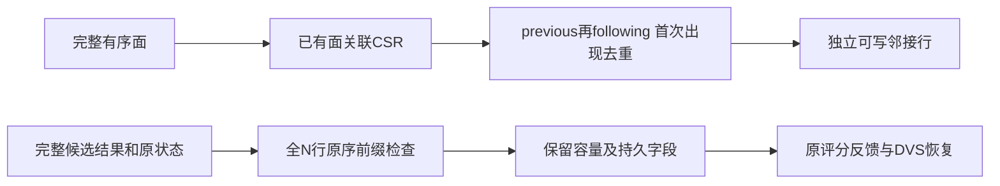
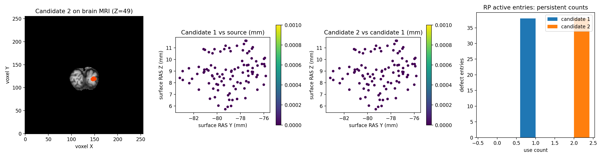

# 拓扑候选：有序邻接与完整状态装配的性能定位

## 1. 功能简介

本轮从一次真实冻结输入剖析开始，优化两处整数和数据组织开销：

- `smooth_surface_python.ordered_neighbors()` 复用已有 `ordered_face_csr()`，由 Numba 按原面/角点顺序执行去重。
- `topology_candidate_cycle` 的状态装配保留每个候选的完整检查，减少短行 `np.array_equal()` 的临时布尔数组和归约，并一次转换完整角点数组。

没有修改候选重连、25次平滑、40次 MRI 匹配、五项评分、RP 更新、DVS 恢复、最终重建及质量门。邻接随面变化重新生成；状态装配不缓存动态邻接。已有不可变基底缓存继续按原版本显式使用。



## 2. Python 调用、输入和输出

```python
from fnit.recon_all.smooth_surface_python import ordered_neighbors
from fnit.recon_all.topology_candidate_cycle import materialize_candidate_state

one_ring_neighbors = ordered_neighbors(
    faces=ordered_triangle_faces,  # 整数(F,3)，保持实际面表/角点顺序
    nvertices=vertex_count,  # 非负整数N，包含孤立顶点
)
next_surface_state = materialize_candidate_state(
    initial=current_surface_state,  # 自产完整一环状态，含有效长度与容量
    result=complete_candidate_result,  # 完整evaluate_candidate返回，不读取参考after
)
```

`ordered_neighbors()` 返回 N 个独立 `list[int]`。每角点先加入 previous，再加入 following，仅去除已经出现的项，不排序邻居。重复角点、自环及孤立顶点的合法数组语义保留；修改返回行不会改变面表或后续调用。输入无坐标和物理单位。错误形状、非整数面、负数/越界索引或非法 N 抛 `ValueError`，先校验再进入编译循环。没有默认缓存、设备或精度参数；首次 JIT 和常驻整数缓冲需要计入调用成本。

`materialize_candidate_state()` 的全部状态字段、坐标与单位见[候选闭环](TOPOLOGY_CANDIDATE_CYCLE.md)：坐标为 surface RAS/mm，曲率为 mm⁻¹，面积为 mm²；MRI 矩阵为拓扑 MRI-only tkregister RAS→连续体素。`initial` 必须有一环计数、完整有序邻接及面/角点存储，`result` 必须是同顶点顺序的完整候选。它不重新评分或恢复。

返回新字典，保留原状态未消费的属性。邻接未新增的行保留原容量尾部；新增行独立复制。入射行按候选有效长度复制，保持与几何结果无别名。每次仍检查全部 N 行、有效邻接/入射前缀、完整有序基底面及 logical nfaces；只接受 all-mode append-only 行。动态删除、多环或顺序变化仍明确失败；输入不修改，不发布失败中间状态。H/K、K/E、fx、curvbak、RP 与 rip 的选择性保存/恢复规则没有改变。

## 3. 命令行调用

这些内部函数没有单独生产 CLI。新工具在明确冻结的旧工作区上做控制/候选/候选/控制四个独立进程，每进程完整运行两条候选→最终写回序列：

```bash
# 固定四线程、隐藏GPU；旧工作区和参考文件只用于隔离诊断。
OMP_NUM_THREADS=4 NUMBA_NUM_THREADS=4 MKL_NUM_THREADS=4 OPENBLAS_NUM_THREADS=4 \
CUDA_VISIBLE_DEVICES="" python tools/benchmark_recon_topology_candidate_hotspots.py \
  --finalization-workspace frozen/finalization-v2 \
  --cycle-workspace frozen/candidate-cycle-v2 \
  --overlay-source candidate/src \
  --before-retess diagnosis/retess.before.bin \
  --initial-attributes diagnosis/match.before.bin \
  --initial-global-priors diagnosis/statistics.bin \
  --input-surface own-subject/surf/lh.orig.nofix \
  --input-qsphere own-subject/surf/lh.qsphere.nofix \
  --brain own-subject/mri/brain.mgz \
  --after-statistics-reference benchmark-only/patch_statistics.bin \
  --after-volume-reference benchmark-only/volume.bin \
  --fitness-reference benchmark-only/fitness.json \
  --output diagnosis/new-hotspot-abba \
  --threads 4
```

- 前两个工作区分别保存完整旧 finalization 代码与旧 candidate 依赖；工具核对已声明 `PATCH_SOURCE` 的 SHA 和大小。
- `overlay-source` 是候选 source 根目录，仅覆盖本轮两个模块；运行报告核对实际加载 SHA。
- 三个 before/global 文件是相位明确的同输入诊断属性/先验。原 nofix、qsphere 与 uint8 brain 用于自产 MRI 校准和局部先验。
- 三个 after reference 仅在自产候选与末态保存后由原比较器打开，不用其评分或属性初始化候选。
- `output` 必须不存在。`threads` 是原工具使用的固定预算，不代表额外并行候选；`--worker` 为工具子进程内部参数。

输出完整 NPZ、控制记录、各进程 receipt/EXIT、ABBA JSON 和加载源码 SHA。异常保留已有产物并报错；不覆盖冻结目录。完整 CLI 时间包含导入、JIT、校验、加载、计算、写出、事后比较和子进程退出。嵌套 API、函数时间不能相加冒充整例。

## 4. 对应原软件步骤

有序邻接对应固定源 `mrisCompleteTopology_old`；状态装配连接 `mrisDefectPatchFitness()` 与 `mrisRestoreVertexState()`。它们属于 `mris_fix_topology -ga` 内部步骤，没有独立官方 CLI。

原版程序只在独立 benchmark 中生成参考。本次优化对照是既有 FNIT 完整 Python 控制，原固定 C++ 首候选参考由成熟比较器事后核对；没有以原 C++ 的速度作为这次配对基线。固定原源码版本为 `d932c45b7941662ea380a05efef580568b98d41a`，源码正文、程序及许可证不随本轮报告发布。

## 5. 最新真实精度、时间和脑图

公开 ds000114 sub07 ses-test LH，FNIT `79a41cdd` 上游；110534 顶点、候选末态216860面，四个固定 CPU 核、总线程4、CUDA隐藏。属性与全局先验明确冻结，原 MRI 校准自产。当前 cProfile 只读报告见[完整机器收据](../../validation/recon_all/optimizations/20261010_topology_candidate_hotspots/profile_v2.json)。

| 实际剖析范围 | 调用次数 | 累计秒数 | 解释 |
|---|---:|---:|---|
| 完整仪器化工具 | 1 | 187.172375 | 两条候选→最终状态序列，包含读取/写出及比较 |
| 完整 driver 含导入 | 1 | 194.367236 | 不是原始T1整例 |
| 首次 Numba `_compile_for_args` | 30 | 64.699654 | 编译调用的父累计；不能再加子编译统计 |
| `ordered_neighbors` | 7 | 37.048040 | 全部在全局准备/校准；不是每个候选耗时 |
| `_candidate_state` | 6 | 16.023034 | 完整状态装配，含内部数组转换和校验 |
| 其中短行 `array_equal` | 1989618 | 6.423362 | 已包含在上一项 |
| 完整几何 | 6 | 39.752692 | 含首次编译、重连、平滑、匹配、法向和完整CSR |
| 25次平滑 | 6 | 7.837738 | 包含输入处理，不只是迭代内核 |
| 40次MRI匹配 | 6 | 9.462291 | 同上 |
| 完整DVS恢复 | 4 | 0.079148 | 此轮不把已经很小的恢复作为主热点 |

同输入首候选参考门通过，两条最终状态重复门通过；本次剖析不是速度前后对照。cProfile 的 Python 计时/调用记录有开销，不能把187秒与未剖析旧时钟相比宣布减速或加速。

随后完成独立新目录、相同四核和线程的非 cProfile ABBA。四个进程均 EXIT0，所有首候选参考门及末态重复门通过；每进程 A/B 完整末态和容量存储共162个字段、形状、dtype、字节与控制轨迹全部一致。实际加载源码只改变本轮两个模块，全部其余 FNIT 模块 SHA 相同。[完整 ABBA 收据](../../validation/recon_all/optimizations/20261010_topology_candidate_hotspots/abba_v1.json)保存逐进程时钟、全部字段门及输入/源码哈希。

| 完整边界或父项 | 控制(s) | 候选(s) | 本组观察 |
|---|---:|---:|---|
| 第一次 fresh CLI，含JIT/加载/校验/读写 | 148.214515 | 126.215347 | 两种后端各自首次独立缓存 |
| 第二次 fresh CLI，同后端已有磁盘缓存 | 131.895036 | 84.118354 | 进程仍重新导入和加载，不是纯内核 |
| **fresh CLI 本组中位** | **140.054776** | **105.166850** | **缩短24.91%，1.332倍** |
| 完整准备和MRI校准本组中位 | 54.110158 | 20.743686 | 含自身多个步骤及首次编译 |
| 七次有序邻接调用和校验的总和中位 | 38.028622 | 4.096078 | 缩短89.23%；已包含在准备父项 |
| 六次完整状态装配总和中位 | 9.183328 | 4.830166 | 缩短47.40%；已包含在候选/最终API |
| 每进程第二条完整候选循环中位 | 6.319958 | 5.925745 | 缩短6.24%，含评分、统计和恢复 |
| 四条完整最终写回API中位 | 12.545949 | 12.068024 | 缩短3.81%，含再评分、恢复和最终几何 |
| 写出中位（另列） | 3.933664 | 4.083591 | 此轮没有优化压缩写出 |

共享 CPU 负载及首次编译造成单次时钟变化，原始四次均保留，不能把局部89%的收益外推整个候选或整例。一次固定候选 ABBA 不等于持续种群吞吐；全局邻接只准备一次，不能乘以候选数量宣称 GA 收益。此轮没有 GPU 运算，GPU 显存为未使用设备的 `null`，没有把不可用采样写成0。CPU内存仅只读 profile 记录最大 RSS 1540612 KiB；新 ABBA 未单独测 CPU 峰值。无新增依赖，主页环境已含 NumPy/Numba/nibabel。整例10分钟目标、干净安装隔离及整体指标等效未完成。

下图是同一冻结病例既有的真实候选/MRI 对照，未因性能剖析重新生成结果：



最终完整网格质量、完整 GA 最优输出、原始 T1 整例和整体指标等效仍为 `not_assessed`；不能把此处固定候选通过解释为这些范围完成。

## 6. 最近版本与 benchmark

- 只读剖析 v1：脚本名 `profile.py` 遮蔽标准库同名模块，导入 `cProfile` 失败，未运行候选。失败及程序 SHA 保留，不归因算法、CUDA或内存。
- 只读剖析 v2：独立新目录更名并显式传入任务根变量，EXIT0；绑定 driver `ed8836ed…`、实际旧模块 SHA、全部输入 SHA 和固定旧工具。
- 本轮优化合同：15 tests + 7 subtests，10.00秒；覆盖面/角点顺序、重复角点、孤立顶点、float32求和次序、动态行改序失败、容量尾部、入射复制别名和持续 RP/K 状态。本地合同不是脑影像 benchmark。
- 本轮完整 ABBA v1：四进程完成，162字段/进程和完整控制轨迹全0差；完整 fresh CLI 本组中位缩短24.91%。控制 `smooth=7ae11634…/cycle=c91d7bd4…`，候选 `smooth=c535aff6…/cycle=67bc3e63…`，driver `6adaace7…`。所有未提交候选源码按实际SHA绑定；后续发布提交不会回填旧执行版本。

## 7. 参考文献和原实现

- [FreeSurfer 固定源：mrisurf.cpp](https://github.com/freesurfer/freesurfer/blob/d932c45b7941662ea380a05efef580568b98d41a/utils/mrisurf.cpp)：完整拓扑邻接。
- [FreeSurfer 固定源：mrisurf_defect.cpp](https://github.com/freesurfer/freesurfer/blob/d932c45b7941662ea380a05efef580568b98d41a/utils/mrisurf_defect.cpp)：候选、评分、DVS和最终重建。
- Fischl et al. 2001. Automated manifold surgery: constructing geometrically accurate and topologically correct models of the human cerebral cortex. IEEE TMI. [DOI](https://doi.org/10.1109/42.906426)。
- [不可变基底缓存](TOPOLOGY_PREPARED_BASE_CACHE.md)、[完整候选状态](TOPOLOGY_CANDIDATE_CYCLE.md)、[全局自产先验](TOPOLOGY_GLOBAL_PRIORS.md)：原算法与完整接口边界。
