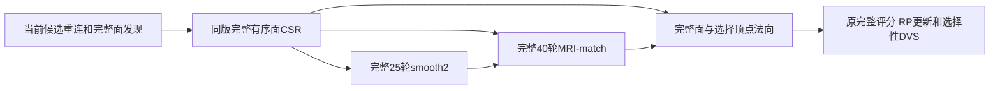

# 拓扑候选：同面版本入射 CSR 复用

## 1. 功能简介

完整候选的25轮曲率自适应平滑和40轮MRI匹配原来各自从完整面表建立入射面列表，之后法向阶段又建立一次。真实剖析中，每个数值内核仅约0.05/0.08秒，两个Python公共准备各约0.54秒。

这次复用已有 `FaceNormalTopology`：每次重连完成后，为实际新候选面版本建立一次有序整数CSR，供两个完整数值步骤和后续法向共用。每轮坐标、法向和MRI采样仍按原规则重算；下一候选重新构建，不跨动态拓扑缓存。



## 2. Python 调用、输入和输出

```python
from fnit.recon_all.place_surface_normals import FaceNormalTopology
from fnit.recon_all.topology_defect_smooth import defect_smooth_type2
from fnit.recon_all.topology_defect_mri_match import defect_mri_match

incident_context = FaceNormalTopology(
    triangles=current_ordered_faces,  # 整数(F,3)，当前实际候选面序和角点序
    nvertices=current_vertex_count,  # N，包含孤立顶点
)
smoothed_original_vertices = defect_smooth_type2(
    xyz=current_original_vertices,  # float32(N,3)，surface RAS/mm
    faces=current_ordered_faces,  # 与上下文完全相同的有序面
    inside_vertices=retained_inside_vertices,  # int32(K,)，保留内点源顺序
    runtime_neighbors=inside_ordered_neighbor_rows,  # K个原有序邻接行
    k1_mean=global_k1_histogram_mean,  # 全局SFF1的1%-peak直方图均值，mm⁻¹
    k2_mean=global_k2_histogram_mean,  # 同上，有限且非零
    topology=incident_context,  # 新可选参数；默认None沿用完整旧构造
)
matched_original_vertices = defect_mri_match(
    xyz=smoothed_original_vertices,  # 完整25轮后的独立float32坐标
    faces=current_ordered_faces,  # 同一候选面版本
    inside_vertices=retained_inside_vertices,  # 同一有序保留内点
    runtime_neighbors=inside_ordered_neighbor_rows,  # 同一原顺序邻接
    volume=own_brain_volume,  # uint8(X,Y,Z)，归一化MRI强度
    ras_to_voxel=own_tkregister_ras_to_voxel,  # float64(4,4)，surface RAS/mm→连续体素
    white_mean=own_white_histogram_mean,  # 校准白质强度均值，无单位
    gray_mean=own_gray_histogram_mean,  # 校准灰质强度均值，无单位
    iterations=40,  # 完整源匹配轮数；此性能版本不减少
    step_acceptor=None,  # 默认完整原更新；显式实验回调是另一算法
    topology=incident_context,  # 共用整数CSR，不共用坐标或法向
)
```

两个函数返回独立 `float32(N,3)` 坐标，不修改输入或移动未选顶点。内点为空时平滑返回独立副本；MRI `iterations=0` 返回独立副本。`iterations`必须为非负整数，不能是布尔值。原MRI接受回调的shape/dtype/finite/fixed-vertex检查保持。

`topology=None`是公共兼容默认，原完整构造仍可独立使用。显式参数必须是 `FaceNormalTopology`，同N和完全相同的整数有序面；面重排、角点反向、顶点数改变或错误类型抛 `ValueError`。不会把浮点面索引量化后匹配缓存。CSR只包含索引，没有物理单位；重复面和角点保留，孤立顶点为空行。传入Numba前仍使用原int32数组；超int32容量明确失败。上下文复制并冻结原面，调用者不能在换拓扑后继续复用它。

`candidate_incidents(..., topology=None)`新增相同可选参数，返回独立 `int32` offsets(N+1)、face_ids/corners(3F)，不与上下文共享可写输出。其完整原参数校验及不可变基底前缀校验保留。

`candidate_geometry()`在每个实际新候选内显式共用上下文；它的输入、输出和完整25/40轮数不变。完整API包含一次CSR准备，分步骤墙钟有包含关系，不能把子项相加冒充整例。

## 3. 命令行调用

内部函数没有独立生产CLI。完整真实回归工具复用原有已验证worker：

```bash
# 四线程、CPU；原完整算法和最终写出均保留。
OMP_NUM_THREADS=4 NUMBA_NUM_THREADS=4 MKL_NUM_THREADS=4 OPENBLAS_NUM_THREADS=4 \
CUDA_VISIBLE_DEVICES="" python tools/benchmark_recon_topology_candidate_incident_reuse.py \
  --finalization-workspace frozen/finalization-v2 \
  --cycle-workspace frozen/candidate-cycle-v2 \
  --baseline-overlay-source frozen/ce96-baseline/src \
  --overlay-source candidate/src \
  --before-retess diagnosis/retess.before.bin \
  --initial-attributes diagnosis/match.before.bin \
  --initial-global-priors diagnosis/statistics.bin \
  --input-surface own-subject/surf/lh.orig.nofix \
  --input-qsphere own-subject/surf/lh.qsphere.nofix \
  --brain own-subject/mri/brain.mgz \
  --after-statistics-reference benchmark-only/patch_statistics.bin \
  --after-volume-reference benchmark-only/volume.bin \
  --fitness-reference benchmark-only/fitness.json \
  --output diagnosis/new-incident-reuse-abba \
  --threads 4
```

`finalization-workspace`和`cycle-workspace`固定原工具与依赖；`baseline-overlay-source`明确选ce96，候选覆盖目录包含已验证ce96 smoothing/cycle和本轮geometry/smooth/MRI-match。输入是冻结同输入阶段，三个after文件只在候选保存后比较。输出目录必须不存在；失败保留原记录。输出四个fresh child的完整状态/数值NPZ、控制JSON、实际源码/输入哈希、receipt、退出标记和ABBA报告。没有原版生产程序、GPU或半精度。

## 4. 原软件调用

对应固定 `mris_fix_topology -ga` 内部 `defectSmooth`、`defectMaximizeLikelihood_new`、完整候选法向及评分。内部函数没有独立官方CLI。本轮速度对照是已验证FNIT控制；原版固定源码参考仅用于隔离benchmark首候选严格门，不在生产执行，不读取reference-after生成候选。

## 5. 最新真实精度、时间和脑图

公开ds000114 sub07 ses-test LH，FNIT79a自产上游，110534顶点/完整候选216860面。固定四核、总线程4、CUDA隐藏，MRI校准自产；全局属性及先验冻结。这是完整冻结候选/最终状态阶段，未宣称完整GA或原始T1整例。

[完整ABBA](../../validation/recon_all/optimizations/20261010_topology_candidate_incident_reuse/abba_v1.json)四个fresh child已EXIT0。控制/候选/候选/控制墙钟为126.241953 / 116.660590 / 73.778920 / 86.719520秒；各child是新进程，后两个复用同backend的显式缓存目录；未缓存内核仍可能JIT。B序列是同进程完整热调用。只改变geometry/smooth/MRI-match三个实际加载模块；cycle与其他FNIT模块、全部输入SHA相同。

| 完整非剖析阶段中位数 | ce96控制 | CSR候选 | 缩短 |
|---|---:|---:|---:|
| fresh CLI，含导入/JIT/加载/校验/写出/退出 | 106.480736s | 95.219755s | 10.5756% |
| 完整两序列API | 96.639658s | 88.040791s | 8.8979% |
| 热B完整candidate cycle | 5.810433s | 4.097741s | 29.4761% |

每child保存A/B的完整final和state，162个数值/容量字段的shape、dtype与字节全相同，控制JSON全相同；源首次候选严格门及完整最终自身重复门四次均通过。保持完整有序面和顶点对应，坐标/法向/评分/RP/DVS/curvbak/容量未引入差异。

六次函数调用合计的中位数：25轮完整wrapper7.461497→1.491173秒，40轮wrapper6.097800→2.563662秒，入射构造3.133581→0.103866秒。这些包含各child首次JIT；上下文准备仍包含在完整API，函数子项不相加作总时间，也不以局部倍数外推495次评分或整例。

这是相同主机、四指定核的串行ABBA共享节点观测，冷JIT/缓存边界与四个原始时钟保留。未完成全GA、最终完整网格质量、原始T1整例或10分钟目标；整体指标等效不判定。峰值RSS没有正式采样；未使用GPU，显存记null，无新增依赖。

同冻结病例的既有脑图用于查看几何与MRI相位，不作为这次新精度结果：


## 6. 更新与 benchmark

- ce96基线：原完整162字段字节门及真实ABBA保持，不回填本次源码。
- [第二轮打包状态对照](TOPOLOGY_CANDIDATE_GEOMETRY_HOTSPOTS.md)：全部输出一致，但完整CLI慢6.7353%，state代码已撤回。本轮未包含该较慢实现。
- 本轮本地合同：22tests+14subtests，13.64秒，覆盖完整25/40数值、回调原提案、空内点、实际换面、重排/错误N/浮点索引、重复角点和不共享写出。合同不是MRI benchmark。
- 本轮真实完整ABBA：四child EXIT0，全部162字段/控制字节门和源首门通过。geometry `c4ebd149…`、smooth `02851b7c…`、match `5f6b8f3b…`；源manifest `06f33ced…`。当前阶段绑定实际未提交源码SHA；公开HEAD只用于发布，不回填成实测版本。完整9缺陷旧冻结源码保持不变。

## 7. 参考文献与原代码

- [FreeSurfer固定mrisurf_defect.cpp](https://github.com/freesurfer/freesurfer/blob/d932c45b7941662ea380a05efef580568b98d41a/utils/mrisurf_defect.cpp)：完整候选平滑、MRI匹配及评分。
- Fischl et al. 2001. Automated manifold surgery. IEEE TMI. [DOI](https://doi.org/10.1109/42.906426)。
- [候选完整几何](TOPOLOGY_CANDIDATE_GEOMETRY.md)、[闭环状态](TOPOLOGY_CANDIDATE_CYCLE.md)、[第一轮热点](TOPOLOGY_CANDIDATE_HOTSPOTS.md)：原接口、严格门与阶段边界。
