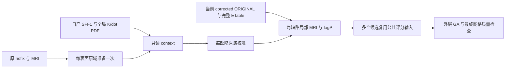
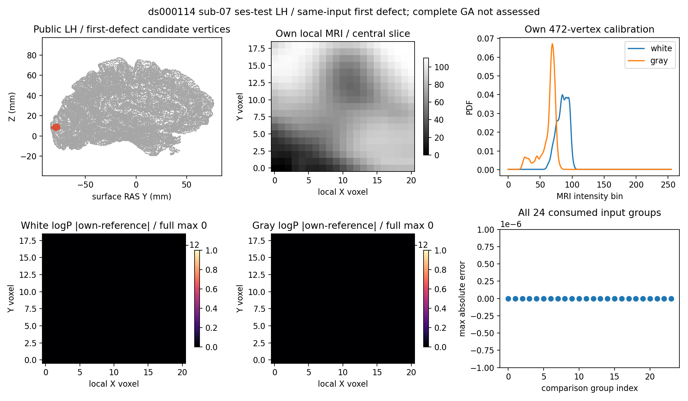

# 拓扑候选的全局缓存与每缺陷输入

## 1. 功能简介

`prepare_candidate_input_context()` 缓存每个原始表面一次的 MRI 采样、中值处理、ORIGINAL 坐标、白灰联合 PDF 和自产全局曲率/法向先验。`prepare_defect_candidate_inputs()` 用每个缺陷的原域 hull、完整候选 ETable 和当前 corrected 坐标生成校准 PDF、局部 MRI、logP 与候选评分参数。两者复用现有 Python/NumPy/Numba 函数，不运行原版 FreeSurfer 阶段程序。



原域校准与 corrected 当前几何分别保存。前一个缺陷改变了 corrected 坐标时，下一个缺陷的局部 MRI 必须读取这个实际状态；context 不缓存或恢复 corrected 坐标。全局 K 均值来自首次 SFF1 PDF 的源 1%-peak 统计，原 `mris` 后续 SFF2 不覆盖 corrected clone，也不重建这些 PDF。

## 2. Python 调用、输入与输出

```python
from fnit.recon_all.topology_candidate_inputs import (
    prepare_candidate_input_context,
    prepare_defect_candidate_inputs,
)

candidate_context = prepare_candidate_input_context(
    vertices=raw_nofix_vertices,                 # float32(N,3)，原域 surface RAS/mm
    faces=raw_nofix_ordered_faces,               # 整数(F,3)，原有序三角面
    defect_vertices=all_original_defect_mask,    # bool(N,)，全部缺陷的原域标记
    vertex_translation=original_to_corrected,   # 整数(N,)，原编号到 corrected 的完整排列
    volume=brain_mri_uint8,                      # uint8(X,Y,Z)，brain MRI 原网格
    ras_to_voxel=topology_mri_ras_to_voxel,       # (4,4)，MRI-only tkregister RAS→连续体素
    global_priors=self_generated_global_priors,  # global_topology_priors 的自产完整结果
)

defect_inputs = prepare_defect_candidate_inputs(
    context=candidate_context,                  # 该表面只读准备，多个缺陷共享
    original_defect_hull=original_hull_vertices, # 整数(H,)，本缺陷有序原域 hull
    candidate_edges=corrected_creation_edges,   # 整数(E,2)，创建时完整候选 ETable
    current_corrected_original_vertices=surface_state["original_vertices"],
                                                # float32(N,3)，当前 corrected ORIGINAL/mm
    volume_resolution=-1,                      # 源默认值，对应局部体素索引尺度 2 mm⁻¹
    mri_weight=1.0,                             # double MRI 评分权重
    volume_unmri_weight=10.0,                   # double 局部体积评分权重
    normal_dot_weight=1.0,                      # double 法向评分权重
    quadratic_curvature_weight=1.0,            # double 联合曲率评分权重
)

candidate_kwargs = defect_inputs["candidate_kwargs"]
# evaluate_candidate 显式展开 **candidate_kwargs。
# evaluate_candidate_cycle 用 candidate_inputs=candidate_kwargs 传入该完整字典。
# 不把 reference 捕获、原程序输出或上一候选的 after 状态当作准备输入。
```

上例变量由自产上游返回，接口不负责从标准文件名推断顶点映射。`nibabel.freesurfer.io.read_geometry()` 读取的坐标可明确转换为 float32；MRI 用 nibabel 读取并保留 uint8 及原几何。`source_topology_ras_to_voxel(volume_header=brain_image.header)` 生成此源分支使用的 MRI-only tkregister 逆矩阵，不替换为表面 footer 到 scanner RAS 的桥接变换。

### 输入与默认值

context 的七个具名参数均必填。原网格、全部缺陷 mask、曲率 PDF 和 `vertex_translation` 必须属于同一原域；translation 必须为 0…N−1 的完整排列。`global_priors` 至少包含：

- `curvature`：float32(100,) 的 K1/K2 bins/counts、有限 start、正 bin width，以及正 float32(100,100) 联合 PDF。
- `normal_dot`：float32(100,) 的 bins/counts 与正 bin_size。这里保留固定源码的历史表达式及单位，不能重新解释成常规归一化点积。

每缺陷接口的前四个具名参数也均必填。`original_defect_hull` 属于原域；`candidate_edges` 和 `current_corrected_original_vertices` 属于 corrected 域。候选边不是最终已接受面的边，不能缩为当前面列表。`volume_resolution=-1` 和其他合法数值沿用 [局部 MRI 接口](TOPOLOGY_VOLUME_PRIORS.md) 的规则。四权重默认值见示例，保留原 double 运算，允许有限负数和零；为公共评分接口准备完整字段，零权重仍生成本缺陷局部场。

### 返回结构

`CandidateInputContext` 是冻结 dataclass，含只读自有数组和只读映射；调用方修改原数组不会改变缓存：

| 字段 | 结构与意义 |
| --- | --- |
| `preparation` | 原域 float32(N,3) ORIGINAL/法向、float32(N,) white/gray、rip 及有序邻域，沿成熟准备接口返回结构 |
| `defect_vertices/vertex_translation` | bool(N,) 原缺陷 mask / 整数(N,) 原→corrected 排列 |
| `volume/ras_to_voxel` | uint8(X,Y,Z) / (4,4) MRI-only 变换 |
| `gray_white_pdf` | float32(256,256,1)，每表面一次生成的白灰联合 PDF |
| 三个 `*_histogram` | `bins/counts` float32(100,)，`bin_size` float32，K 单位 mm⁻¹ |
| `joint_curvature_pdf` | float32(100,100,1)；`joint_origin_mm_inv/joint_spacing_mm_inv` 均 float32(2,) |
| `k1_mean/k2_mean` | float32，按首次全局 K PDF 的源 1%-peak 规则求值，不使用任意 mean 元数据 |
| `seconds` | 含校验、准备、JIT 和只读复制的 API 墙钟，不含导入与外部文件读写 |

每缺陷返回字典：

- `candidate_kwargs`：`volume/ras_to_voxel`、`local_priors`、全局灰白/联合曲率 PDF、三个 histogram、联合 PDF 的 origin/spacing、K 均值及四权重，可展开到现有完整候选评分接口。MRI 与矩阵直接引用 context 的只读自有数组，不重复拷贝；cycle 的 `candidate_inputs` 参数接收此字典。
- `local_priors` 的 uint8 局部强度卷与初始边 mask、float32 white/gray logP、白灰均值和初始平均 logP、局部 origin/scale/end/geometry，沿成熟接口完整返回。
- `calibration`：有序 `selected` 顶点，256-bin raw/smooth 白灰 PDF、float32 bins 及源实际 `bin_size=0`。
- `stage_seconds`：`calibration/local_priors/complete_api` 含各自实际校验和 JIT；子项已经包含在 API 时间中。
- `source_phase/complete_ga=False/production_default_changed=False`：明确该调用仅准备阶段输入。

格式、有限性、排列、索引、非法 PDF、零 K 均值、空校准和非法权重抛 `ValueError`；成熟子函数的异常保留。输入不原地修改，没有隐藏磁盘缓存，不改变线程、CUDA、TF32 或半精度策略。复用本项目已有依赖，主页 Conda 环境无需新增库。

## 3. 命令行调用

此内部阶段没有生产 CLI。下面是独立同输入验证入口，参考仅在自产检查点写出后读取：

```bash
python tools/benchmark_recon_topology_candidate_inputs.py \
  --input-surface own_subject/surf/lh.orig.nofix \
  --brain own_subject/mri/brain.mgz \
  --global-checkpoint own_global_priors/candidate.npz \
  --global-report own_global_priors/report.json \
  --etable-checkpoint own_ordered_etable/cold.npz \
  --etable-report own_ordered_etable/report.json \
  --creation-reference benchmark_reference/repeat0/prepared.creation.bin \
  --likelihood-reference benchmark_reference/repeat0/prepared.likelihood.bin \
  --statistics-reference benchmark_reference/repeat0/statistics.bin \
  --match-reference benchmark_reference/repeat0/match.before.bin \
  --source-manifest frozen_source/SOURCE_MANIFEST.json \
  --output new_empty_validation/candidate \
  --threads 4
```

前两个路径是自产 nofix 与 uint8 MRI；两组 checkpoint/report 各自绑定自产全局先验和有序 ETable 的 SHA。creation/likelihood/statistics/match 四条路径是独立参考相位；source-manifest 绑定实际冻结程序，output 必须尚不存在，threads 为总线程预算，默认 4。工具比较失败也保留候选、报告与退出原因，不把参考数据放进生产 kwargs。

可在算法退出后运行 `tools/plot_recon_topology_candidate_inputs.py`，具名参数为 `--candidate` 自产 NPZ、`--report` 绑定报告、`--likelihood-reference` 事后冻结参考和 `--output` 新 PNG；SHA 不符或目标已经存在会失败。

## 4. 原软件调用与相位

对应固定 FreeSurfer `d932c45b7941662ea380a05efef580568b98d41a` 的 `mrisComputeJointGrayWhiteBorderDistributions`、`mrisComputeGrayWhiteBorderDistributions`、`computeDefectStatistics` 与 `mriDefectVolume`；都是 `mris_fix_topology -ga ...` 内部步骤，没有独立等价 CLI。本轮只复用独立 benchmark 捕获，不把观察器程序接入生产。

原域全局 PDF 一次生成；每个缺陷清理并重建白灰校准，K 均值来自已存在的首次全局 K PDF；创建局部体积时使用 corrected 表面当前 ORIGINAL 和完整 ETable。随后同一缺陷的多个候选共享局部场。四标准权重为 MRI 1、unMRI 10、normal 1、quadratic 1；成熟评分器仍保留原 FZERO、有效局部 shape、面检查和最终网格质量规则。

## 5. 最新真实精度与耗时

公开 ds000114 sub-07 ses-test 左半球，110,534 顶点、221,116 面、首缺陷 4723 条候选边。从自产 nofix/MRI、[自产全局先验](TOPOLOGY_GLOBAL_PRIORS.md) 和 [自产有序缺陷输入](TOPOLOGY_GENETIC_DEFECT_INPUTS.md) 组装，参考在自产检查点落盘后读取。creation/likelihood/statistics/match 四种参考的两次捕获文件分别 SHA 相同；本轮独立重复两次每缺陷调用，复用同一 context。

| 比较 | 当前实测 |
| --- | --- |
| corrected 初始几何与完整有序 ETable | 坐标/索引逐位一致 |
| 校准 PDF、bins、灰白和曲率联合 PDF、matching means | 逐位一致 |
| 21×19×16 局部强度、logP、初始边 mask、几何 | 逐位一致 |
| 三组 100-bin histogram 的 bins/counts/bin_size | 逐位一致 |
| 被消费输入 24 组、自身每缺陷重复 29 组 | 全部 0 不同元素、0 最大/P99 误差、0 字节差 |
| 内部 RAS→voxel 矩阵 | 16 个数值全相同，正负零字节差另保留；整体内部逐位严格复现仍 false |

两次最小冻结均绑定 d76310419eb71b2d59e39d980de0e9e829ed9d41 与明确 5 个文件 overlay；不把后续提交号回填为实测版本。v1 模块 `214f5bca…` 通过阶段数据对照，但完整 GA 接线发现 kwargs 缺两个必需字段；v2 模块 SHA `b3fc6e1e56549c3a98cf15cb31cfa42ae39949f45576796821ffbc415a9c7527` 补齐调用契约。v2 的 24/29 组结果仍精确，整个自产 NPZ 与 v1 的 SHA 也相同；实际消费者必需参数绑定及只读共享 MRI 检查通过。全部输入、程序、参考与版本见 [机器报告](../../validation/recon_all/optimizations/20261010_topology_candidate_inputs/README.md)。

| 同一 CPU 四核、总线程 4，跨时段观察 | v1（s） | v2（s） |
| --- | ---: | ---: |
| 每表面一次 context API，含校验、采样/中值、实际 JIT、复制 | 16.201264 | 10.701906 |
| 首缺陷校准 | 0.012925 | 0.013488 |
| 首缺陷局部 MRI，含实际首次启动/JIT 成本 | 1.648310 | 0.015469 |
| 首次每缺陷完整 API | **1.661410** | **0.029227** |
| 同 context 重复校准 / 局部 MRI | 0.012737 / 0.002005 | 0.013446 / 0.002063 |
| 同 context 重复每缺陷完整 API | **0.014940** | **0.015733** |
| 加载 | 0.474140 | 0.497478 |
| 完整驱动：两次每缺陷、加载、检查点与比较 | **20.422733** | **14.135993** |
| 导入另计 | 1.937002 | 5.390987 |

v2 驱动还包含完整消费者的导入与调用签名检查，v1 没有此检查。子项不重复累加。驱动数字不含最后 JSON 写出和解释器启动；完整冷 CLI 墙钟未单独采样。共享 CPU 负载与 JIT 状态下的首次/重复仅是本次观察，未做 ABBA，不发布速度比。参考观察器覆盖其他相位和写出，不用其约 6 秒与本 API 作比。没有初始化 CUDA，显存为未测 null，不记为零显存；精度/TF32 策略未改。接口原 15 项合同通过，补真实消费者签名后 16 项通过，JUnit 分别为 16.801/39.899 秒；涵盖跨缺陷当前几何更新、映射、缓存别名、失败输入和必需参数完整性。最后一次源码仅纠正 cycle 的字典传参说明，排除 docstring 的 AST 相同，记录在合同收据中。



跨缺陷当前状态传递目前只有合同证据；有序 region 上游保持其显式阶段输入边界，完整 GA、最终网格、整例速度和指标等效未评估。本接口不修改生产默认，也不把首缺陷零差异外推到完整 GA。

## 6. 版本与 benchmark 记录

| 版本 | 改动与证据 |
| --- | --- |
| 全局 priors producer v3 | 从 nofix/qsphere 自产全部 K/dot PDF，11 个先验字段与固定参考逐位一致，保留各自版本 |
| 有序缺陷输入 v2 | 标准 edge_table=0、use_overlap=False；4723 条边/评分/顺序与首缺陷捕获相同，开启 overlap 尚未评估 |
| candidate_inputs v1 | 复用成熟原域准备、校准和局部 MRI，明确当前 corrected 坐标必填，15 合同与 24 组真实输入通过 |
| 完整调用接口修复 | 首次完整 GA 在首候选前发现 v1 的 kwargs 漏了必需 `volume/ras_to_voxel`，报 TypeError。补回 context 的只读共享数组，新增真实 `inspect.signature(evaluate_candidate).bind(...)` 合同；阶段数值通过不能代替完整消费者契约，旧 v1 证据不回标 |
| candidate_inputs v2 | 补齐两个共享 kwargs，数值计算未改，重新跑首缺陷 24/29 组仍逐位一致，完整调用签名检查通过；完整 GA 由外层独立验证 |
| 参数说明纠正 | `evaluate_candidate` 原文将 K 均值误称 25 轮平滑均值，改为首次 SFF1 PDF 的 1%-peak 统计；算法参数及旧报告 SHA 不改 |

局部 MRI 若错误使用 context 中的原始几何，会丢掉前面缺陷的最终更新；新接口用显式参数和测试覆盖这个调用风险。此处没有对成熟采样或评分函数添加被试特例。

## 7. 参考文献与原实现

- [固定拓扑源码](https://github.com/freesurfer/freesurfer/blob/d932c45b7941662ea380a05efef580568b98d41a/utils/mrisurf_defect.cpp)：原域校准、K 均值、每缺陷局部 MRI 与候选生命周期。
- [固定全局曲率/法向先验源码](https://github.com/freesurfer/freesurfer/blob/d932c45b7941662ea380a05efef580568b98d41a/utils/mrisurf_metricProperties.cpp)。
- Fischl et al. Automated manifold surgery: constructing geometrically accurate and topologically correct models of the human cerebral cortex. *IEEE TMI* (2001)。
- [公开 ds000114](https://openneuro.org/datasets/ds000114)、[候选评分流程](TOPOLOGY_CANDIDATE_PIPELINE.md)、[全局 SFF](TOPOLOGY_GLOBAL_SFF.md)。
