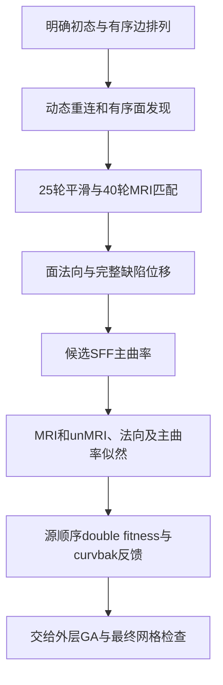

# 拓扑候选：连续几何与完整评分

## 1. 功能简介

`evaluate_candidate()` 从一份明确的候选初态连续生成重连、25 轮平滑、40 轮 MRI 匹配、面法向、位移、主曲率和五项 fitness。各部分复用 FNIT 已验证的 NumPy/Numba 实现，运行时不调用 FreeSurfer 阶段程序。

本接口处理一个候选。初始完整属性和全局法向/曲率先验仍由调用者提供；种群控制、跨候选 DVS 恢复和 RP 更新由外层负责。最终拓扑修复还需独立检查连通性、非流形、自相交、形状及后续球面质量。



新增显式 `distance_backend="serial"|"parallel"`，默认 serial。搜索与最终评分共用选择；实际 unMRI 跳过时记录 actual=null，Numba mask/slab 与采样 OS 线程数分开。参数、真实六评分和预算证据见 [距离路由](TOPOLOGY_GENETIC_DISTANCE_ROUTING.md)。

## 2. Python 调用与输入输出

```python
from fnit.recon_all.topology_candidate_pipeline import evaluate_candidate

candidate_result = evaluate_candidate(
    surface_state=initial_surface_state,  # 本链自身完整初态，字段如下
    retessellation_inputs=ordered_retessellation_inputs,  # 同版本有序基底、边、重叠表和缺陷映射
    volume=brain_volume_uint8,  # 原MRI的uint8(X,Y,Z)数据
    ras_to_voxel=topology_ras_to_voxel,  # MRI-only tkregister surface RAS→连续体素4×4矩阵
    local_priors=calibrated_local_priors,  # 同缺陷一次自产的强度、白灰log-P及局部几何
    gray_white_pdf=calibrated_joint_pdf,  # 同原MRI/初态校准的白灰联合PDF
    k1_mean=initial_principal_curvature_mean_1,  # 首次全局SFF1 K1-PDF的1%-peak F32 mean，mm⁻¹
    k2_mean=initial_principal_curvature_mean_2,  # 首次全局SFF1 K2-PDF的1%-peak F32 mean，mm⁻¹
    normal_dot_histogram=calibrated_normal_dot_histogram,  # bins/counts/bin_size，无量纲
    k1_histogram=calibrated_curvature_histogram_1,  # bins/counts/bin_size，mm⁻¹
    k2_histogram=calibrated_curvature_histogram_2,  # 同版本第二主曲率直方图
    joint_curvature_pdf=calibrated_joint_curvature_pdf,  # 同版本二维主曲率PDF
    joint_origin_mm_inv=joint_curvature_origin,  # 二维PDF起点，mm⁻¹
    joint_spacing_mm_inv=joint_curvature_spacing,  # 二维PDF步长，mm⁻¹
    mri_weight=1.0,  # 源double MRI权重
    volume_unmri_weight=10.0,  # 源double体积unMRI权重
    normal_dot_weight=1.0,  # 源double法向权重
    quadratic_curvature_weight=1.0,  # 源double主曲率权重
)
```

### 完整初态 `surface_state`

全部顶点字段采用同一顶点顺序。`original_vertices` 为 surface RAS/mm；不应套用 placement 的 footer→scanner 桥来构建拓扑 MRI 采样矩阵。

| 字段 | 格式、意义 |
| --- | --- |
| `original_vertices` | 有限 `float32(N,3)`，本候选匹配前的原坐标，mm |
| `vertex_normals` | 有限 `float32(N,3)`，当前法向；外部顶点保持初值 |
| `tangent_e1`、`tangent_e2` | 有限 `float32(N,3)`，已有切向基；SFF只更新本次选中顶点 |
| `flattened_vertices` | 有限 `float32(N,3)`，源 fx/fy/fz 状态；只将非DISCARD缺陷点保存为当前原坐标 |
| `k1`、`k2` | 有限 `float32(N,)`，已有主曲率，mm⁻¹ |
| `vertex_area` | 有限 `float32(N,)`，源 VERTEX.area，mm²；有向或零面积合法 |
| `curvbak` | 有限 `float32(N,)`，完整原反馈状态；缺陷外和DISCARD保留 |
| `faces` | 整数 `(F,3)`，当前逻辑基底面，必须等于重连参数的 `base_faces` |
| `face_area` | 有限 `float32(F,)`，对应源 FACE.area；新追加面依源 calloc 为零 |

`FaceNormCache.orig_area` 与 `FACE.area`、`VERTEX.area` 是不同字段。不能把缓存面积写入后两者；首次候选面积加权诊断的 0/0 保留为 IEEE NaN，五项核心 likelihood 和 double fitness 必须有限。

### 重连及先验

`retessellation_inputs` 与 [动态重连](TOPOLOGY_DYNAMIC_RETESS.md) 的完整输入一致：`canonical(N,3)`、有序 `base_faces`、`neighbors`、`candidate_edges(E,2)`、`edge_used(E,)`、完整 `ordering(E,)`、`inside_vertices` 与同长 bool `inside_discarded`、`border_vertices`、`hull_vertices`、`vertex_rip`、可选 `fixed_mapping`、`mode`、有序 `overlaps` 和 `overlap_complete`。完整映射包含未选中和DISCARD点，不能仅传本次38个活动点。

`local_priors` 由 [白灰校准](TOPOLOGY_DEFECT_CALIBRATION.md) 每缺陷一次生成，包含 `defect_intensity_volume`、`white_log_probability`、`gray_log_probability`、`volume_shape`、`volume_origin_mm`、`volume_index_scale_per_mm`、`white_mean`、`gray_mean`、`initial_white_mean_log_probability` 和 `initial_gray_mean_log_probability`。局部坐标采用源 mm→索引**乘法尺度**，不能将其改成物理 spacing。

`k1_mean/k2_mean` 是固定 `computeDefectStatistics` 从传入首次全局 K-PDF 算出的 1%-peak 截断 float32 mean，供平滑目标半径使用。后续 original SFF2 更新顶点 K，不重建这两项先验。这次纠正复用函数的参数说明，算法参数和旧版本报告 SHA 保留。[候选输入准备](TOPOLOGY_CANDIDATE_INPUTS.md) 将每表面全局准备与每缺陷当前 corrected 局部 MRI 分开缓存。

其余先验及输入按 [五项评分](TOPOLOGY_PATCH_FITNESS_ASSEMBLY.md) 验证。四个权重允许负值，按源 `abs(weight)<FLT_EPSILON` 跳过；局部任一轴≤5跳过 unMRI。SFF作为曲率评分准备先算，unMRI反馈不改变其几何输入。API不修改线程、TF32或全局设备策略，无文件读写。

### 返回结构与失败行为

返回 dict 包含 `geometry`（坐标、完整面、CSR和所选集合）、`sff`（完整K1/K2和切向基）、`fitness`（五项、完整自产距离和合成评分）、`vertex_normals`、`vertex_curvbak`、`flattened_vertices`、`face_area`、`displacement`、`face_check` 和 `seconds`。全部反馈为副本，调用者决定何时提交。

`candidate_face_check()` 按源检查选中点每个有序一环共边是否恰有两个入射面。其 `source_result` 为1或−1，返回首次异常 `[vertex,neighbor,face_count]` 和实际检查量。它不代替几何相交或最终QC。中间候选该检查失败时仍按原fitness罚分，不作为最终输出放行。

缺字段、非法类型/形状/CSR/越界或跨版本输入抛 `KeyError`/`ValueError`；成熟子函数错误原样传播。不改变输入，不隐式回退原版程序或填入参考后态。

## 3. 命令行与复现

原内部步骤没有单独公共CLI。真实同输入诊断工具可从仓库根运行：

```bash
PYTHONPATH=src:tools python tools/benchmark_recon_topology_candidate_pipeline.py \
  --before-retess diagnosis/retess.before.bin \
  --initial-attributes diagnosis/match.before.bin \
  --initial-global-priors diagnosis/statistics.bin \
  --input-surface own-subject/surf/lh.orig.nofix \
  --input-qsphere own-subject/surf/lh.qsphere.nofix \
  --brain own-subject/mri/brain.mgz \
  --after-statistics-reference benchmark-only/patch_statistics.bin \
  --after-volume-reference benchmark-only/volume.bin \
  --fitness-reference benchmark-only/fitness.json \
  --output diagnosis/new-candidate-run \
  --threads 4
```

所有参数必填：前三个为带哈希且明示相位的诊断初态；后三个为参考后态，候选完整NPZ写出后才打开。`output` 必须不存在。工具先从本链原 no-fix/MRI自产白灰校准、局部场和白灰联合PDF；初始属性和global K/dot先验明确冻结。它不等于完整base/global prior producer。生成 `cold.npz`、`repeat.npz` 和完整JSON；失败保留数据并以非零退出，不写生产目录。

## 4. 原软件调用

对应固定源码 `mrisDefectPatchFitness()` 内部的 retessellation、`detectDefectFaces`、`orientDefectFaces`、`defectMatch`、`computeDisplacement`、`computeDefectFaceNormals` 与 `mrisComputeDefectLogLikelihood`。原入口为 `mris_fix_topology`，不是独立的“candidate pipeline”命令。本阶段不包含其种群搜索、RP统计更新、DVS恢复或最终写出。

参考源码固定为 `d932c45b7941662ea380a05efef580568b98d41a`。源码编译观察器仅在隔离benchmark运行；生产接口只调用FNIT函数。

## 5. 当前真实数据、时间与图

公开 ds000114 sub-07 ses-test LH、FNIT 79a41cdd 自产上游，四核 CPU 同机、GPU隐藏、共享负载。v2从新目录完成冷调用及重复。候选算法模块SHA `32a8dba2…`；隔离参考程序SHA `2df26fc8…`，两次捕获逐字节重复。所有原始MRI、NPZ与完整收据留在授权私有目录；公开[指标报告](../../validation/recon_all/optimizations/20261010_topology_candidate_pipeline/README.md)绑定完整哈希。

| 检查 | 当前同输入结果 |
| --- | --- |
| 110,534 顶点XYZ、法向、K1/K2、fx/fy/fz、curvbak | 全元素及F32 bits一致，最大/P99为0 |
| 216,860 有序面 | 全元素一致；138新增面由本链生成 |
| 局部uint8 MRI、白灰log-P、21×19×16有向距离 | 全bits一致 |
| 白灰联合PDF、五项F32核心似然及double fitness | 全bits一致；fitness = −97.760777950286865 |
| 同一初态两次自产 | 所有已保存字段完全重复 |
| 源有向共边检查 | 600条检查通过；不等于最终完整QC |

| 计时边界 | 冷调用 / 同进程重复 |
| --- | --- |
| 完整候选API，含校验/几何/评分 | 18.466938 / 5.748928 s |
| 其中几何（包含在上行） | 8.332279 / 5.570554 s |
| 其中SFF | 6.381337 / 0.004365 s |
| 其中五项完整评分 | 3.727669 / 0.149834 s |
| 候选NPZ写出 | 0.344392 / 0.346958 s |
| 原no-fix/MRI准备、缺陷识别、校准与局部先验一次生成 | 45.720757 s |
| 全部fresh CLI，含导入、加载、两次API、读写及事后比较 | 74.922992 s |

观测子进程峰值RSS 1,145,812 KiB；无CUDA测量，不宣称GPU预算或整例速度。参考观察器包含额外上游与捕获，计时边界不同，未计算速度比。初始全属性和全局K/dot先验明确冻结，完整base/global-prior producer及GA、最终网格和原始T1整例未在本阶段验收。

v3另做透明cProfile，算法模块字节不变、严格结果仍全部一致。受剖析影响的第二API为8.038040s，不能把它与v2的5.748928s比较提速。重连/面发现5.711145s（其中动态边4.333858s、面发现1.256594s），smooth0.583990s、match0.903642s、全入射CSR0.567764s。110,539次索引校验、110,544次`unique`及全N邻接/全F索引重复构造是已测热点；实际351,038次已Numba编译的球面边相交仅0.207506s。下一项优先共用核心与一次验证的不可变base缓存，保持有序阻挡边及DVS字段边界。


## 6. 更新记录

- 2026-10-10：新增完整单候选连续接口，复用已验证几何、SFF、距离与五项似然。保留源fx保存域、DISCARD、零面积诊断及外部状态；三项本地结构/状态契约通过；v2完整同输入连续链全部bits一致。
- v1检查器错误将FNITVOL1的法向列3:6当作fx/fy/fz，造成255,057元素/max82.71mm假差异；候选算法没变。保留v1原失败收据，v2仅修事后列定义6:9，并从新目录完整重跑。
- v3单列透明剖析开销；不把剖析时间称性能退化或优化提速。
- 上游几何已有同输入完整坐标、面、CSR及法向零bit差异；其独立计时和边界见 [候选几何](TOPOLOGY_CANDIDATE_GEOMETRY.md)。这些记录不能替代本页完整链回归。

## 7. 参考文献和源码

- [FreeSurfer固定拓扑源码](https://github.com/freesurfer/freesurfer/blob/d932c45b7941662ea380a05efef580568b98d41a/utils/mrisurf_defect.cpp)。
- [FNIT连续几何](../../src/fnit/recon_all/topology_candidate_geometry.py)、[候选SFF](../../src/fnit/recon_all/topology_candidate_sff.py)、[五项评分](../../src/fnit/recon_all/topology_patch_fitness.py)。
- Fischl, B., Liu, A. & Dale, A. M. (2001), Automated manifold surgery: constructing geometrically accurate and topologically correct models of the human cerebral cortex, IEEE TMI 20, 70–80. [原作者公开论文](https://surfer.nmr.mgh.harvard.edu/pub/articles/fischl01-topology-fixing.pdf)。具体源步骤以固定实现为准。
