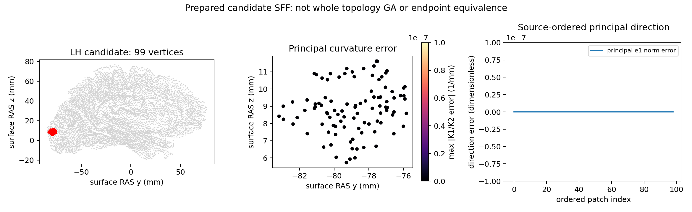

# 拓扑候选的二阶曲面拟合

## 1. 功能简介

`candidate_second_fundamental_form()` 从同一个候选网格的原坐标、当前法向及原有序 `vtotal` 邻域重新计算主曲率和主方向。计算使用 NumPy/Numba，复用 FNIT 已有的 float32 3×3 VNL SVD；生产函数不调用 FreeSurfer 程序。

这是 `mris_fix_topology` 内部候选评分的曲率准备步骤。初始 qsphere 的主曲率函数还包含投影、rip 和邻域准备，不能直接用于这里。此次没有重复实现已有 SVD、MRI 似然或有向距离函数。

本次真实验证的计算链为：


法向、校准 PDF 和局部 MRI 是明确的阶段输入。此页验证了完整候选 SFF 及其评分传播，没有把完整 GA、原始 T1 整例或最终拓扑质量标为通过。

## 2. Python 调用、输入和输出

```python
import numpy as np
from fnit.recon_all.topology_candidate_sff import candidate_second_fundamental_form

# candidate_state.npz 由 FNIT 候选控制器产生；生产不得读取官方检查点。
candidate_state = np.load("candidate_state.npz", allow_pickle=False)
fitted = candidate_second_fundamental_form(
    original_vertices=candidate_state["original_vertices"],  # (N,3)，surface RAS，mm
    vertex_normals=candidate_state["vertex_normals"],          # (N,3)，当前候选法向
    neighbor_offsets=candidate_state["neighbor_offsets"],    # (N+1)，原 vtotal CSR
    neighbors=candidate_state["neighbors"],                  # (E,)，原 vt.v 次序
    patch_vertices=candidate_state["patch_vertices"],        # (P,)，原 TP 顶点次序
    initial_k1=candidate_state["initial_k1"],                # (N,)，先前 K1，mm^-1
    initial_k2=candidate_state["initial_k2"],                # (N,)，先前 K2，mm^-1
    initial_tangent_e1=candidate_state["initial_tangent_e1"],# (N,3)，先前主方向一
    initial_tangent_e2=candidate_state["initial_tangent_e2"],# (N,3)，先前主方向二
)
candidate_state.close()

# 将这次自产全长度 K1/K2 交给已有曲率似然函数；不要沿用旧表面版本。
principal_curvature_k1_mm_inv = fitted["k1"]
principal_curvature_k2_mm_inv = fitted["k2"]
```

全部参数均必填。函数将坐标、法向、曲率和方向转换为连续 float32；输入转换不改变调用者的数据。CSR 和 patch 必须是整数，使用原 `vt.v[0:vtotal]` 次序，不能用排序邻接或只截取 `vnum`。

| 参数 | 格式、含义与单位 |
| --- | --- |
| `original_vertices` | 有限 `(N,3)`，原候选 orig 坐标，tkregister/surface RAS，mm；不使用 qsphere 坐标 |
| `vertex_normals` | 有限 `(N,3)`，当前候选法向，无量纲；本函数不重算法向 |
| `neighbor_offsets` | 整数 `(N+1)`，首项 0、末项 E、单调非降，保留每个顶点原 vtotal |
| `neighbors` | 整数 `(E,)`，顶点索引，范围 `[0,N)`；原邻域次序影响 float32 累加 |
| `patch_vertices` | 不重复整数 `(P,)`，按原 TP 顺序，范围 `[0,N)` |
| `initial_k1` / `initial_k2` | 有限 `(N,)`，mm⁻¹；patch 外或无邻点的曲率保留这份状态 |
| `initial_tangent_e1` / `initial_tangent_e2` | 有限 `(N,3)`，无量纲；patch 外方向保留，patch 内从当前法向重新计算 |

| 返回字段 | 结构与语义 |
| --- | --- |
| `k1` / `k2` | float32 `(N,)`，完整有序主曲率副本；按原特征值绝对值顺序写回，不能再用数值大小重新排序 |
| `tangent_e1` / `tangent_e2` | float32 `(N,3)`，完整主方向副本；病态回退保留该顶点刚重算的切向量 |
| `condition_number` | float32 `(P,)`，原 SVD 条件数；无邻点为未计算的 NaN 诊断 |
| `fit_kind` | int8 `(P,)`；0 无邻点，1 正常拟合，2 病态曲率回退，3 原零矩阵分支 |
| `gram` | float32 `(P,3,3)`，原有序 `UᵀU`，mm⁴ |
| `rhs` | float32 `(P,3)`，`Uᵀz`，mm³；未进入该分支的值为诊断初始化值 |
| `hessian` | float32 `(P,2,2)`，二阶拟合 Hessian，mm⁻¹ |
| `seconds` / `scope` | 包含输入校验和当前 JIT 成本的 API 秒数、阶段边界说明 |

`fit_kind=0` 仍按原逻辑计算切平面，但不改变 K1/K2。源零矩阵分支将曲率写为 0，并使用本次调用内前一个已解特征向量矩阵；首次该矩阵为 0。没有把这两个分支改成不同的近似算法。

维度、非有限输入、负值/越界索引、重复 patch 或错误 CSR 抛 `ValueError`；现有 VNL SVD 不收敛抛 `RuntimeError`。本函数不读写文件，不改变线程总预算、CUDA 缓存、TF32 或 autocast。结果如何写回候选由控制器明确决定。现有真实回归的 99 个顶点全部进入正常拟合；其他分支有契约检查，没有独立真实异常脑形态证据。

## 3. 命令行调用

生产内部步骤没有新增单独 CLI。隔离同输入回归工具如下，所有 `prepared_inputs/` 文件只用于 benchmark，不进入生产：

```bash
python tools/benchmark_recon_topology_candidate_sff.py \
  --neighborhood-capture prepared_inputs/before.repeat0.bin \
  --neighborhood-repeat prepared_inputs/before.repeat1.bin \
  --statistics-capture prepared_inputs/after.repeat0.bin \
  --statistics-repeat prepared_inputs/after.repeat1.bin \
  --post-neighborhood prepared_inputs/post_sff.repeat0.bin \
  --volume-capture prepared_inputs/local_volume.bin \
  --distance-capture prepared_inputs/distance_geometry.bin \
  --brain prepared_inputs/brain.mgz \
  --fnit-joint-pdf fnit_calibration/candidate.npz \
  --reference-fitness prepared_inputs/fitness.repeat0.json \
  --reference-repeat prepared_inputs/fitness.repeat1.json \
  --source-manifest frozen_source/TRANSFER_SOURCE_MANIFEST.json \
  --output new_diagnostic_directory \
  --threads 4
```

`--threads` 默认为 4，受 FNIT 总线程预算管理。`--post-neighborhood` 是可选的 SFF 后主方向捕获；没有它时主方向参考一致性明确为 `not_assessed`。其余文件/输出参数必填。输出目录必须不存在；工具写私有候选 NPZ 和完整 JSON，错误时保留已产生证据。参考 fitness 只在候选写出后比较，不决定求解分支。

捕获前后有序坐标、当前法向和 patch 顶点须对应同一候选。这个工具会重新生成主曲率和有向距离；校准分布、非 patch 的缓存及局部强度/log-P 仍是准备后阶段输入。后续[局部 MRI 准备](TOPOLOGY_VOLUME_PRIORS.md)可提供 FNIT 自产输入，但没有将那项独立回归回标成本次工具已经执行的步骤。

## 4. 对应原软件步骤

固定 FreeSurfer 源码提交为 `d932c45b7941662ea380a05efef580568b98d41a`。`utils/mrisurf_defect.cpp` 的 `computeDefectSecondFundamentalForm()` 是 `mrisComputeDefectLogLikelihood()` 内部步骤，没有独立命令。

本轮参考由在 Conda 独立构建的只读观察程序产生，只用于隔离 benchmark：

```bash
mris_fix_topology_post_sff_observer \
  -mgz \
  -sphere qsphere.nofix \
  -inflated inflated.nofix \
  -orig orig.nofix \
  -out diagnostic.orig.premesh \
  -ga \
  -seed 1234 \
  -threads 4 \
  subject lh
```

示例以清晰的观察程序别名展示；实际程序名称、完整 argv 和 SHA 在[参考收据](../../validation/recon_all/optimizations/20261010_topology_candidate_sff/reports/reference_repeat_receipt.json)。它只在首次完整候选 fitness 后结束，不能当作完整 GA 或 `mris_fix_topology` 整例计时。观察字段放在单次 SFF 调用之后，不额外执行拟合。

此次实际链接的是 ITK 5.4 的 VNL。其对称特征分解将 float32 Hessian 转为 double EISPACK，再写回 float32；已核对的 5.3/5.4 辅助算法源码字节相同。原源和数学辅助文件 SHA 保存在[规则收据](../../validation/recon_all/optimizations/20261010_topology_candidate_sff/source_rules.json)，不在仓库发布原 C++ 主体。

## 5. 当前真实数据精度、耗时和脑图

公开 ds000114 `sub-07/ses-test` 的 FNIT 自产左半球，第一份完整拓扑候选：全网格 110,534 顶点、216,860 面；拟合 patch 99 顶点、138 面，原 vtotal 次序保留。两次独立源码观察器参考均退出 0，所有原有 preparation/sample/matrix/initial-stat/volume/patch-stat/fitness 捕获 SHA 保持不变，新增主方向后态也两次逐字节相同。

| 当前同输入输出 | 实测结果 |
| --- | --- |
| 全长度 K1/K2 | 不同值、不同字节、最大/P99 绝对误差均 0 |
| 全长度主方向 e1/e2 | 不同值、不同字节、最大/P99 绝对误差均 0 |
| 自产 K 输入后的五项 TP | 全部 float32 bits 相同 |
| 最终 double fitness | `-97.760777950286865`，位模式相同 |
| 完整 21×19×16 距离 / 110,534 顶点反馈 | 字节相同 |
| 四个零面积加权诊断 | 保留 NaN `0xffc00000`，没有用 0 代替 |
| 自身两次拟合/评分 | 所比较输出逐位相同，输入未修改 |
| 准备矩阵内部 | 16 个数值相同，7 个正负零位差；完整内部字节复现仍为 **false** |

下列均为本轮同一 CPU 主机、88–91 四核预算的实测。没有原 SFF 独立子段计时，因此不报告对原软件的加速倍数。

| 时间边界 | 秒 |
| --- | ---: |
| 第一次完整 SFF API，含本次 JIT | 7.695347 |
| 第二次 SFF API | 0.007048 |
| 第一次完整五项评分 API | 4.406668 |
| 第二次完整五项评分 API | 0.151614 |
| 冷 Python 子进程，含导入、加载、两次拟合/评分、比较和写出 | 15.498167 |
| 原观察进程两次，含候选准备和捕获 | 5.746432 / 5.945036 |

评分分步骤及全部边界见[完整机器报告](../../validation/recon_all/optimizations/20261010_topology_candidate_sff/reports/v1/report.json)。CPU 为 Xeon Platinum 8369B；Python 3.11.16、NumPy 1.26.4、Numba 0.67.0、PyTorch 2.5.1。进程 RSS 高水位 752,312,320 字节。CUDA 未初始化；此 CPU 步骤没有 GPU 占用采样，不能把它写成“GPU 显存 0”。没有半精度，没有改变 TF32。

执行和该阶段输出一致性已通过。完整 GA、最终网格质量、第二个候选/另一个被试的 SFF、原始 T1 整例速度及整体指标等效均未在此页判定。



## 6. 最近更新与 benchmark

- 2026-10-10：新增自有候选 SFF 接口，复用已有 VNL3 SVD；保留原邻域、float32 累加和 double EISPACK 边界。
- 本地首轮真实诊断：候选 99 个 K1/K2 均为 0 位差，10.886 秒含首次 JIT；这是跨主机诊断，不是当前 CPU 配对速度。
- 当前独立 v1：accelerator-b 原参考双重复、拟合前/后完整字段及自产主曲率评分传播通过。实际模块 SHA `fe13a04d37c8eaf2bddefd8f35c59a0ce208b3fb03b894d4231dbf2145053321`；29 文件冻结清单绑定当时实际 Git HEAD，未改为交付 HEAD。
- 冻结 v1 的 14 项契约通过；最终 v2 增加病态回退无额外倍数检查，15 项通过（4.222 秒，JIT 缓存条件与首轮不同，不作速度比较）。覆盖输入保护、解析曲面、病态输入和原分支；它们不替代上面的真实候选回归。
- 首次 head 部署脚本在执行前出现括号语法错误，构建/算法均未开始；失败原因保留在本组收据，不归因于 OOM。修正后独立构建和两个参考均完成。
- 先前[prepared 五项评分](TOPOLOGY_PATCH_FITNESS_ASSEMBLY.md)的 v3 内部矩阵位差失败继续保留；此页没有回写那份源版本或失败状态。

## 7. 原代码与参考文献

- [固定 FreeSurfer `mrisurf_defect.cpp`](https://github.com/freesurfer/freesurfer/blob/d932c45b7941662ea380a05efef580568b98d41a/utils/mrisurf_defect.cpp)：候选切平面、SFF 和 fitness 调用。
- [固定 FreeSurfer `matrix.cpp`](https://github.com/freesurfer/freesurfer/blob/d932c45b7941662ea380a05efef580568b98d41a/utils/matrix.cpp)：有序 float32 矩阵积、条件数、SVD 逆和特征值重排。
- [固定 FreeSurfer `numerics.cpp`](https://github.com/freesurfer/freesurfer/blob/d932c45b7941662ea380a05efef580568b98d41a/utils/numerics.cpp)：VNL 调用与精度转换。
- [ITK 5.4 VNL 对称特征分解](https://github.com/InsightSoftwareConsortium/ITK/blob/v5.4.0/Modules/ThirdParty/VNL/src/vxl/core/vnl/algo/vnl_symmetric_eigensystem.hxx)；[EISPACK](https://www.netlib.org/eispack/) 的对称三对角 QL 方法。
- [公开数据作者元信息](https://github.com/OpenNeuroDatasets/ds000114/blob/master/dataset_description.json)：数据许可和来源按既有核验记录；不在此页发布原始影像或冻结字段。
- Dale AM, Fischl B, Sereno MI. Cortical Surface-Based Analysis I. *NeuroImage* (1999). [DOI](https://doi.org/10.1006/nimg.1998.0395)。
- Fischl B, Sereno MI, Dale AM. Cortical Surface-Based Analysis II. *NeuroImage* (1999). [DOI](https://doi.org/10.1006/nimg.1998.0396)。
