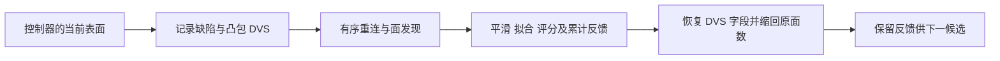
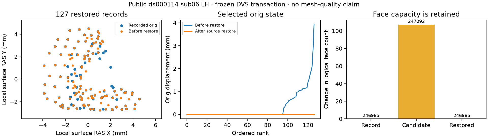

# 拓扑候选的 DVS 保存与恢复

## 1. 功能简介

`record_candidate_state()` 与 `restore_candidate_state()` 使用 NumPy 保存并恢复拓扑候选的部分状态。它们不调用原版 C++，不要求 CUDA。每个候选评分结束后，恢复原坐标、法向及连接关系；评分反馈和 RP 累计统计保留当前值。



这里的恢复不是整网格回滚。源程序只恢复指定顶点和指定字段；不能把 curvbak、marks、曲率、RP 统计、边状态或实际面内容一起还原。候选重连、评分、边复位、最终网格质量及完整 GA 分别由控制器负责。

## 2. Python 调用、输入和输出

```python
from fnit.recon_all.topology_candidate_state import (
    record_candidate_state,
    restore_candidate_state,
)

# baseline_state 和 candidate_state 是 FNIT 控制器的自产内存状态。
defect_snapshot = record_candidate_state(
    surface_state=baseline_state,              # 下表的显式表面字段
    defect_vertices=original_defect_vertices,   # 原网格缺陷顶点，保留原顺序
    convex_hull_vertices=original_hull_vertices,# 原凸包列表，包含源 border 顺序
    border_vertices=original_border_vertices,  # 原 border 列表
    vertex_translation=original_to_corrected,  # 原→当前网格索引；负数跳过
    profile="chull",                          # 固定原源码 error-mode=1 分支
)
restored_state, restoration_report = restore_candidate_state(
    surface_state=candidate_state,             # 评分后状态；反馈仍在这里
    snapshot=defect_snapshot,                  # 本候选对应的独立只读快照
    mode="full",                              # 恢复 DVS 全部字段；faces 只恢复入射面
)
# 调用方使这些顶点的外部空间索引/原坐标距离缓存失效后再使用。
moved_vertices = restoration_report["original_coordinate_restored_vertices"]
```

### 表面状态字典

| 字段 | 格式和含义 |
| --- | --- |
| `faces` / `nfaces` | 整数 `(capacity,3)` 有序面存储及当前有效面数；有效输出为 `faces[:nfaces]` |
| `original_vertices` | `(N,3)` 转换为 float32；orig 坐标，tkregister/surface RAS，mm |
| `vertex_normals` | `(N,3)` 转换为 float32；当前顶点法向，无量纲；不重新计算 |
| `vertex_rip` | bool/整数 `(N,)`；记录时非零顶点不进入可恢复字段；恢复不修改 rip |
| `vertex_topology` | int32 可表示的整数 `(N,7)`，列序为 `nsizeCur,nsizeMax,vtotal,vnum,v2num,v3num,num` |
| `neighbor_storage` | N 行有序整数存储，包含到 `mrisVertexVSize`；不能只提供当前 vtotal 或重建排序邻接 |
| `incident_faces` | N 行有序整数存储，有效长度为 `num`，引用当时有效面号 |
| `incident_corners` | N 行 0/1/2 三角面局部角号，与对应 `incident_faces` 同序 |
| 其他字段 | 当前值按原引用保留，例如 current XYZ、curvbak、marks、K1/K2、边状态、RP 统计；不会偷偷恢复 |

`defect_vertices`、`convex_hull_vertices`、`border_vertices` 均为原网格有序整数列表；`vertex_translation` 是原到 corrected 网格的整数映射。任何负映射跳过。`profile="chull"` 默认记录 defect+chull；`"border"` 显式对应另一个编译分支。重复记录不排序、不去重。

返回 `DefectVertexSnapshot` 包含原有效面数、原有序映射、可恢复标记、选定顶点的 orig/normal/7 计数和独立只读邻域/入射面/角号，以及 `vsize_exceeds_vtotal` 和保存秒数。输入没有被修改，也没有将未选顶点整份保存。

`restore_candidate_state()` 返回 `(new_surface_state, report)`。`mode="full"` 默认恢复全部 DVS 字段；`mode="faces"` 只恢复 `num` 与入射面/角号。两者均缩回原 `nfaces`，不恢复面内容。原保存时 ripped/负映射跳过，即使当前 rip 改变也不重新选择。`num`/邻域有效存储为 0 时保留当前缓冲，对应原实现避免零大小 realloc 的行为。

恢复使用新字典发布改动字段：坐标、法向、拓扑和被改行独立；未改缓冲可以共享。快照、输入或容量错误抛 `ValueError`，不会先修改部分输入。合法快照只接受同一 corrected 顶点数；当前面数不得少于原记录。`vtotal` 必须与恢复时 `nsizeCur` 选择的计数相同，不能忽略原断言。显式 report 给出恢复/跳过数量、前后有效面数、需使外部空间缓存失效的顶点和墙钟。

原源码分配 `vtotal` 个整数却复制 `vsize` 个，超邻域可能写越界。本实现安全保存实际 `max(count_at_nsizeMax,vtotal)` 长度，并记录触发数量；不移植未定义内存行为。原面/邻接检查与空间索引副作用由调用方落实，此接口不替代完整 QC。

## 3. 命令行调用

这个内部步骤没有独立生产 CLI。隔离同输入回归工具读取无 pickle 的私有 NPZ：

```bash
python tools/benchmark_recon_topology_candidate_state.py \
  --record-state frozen_diagnostic/record.npz \
  --candidate-state frozen_diagnostic/before_restore.npz \
  --reference-state frozen_diagnostic/restored.npz \
  --reference-repeat frozen_diagnostic/restored_repeat.npz \
  --selection frozen_diagnostic/selection.npz \
  --source-manifest frozen_source/SOURCE_MANIFEST.json \
  --profile chull \
  --threads 4 \
  --output new_dvs_diagnostic
```

所有文件路径及新输出目录必填；`--profile` 默认为 chull，`--threads` 默认为 4。`--reference-repeat` 可选；face-only 需成对提供 `--face-candidate-state` 与 `--face-reference-state`，原流程未实际执行时明确未测。参考只在恢复后比较，不决定选择、字段或恢复规则。

NPZ 除普通数组字段外，使用 `neighbor_offsets/neighbor_storage` 和 `incident_offsets/incident_faces/incident_corners` 编码完整有序存储。邻域 CSR 不是 vtotal 截断；零有效长度的缓冲可以保留。输出包含私有候选 NPZ、JSON 的逐字段不同值/字节和最大/P99 误差、源码/输入哈希、线程和完整读写边界。工具只把有效面及实际使用邻域/入射行用于输出比较，容量尾部不是有效网格。

## 4. 对应原软件步骤

固定 FreeSurfer 提交 `d932c45b7941662ea380a05efef580568b98d41a` 的 `utils/mrisurf_defect.cpp`：`mrisRecordVertexState()`、`mrisRestoreOneVertexFaceState()`、`mrisRestoreOneVertexState()`、`mrisRestoreFaceVertexState()` 和 `mrisRestoreVertexState()`。这些函数是 `mris_fix_topology` 内部步骤，没有独立官方命令。

独立观察器仅在 benchmark 中保存真实 record→完整候选评分→真实恢复的字段，不额外执行原算法，不生成已通过的生产拓扑结果：

```bash
mris_fix_topology_candidate_state_observer \
  -mgz \
  -sphere qsphere.nofix \
  -inflated inflated.nofix \
  -orig orig.nofix \
  -out diagnostic.orig.premesh \
  -ga \
  -seed 1234 \
  -threads 4 \
  subject lh
```

实际独立程序名称、观察时点、编译参数和 SHA 以本组机器收据为准。原 C++ 主体、编译库和原始影像不发布。

## 5. 当前精度、时间与可视化

当前本地 23 项契约通过：选择顺序、负映射/rip、max 邻域存储、别名保护、face-only/full 恢复、零长度缓冲和失败事务。它们不是 MRI benchmark。

最新一轮本地 JUnit 记录 23 项通过、套件 5.238 秒，绑定该轮实际模块/工具与测试 SHA；不包括 MRI 计算。

真实同输入门已经完成：公开 ds000114-sub06 左半球的历史 3a 冻结阶段输入，在独立固定源码参考中记录首次真实 DVS 保存和完整恢复。参考执行两次，三份捕获逐字节相同。候选在另一 CPU 环境只消费 record 与 before-restore 状态，计算完成后才读取参考 after-state 比较；没有将参考输出填入计算。

| 本阶段检查 | 实测结果 |
| --- | --- |
| 顶点数 | 126,778 |
| 逻辑面数 | 保存 246,985 → 候选 247,092 → 恢复 246,985 |
| 原有序记录 | 167；恢复 127，跳过原 rip/负映射 40 |
| 存储容量风险 | 本例 `vsize>vtotal` 为 0；该分支另有安全契约 |
| 24 组状态、有效面和有效邻域/入射存储 | 不同值、不同字节均为 0；包括保持当前值的 curvbak、marks、K 和反馈字段 |
| 自身重复 / 参考重复 | 都逐位相同 |
| face-only 真实分支 | 本次源调用未执行，未评估；契约覆盖不作为真实证据 |

候选固定 4 线程，Python 3.11.16、NumPy 1.26.4。保存 API 为 0.00556 秒，恢复 API 为 0.01125 秒，再次恢复为 0.01113 秒。包含导入、加载、完整比较和候选写出的冷诊断 CLI 为 81.03663 秒；另有 17.21606 秒将原捕获转换成诊断 NPZ。参考带观察器的两次执行为 7.43155/6.92074 秒，包含首个候选生成与评分，且主机不同，**不计算速度比**。

这次 corrected 状态的面数与原 nofix 日志中的 253,652 面是不同相位。它也不是后来 CFFF79 的 candidate 初态，不能拼入另一条连续 GA 链。完整 GA、最终网格 QC、原始 T1 整例和整体指标等效仍未判定。CPU 状态拷贝没有 CUDA 运算；本次没有显存采样，不写成显存 0。



图显示选定 orig 坐标和逻辑面数变化，不作为最终网格质量图。完整白名单指标见 [候选报告](../../validation/recon_all/optimizations/20261010_topology_candidate_state/reports/candidate_v1.json)、[参考重复收据](../../validation/recon_all/optimizations/20261010_topology_candidate_state/reports/reference_v2.json) 和 [相位信息](../../validation/recon_all/optimizations/20261010_topology_candidate_state/reports/phase_metadata.json)。原始捕获、私有路径和日志留在授权工作目录；公开报告保留计算/程序/输入 SHA。

## 6. 最近更新与 benchmark

- 2026-10-10：新增自有 DVS 字段事务，保留未记录的评分反馈；源存储容量风险明确处理。
- 首次契约因 Python `np.iinfo.min/max` 属性误写为调用而失败；19 项失败收据保留，未发生原程序或真实数据运算。
- 修复后 19 项通过，新增无 pickle 存储解析与容量比较后 22 项通过；进一步覆盖未使用高跳邻域负哨兵后 23 项通过。各轮收据绑定实际源码，不改历史 SHA。
- 上传观察器到 headcw 的操作被自动审批拒绝，理由为目的地代码上传授权缺失；没有绕过。随后将固定构建输入下载到本地再转移的替代操作也被拒绝，理由为该资源传输未获明确授权。两项动作均未执行；继续完成不依赖传输的代码/契约及源码规则核对。
- 用户随后明确允许上传本轮 DVS 验证脚本。固定源、库和原版程序保留在参考环境，只迁移已授权公开基准捕获。构建 v1 因恢复调用 anchor 非唯一失败；v2 选择实际 RP 更新后的完整恢复点后成功。参考 wrapper v1 缺少固定 benchmark main 要求的 FNIT 自产 canonical 坐标环境，捕获前中止；修正部署条件后 v2 两次成功。失败收据均保留，不归因为 DVS 或显存。
- 下载完整 private 报告被自动审批拒绝后，改为服务器固定白名单导出，排除账号、主机、路径、命令和顶点 ID，只迁回公开指标。冻结模块 SHA `782786f5…`、工具 SHA `6b5f3c47…`、参考程序 SHA `6dc1777e…`；完整值见机器报告。

## 7. 原代码与参考文献

- [固定原 DVS 保存与恢复](https://github.com/freesurfer/freesurfer/blob/d932c45b7941662ea380a05efef580568b98d41a/utils/mrisurf_defect.cpp)。
- [固定邻域计数和存储规则](https://github.com/freesurfer/freesurfer/blob/d932c45b7941662ea380a05efef580568b98d41a/utils/mrisurf_topology.cpp)。
- [固定有效面数管理](https://github.com/freesurfer/freesurfer/blob/d932c45b7941662ea380a05efef580568b98d41a/utils/mrisurf_base.cpp)；[orig 坐标 setter](https://github.com/freesurfer/freesurfer/blob/d932c45b7941662ea380a05efef580568b98d41a/utils/mrisurf_metricProperties.cpp)。
- Fischl B et al. Automated manifold surgery. *NeuroImage* (2001). [DOI](https://doi.org/10.1006/nimg.2001.0781)。
