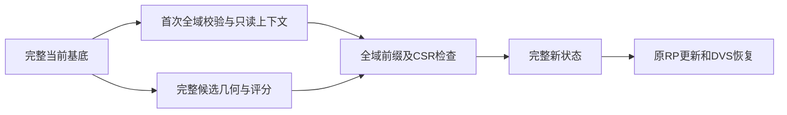

# 拓扑候选：完整状态装配的显式基底缓存

## 1. 功能简介

真实热剖析发现，完整候选状态装配每次在 Python 中检查三组全部顶点行，并逐行转换列表、复制小数组。当前冻结病例110534顶点，每次331602行，cProfile内装配约1.58–1.76秒；后续非剖析实际旧装配约0.71–0.75秒。25轮平滑和40轮MRI匹配的完整数值核合计只有约0.13–0.15秒，因此本轮先减少状态装配的重复工作。

新入口保存一份只读基底有效前缀；每个候选仍逐元素验证全域当前基底、完整有序面及追加规则。已有完整CSR供Numba检查；入射面和角点各复制一个完整缓冲，再建立互不重叠的行视图。邻接容量尾部、DVS恢复、持久曲率和反馈均保持原语义。



## 2. Python调用、输入和输出

```python
from fnit.recon_all.topology_candidate_state_cache import prepare_candidate_state_context
from fnit.recon_all.topology_candidate_cycle import CandidateCycleEvaluator

state_context = prepare_candidate_state_context(
    surface_state=complete_surface_state,  # 自产完整当前一环基底，包含容量行
)
evaluator = CandidateCycleEvaluator(
    surface_state=complete_surface_state,  # 完整坐标、属性及拓扑；不读参考后态
    snapshot=own_defect_snapshot,          # 同基底自产DVS选择性快照
    retessellation_inputs=retessellation_parameters,  # 全部有序边/域与原控制参数
    candidate_inputs=fitness_parameters,   # 自产MRI、局部先验、全局PDF及源权重
    state_context=state_context,           # 显式优化；默认None保持旧装配
)
feedback = evaluator(
    ordering=ordered_candidate_edge_indices,  # 当前完整边序排列
    discarded_defect_vertices=discarded_defect_mask,  # 当前原序DISCARD bool(K,)
    vertex_rip=current_vertex_rip_flags,      # 当前完整源signed-char标记，N项
    use_counts=defect_use_counts,             # 原序int32(K,)RP累计次数
    vertex_fitness=defect_vertex_fitness,     # 原序float32(K,)RP累计反馈
)
complete_new_state = evaluator.surface_state  # 完整恢复后状态，供下一候选
```

`prepare_candidate_state_context(surface_state=...)` 无隐式初态，返回 `CandidateStateContext`。`materialize_candidate_state(initial=..., result=..., state_context=None)`、`evaluate_candidate_cycle(..., state_context=None)` 和类构造均有同一显式选项；默认仍调用旧完整装配。

| 输入 | 结构、空间与意义 |
|---|---|
| 完整state坐标/法向/属性 | 原接口完整float32(N,3) surface RAS/mm；法向无量纲；K等单位沿既有接口。不进入缓存 |
| `vertex_topology` | int32(N,7)：nsizeCur、nsizeMax、vtotal、vnum、v2num、v3num、num；限当前已验证一环/all模式 |
| `neighbor_storage` | N个有序容量行；仅vnum有效前缀验证；当前未用容量尾部保留，不用面重造邻接 |
| `incident_faces` / `incident_corners` | N个有序容量行；前num项是完整面号/角点0、1、2；不排序、去重 |
| `faces` / `nfaces` | 完整整数面容量及逻辑面数；上下文仅冻结逻辑基底前缀 |
| `result` | 完整 `evaluate_candidate` 返回；邻接列表与完整CSR必须相同，所有追加前缀检查覆盖全N |
| `state_context` | 原基底完整只读快照；跨基底、计数或有效拓扑变化必须重新准备 |

上下文包含只读topology、逻辑faces、neighbor/incident offsets、有效前缀和构造秒数，不保存动态坐标、rip/marks、K/E/H、fx/curvbak、面积或RP。输入修改不能改变快照；后续每次按值验证当前全域，不只检查对象身份。

输出字段与原完整状态相同。不变邻接复用当前容量行；新增邻接独立复制。入射面和角点行是新独立flat缓冲的非重叠视图；输入候选修改不影响输出，行间写入不相互影响。未用入射容量尾部按原装配移除。H/K仅已有且实际非空SFF行更新，其他动态写回复用同一成熟helper。

非法shape/类型、损坏上下文metadata、无效索引、缺字段、多环、删点、前缀改变或冗余CSR不一致报`ValueError`；失败不发布部分状态。原子恢复继续由原DVS函数完成。没有自动最终网格放行、文件写出或线程切换。

## 3. 命令行调用

内部状态管理没有独立生产CLI。使用 `tools/benchmark_recon_topology_candidate_state_cache.py` 对显式冻结阶段执行完整ABBA；`--help` 列出全部路径参数：旧finalization/cycle workspace、两个明确源码覆盖、三张真实影像/表面、初态前置、事后参考和新输出目录。`--threads=4` 固定预算，CUDA须隐藏；上下文准备、首次JIT、导入、加载、校验和完整读写均计入。

例如使用已授权真实冻结前置，显式传入全部参数（每个路径须由本次manifest核验）：

```bash
# 先在shell定义以下变量：真实阶段前置/事后参考、两套源码与新输出路径
export CUDA_VISIBLE_DEVICES=''  # 本项为有序CPU状态装配，不初始化GPU
export OMP_NUM_THREADS=4 NUMBA_NUM_THREADS=4 OPENBLAS_NUM_THREADS=4 MKL_NUM_THREADS=4
arguments=(
  --finalization-workspace "$frozen_finalization_workspace"  # 完整成熟末段诊断及SHA清单
  --cycle-workspace "$frozen_cycle_workspace"                # 其余固定FNIT依赖
  --baseline-overlay-source "$baseline_python_source"       # fc78五模块的固定控制覆盖
  --overlay-source "$candidate_python_source"               # 明确本轮模块覆盖及SHA
  --before-retess "$frozen_retess_before"                    # 完整候选重连前初态
  --initial-attributes "$frozen_initial_attributes"          # 明确同版本初始属性
  --initial-global-priors "$frozen_global_priors"            # 阶段冻结全局先验，非自产门
  --input-surface "$own_original_nofix_surface"              # 自产orig.nofix表面
  --input-qsphere "$own_qsphere_nofix_surface"                # 同版本球面
  --brain "$own_brain_mri"                                  # uint8脑影像用于自产MRI校准
  --after-statistics-reference "$comparison_statistics"     # 仅写出后比较
  --after-volume-reference "$comparison_volume"             # 仅写出后比较
  --fitness-reference "$comparison_fitness"                 # 仅写出后比较
  --output "$fresh_abba_directory"                          # 必须不存在，保留完整失败记录
  --threads 4                                                # 固定总预算，不另增线程
)
python tools/benchmark_recon_topology_candidate_state_cache.py "${arguments[@]}"
```

参考after只在候选保存后由原比较器读取。该工具不是完整GA搜索或原始T1整例，不能把单次固定ordering当作搜索winner。

## 4. 原软件调用

对应固定 `mris_fix_topology -ga` 的候选完整状态装配、RP更新及 `mrisRestoreVertexState` 部分恢复。这些原函数没有独立CLI。原固定Conda程序只在独立benchmark生成参考；新运行不调用原版程序、不复制参考输出。

## 5. 最新精度、时间和脑图

[实际热剖析](../../validation/recon_all/optimizations/20261011_topology_candidate_locality_profile/profile.json)绑定当前成熟fc78模块、公开ds000114 sub07 ses-test LH的FNIT79上游冻结输入。110534顶点、216860面、38内点、99所选点；不是另一新125k/67内点纯GA病例。六次完整几何和六次装配均完成，源首候选严格门及完整末态自身重复门通过。

| 实际核 | 每次处理范围 | cProfile后续调用范围 |
|---|---|---:|
| detect完整面发现 | N行set、完整216722基底面/650166面边 | 1.544–1.601s |
| 完整状态装配 | 3N=331602有序行 | 1.584–1.765s |
| 25轮平滑数值核 | 5421500面法向、完整坐标副本 | 0.045–0.053s |
| 40轮MRI匹配数值核 | 8674400面法向、4560局部采样 | 0.083–0.095s |
| 最后完整面法向 | 全216860面 | 0.020–0.021s |
| 所选SFF | 99点，完整有序CSR | 0.006–0.017s |

完整剖析125.481983秒包含cProfile开销、首次JIT和写出，只用于定位。首个SFF调用11.993843秒，不能作为热算子耗时或受控速度对照。全N返回列表转换和全F面边字典仍是其他大成本，此新接口不修改retess算法。

首版[完整v2 ABBA](../../validation/recon_all/optimizations/20261011_topology_candidate_state_cache/reports/v2/report.json)四child EXIT0；162个完整数值/容量字段及控制字节全相同、四次源首门/末态重复门均通过。但CLI中位85.638783→90.499687秒，慢5.6761%；API77.994675→81.276919秒，慢4.2083%。额外全域打包/冷JIT未带来阶段收益，保留为失败性能实验，不设默认。

下一冻结v3仅按行容器类型优化全域打包：ndarray有效前缀用成熟NumPy concatenate，Python list用原iterator，所有整数/范围/CSR/追加验证保留。其[完整v3 ABBA](../../validation/recon_all/optimizations/20261011_topology_candidate_state_cache/reports/v3/report.json)四child已EXIT0，162个完整字段、控制JSON以及四次源首门/完整末态自身重复门均保持。

| v3完整阶段，非剖析 | 原装配 | 显式缓存 | 观察 |
|---|---:|---:|---|
| fresh CLI中位，含导入/首次JIT/全域准备/写出 | 83.037567s | 86.674524s | 慢4.3799% |
| 完整两条诊断序列API中位 | 76.621943s | 79.369881s | 慢3.5864% |
| 同进程热B完整candidate cycle中位 | 3.648775s | 3.335028s | 缩短8.5987% |

完整CLI原始ABBA四次为99.336923 / 94.287643 / 79.061405 / 66.738212秒。热状态装配约0.42–0.45秒，对照约0.71–0.75秒；首候选包含上下文准备/JIT。局部成本下降没有转化为本组完整阶段提速，默认None保持。不可将热调用或共享主机一次ABBA外推为完整GA/rawT1提速，更未达10分钟。同一Intel Xeon Platinum8369B主机、固定四核/线程4，Python3.11.16/NumPy1.26.4/Numba0.67.0。GPU隐藏，显存记null、峰值RSS未正式采样；无新增依赖，既有Numba在主页环境内。完整GA、原始T1、安装隔离和整体指标等效未评估。最终网格质量门保持原要求。

既有同冻结病例脑图仅提供MRI及几何相位查看，不是这次新图或新的整例结果：


## 6. 版本和benchmark

- fc78：已验完整同面CSR复用，162完整数值/容量字段及控制字节一致，冻结阶段CLI缩短10.5756%；不回填本轮版本。
- 前一全部行打包实验完整CLI慢6.7353%，失败收据保留，原cycle已撤回。本轮显式只读上下文另建实现，默认None。
- 本轮只读剖析：全步骤/首门完成，但包含cProfile/JIT，不作为性能基线。
- 本轮针对缓存合同：17tests与9subtests，10.52秒；覆盖同对象内容变更、metadata损坏、全行前缀、容量尾部、动态反馈、DVS及输出别名，不替代真实数据。
- v3状态装配源码`64d57c499…`、cycle`4ffe4373…`，bundle manifest`5674352e…`；当前实际源码与报告绑定。四child完整输出全0差，但完整阶段变慢，不设默认。
- 新启动器v1仅上传未解包/执行，发现未声明环境变量后保留；v2使用已核验环境绝对路径。算法源码保持同一冻结版本。

## 7. 参考文献和原代码

- [FreeSurfer固定mrisurf_defect.cpp](https://github.com/freesurfer/freesurfer/blob/d932c45b7941662ea380a05efef580568b98d41a/utils/mrisurf_defect.cpp)：DVS、RP与候选完整状态语义。
- Fischl et al. 2001. Automated manifold surgery. IEEE TMI. [DOI](https://doi.org/10.1109/42.906426)。
- [完整候选闭环](TOPOLOGY_CANDIDATE_CYCLE.md)、[同面CSR复用](TOPOLOGY_CANDIDATE_INCIDENT_REUSE.md)、[选择性DVS](TOPOLOGY_CANDIDATE_STATE.md)：原完整接口和既有真实参考边界。
