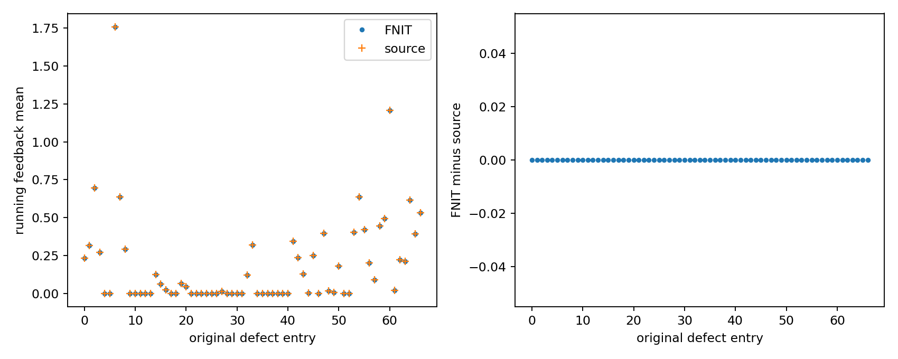

# 拓扑候选的顶点反馈统计

## 1．功能简介

`update_candidate_statistics` 用独立 NumPy 完成拓扑修复内部的顶点反馈累积。它标记当前候选采用的边端点，排除 border，再按原缺陷顺序更新使用次数和 F32 运行均值。输入状态由 FNIT 控制器生成，函数不执行或链接原版程序。

固定原流程把候选分数权重、总反馈归一化值都覆盖为 1。本实现保留这个规则，不能将它改成按候选分数加权。反馈统计不是脑区统计、最终曲率，也不是完整 GA。

## 2．Python 调用、输入与输出

```python
from fnit.recon_all.topology_candidate_statistics import update_candidate_statistics

new_statistics = update_candidate_statistics(
    vertex_marks=current_vertex_marks,  # int32 (N,)，当前完整网格标记
    vertex_curvbak=current_unmri_feedback,  # float32 (N,)，unMRI 后的完整反馈
    candidate_edges=current_ordered_edge_endpoints,  # 整数 (E,2)，当前候选边端点
    edge_used=current_edge_states,  # 整数 (E,)，原 0…6 边状态
    translated_defect_vertices=original_to_current_defect_mapping,  # 整数 (K,)，按原缺陷顺序
    discarded_defect_vertices=discarded_original_defect_entries,  # bool (K,)，原 status==DISCARD
    translated_border_vertices=current_border_vertex_mapping,  # 整数 (B,)，原 border 对应的当前顶点
    use_counts=current_defect_use_counts,  # 非负 int32 (K,)，RP.nused
    vertex_fitness=current_defect_running_means,  # float32 (K,)，RP.vertex_fitness
    candidate_fitness=current_candidate_score,  # 有限实数；原函数将其统计权重覆盖为 1
)
# 控制器保存新返回状态；输入没有原地修改。
current_vertex_marks = new_statistics['vertex_marks']
current_defect_use_counts = new_statistics['use_counts']
current_defect_running_means = new_statistics['vertex_fitness']
```

| 参数或输出 | 数据结构、单位与规则 |
| --- | --- |
| `vertex_marks` | int32 `(N,)` 完整网格标记；这里的 `FINAL_VERTEX=2` 是统计标记，不能混用重连阶段的临时标记 |
| `vertex_curvbak` | 有限 float32 `(N,)`，本候选 unMRI 后的反馈；沿用原反馈单位，不是毫米距离或曲率图 |
| `candidate_edges` | 整数 `(E,2)`，当前完整有序边端点，使用当前顶点索引 |
| `edge_used` | 整数 `(E,)`，原 0…6 状态；仅状态 3、4 的端点标记为 FINAL |
| `translated_defect_vertices` | 整数 `(K,)`，原缺陷条目到当前网格的映射；非丢弃条目须在 `[0,N)`；丢弃映射不查询，可为 -1 |
| `discarded_defect_vertices` | bool `(K,)`，原 status 是否 DISCARD；不由当前 patch 成员资格推断 |
| `translated_border_vertices` | 整数 `(B,)`，当前 border 映射，须在 `[0,N)`；边标记之后先清 border |
| `use_counts` | 非负 int32 `(K,)`，按原缺陷顺序的历史使用次数 |
| `vertex_fitness` | 有限 float32 `(K,)`，按原缺陷顺序的历史运行均值 |
| `candidate_fitness` | 有限实数标量；保持原接口意义，但统计权重固定为 1，不用于新均值计算 |
| 返回 `vertex_marks` | 新 int32 `(N,)`，更新后的完整状态；非丢弃缺陷条目按序清标记，不强制清空所有域外或丢弃标记 |
| 返回 `use_counts` | 新 int32 `(K,)`，仅当前 FINAL 且非丢弃条目的使用次数递增 |
| 返回 `vertex_fitness` | 新 float32 `(K,)`，按 F32 乘法、加法、除法顺序计算的运行均值 |
| 返回 `updated_defect_entries` | 新 int64 `(A,)`，本次实际更新的原缺陷条目序号，保持顺序 |

这些数组没有坐标字段，索引必须属于同一个当前网格及同一原缺陷顺序。所有参数必填，没有设备、阈值或线程默认值。输入不修改，也不读写文件。

源循环在每次处理后立即清该顶点标记；重复映射会受到前一条目的清标记影响，因此不能用一次性布尔索引计算所有均值。DISCARD 条目不查询映射、不清标记。函数不恢复 DVS、不复位边状态、不删除顶点。

非法类型、形状、索引、负次数或非有限输入抛 `ValueError`；实际更新导致 int32 次数或 F32 均值溢出时抛 `FloatingPointError`。失败不会改变输入状态。GPU、TF32、autocast 和线程策略保持调用方设置。

## 3．命令行调用

这是数组 API，没有独立生产文件 CLI。当前契约测试：

```bash
PYTHONPATH=src python -m unittest discover \
  -s tests/recon_all \
  -p test_topology_candidate_statistics.py \
  -v
```

真实阶段工具使用隔离诊断目录中的完整 before/after 状态，比较完整 marks、使用次数和运行均值；不能从 after 统计补齐生产输入：

```bash
python tools/benchmark_recon_topology_candidate_statistics.py \
  --capture isolated_reference/repeat0/statistics0.bin \
  --native-repeat isolated_reference/repeat1/statistics0.bin \
  --observer-receipt isolated_reference/receipt.json \
  --output new_diagnostic/statistics \
  --threads 4
```

`capture`、`native_repeat` 为两次完整 `FNITRST1` 参考捕获；`observer_receipt` 绑定其源版本和程序。`output` 必须不存在，工具写 JSON、私有 NPZ 及误差 PNG；`threads` 默认为 4，须为正整数，结束后恢复线程预算。工具核对 magic、完整字段长度和尾部字节；严格比较失败保留报告并以非零状态退出。首次 API 与重复 API 单列，读写和 PNG 绘制另包含在工具墙钟中。

## 4．原软件调用与源码

对应固定 d932 `mrisurf_defect.cpp` 内部 `updateVertexStatistics`，没有该辅助函数独立 CLI。完整参考运行方式：

```bash
mris_fix_topology -ga -seed 1234 -threads 4 reference_subject lh
```

参考程序只在 benchmark 路径使用。先标记 source `USED_IN_NEW_TESSELLATION=3` 和 `USED_IN_BOTH_TESSELLATION=4` 的端点，清 border；实际 `fitness=1.f`、`total_vertex_fitness=1.f`，按序执行 `(feedback + float(nused) * previous_mean) / (float(nused) + 1.f)`，然后清当前顶点标记。被覆盖且不参与返回状态的总和不重复计算。

固定头 `mrisurf_defect.h` 的 SHA-256 为 `2463a2b9477ede08f29d4ae9c0678913136ca947ff49fccd0b852a82dcf3d19f`，其中 `FINAL_VERTEX=2` 已现场核对。

## 5．当前精度、耗时与图

2026-10-10 在 accelerator-b 使用公开 ds000114 `sub07` 左半球真实候选，冻结三次原始 `updateVertexStatistics` 调用的完整 before/after 状态。固定源码参考程序两次独立运行，三次调用的捕获字节都重现。FNIT 每次只读取 before、边状态、映射及当前反馈作为输入，after 仅用于比较。三次调用分别覆盖 RP 使用次数 `0→1`、`1→2`、`2→3`；每次更新 38 个缺陷条目。

| 真实调用 | 完整 marks／RP 次数／运行均值 | 首次 API | 重复 API | 含加载、NPZ、PNG，报告写出前 |
| --- | --- | ---: | ---: | ---: |
| 0 | 全部逐位一致，最大与 P99 误差均 0 | 0.000683 s | 0.000597 s | 0.417468 s |
| 1 | 全部逐位一致，最大与 P99 误差均 0 | 0.000480 s | 0.000409 s | 0.134537 s |
| 2 | 全部逐位一致，最大与 P99 误差均 0 | 0.000489 s | 0.000424 s | 0.132061 s |

完整数组包含 110,534 个顶点标记和 67 个原缺陷条目；所有 FNIT 重复结果也逐位一致。Xeon 8369B 节点固定 CPU 120–123、4 线程，Python 3.11.16。服务器 8 项契约测试通过，耗时 0.029540 秒；本地此前同组 0.045 秒。6 项覆盖 border、原序映射、别名清标记、DISCARD、分数覆盖规则、零反馈和溢出事务，2 项覆盖格式截断、尾字节、伪造计数及字段类型。

三次回归的 driver 耗时 0.727513 秒，含契约测试及结果读写，但计时从导入后开始；不能称完整冷进程墙钟。工具顶层导入另记 0.146408 秒。原参考没有独立统计函数的配对计时，因此不提供阶段速度比。全 GA、整例提速及整体等效仍未评估。



图横轴为 67 个原缺陷条目，左图显示 FNIT 与参考运行均值，右图显示逐条误差；不是最终表面或脑区 QC 图。完整输入哈希、程序哈希、采样范围、版本及机器可读指标见[本轮报告](../../validation/recon_all/optimizations/20261010_topology_candidate_statistics/README.md)。上传快照绑定 `8de83f0f17d51b91a52d5b97a4ad6ed2810bef7a` 与逐文件 SHA，不能仅凭后来提交号声称测过该提交。

没有创建 CUDA 上下文，调用前后 TF32 设置保持不变；未采样进程显存，报告为 `null`。源码使用主页环境已有 NumPy，不增加依赖；未进行新的干净环境整例安装验收。当前验证是冻结候选统计的同输入阶段测试，不是自产候选、完整 GA 或原始 T1 整例。

## 6．更新记录与 benchmark

- v1 新增独立 NumPy 更新，保留原 F32 运算与原序清标记，避免误用候选分数加权。
- 保留控制器显式状态，不构造全零占位网格状态；未替换默认拓扑生产调度。
- v1 在三次真实候选调用上完成完整状态回归和重复性验证，脱敏导出保留所有数值、bool 与 null；完整 GA 仍需独立控制器及自产上游验证。

## 7．参考文献与源码库

- [固定原统计步骤](https://github.com/freesurfer/freesurfer/blob/d932c45b7941662ea380a05efef580568b98d41a/utils/mrisurf_defect.cpp#L5139-L5205)。
- [FNIT 独立 NumPy 实现](../../src/fnit/recon_all/topology_candidate_statistics.py)。
- Fischl B, Liu A, Dale AM. Automated manifold surgery. IEEE TMI, 2001. [DOI](https://doi.org/10.1109/42.906426)。
