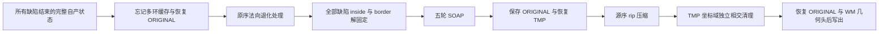

# 拓扑修复结束后的 SOAP 与有序压缩

## 1. 功能与流程

`topology_finish_geometry.py` 和 `topology_compact.py` 补全自有拓扑搜索结束后的几何收尾接口。五轮 SOAP 使用源顺序 float32 累加及双 pass 更新；压缩按旧编号升序保留未 rip 的顶点和面，保留原邻接与入射面顺序，不从面重建或删掉悬空边。



本页代码覆盖 B–G 中最终保留的坐标/法向与网格状态子集。法向退化处理复用已有 `normal_pending_python._repair`；它不代替完整 metric 的距离、角度等统计。H–I 由上层明确调用。完整 GA、最终网格质量、原始 T1 整例和整体指标等效分别验收。

## 2. Python 调用与完整输入输出

```python
from fnit.recon_all.topology_finish_geometry import finish_and_compact_topology

finished_surface = finish_and_compact_topology(
    surface_state=own_finished_surface_state,  # 所有缺陷搜索结束的完整自产状态字典
    metadata=own_surface_metadata,             # 原体积几何与状态，不读取参考头来补齐
    defect_vertices=ordered_defect_vertices,   # 所有缺陷的有序 inside 列表，原顶点编号
    border_vertices=ordered_defect_borders,    # 与 inside 一一对应的有序 border 列表
    vertex_translation=original_to_corrected,  # 完整原→当前 int32 映射，删除项为 −1
    normal_status="surface",                  # 明确选择原表面法向处理语义
    iterations=5,                             # 固定原主程序默认 nsmooth=5
)
```

`surface_state` 必须属于同一几何、拓扑版本，输入不修改。所有数组含完整 N 顶点；`faces` 可有容量尾部，仅 `nfaces` 个面有效。

| 状态字段 | 形状、类型与意义 |
| --- | --- |
| `current_vertices`、`original_vertices`、`temporary_vertices`、`canonical_vertices`、`vertex_normals` | `float32(N,3)`；前四项为对应坐标域 surface RAS/mm，法向无量纲。压缩复制全部五项 |
| `val`、`val2`、`valbak`、`val2bak`、`imag_val`、`curv`、`curvbak`、`stat`、`mean`、`mean_imag`、`std_error`、`H`、`K`、`k1`、`k2` | `float32(N,)`；源状态白名单原位复制，含标量 NaN 位模式。强度/反馈意义由自产控制器定义；H/k1/k2 为 mm⁻¹，K 为 mm⁻² |
| `faces`、`nfaces` | 整数 `(capacity,3)` 与实际逻辑面数 F；顶点编号为当前域 |
| `vertex_rip`、`face_rip` | 源有符号字符范围的整数或 bool；长度 N/capacity。零表示保留 |
| `vertex_topology` | `int32(N,7)`：nsizeCur、nsizeMax、vtotal、vnum、v2num、v3num、num |
| `neighbor_storage` | N 个有序整数行；当前一环为每行前 vnum 项，保留非面支撑的未删除邻接 |
| `incident_faces`、`incident_corners` | N 个有序行；每行前 num 项有效，corner 为 0–2，必须覆盖全部逻辑面角点 |
| `vertex_area`、`vertex_marks` | 几何收尾需要的 `float32(N,)` 面积 mm²/整数(N,)；原标记不作为跳过所有缺陷的依据 |

`metadata` 包含 `use_real_ras`、`status`、`origxyz_status`、`volume_geometry`、`hemisphere`。几何对象深复制；新源表面的 `register_mat` 为 null，外层原调用复制的半球和文件名保留。压缩后 nsize 为1，容量按源 nint(1.5×计数)；邻接实际长度与逻辑拓扑分别保留。

三个入口共享同一实现：

- `soap_bubble_vertex_positions(vertices=..., neighbor_offsets=..., neighbors=..., vertex_rip=..., vertex_marks=..., iterations=5)`：float32(N,3) 与有序一环 CSR。只有 marks==1 或 rip 非零的顶点固定；每轮包含中心点与非 rip 邻居，按原顺序 float32 累加再除以 float32 count，全部目标算完后交换。返回新坐标、原 marks 副本、移动顶点数、轮数与包含校验/JIT 的 API 秒数。迭代可为0。
- `finish_topology_geometry(surface_state=..., defect_vertices=..., border_vertices=..., vertex_translation=..., normal_status=..., iterations=5)`：先按全部缺陷映射解固定，法向退化处理后 SOAP；结果更新 ORIGINAL，current 恢复显式 TMP，marks 清零，忘记多环。法向保持 SOAP 之前的源 metric 状态。返回新 state、退化处理/坐标更新诊断、SOAP 报告与耗时；`normal_status` 支持 surface/sphere/spherical_patch/parameterized_sphere，plane/cut 的额外朝向暂不支持。
- `compact_ripped_surface_elements(surface_state=..., metadata=...)`：仅做源序压缩，返回新 state/metadata、完整 vertex/face translation、保留原编号、删除计数和 API 秒数。删除映射为 −1，新 E/fx/area/marks/rip/面法向等源 calloc 未复制字段为零。不能把旧缓存继续视为有效。

`finish_and_compact_topology()` 顺序复用后两项，返回压缩字段与完整 finish 报告、含两次输入检查的总 API 秒数。没有设备参数、文件写出或全局线程/精度变化；Numba 关闭 fastmath，不用半精度。

非法类型、溢出/浮点编号、容量、CSR 或入射关系为 `ValueError`。未 rip 面引用 rip 顶点直接失败，不自动删面掩盖上游错误。法向 pending 未解决为 `RuntimeError`；非有限 SOAP 为 `FloatingPointError`。新表面不能据 Euler 值直接发布，连通、流形、自交、形状和后续球面质量仍单独检查。

## 3. 命令行与复现

这是原软件内部步骤，当前没有独立公共生产 CLI。真实大网格诊断工具使用完整自产、带哈希的检查点：

```bash
PYTHONPATH=src:tools python tools/benchmark_recon_topology_compact.py \
  --input-state own-base/base_state.private.npz \
  --input-maps own-base/base_maps.private.npz \
  --input-regions own-merge/sff1_inputs.private.npz \
  --input-surface own-subject/surf/lh.orig.nofix \
  --input-manifest own-base/report.private.json \
  --source-manifest own-base/SOURCE_MANIFEST.json \
  --hemisphere lh \
  --output diagnosis/new-finish-compact \
  --threads 4 \
  --iterations 5
```

`input-state` 为完整 DVS 状态 NPZ，含有序 storage/incident CSR；`input-maps` 含原→当前映射与 merged labels；`input-regions` 必须含相同自产 merge 的 `merged_vertices_offsets/merged_vertices`、`merged_border_offsets/merged_border` 和 `merged_vertex_translation`。`input-surface` 只提供同源几何头，两个 manifest 绑定检查点与源码。`hemisphere` 为 lh/rh，`output` 必须不存在；线程为正整数，SOAP 迭代为非负整数。这次工具输入是实际自产 pre-GA 基底，所以只能检验大网格兼容与重复性，不能称全25缺陷后连续执行。

工具两次执行几何收尾和压缩，另验证压缩幂等性、完整状态字节、坐标及有序面映射。首次 JIT、数据读取、NPZ 写出分别计时，fresh CLI 包含解释器与全部读写。原参考 after 不进入计算。完整私有检查点/日志留在授权目录，公开只发指标与哈希。

## 4. 原软件调用与顺序

固定源码 `d932c45b7941662ea380a05efef580568b98d41a` 的 `mris_fix_topology -ga` 内部完成这些操作；SOAP 和压缩本身没有独立命令。主程序默认 nsmooth=5、noint=1。

`MRIScorrectTopology` 最后忘记邻域→恢复 ORIGINAL→metric→所有缺陷 inside/border 解固定→SOAP→保存 ORIGINAL→清 marks→恢复 TMP→`MRISremoveRippedSurfaceElements`。源主程序随后在 current=TMP 上 `MRISremoveIntersections`、查 Euler，再恢复 ORIGINAL 写修复面并复制 WM 几何头。**TMP 清理结果与最终 ORIGINAL 输出是两个状态，不能混写。** GA 没有贪心分支附加的朝向步骤。

收尾不重新 SFF/评分/RP，不把完整25缺陷后步骤替换成首候选。`normal_pending_python` 和 `mris_remove_intersection_python` 是已有自有处理模块；相交门仍独立，不能以本页收尾成功跳过。

## 5. 当前真实验证

本轮使用公开 ds000114 既有3a左半球输入及本轮自产 `rawBase v2`，**输入是 pre-GA 母板**：126,778顶点、246,985逻辑面、25条有序 merged regions。v4 完整 CLI 退出0；压缩移除2,055个已 rip 顶点和0面，留下124,723顶点、246,985面。两次 finish 全状态、两次 compact 全状态及两次幂等检查均0 byte差异，最大/P99坐标误差0；五个坐标/法向域及有序面映射逐位保持。法向 pending为0，marks最终全清零，SOAP非 rip移动域1,713顶点。

| 本次实际边界 | 首次 / 热重复 |
| --- | --- |
| 输入直接compact，含检查 | 9.407000 / 9.398518 s |
| 完整finish API，含检查/JIT | 12.222687 / 7.279538 s |
| 其中原序法向退化内核 | 4.947342 / 0.150968 s |
| 其中五轮SOAP，含其检查/JIT | 0.191627 / 0.003334 s |
| finish后compact API，含检查 | 9.455284 / 9.438866 s |
| 幂等compact API，含检查 | 9.384965 / 9.334930 s |
| 每份完整NPZ写出，另计 | 1.786743 / 1.717510 s |

固定四核亲和性8–11、4线程、GPU隐藏，共享主机。数据加载1.087485s、工具初始导入9.237757s。**fresh CLI 193.088720s** 包含导入、加载、六次压缩、两次finish、全部写出及重复/幂等全状态比较；不是一次收尾API耗时，也不能当整例。子进程峰值RSS1,197,672 KiB。相同环境十项契约全部通过，fresh测试进程墙钟9.155709s。

[完整机器指标](../../validation/recon_all/optimizations/20261010_topology_compact/README.md)保留全部字段，服务器先白名单导出、1,104项数值/布尔/null叶不变。compact模块SHA `6add953e…`、finish `46ba4f8e…`、诊断器 `ed5d0cee…`。本轮没有再次运行原版完整25收尾、同范围原版计时或其重复性；严格源参考、最终网格质量、独立部署、原始T1整例与整体指标等效全部 `not_assessed`。没有CUDA工作，不宣称显存预算验收或10分钟整例目标已完成。

真实MRI叠加只显示此pre-GA母板上的SOAP形变；该阶段尚缺洞内新面，图不作为最终闭合网格或解剖质量证明。


1,713个非 rip 顶点参与SOAP，压缩后实际940个顶点坐标改变，最大位移1.690949mm；全顶点P99为0，因为大部分外部顶点固定。该位移是算法前后形变，不是对原版的误差。图以同源MRI的tkreg逆矩阵映射surface RAS，切片在本次最大形变点；蓝色为SOAP前、橙色为后，不能将未画到的缺陷算作质量通过。

绘图器现在可复用到同索引的独立清理诊断：`figure_title=None`、
`before_label="before SOAP"`、`after_label="after SOAP"` 保持原显示；
显式字符串只改变标题/图例。`zoom_voxels=None` 保持全切片，显式正
有限voxel半径以最大位移点缩放，全网格位移统计不变。真实非零CSR
阶段的完整具名调用及新局部脑图见 [非零清理验证](TOPOLOGY_NONZERO_CSR_REPAIR.md)。
该新图与本页旧五轮SOAP图分别绑定实际绘图源码，不改旧报告SHA。

## 6. 更新与 benchmark 记录

- 2026-10-10：新增源序压缩与明确坐标域的五轮 SOAP，复用成熟法向退化内核，无新依赖。
- v1 冻结诊断缺已提交的遗传基底常量依赖，导入失败，算法未运行。
- v2 诊断器错误读取 merge 检查点映射键，启动检查失败，算法未运行；实际 key 为 `merged_vertex_translation`。
- v3 真实两重复计算与写出后，汇总把成熟 `compare_states()` 的 `byte_equal` 错叫 `bitwise_equal`，诊断器末尾失败。原失败收据保留，不称整次验证通过。
- v4 仅修诊断器字段契约，从新目录完整重跑，算法模块字节不变。原版全25收尾参考、最终网格质量和整例尚待验证。

## 7. 参考文献与代码

- [固定 FreeSurfer deform 源码](https://github.com/freesurfer/freesurfer/blob/d932c45b7941662ea380a05efef580568b98d41a/utils/mrisurf_deform.cpp)，`MRISsoapBubbleVertexPositions`、`MRISremoveRippedSurfaceElements`。
- [固定拓扑主流程源码](https://github.com/freesurfer/freesurfer/blob/d932c45b7941662ea380a05efef580568b98d41a/utils/mrisurf_defect.cpp)、[原命令](https://github.com/freesurfer/freesurfer/blob/d932c45b7941662ea380a05efef580568b98d41a/mris_fix_topology/mris_fix_topology.cpp)。
- [FNIT 压缩](../../src/fnit/recon_all/topology_compact.py)、[几何收尾](../../src/fnit/recon_all/topology_finish_geometry.py)、[法向退化](NORMAL_PENDING_PYTHON.md)、[自有相交处理](SOURCE_INTERSECTION_CLEANUP.md)。
- Fischl, B., Liu, A. & Dale, A. M. (2001). Automated manifold surgery: constructing geometrically accurate and topologically correct models of the human cerebral cortex. IEEE Transactions on Medical Imaging 20, 70–80。[论文](https://surfer.nmr.mgh.harvard.edu/pub/articles/fischl01-topology-fixing.pdf)。
