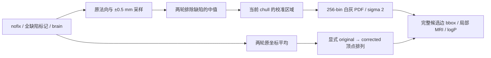

# 拓扑缺陷白灰强度校准与局部概率场

## 1．功能与范围

`calibrated_defect_volume_priors()` 从原 nofix 网格和归一化 MRI 生成白灰强度、校准直方图和完整局部强度/logP，不接收参考程序产生的局部体积或校准 PDF。它复用已写好的采样、中值、原坐标平均、直方图和局部体积函数。



网格缺陷识别、候选边生成、候选变形、二阶曲率、重连和 GA 种群控制仍是独立阶段。此接口不替代最终网格质量检查。成熟的 `topology_tissue_patch_python` 是另一实验配方，不能用其采样和整个半球校准代替本接口的原流程。

应在当前缺陷进入 GA 前按原流程准备一次；同缺陷的候选共享校准 PDF 和局部场，不对每个 mutation 重算全网格采样。缓存必须绑定原 MRI、nofix、全部缺陷标记、当前 chull、顶点排列及完整初始边表；跨缺陷或网格版本失效。

## 2．Python 调用及数据结构

```python
from fnit.recon_all.topology_defect_calibration import calibrated_defect_volume_priors

result = calibrated_defect_volume_priors(
    vertices=original_nofix_vertices_mm,       # float32(N,3)，原有序 surface RAS/mm
    faces=original_nofix_faces,                # 整数(F,3)，原有序三角面
    defect_vertices=all_defect_vertices_mask,  # bool(N,)，全部缺陷标记
    defect_hull=current_defect_hull_indices,  # 整数(H,)，当前完整 chull，原顶点索引
    candidate_edges=complete_candidate_edges, # 整数(E,2)，完整候选表，corrected 索引
    vertex_translation=original_to_corrected, # 整数(N,)，原索引→corrected 索引的全排列
    volume=normalized_brain_uint8,            # uint8(X,Y,Z)，归一化 brain 的原网格
    ras_to_voxel=surface_ras_to_mri_voxel,     # float32(4,4)，MRI-only tkregister 逆变换
    volume_resolution=-1,                    # 默认局部索引密度2 mm^-1；正数显式指定
)
local_white_log_probability = result["priors"]["white_log_probability"]
```

全部参数有名。`defect_hull` 必须是实际凸壳，不能只传一环 border；`defect_vertices` 标记全部缺陷。原 MRI 为 uint8 XYZ，不将 scanner RAS 当成 surface RAS。变换可用 `source_topology_ras_to_voxel(volume_header=brain_image.header)` 从 nibabel MGH 头生成。

返回字典：

| 字段 | 数据及索引空间 |
| --- | --- |
| `preparation` | `original_vertices/original_normals` float32(N,3)，`white_values/gray_values` float32(N,)，`ripped` bool(N,) 与有序 `neighbors`；全部原 nofix 索引 |
| `calibration` | `selected` int32(K,) 升序校准原顶点（不代表源访问顺序），白灰 `raw/smooth` float32(256,)，`bins=0..255` float32，`bin_size=0` float32，白灰均值 |
| `priors` | 与 [局部准备接口](TOPOLOGY_VOLUME_PRIORS.md) 一致：局部 XYZ uint8 强度和初始边掩膜、float32 白灰 logP、原点/每毫米索引密度、shape、均值/方差/均值 logP |
| `stage_seconds` | 准备、校准、局部场及完整 API 的秒数；包含校验，排除导入和外部读写 |
| `scope` | 本次完整子链的范围说明，不是完整 GA 或整例状态 |

函数不修改输入、线程或设备状态。非法顶点排列、越界、空校准区域、非有限结果明确失败。保持 float32 字段和原有 float64 累加，不启用半精度。原 nofix 与 corrected 的索引变化通过显式排列完成，不按最近点匹配、不从参考坐标推断。

## 3．命令行调用

本函数是内部子链，没有生产 CLI。真实同输入诊断脚本如下；候选从自有输入生成并保存后才打开参考捕获：

```bash
python tools/benchmark_recon_topology_calibration.py \
  --input-surface "subject/surf/lh.orig.nofix" \
  --input-qsphere "subject/surf/lh.qsphere.nofix" \
  --brain "subject/mri/brain.mgz" \
  --creation-capture "diagnostics/repeat0/prepared.creation.bin" \
  --likelihood-capture "diagnostics/repeat0/prepared.likelihood.bin" \
  --creation-repeat "diagnostics/repeat1/prepared.creation.bin" \
  --likelihood-repeat "diagnostics/repeat1/prepared.likelihood.bin" \
  --producer-benchmark "producer/benchmark.json" \
  --observer-build-receipt "diagnostics/build.safe.json" \
  --observer-run-receipt "diagnostics/receipt.private.json" \
  --source-manifest "frozen/TRANSFER_SOURCE_MANIFEST.json" \
  --output "new_calibration_diagnosis" \
  --threads 4
```

所有影像和完整 NPZ 留在授权计算环境。`output` 必须为新目录。观察程序只用于诊断，不由候选运行。

已保存的独立候选可追加只读三时点比较，不重新运行 MRI：

```bash
python tools/compare_recon_topology_calibration_fields.py \
  --candidate "new_calibration_diagnosis/candidate.private.npz" \
  --candidate-report "new_calibration_diagnosis/report.private.json" \
  --surface "subject/surf/lh.orig.nofix" \
  --capture-parser "tools/benchmark_recon_topology_calibration_fields.py" \
  --before "hist_diagnostics/repeat0/calib.before.bin" \
  --raw "hist_diagnostics/repeat0/calib.raw.bin" \
  --smooth "hist_diagnostics/repeat0/calib.smooth.bin" \
  --before-repeat "hist_diagnostics/repeat1/calib.before.bin" \
  --raw-repeat "hist_diagnostics/repeat1/calib.raw.bin" \
  --smooth-repeat "hist_diagnostics/repeat1/calib.smooth.bin" \
  --priors-creation "diagnostics/repeat0/prepared.creation.bin" \
  --priors-parser "tools/benchmark_recon_topology_volume_prepare_fields.py" \
  --observer-build "hist_diagnostics/build.safe.json" \
  --observer-receipt "hist_diagnostics/receipt.private.json" \
  --output "new_readonly_calibration_comparison"
```

`candidate/candidate-report` 绑定已完成的自产快照和原SHA；`surface` 是原同输入有序nofix；`capture-parser` 解码三时点的FNITHST1，六个捕获区分两个原进程；`priors-creation/priors-parser` 验证新平滑PDF与原局部准备的FNITPDF1来自相同校准；两份observer收据绑定实际程序/运行。`output` 新建JSON与COMPLETE，不写候选或生产。初始法向未保存在本轮候选NPZ中，脚本明确不声称新比较覆盖它。

## 4．对应原软件调用

对应固定 FreeSurfer `mris_fix_topology -ga` 内部 `mrisFindGrayWhiteBorderMean`、`mrisComputeGrayWhiteBorderDistributions`、`mriDefectVolume`、`defectVolumeLikelihood`，没有独立校准 CLI：

```bash
mris_fix_topology -mgz -sphere qsphere.nofix -ga subject_id lh
```

参数、上游网格和 MRI 必须固定；原版程序仅存在于隔离 benchmark。校准 white/gray bins 为0..255，原 histogram 的 `bin_size` 可保持0；不能擅自改为1或按 bin 间距重建。

## 5．真实精度、时间与图

公开 ds000114 sub-07/ses-test 左半球、`79a41cdd` 原始 T1 连续自产上游，候选从 nofix/qsphere/归一化 brain 自行生成全部校准输入。新链绑定 `69467e58` 加完整模块 SHA `0a67acfc…`，当前实测为：

| 同输入字段 | 不同元素 / max / P99 | 原始位比较 |
| --- | --- | --- |
| 白灰平滑 PDF、bins、bin_size | 0 / 0 / 0 | 完整512概率和512bins逐位同 |
| corrected 原坐标、完整MRI排序候选边 | 0 / 0 / 0 | 110,534×3坐标、4,723×2端点逐位同 |
| 初始mask、完整 uint8局部强度、白灰logP | 0 / 0 / 0 | 每场21×19×16，全部逐位同 |
| 9项几何、shape、4项校准统计 | 0 / 0 / 0 | 逐位同 |
| 内部MRI-only矩阵 | 数值0 / 0 / 0 | 保留正负零原始位差，完整严格门为False |

完整 chull 有125顶点，校准区域472顶点。两次候选 API 输出逐位同；两个独立源参考捕获逐字节同。完整 API 首次9.687754550948739秒、重复9.565229784697294秒，其中校准0.013688899576663971/0.013481971807777882秒，局部场0.07055662292987108/0.06298846658319235秒。首次受到先行合同 JIT cache 影响；工具的前置自有 sphere/labels/边表准备46.24284235201776秒另计。候选包含checkpoint写入、打开参考前66.16516894567758秒；工具含参考比较和绘图67.70834112539887秒，不含解释器/bootstrap导入和末尾JSON写出。脚本的0.004069223068654537秒导入仅发生在bootstrap预加载以后，不能作为完整导入时间。

同机四线程、候选 CPU100–103、参考 CPU8–11；共享负载未排除。参考5.665037/5.559619秒包含别的上游和观察器I/O，未单测此子链，不计算加速比。GPU未用、显存未测，无新增依赖。四项合同服务器7.197秒、本地11.143秒通过。新的入口/raw/smooth三时点对照确认全110,534个白灰中值和平均原坐标、221,116有序面、125 chull、raw/smooth两PDF与metadata均0bit差；110,534行one-ring顺序和2,166,570个vtotal两环集合相同。472 selected集合相同，API升序输出与原访问顺序不同，原始 `ordered_equal=false` 保留；精确整数计数及最终PDF相同。两原进程的六捕获逐字节同，七个旧fitness产物SHA未变。额外只读对照6.233150987885892秒不计MRI运行时间。当前candidate未保存initial normals，此新快照不承担该字段验证。


完整机器记录、实际原/公开SHA和复现脚本见[本轮专属报告](../../validation/recon_all/optimizations/20261010_topology_defect_calibration/README.md)。这是完整校准与局部准备子链；完整GA、整例质量和整体指标等效未判定。

已有成熟采样 v3 记录显示公开 sub-07 LH 110,534 顶点的平均原坐标、原法向、白灰中值、MRI-only 矩阵数值一致，221,116 有序面一致，见[原准备回归](../../validation/recon_all/optimizations/20261010_topology_source_mri_score/README.md)。旧两半球强度直方图只验证十位文本输出，不能代替本版完整 float32 字段回归。

## 6．最近更新与 benchmark 边界

本版增加可复用串联接口，保持各成熟子函数；校准直方图由 MRI 自行生成。此前 [局部场](TOPOLOGY_VOLUME_PRIORS.md) 门使用冻结校准直方图作为阶段输入，其原报告仍保留，不能改标为本次自产校准链。完整 GA、另一例和整例质量另行验证；默认生产配方本次不变。实测模块 `0a67acfc…` 后只更正文档字符串中的实际输出键名，可执行AST未变，报告未重新标记源码版本。

## 7．源码与参考文献

自有实现：[topology_defect_calibration.py](../../src/fnit/recon_all/topology_defect_calibration.py)、[topology_edge_mri_score.py](../../src/fnit/recon_all/topology_edge_mri_score.py)、[topology_intensity_histogram.py](../../src/fnit/recon_all/topology_intensity_histogram.py)、[topology_defect_volume_priors.py](../../src/fnit/recon_all/topology_defect_volume_priors.py)。原版固定源码 [mrisurf_defect.cpp](https://github.com/freesurfer/freesurfer/blob/d932c45b7941662ea380a05efef580568b98d41a/utils/mrisurf_defect.cpp)。

Fischl B, Liu A, Dale AM. *Automated manifold surgery*. IEEE TMI (2001)，[DOI](https://doi.org/10.1109/42.906426)。Ségonne F, Pacheco J, Fischl B. IEEE TMI (2007)，[DOI](https://doi.org/10.1109/TMI.2006.887364)。完整网格校准原理与当前候选控制边界见各阶段文档。
