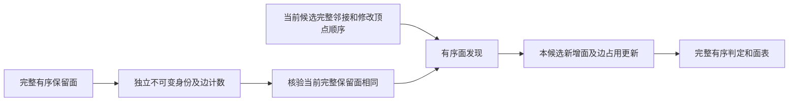

# 拓扑候选的保留面索引缓存

## 1．功能与流程

这个接口为同一保留面版本准备一次索引，候选之间复用面身份和无向边计数。当前邻接、新增面、接受/拒绝顺序和球面包含/定向仍逐候选计算。它不调用原版程序，也不省略网格外的无面支撑边。



真实热剖析发现，重复构造全部顶点邻接集合、全部面身份和边字典比已编译的平滑/MRI匹配内核更昂贵。这里首先消除整数索引的重复构造；TF32和影像精度策略保持原样。

## 2．Python、全部输入与输出

```python
from fnit.recon_all.topology_face_detection_cache import (
    prepare_face_detection_context,
    detect_patch_faces_cached,
)

face_detection_context = prepare_face_detection_context(
    base_faces=retained_ordered_faces,  # 完整保留面整数(F,3)，不改变有序面
    vertex_count=canonical_vertices.shape[0],  # 同一顶点域的完整顶点数N
)

new_ordered_faces, face_detection_report = detect_patch_faces_cached(
    canonical=canonical_vertices,  # 有限(N,3)，canonical RAS；按源规则使用float32
    vertices=selected_vertices,  # retain-inside随后border，完整源顶点顺序
    neighbors=current_candidate_neighbors,  # 本候选全部N行有序邻接，保留无面支撑边
    external_faces=retained_ordered_faces,  # 必须与缓存完整逐元素相同
    context=face_detection_context,  # 显式传入，不从全局状态猜测缓存版本
)
```

这些变量由既有完整基底与动态重连产生，不能用官方末态代替。它们没有文件 I/O；通过 `retessellate_and_detect_candidate(face_detection_context=...)` 接入的完整参数见[动态重连](TOPOLOGY_DYNAMIC_RETESS.md)。该参数默认 `None`，保持成熟完整面发现；本轮实验不修改生产默认。

| 函数、参数 | 结构、空间和限制 |
|---|---|
| `prepare_face_detection_context.base_faces` | 必填整数 `(F,3)`，索引在 `[0,N)`。重复面和重复边计数保留，完整有序面独立复制为不可变 int32。 |
| `prepare_face_detection_context.vertex_count` | 必填非负整数 `N`，不接受 bool；与候选 canonical 顶点域相同。 |
| `detect_patch_faces_cached.canonical` | 必填有限 `(N,3)` 数组，按原语转换为 float32，canonical RAS；与当前有序邻接一一对应。 |
| `detect_patch_faces_cached.vertices` | 必填一维整数数组，索引在 `[0,N)`；不排序或去重，原迭代次序保留。 |
| `detect_patch_faces_cached.neighbors` | 必填当前候选的全部 `N` 行有序邻接，每行含 Python 整数顶点索引。不能复用另一个候选的邻接。 |
| `detect_patch_faces_cached.external_faces` | 必填完整 `(F,3)` 保留面，转换为 int32 后须与缓存的全部有序面相同。 |
| `detect_patch_faces_cached.context` | 必填 `FaceDetectionContext`，必须由工厂产生。没有隐式全局缓存或过期状态回退。 |

工厂返回 `FaceDetectionContext`：`faces` 为独立 bytes-backed int32 `(F,3)`；`vertex_count` 为 N；`face_identities` 为不可变无序身份集合（只用于成员判断，不重排面）；`edge_counts` 为只读无向边计数；另含面字节 SHA 和准备秒数。原输入后续修改不影响它，数组不能重新开启写入。NumPy元数据被改变或缓存版本不符时抛出 `ValueError`。

面发现返回 `(new_ordered_faces, face_detection_report)`：前者 int32 `(K,3)`，顺序为实际接受次序；后者含接受数、球面包含拒绝数、占用边拒绝数和全部有序判定 `complete_ordered_face_decisions`。本次新增面/边计数保存在独立 overlay，不影响缓存或其他候选。非法输入抛异常，不伪造最终表面或质量通过。

## 3．命令行

该内部函数没有独立生产 CLI。完整冻结候选/末态 ABBA 使用[验证工具](../../tools/benchmark_recon_topology_face_detection_cache.py)：

```bash
CUDA_VISIBLE_DEVICES='' OMP_NUM_THREADS=4 MKL_NUM_THREADS=4 \
OPENBLAS_NUM_THREADS=4 NUMBA_NUM_THREADS=4 PYTHONPATH=src:tools \
python tools/benchmark_recon_topology_face_detection_cache.py \
  --finalization-workspace frozen-finalization \
  --cycle-workspace frozen-cycle \
  --baseline-overlay-source frozen-fc78-six-modules \
  --overlay-source frozen-face-cache-seven-modules \
  --before-retess inputs/retess.before.bin \
  --initial-attributes inputs/match.before.bin \
  --initial-global-priors inputs/statistics.bin \
  --input-surface inputs/lh.orig.nofix \
  --input-qsphere inputs/lh.qsphere.nofix \
  --brain inputs/brain.mgz \
  --after-statistics-reference reference/patch_statistics.bin \
  --after-volume-reference reference/volume.bin \
  --fitness-reference reference/fitness.json \
  --output fresh-face-cache-abba --threads 4
```

前三个原始快照分别是阶段前完整重连、属性与全局先验；nofix/qsphere 必须同顶点顺序，brain 为源 uint8 conformed MRI。after 三项只在计算产物保存后用于比较。两 source 目录固定六/七模块的 SHA，其他依赖沿用冻结 workspace。输出目录必须不存在；记录四个完整新进程、162 个数组字段及控制比较、实际源码/输入 SHA、CLI/API和上下文准备耗时。失败保留回执并退出非零。诊断不作为原始 T1 连续运行。

## 4．原软件调用

属于固定 FreeSurfer `mris_fix_topology -ga` 的内部 `detectDefectFaces`，没有独立 CLI。这里复用 FNIT 已通过阶段验证的 `_contains_neighbor_on_sphere` 和 `_canonical_winding`；不是在 Python 中运行原生程序。原生参考限于隔离 benchmark。

## 5．真实数据、精度、耗时与脑图

当前 20 项本地合同通过，pytest 16.84 秒，包含成熟动态 `some/all`、源顺序、重复面、当前邻接改变、完整边占用、元数据损坏和两个候选共享缓存；它们不是 MRI benchmark。

固定公开 ds000114 sub-07 ses-test 左半球的完整候选/末态 ABBA 已完成，四次退出均为0。110,534顶点、216,722保留面、99个选中顶点和138个新增面；每子进程完整面发现6次，缓存版本各准备上下文一次。全部162个数组字段、完整控制记录与原版首候选门/自身最终重复门均一致，坐标最大/P99误差均0。原版首候选门不能证明原版完整搜索赢家一致。

| 次序 | 版本 | 完整新进程CLI（秒） | 完整API（秒） |
|---|---|---:|---:|
| A1 | 成熟完整基线 | 92.306609 | 85.766696 |
| B1 | 显式保留面缓存 | 91.439419 | 84.934997 |
| B2 | 显式保留面缓存 | 54.285356 | 48.892885 |
| A2 | 成熟完整基线 | 61.459395 | 56.831254 |
| 中位数 | 基线→缓存 | 76.883002→72.862388 | 71.298975→66.913941 |

本组CLI缩短5.2295%，API缩短6.1502%，包含加载、校准、计算、参考检查及写出。四次共CLI316.963930秒，父工具API316.187004秒；嵌套时间不再相加。缓存准备分别0.987594/1.064928秒，计入B1/B2。CPU为Xeon Platinum8369B，固定4线程/116–119亲和性；共享环境未在ABBA期间连续记录负载，冷JIT/热缓存差异保留，没有删除3.929秒的慢调用。四次不足以证明稳定吞吐，更不能外推495次完整搜索或整例。

实际冻源基点`c0e8b3db`，基线`fc78aebf`，清单SHA `7090a7c1b11ec057404bf389fc28bb5d8c75472b72a4b6a34aee0d38df673561`。新模块SHA `92326f62d8b2b0351315e687ff13a3c8781316cf77cfd105889a080cd44eb449`、动态入口SHA `bac43cc30eba9f1ed9f863311252628b7ff4aedf8d9d16585b536eed1e1b436e`。完整[报告、162项矩阵、版本、CSV和图](../../validation/recon_all/optimizations/20261011_topology_face_detection_cache/README.md)绑定实际字节；完整私有记录保留服务器，只发布白名单指标与SHA。


图用MRI头的vox2ras_tkr逆把surface RAS/mm映射到voxel XYZ，实际Z=49、±2体素内69个选中顶点。右图只是严格对应零差；未展示完整半球网格质量。绘图`run(brain=..., baseline_candidate=..., cached_candidate=..., benchmark_report=..., output=...)`五个Path必填：uint8三维MGZ、该报告实际A1/B1末态NPZ、完整成功报告、新PNG；NPZ须含有限float32 `(N,3)`坐标、整数`(F,3)`面和非空整数`(K,)`选中索引。核对四次brain SHA、实际产物位置及完整有序字段后作同索引；未完成、SHA不符、NaN、负/越界索引或已有输出即报错。返回图/三输入/报告/脚本SHA、切片、覆盖和最大/P99差，不返回QC通过。

```python
from pathlib import Path
from tools.plot_recon_topology_face_detection_cache import run

plot_receipt = run(
    brain=Path("inputs/brain.mgz"),  # 同一冻结uint8 conformed MRI
    baseline_candidate=Path("fresh-abba/0-control/candidate/A.final.private.npz"),  # 实际A1自产末态
    cached_candidate=Path("fresh-abba/1-candidate/candidate/A.final.private.npz"),  # 实际B1自产末态
    benchmark_report=Path("fresh-abba/report.private.json"),  # 四次完整成功报告
    output=Path("new-figures/candidate.png"),  # 新图，不覆盖旧图
)
```

安全导出`tools.export_recon_topology_face_detection_cache.run(run_directory=..., source_manifest=..., plot_directory=..., output=...)`四个Path必填：父运行目录（含两EXIT、STARTED与process）、实际冻结JSON清单、上述完成绘图目录、新导出目录。要求全部4次/162字段严格成功、图/brain/report清单SHA闭合，输出白名单JSON、原清单、真实PNG及绘图回执；返回每文件字节数和SHA。源数据、路径、命令不复制；不合格输入或已有目录报错。版本探测明确记为完成后，负载与GPU占用缺测记null/未记录。

```python
from tools.export_recon_topology_face_detection_cache import run as export_completed_stage

public_receipt = export_completed_stage(
    run_directory=Path("fresh-abba-parent"),  # 含candidate/四次状态和两EXIT的完成父目录
    source_manifest=Path("frozen-source/SOURCE_MANIFEST.json"),  # 实际冻结18文件清单
    plot_directory=Path("completed-plot"),  # 新版图、图收据及EXIT均已写出
    output=Path("new-public-export"),  # 必须不存在；只导出数字、版本及哈希
)
```

本接口仅整数索引及 CPU 有序控制，调用成熟 float32 几何谓词，无 CUDA 初始化或半精度。GPU占用记 `null`；原始 T1 整例显存、138项、整体指标等效和10分钟目标尚未测定。

后续[完整默认首缺陷搜索](TOPOLOGY_GENETIC_FACE_CACHE.md)已实际完成：495次搜索评分加1次最终评分、29条轨迹、1,362,381次随机调用、80个完整状态字段及三份NPZ与旧完整基线完全一致。每缺陷准备索引一次，实际面发现497次（包含末态写回）；准备1.095209秒计入完整墙钟。完整CLI2263.422952→1329.628818秒，连接搜索/最终API2182.039244→1252.548780秒，分别观察缩短41.2558%/42.5973%。两次均CPU8–11/4线程，但为共享主机跨时段运行，基线缺负载曲线，不是受控ABBA或整例提速。全部九缺陷和后续orig仍须单独验收，不把首缺陷结果改称全半球完成。

## 6．更新与验证

- 初版新增显式不可变保留面上下文；动态邻接、源谓词及完整判定不缓存。
- `topology_retessellation_dynamic.py` 只增加默认 `None` 的可选入口；保留其他人的未提交 retessellation 工作及正在运行的冻结源码。
- 保留已拒绝状态缓存实验的失败记录；本方案是否提速以完整同输入回归为准。
- 使用已有 NumPy/Numba；主页 Conda 与 `pyproject.toml` 已声明，无新增依赖。
- 本轮补齐绘图输入绑定、有限坐标及索引检查；真实新版图重跑成功，PNG与旧版相同，但新脚本和运行回执各自记录SHA，没有回写旧运行。
- 完整默认首缺陷495次搜索已通过；继续在独立冻结目录验证全部九缺陷、完整清理与最终orig，不切换生产默认。

## 7．源码与参考

- [缓存实现](../../src/fnit/recon_all/topology_face_detection_cache.py)、[动态重连](../../src/fnit/recon_all/topology_retessellation_dynamic.py)、[合同](../../tests/recon_all/test_topology_face_detection_cache.py)。
- [固定拓扑源码](https://github.com/freesurfer/freesurfer/blob/d932c45b7941662ea380a05efef580568b98d41a/utils/mrisurf_defect.cpp)。
- [Fischl 等，2001，Automated manifold surgery](https://doi.org/10.1109/42.906426)。
