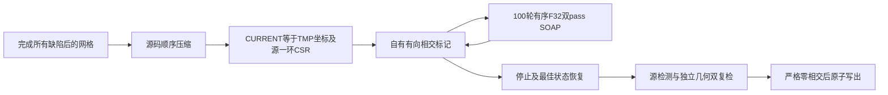

# 拓扑最终相交清理的有序邻接接口

## 1. 功能与流程

完整拓扑修复后，`compact_ripped_surface_elements()` 保留源有序一环邻接，
其中可能包含未被当前面支撑的边。固定原算法的最终相交修复直接消费该
邻接；从面重建会改变邻居域、求和顺序和 F32 SOAP 更新。

本次在成熟 `repair_intersections()` 新增显式 CSR 参数，并由完整文件接口
`run_remove_intersection()` 和兼容包装 `remove_intersection_surface()` 转发。
它复用已有 `soap_bubble_vertex_positions()`，保留每周期100轮、标记谓词、
停止条件和最佳状态恢复。未传 CSR 时仍执行原有 pial 路径。



源拓扑最终链在相交清理后恢复 ORIGINAL 再写 `orig`；这一坐标状态转换由
完整控制器管理。本接口清理传入的 CURRENT，不能自行用它覆盖 ORIGINAL。
不调用原软件程序，不增加依赖，不改变 CUDA、TF32 或半精度设置。

## 2. Python 调用、输入与输出

```python
from pathlib import Path
import numpy as np
from fnit.recon_all.mris_remove_intersection_python import run_remove_intersection

# compact_state来自本次自产压缩结果，不能从官方参考读取。
ordered_rows = [
    np.asarray(neighbor_row, dtype=np.int32)[:int(topology_row[3])]
    for neighbor_row, topology_row in zip(
        compact_state["neighbor_storage"], compact_state["vertex_topology"]
    )
]
ordered_neighbor_offsets = np.concatenate([
    np.array([0], dtype=np.int32),
    np.cumsum([len(row) for row in ordered_rows], dtype=np.int32),
])  # (N+1,)，完整一环行边界
ordered_neighbors = np.concatenate(ordered_rows).astype(np.int32)  # (E,)，保留原序

cleanup_report = run_remove_intersection(
    input_path=Path("/data/own/left.compact-current.surface"),  # CURRENT/TMP，surface RAS/mm
    output_path=Path("/data/own/left.cleaned-current.surface"),  # 严格通过后写出
    marking_backend="source_numba",  # 自有有向源规则；不运行FreeSurfer
    device=None,  # CPU路径；source_torch需明确cpu或cuda:N
    candidate_grid_cells_per_axis=2,  # 原完整空间候选规则
    require_zero=True,  # 源与独立几何检测均须为0
    ordered_neighbor_offsets=ordered_neighbor_offsets,  # 原一环CSR偏移
    ordered_neighbors=ordered_neighbors,  # 含真实悬空边，不从面重建
    report_path=Path("/data/own/cleanup.json"),  # 本次完整轨迹、SHA与计时
)
```

| 参数 | 格式、默认值和限制 |
|---|---|
| `input_path` | 必填，nibabel可读的三角表面；顶点 `(N,3)`、面 `(F,3)`，surface RAS/mm |
| `output_path` | 必填，可与输入同路径；无残余后原子写出。零相交保持原文件字节 |
| `marking_backend` | 文件API默认 `source_numba`；可选 `source_torch`。底层清理器另保留旧默认 `legacy` |
| `device` | 默认None；`source_torch`须明确CPU或有编号CUDA设备，不静默回退 |
| `candidate_grid_cells_per_axis` | 默认2；显式3仅允许 `source_torch`，不截断候选 |
| `require_zero` | 默认True；False仅用于原停止语义诊断，不应绕过生产质量门 |
| `ordered_neighbor_offsets` | 默认None；显式整数 `(N+1,)`，首0、非递减、末值E，与邻居数组同时提供 |
| `ordered_neighbors` | 默认None；显式整数 `(E,)`，每值 `[0,N)`，编号与输入表面一致；保留源行顺序和未被面支撑的边 |
| `report_path` | 默认None；指定则写JSON，包括读/计算/独立双复检/写/含I/O总时间和SHA |

底层 `repair_intersections(vertices,faces,ripped,...)` 接收同样两项 CSR；
`vertices` 为有限 `(N,3)` 坐标，`faces` 为有序面，`ripped` 为 `(N,)` bool。
返回 `(float32(N,3), diagnostics)`，含初末相交面数、逐周期轨迹、
平滑次数；显式 CSR 另记录 `smoothing_neighbor_domain` 和邻居数。

完整文件 API 返回 `dict`，含输入/输出 SHA、读/计算/双复检/写/总秒和轨迹。
非法 CSR 在首个标记前报 ValueError，即使输入零相交也校验；类型和范围
在整数转换前检查，防止浮点截断或大整数溢出。不修改调用方数组。
停滞残余且 `require_zero=True` 时报告失败、抛 RuntimeError、不写新输出。
CUDA错误原样传播。文件修复只改坐标，保留有序面、几何头和尾标记。

兼容包装的 `binary=None`、`assets_dir=None` 仅保留旧调用签名；不读取、
查找或执行程序。返回输入相交面数和标记顶点数，严格残余门相同。

## 3. 命令行与复现

现有生产文件 CLI 保留面邻接默认；最终拓扑控制器通过 Python API 提供
真实 CSR。以下命令执行独立真实阶段验证，必须使用新输出目录：

```bash
CUDA_VISIBLE_DEVICES='' OMP_NUM_THREADS=4 MKL_NUM_THREADS=4 \
OPENBLAS_NUM_THREADS=4 NUMBA_NUM_THREADS=4 \
python tools/benchmark_recon_topology_final_intersection_csr.py \
  --compact-state /data/own/compact.private.npz \
  --input-surface /data/own/lh.orig.nofix \
  --source-manifest /data/frozen/SOURCE_MANIFEST.json \
  --output /data/runs/ordered-csr-file-pair \
  --threads 4
```

`--compact-state` 是自产完整压缩状态；`--input-surface` 仅读取同源几何头；
`--source-manifest` 绑定冻结代码；`--output`必须不存在；`--threads` 默认4。
脚本写自产 CURRENT 表面，分别调用默认与源 CSR 完整接口，比较全部坐标、
有序面、文件 SHA 和严格双复检。输出包括诊断表面、JSON和完成/失败收据。
初始零交时明确标记非零真实修复尚未验证。没有调用原参考程序或读取参考
输出参与计算。进程导入、读写、计算和冷 CLI 墙钟分别报告。

## 4. 原软件调用与算法来源

仅供隔离 benchmark 的原命令：

```bash
mris_remove_intersection /data/benchmark/input.surface /data/benchmark/output.surface
```

固定源码 `d932c45b7941662ea380a05efef580568b98d41a` 的
`utils/mrisurf_deform.cpp`：`MRISremoveIntersections` 消费现有 `vt.v[0:vnum]`，
通过 `MRISsoapBubbleVertexPositions(100)` 按源 F32 顺序求和、双pass更新。
它不从面重建一环。当前自有后端和实际 C++ 参考各自保留原语义和质量门。

## 5. 本版精度、耗时与真实数据范围

真实公开 ds000114 历史3a左半球，自产 pre-GA 基底压缩后124723个顶点、
246985个面。显式CSR共有741916项，40条邻接未被当前面支撑；全量校验保留。
这不是完成25缺陷修复后的最终输入。

| 同输入完整文件API | 读/s | 计算/s | 源与独立几何双复检/s | 写/s | 含I/O墙钟/s |
|---|---:|---:|---:|---:|---:|
| 默认面邻接 | 0.017695 | 44.737753 | 103.639763 | 0.286473 | 148.722625 |
| 显式源CSR | 0.012610 | 39.439935 | 102.243870 | 0.099650 | 141.802750 |

全部 float32 坐标、有序面和表面字节完全相同，P99/最大坐标误差0 mm。
源与独立几何检测初末均0，不需要实际SOAP，因此本次非零CSR修复尚未
实测；不能用该零交结果代替非零门。几何头/尾部随文件字节保留。

顺序双调用冷CLI308.058306秒、峰RSS879176 KiB；CPU8–11、四线程、共享
主机、GPU隐藏。仅一组顺序冷观测，不据此宣布实现提速。导入/加载/写初始
网格另计，全部原数值见 [机器可读报告](../../validation/recon_all/optimizations/20261010_topology_final_intersection_csr/report.json)。
实际模块SHA86536276…/af53953c…，工具ebbd0e9c…；冻结复现绑定各完整SHA，
没有把历史报告重新标为当前源码。

新4项CSR契约与既有完整文件接口合计10测试、6子测试通过，18.64秒。
包含未被面支撑的边、F32求和顺序、非法整数输入、严格残余拒绝和原文件
保留；mock仅隔离100SOAP或文件调度，不作为真实MRI修复benchmark。

完整25缺陷、原版同输入最终修复、全部网格质量、整体指标等效及独立安装
均未评估。已有真实MRI的SOAP形变示例见 [拓扑压缩](TOPOLOGY_COMPACT.md)，
该图是实际pre-GA几何变化，不是本次坐标0差的误差图。

## 6. 更新记录与 benchmark

- 2026-10-10：本版真实零交完整文件对照通过，实际40条悬空邻接保留。
  新增显式有序邻接 CSR，默认面邻接完整保留；源100SOAP和
  严格双复检不变。旧测试仍预期原生 fallback，已改为自有文件API调度合同。
- 成熟非零相交输入的已有验证见 [源相交清理](SOURCE_INTERSECTION_CLEANUP.md)。
  该历史冻结SHA与本次不同，不能重新标为本次新CSR的非零真实结果。
- 本次结构压缩与 SOAP 阶段见 [拓扑压缩](TOPOLOGY_COMPACT.md)；其输入是
  真实 pre-GA 自产基底，尚未完成所有25缺陷的修复。
- 后续同版本ORIGINAL槽真实非零阶段已独立完成：两次2→0、各完整
  100SOAP，有序面/全部非坐标字节/轨迹自身重复通过。详见
  [非零CSR完整阶段](TOPOLOGY_NONZERO_CSR_REPAIR.md)。这是新的冻结
  输入槽与报告，不将本页CURRENT零交历史改标为非零结果，也不把
  ORIGINAL提前清理接入标准GA生产顺序。

## 7. 参考文献和原软件代码库

- [FreeSurfer固定源码](https://github.com/freesurfer/freesurfer/tree/d932c45b7941662ea380a05efef580568b98d41a)。
- [源相交清理与真实非零输入记录](SOURCE_INTERSECTION_CLEANUP.md)。
- [最终拓扑几何与压缩接口](TOPOLOGY_COMPACT.md)。
