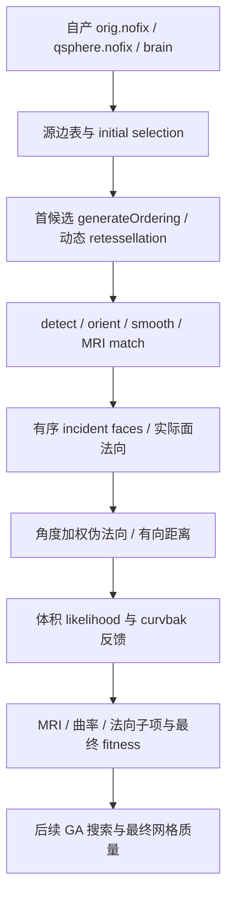

# 拓扑候选的完整 fitness 与有向距离诊断

## 1. 功能与范围

本页说明首次真实拓扑候选的同输入检查点，用于开发自有拓扑修复。
固定源码观察器在独立 benchmark 目录中编译和执行，FNIT 生产流程不会
读取这些参考文件。观察器不是生产后端，也没有完成整个 GA 搜索。

三个检查点的边界不同：



`FNITDST1/2` 在 F 后停止；`FNITVOL1` 在 G 后停止；完整 fitness 观察器在 H 后
停止。I 尚未由这些检查点覆盖。候选面数、坐标对应或子项完全一致，不能
替代最终连通性、流形、自相交、形状及原始 T1 整例验收。

## 2. Python 调用、输入与输出

### 有向距离检查点

```python
from pathlib import Path
from tools.benchmark_recon_topology_distance_fields import load_distance_capture

distance_fields = load_distance_capture(
    capture_path=Path("/workspace/benchmark/repeat0/distance.bin"),  # 独立参考检查点
)
original_vertices_mm = distance_fields["vertex_fields"][:, :3]  # surface RAS，mm
current_vertices_mm = distance_fields["vertex_fields"][:, 3:6]  # 同一有序顶点，mm
incident_offsets = distance_fields["incident_offsets"]  # int32 CSR，长度 N+1
incident_face_ids = distance_fields["incident_faces"]  # 原 vt.f 顺序，不能排序重建
incident_corner_ids = distance_fields["incident_corners"]  # 原 vt.n，面内索引 0…2
reference_distance_mm = distance_fields["distance_after"]  # float32，XYZ 局部网格
```

`capture_path` 是完整 `FNITDST1/2` 文件路径，无默认值。返回字典中的数组独立
复制，不修改检查点。全部输入/返回结构如下；N 是顶点数、F 是面数、B 是
实际 buffer 面数、Q 是实际查询顶点数。

| 键 | dtype / shape | 含义、空间与单位 |
|---|---|---|
| `header` | int32 / (10,) | N、F、incident 数、B、Q、W/H/D、MRI type、实际线程数 |
| `volume_geometry` | float32 / (9,) | 距离存储头；不是算法采样变换，不能据此代替 mri_defect |
| `algorithm_volume_dimensions` | int32 / (4,) | FNITDST2：实际 mri_defect 的 W/H/D/type |
| `algorithm_volume_geometry` | float32 / (9,) | FNITDST2：实际 mri_defect 的 start XYZ、索引乘数 XYZ、end XYZ |
| `settings` | int32 / (5,) | shared-pseudo/new-MRI/new-loop3、delta、`sizeof(dp->fitness)` |
| `vertex_fields` | float32 / (N,6) | 原 origXYZ 与当前 XYZ；tkregister surface RAS，mm |
| `vertex_rip` | int32 / (N,) | 原 ripped 标志，不删除顶点或改变映射 |
| `faces` | int32 / (F,3) | 原有序顶点索引 |
| `face_normals` / `face_rip` | float32 / (F,3)；int32 / (F,) | 实际 `getFaceNorm` 值和原标志 |
| `incident_offsets/faces/corners` | int32 CSR | 原面邻接与面内 corner；保留原求和顺序 |
| `buffer_bounds` | int32 / (B,7) | fno 与未夹紧 imin/imax/jmin/jmax/kmin/kmax |
| `buffer_coordinates` | float32 / (B,9) | Entry 的 x012/y012/z012，mm |
| `buffer_other_faces` | int32 / (B,3) | 01、12、20 边的实际 other-face ID |
| `query_vertices/query_pseudonormals` | int32 / (Q,)；float32 / (Q,3) | 实际 shared-cache 查询及角度加权伪法向 |
| `distance_before/after` | float32 / (W,H,D) | 原公共距离图及线程合并后的图，XYZ/mm |

本例 `distance_before` 全为 0，但启用的新算法为每线程私有图重新分配 NPY
初值；不能用公共图中的 0 作为自有求最小距离的初值。伪法向在原 shared-cache
并行计算完成后读取；没有把它换成普通面积加权法向。

本例两个 MRI 头确实不同：距离存储头的 start 为 (−10.5,−9.5,−8)、乘数为
(1,1,1)；实际 `mri_defect` 的 start 为 (−24.8174610138,−84.1819915771,
4.72630405426)、乘数为 (2,2,2)。两者 shape 都是 (21,19,16)。源 bbox、delta
和 x/y/zSURF 使用后者；只捕获距离头不足以定义这个算子的输入。
FNITDST1 旧格式仍能解析，但没有算法几何字段，调用方必须使用绑定到同一
候选的 FNITVOL1 intensity metadata，或使用完整 FNITDST2；不能猜测或用参考
面列表修补。旧缺口及因此产生的失败诊断保留。

解析器检查格式、截断/尾部、shape、索引、CSR/corner 的真实归属，以及查询
是否覆盖全部 buffer 面。失败抛 `ValueError`。这些验证不改变参考几何或质量门。

### 完整候选与体积聚合检查点

```python
from pathlib import Path
from tools.benchmark_recon_topology_mri_likelihood import load_statistics_capture
from tools.benchmark_recon_topology_unmri_fields import load_volume_capture

candidate_statistics = load_statistics_capture(
    capture_path=Path("/workspace/benchmark/repeat0/patch_statistics.bin"),  # FNITFIT1
)
volume_statistics = load_volume_capture(
    capture_path=Path("/workspace/benchmark/repeat0/volume.bin"),  # FNITVOL1
)
```

`FNITFIT1` 返回完整有序 XYZ、法向、面积、k1/k2、邻接、实际 selected V/F、
PDF 与八个子项。格式见 [完整 MRI likelihood](TOPOLOGY_MRI_LIKELIHOOD.md)。
`FNITVOL1` 返回原 status/映射顺序、四个局部 volume、八个聚合参考字段及
全部 curvbak；后者仍使用已计算的源距离，不能因此声称自有距离内核完成。
所有 capture 参数必须显式给出。原始 MRI、NPZ 和二进制参考保留在授权
benchmark 目录，不进入公开报告或生产输入。

## 3. 命令行调用

```bash
# 解析完整原始检查点到新诊断 NPZ；已有输出会报错。
python tools/benchmark_recon_topology_distance_fields.py \
  --capture /workspace/benchmark/repeat0/distance.bin \
  --output /workspace/diagnostics/repeat0/distance_fields.npz

# 解析体积聚合检查点，保留原映射和反馈；不能作为生产结果回灌。
python tools/benchmark_recon_topology_unmri_fields.py \
  --capture /workspace/benchmark/repeat0/volume.bin \
  --output /workspace/diagnostics/repeat0/volume_fields.npz
```

输出为具名数组 NPZ，标准输出为 shape、输入/输出 SHA-256 和范围说明。
`--capture`/`--output` 均必需；输出必须不存在，失败不覆写其他结果。

构建诊断程序只供固定源码开发者环境使用：

```bash
python validation/recon_all/optimizations/20261010_topology_source_unmri_observer/build_distance_observer.py \
  --native-build /workspace/reference/fixed-source-build \
  --base-observer /workspace/reference/complete-fitness-observer-build \
  --output /workspace/reference/new-distance-observer-build
```

三个参数分别是固定源码构建树、已验证 firstfit observer 的源码/archive/命令
收据目录、全新输出目录。完整构建参数、依赖源码及程序哈希写入
`build.private.json`；编译日志写入 `build.log`。SHA 不匹配、源码 anchor 改变、
目标目录已有或编译失败会报错。构建者不下载资产，不复制系统安装程序。

## 4. 对应原软件步骤

这些是 `mris_fix_topology` 内部函数，没有独立官方 CLI。实际参考配方为：

```bash
# 仅在隔离 benchmark 环境生成参考，不属于 FNIT 生产命令。
mris_fix_topology -mgz -sphere qsphere.nofix -inflated inflated.nofix \
  -orig orig.nofix -out diagnostic.orig.premesh -ga -seed 1234 \
  -threads 4 subject lh
```

固定版本为 `d932c45b7941662ea380a05efef580568b98d41a`。首候选来自
`generateOrdering → mrisDefectPatchFitness → retessellate/detect/orient →
defectMatch → normals → mrisComputeDefectLogLikelihood`，不是初始全表面的统计。
观察器有意在检查点处退出，不生成最终拓扑修复结果。参考原程序与已加入
观测代码的程序分别保存 SHA，不能把观察器墙钟写成官方完整阶段耗时。

## 5. 当前真实数据精度与时间

输入为公开 ds000114 sub07 ses-test 左半球，由 `79a41cdd` 原始 T1 连续链自产。
原始 T1、三个阶段输入、源码、构建程序和每个检查点 SHA 在
[机器可读收据](../../validation/recon_all/optimizations/20261010_topology_source_unmri_observer/README.md)
中。CPU 8–11、总四线程；参考不使用 GPU。以下均为冻结同输入诊断，不是整例。

| 检查 | 实测结果 |
|---|---|
| 完整 firstfit v2 参考两次 | 6.227574 / 5.112346 s；含原上游、观察器与检查点写入 |
| 完整 firstfit 的原始 12 TP 字段 | 两次原 uint32 bits 相同；五个被消费子项均有限 |
| face / vertex / curv / qcurv / unMRI | −7.894798279 / −7.215606213 / −4.631804466 / −8.637045860 / −6.938152313 |
| 实际 double 权重 MRI/unMRI/qcurv/curv | 1 / 10 / 1 / 1 |
| 最终 double fitness | −97.760777950286865；参考两次相同 |
| 候选 selected 面积 | 99 顶点、138 面的面积全部 +0；源有序 double 分母均为 0 |
| fll/vll/cll/qcll | 源函数实际 0/0，原 float32 bits 均 `0xffc00000`；未用于最终 fitness |
| 距离 v2 参考两次 | 5.868571 / 5.106336 s；含上游及读写，非距离内核单独耗时 |
| 完整距离域 | 110,534 顶点、216,860 面、650,580 incident entries；1,628 buffer 面、903 伪法向查询 |
| 两次距离、伪法向、法向、CSR 和 XYZ | 原数组字节相同；最终距离相对此前 unMRI 检查点也 0 差异 |
| OMP buffer 原始追加次序 | 两次不同，原二进制 SHA 不同；按 fno 对应后的 bbox/XYZ/other-face 全部相同 |
| distance v3 / FNITDST2 两次参考 | 6.483830 / 5.633459 s；实际算法几何、最终图与旧同候选检查点逐字节相同 |
| 解析契约 | 双几何格式共 6/6，本地 0.089 s；声明环境 6/6、0.035 s 通过，日志绑定源码 SHA |
| 固定 TU 实际类型 | `sqrt(float)`、`acos(float)`、F_DOT、NORM3、连续两次除法均 4 bytes；MAX/MIN 整个表达式 8 bytes，再赋 float32 alpha |
| 通用三角形类型 fixture | 三角 alpha 原 float32 位模式为 1069616968 / 1058867116 / 1065520278；不是影像 benchmark |

面积加权诊断值是实际计算出的未定义值；不能误称未初始化字段，也不能将它们
送入仅消费五个有限子项的 fitness 合成。这里保留严格比较、原 NaN bits 与
诊断有效性，不改变最终网格 QC。初始全表面有符号面积统计是另一检查点；
不能用其非零面积证明首个动态候选的面积非零。

角度伪法向源码使用 `alpha = MAX(0.0, MIN(1.0, dot / norm1 / norm2))`
赋 float，再执行 `alpha = acos(alpha)`。固定 metricProperties TU 的全部前置
头、实际 Ninja target 编译参数和 Conda C++17 工具链实测确认上述类型。
不能把先求 double sqrt/acos 的实现当作相同算子。探针两次输出相同；
source/compiler/program SHA 和筛选字段逐叶一致证明见公开收据。
探针在固定源码参考主机编译执行，距离捕获在另一主机执行；不声称跨主机
整个算法重复。原始路径/编译 argv 留来源主机，公开版本仅保留类型、哈希与 fixture。

本页不宣称自有完整 GA、整例通过、整体等效或 600 s 目标达成。没有迁移参考
影像到公开仓库，也没有独立安装环境的隔离验收证据。

## 6. 更新与 benchmark 记录

| 版本 | 变化与保留的证据 |
|---|---|
| first-unMRI v1 | 冻结完整距离后体积输入与反馈；两次参考 capture SHA 相同 |
| full-fitness v1 | 捕获五项及完整候选；JSON 写出了非法 `-nan`，失败格式及原 SHA 保留 |
| full-fitness v2 | 非有限诊断值以 null 表示，同时保存全部 float32 原位模式；完整几何/子项与 v1 相同 |
| distance v1 | signed allocation 范围触发固定工具链 `-Werror`；未运行，失败记录保留 |
| distance v2 | 仅修正观察器的分配类型/合法性检查；真实两次捕获并证明最终距离未改变 |
| distance v3 / FNITDST2 | 明确区分距离存储头和实际算法 mri_defect 几何；两次真实参考及六项格式契约完成，原数值计算保持不变 |
| math-type probe v1 / v2 | v1 错误假定 Make recipe，未编译；v2 读取实际 Ninja 参数，类型和 fixture 两次一致，旧失败留来源主机 |

原始失败收据、两次完整参考、原始 source/program/input 哈希、字段匹配报告
都保留。观察器只提供开发参考，不接入生产调用链；旧 frozen 运行目录不修改。

## 7. 原代码与参考资料

- [固定版本 mrisurf_defect.cpp](https://github.com/freesurfer/freesurfer/blob/d932c45b7941662ea380a05efef580568b98d41a/utils/mrisurf_defect.cpp)：候选构造、内部 likelihood 与距离计算。
- [固定版本 metricProperties](https://github.com/freesurfer/freesurfer/blob/d932c45b7941662ea380a05efef580568b98d41a/utils/mrisurf_metricProperties.cpp)：角度加权伪法向。
- [固定版本 mrisurf_base.h](https://github.com/freesurfer/freesurfer/blob/d932c45b7941662ea380a05efef580568b98d41a/include/mrisurf_base.h)：F_DOT、SQR3、NORM3 表达式。
- [FreeSurfer mris_fix_topology 说明](https://surfer.nmr.mgh.harvard.edu/fswiki/mris_fix_topology)。
- [已有动态拓扑实验与范围](TOPOLOGY_RETESS_PYTHON.md)。

公开报告只含去敏数值收据和复现代码。MRI、许可证、参考二进制及私有服务器
标识不发布；需要源资产时沿用原作者许可和 FNIT 固定资源清单。
