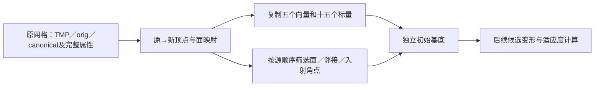

# GA 初始基底：完整属性复制和有序拓扑

## 1．功能简介

`create_genetic_base()` 将拓扑修复前的完整状态转换为 GA 搜索的初始基底。
它复用已有 `genetic_base_translation()` 和 `source_base_neighbors()`，按原
顺序复制顶点、筛选面和邻接，不依赖原版 C++ 阶段程序。当前为独立候选，
没有切换生产默认，也没有将此步骤称为完整 GA。



关键输入边界：`current_vertices` 来自恢复 TMP 的网格，`vertex_normals`
是该状态重新计算的法向；`original_vertices` 来自两轮平均后的原网格。
校准接口返回的平滑网格法向不能代替 TMP 法向。参考构建后的坐标或属性
不能填补生产输入。

## 2．Python 调用和输入输出

```python
from fnit.recon_all.topology_genetic_base import create_genetic_base

base = create_genetic_base(
    faces=original_faces,                         # int32(F,3)，原有序三角面
    defect_labels=component_labels,              # int32(N,)，0外部／1…D缺陷域
    defect_status=retention_status,              # int32(N,)，缺陷内0保留／1丢弃
    source_vertex_fields=original_vector_fields, # 五个float32(N,3)完整向量
    source_scalar_fields=original_scalar_fields, # 十五个float32(N,)原始标量
    source_neighbors=ordered_one_ring,           # list[N]，原有序一环
    source_incident_faces=ordered_incident_faces,# list[N]，原有序入射面编号
    source_incident_corners=ordered_corners,      # list[N]，对应角点0／1／2
    source_vertex_rip=original_rip_flags,         # 原状态标志；本步骤不复制其rip
    source_metadata=original_geometry_metadata,  # 空间、半球和原状态元数据
    vertex_translation=None,                    # 省略时复用已有原→新映射函数
    face_translation=None,                      # 省略时复用已有原→新面映射函数
    ordered_defect_vertices=merged_inside_rows,  # 合并后的原有序inside列表；未合并可用None
)
state = base["surface_state"]
```

### 全部输入

| 参数 | 格式和含义 |
| --- | --- |
| `faces` | 原有序整数 `(F,3)`，编号在 `[0,N)`。保留面原顺序。 |
| `defect_labels` | 非负整数 `(N,)`，标签连续 `1…D`。默认路径每个正标签必须连通；源合并的完整域需显式给inside顺序。 |
| `defect_status` | 整数 `(N,)`；正标签顶点只能是 KEEP=0 或 DISCARD=1。外部值不参与。 |
| `source_vertex_fields` | 五个 float32 `(N,3)`：`current_vertices`、`original_vertices`、`temporary_vertices`、`canonical_vertices`、`vertex_normals`。前三个分别对应 x／orig／tx，canonical 对应 cx，法向对应 nx。坐标为 surface RAS、mm；法向无量纲。 |
| `source_scalar_fields` | 十五个 float32 `(N,)`：`val`、`val2`、`valbak`、`val2bak`、`imag_val`、`curv`、`curvbak`、`stat`、`mean`、`mean_imag`、`std_error`、`H`、`K`、`k1`、`k2`。原值和 IEEE 位模式只复制；它们在上游各步骤的含义不由本函数重新定义。 |
| `source_neighbors` | 长度 N 的原有序一环列表，需与初始原网格面遍历一致。不能由筛选后的面重建。 |
| `source_incident_faces` / `source_incident_corners` | 两个长度 N 的列表；每行长度一致，完整覆盖原三角面的所有角点。保留各行原顺序。 |
| `source_vertex_rip` | 原整数或 bool `(N,)`。输入明确原状态，构建后的 rip 由内部 DISCARD 规则生成。 |
| `source_metadata` | 必须有 `use_real_ras`、`hemisphere`、`volume_geometry`、`status`、`origxyz_status`；完整深复制。不会改变体积或表面坐标空间。 |
| `vertex_translation` / `face_translation` | 默认 `None`。若提供，必须与成熟映射函数完全一致。正模式保留全部 N 顶点；移除面映射为 −1。 |
| `ordered_defect_vertices` | 默认 `None`，保留既有连通成分BFS顺序。源合并时传长度D的有序整数数组；每行必须无重复完整覆盖该标签，允许由border相邻的原组件直接concat，不重新BFS，不消费参考映射。 |

几何向量必须有限，标量可保留已有 NaN／Inf 的位模式，因为复制本身不
解释后续适应度。所有输入保持不变，返回数组不与输入别名。缺字段、错误
dtype／shape、无效标签、映射、邻接或不完整入射表会抛 `ValueError`。

### 全部输出

顶层返回 `surface_state`、`vertex_translation`、`face_translation`、
`source_order`、`metadata`、`seconds` 和 `scope`。`source_order` 是新→原
全排列；两张 translation 是原→新。`seconds` 仅完整内存 API 墙钟。

`surface_state` 包含五个已复制向量、十五个已复制标量、有序 `faces` 和
`nfaces`，以及 `neighbor_storage`、`incident_faces`、`incident_corners`。
`vertex_topology` 为 int32 `(N,7)`，列顺序为 nsizeCur、nsizeMax、vtotal、
vnum、v2num、v3num、num。外部点 nsizeCur／Max=1；内部点拓扑为0。
双端都是外部点的悬空边按源规则保留，即使关联面均被移除。

新 `vertex_rip` 仅内部 DISCARD 为1。原分配为零且没有在构建中赋值的
`vertex_marks`、`vertex_border`、`vertex_area`、`flattened_vertices`、
`tangent_e1`／`tangent_e2`、`undefval`／`old_undefval`、`face_rip`、
`face_area`／`face_normals` 按源零分配语义生成。它们不是已经重算的度量。
metadata 记录目标三角面类型、全局 nsize=1、N+10／2F容量；数组只返回
实际使用部分。

`inside_order_source` 记录 `component_BFS` 或 `explicit_source_merge_order`。
两条路径的标量复制和拓扑规则相同；显式顺序用于保留源
`mrisMergeNeighboringDefects()` 合并多个组件时的列表顺序。

体积几何完整复制 ras_good_flag、shear、文件名字节及已有 i_to_r／r_to_i
缓存。原 VOL_GEOM 赋值不复制 register_mat；显式输入含此缓存时，新的
`register_mat` 保持 `None`。这不重算空间变换，也不改父进程缓存。

## 3．命令行调用

生产入口暂不新增独立 CLI。冻结阶段诊断通过复现工具运行：

```bash
python tools/benchmark_recon_topology_genetic_base.py \
  --before /benchmark/repeat0/base.before.bin \
  --after /benchmark/repeat0/base.after.bin \
  --before-repeat /benchmark/repeat1/base.before.bin \
  --after-repeat /benchmark/repeat1/base.after.bin \
  --source-manifest /candidate/SOURCE_MANIFEST.json \
  --producer-benchmark /producer/benchmark.json \
  --observer-build-receipt /benchmark/build.private.json \
  --observer-run-receipt /benchmark/receipt.private.json \
  --output /diagnostics/new-genetic-base \
  --threads 4
```

前两组分别为实际 before／after 和原程序重复；后三份记录绑定候选源码、
原始 T1 生产者和独立参考程序。输出必须是不存在的新目录。工具先用
before 显式状态完成两次 API 并保存私有候选，再打开 after 比较；JSON
和 COMPLETE 分别保存实际结果、SHA和完成状态，不把进程启动当完成。

## 4．原软件调用

本函数属于 `mris_fix_topology -ga` 内部初始网格构建，没有独立官方 CLI。
固定 d932 源码 `utils/mrisurf_defect.cpp` 的8155–8408行，完成源 TMP
恢复和指标计算后，复制外部点及所有缺陷点，再筛选面和有序邻接。
本功能没有调用原程序，也不链接其库。

独立 benchmark 观察器只在源计算前后的明确位置读取字段，保留旧候选
适应度产物的 SHA。其构建和执行需要相应服务器脚本授权；构建源码和
程序仅保留私有验证目录，不随 FNIT 发布。

## 5．精度、耗时和可视化

当前完成8项初始基底 API 合同及2项格式合同：完整属性复制、IEEE标量位模式、悬空边、
原入射顺序、错误映射／不完整输入拒绝、全缺陷顶点保留和零初始化。
包含体积几何复制／注册缓存例外。本地10项合同运行0.019秒，不能作为
真实数据 benchmark 或完整步骤提速。

上述10项记录属于初版合同。当前已补[raw nofix／qsphere／MRI自产字段链](TOPOLOGY_GENETIC_BASE_PREPARE.md)，三组共23项合同通过，并完成真实同输入初始基底：126,778顶点／246,985面，完整API79.6114秒，含读写工具82.0220秒，导入1.6006秒另计。独立DVS-after比较先确认全部current／original XYZ和有序面对应，再核全K1／K2与已捕映射1889前缀，均0bits；不会从参考after补字段。完整基底all-fields before／after观察仍待执行，缺H／K等参考字段，初始法向和merge非零分支未作真实字段门。完整GA、整例网格质量、干净部署及整体指标等效未验收。

## 6．更新和 benchmark 记录

- 2026-10-10：复用已有映射／邻接，补完整初始属性 producer 和10项合同；
  固定源唯一锚点校验通过。保持生产默认不变。
- 本版特别记录 TMP法向／平滑原网格法向的输入边界，避免成熟接口被
  调度误用。新增参考观察器上传等待明确授权；未生成文件不写成结果。
- 后续候选新增 `ordered_defect_vertices`：修复源合法合并域不能直接送入
  连通BFS的问题。两项新契约覆盖通过border相邻的断连inside、原concat
  顺序和缺项/重复/错误映射拒绝；未把本地合同改称真实base验收。
- 新完整producer两版保留独立源码与报告绑定；中心前初始normal／中心后merge normal的相位修复见专页。当前merge0真实例完整state/maps未引入位差。初版合同和当前真实subset分开，不改历史测试范围。

## 7．参考文献和原代码

源算法：[固定版本 mrisurf_defect.cpp](https://github.com/freesurfer/freesurfer/blob/d932c45b7941662ea380a05efef580568b98d41a/utils/mrisurf_defect.cpp)，
零初始化：[mrisurf_base.cpp](https://github.com/freesurfer/freesurfer/blob/d932c45b7941662ea380a05efef580568b98d41a/utils/mrisurf_base.cpp)，
类型定义：[mrisurf.h](https://github.com/freesurfer/freesurfer/blob/d932c45b7941662ea380a05efef580568b98d41a/include/mrisurf.h)。

Fischl B, Liu A, Dale AM. Automated manifold surgery: constructing geometrically
accurate and topologically correct models of the human cerebral cortex.
IEEE Transactions on Medical Imaging. 2001;20:70–80.
