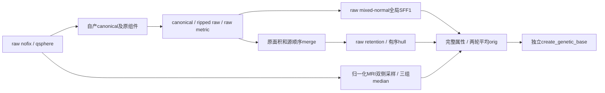

# 拓扑初始网格的自产字段准备

## 1. 功能简介

`topology_genetic_base_prepare.py` 将 raw nofix、同序 qsphere 和归一化 MRI 转成完整 GA 初始基底候选。它复用已有中心化、法向、SFF、源顺序合并、retention、采样、中值、坐标平均和基底复制，不调用原版阶段程序。当前不是完整 GA，也未切换生产默认。



四个入口分别是 `prepare_nofix_border_fields()`、`prepare_genetic_base_sff1_inputs()`、`prepare_genetic_base_field_inputs()` 和组合接口 `prepare_nofix_genetic_base()`。阶段参考和真实 MRI 保留在授权验证目录；候选不会用参考 after 属性补输入。

## 2. Python 调用、输入和输出

```python
from fnit.recon_all.topology_genetic_base_prepare import prepare_nofix_genetic_base

candidate = prepare_nofix_genetic_base(
    vertices=raw_nofix_vertices,             # float32(N,3)，raw surface RAS/mm
    faces=ordered_nofix_faces,               # 整数(F,3)，原三角面顺序
    qsphere_vertices=own_qsphere_vertices,   # float32(N,3)，同序自产球面/mm
    volume=normalized_brain_volume,          # uint8(X,Y,Z)，原MRI网格，不转置
    ras_to_voxel=mri_surface_ras_to_voxel,    # (4,4)，surface RAS→连续体素
    source_metadata=own_surface_metadata,    # 自产nofix头、半球及fresh状态属性
)
state = candidate["surface_state"]            # 完整独立基底属性和有序拓扑
mapping = candidate["vertex_translation"]     # 自产原顶点→corrected顶点
```

六个参数均必填，没有设备或低精度选项。`source_metadata` 必含 `use_real_ras`、`hemisphere`、`volume_geometry`、`status`、`origxyz_status`，从自身读取器与实际原头产生，不能从参考补值。组合接口返回完整 base 输出，再附 `sff1`、`merge`、`retention_status`、`prepared`、`metric`、`center_iterations`、完整 API `seconds` 和验证范围。中间数组也均自产。

### 分阶段入口

| 函数 | 全部输入 | 返回结构 |
| --- | --- | --- |
| `prepare_nofix_border_fields` | `vertices` float32(N,3)、`faces` 整数(F,3)、`defect_vertices` bool(N,)全缺陷掩膜、`initial_border_values` float32(N,)原初val、`volume` uint8(X,Y,Z)、`ras_to_voxel` (4,4) | `val/val2/val2bak` float32(N,)、raw法向float32(N,3)、原序一环、seconds |
| `prepare_genetic_base_sff1_inputs` | `vertices`、`faces`、`canonical_vertices` float32(N,3)、`defect_vertices` bool(N,)；可选`precenter_vertices=None` | 十项`sff_arguments`、中心前/后法向、全raw法向、raw原始面积、原序一环CSR、pending次数及seconds |
| `prepare_genetic_base_field_inputs` | `vertices/faces/canonical_vertices`、`defect_labels` 整数(N,)连续0…D、`defect_status` 整数(N,)内部KEEP0/DISCARD1、`defect_areas_mm2` float32(D,)、`ordered_defect_regions`、`principal_curvature_fields`、`volume/ras_to_voxel/source_metadata`；可选`initial_border_values=None` | `base_arguments`、逐字段`field_provenance`、`stage_seconds`和`validation_scope` |

`ordered_defect_regions` 是 D 个字典，含 `inside/border/hull` 原序索引。`principal_curvature_fields` 含完整float32(N,)的 `k1/k2/H/K`，前三者单位mm⁻¹，K为mm⁻²。`initial_border_values=None`仅兼容未合并组件按原area初始化；源merge之后必须传原组件val，合并后的area不能回写它。所有输入不变，返回不与输入别名。

SFF1的十项输入是 `current_vertices`、`vertex_normals`、`neighbor_offsets`、`neighbors`、`vertex_rip`、`initial_k1`、`initial_k2`、`initial_h`、`initial_gaussian_curvature`、`vertex_area`。raw重新算法向时内部rip点保留此前canonical法向；恢复rip后进行SFF1，因此不能将这组mixed法向换成全raw或平滑orig法向。初始四项K/H从fresh分配自产零。CSR是原序二环，不排序；原始面积来自raw metric，单位mm²，不是canonical或base零分配面积。`prepare_genetic_base_sff1_inputs`的可选`precenter_vertices=None`兼容旧四参调用；显式给实际project/smooth输出时，另自产中心前`initial_segment_vertex_normals`。省略时返回None，不用中心后法向代填。

三个坐标相位独立：current/temporary是raw TMP；original是两轮平均orig；base法向是最后raw TMP metric。原mris在base复制后的SFF2不会写回clone，因此base复制的K/H是SFF1。`val`先将双精度白灰采样平均写float32，再独立两轮median，不能用过滤后的白灰值再平均。`curv`保留labels→border→逐hull的原覆盖顺序。

fresh三角面读取的 `valbak/imag_val/curvbak/stat/mean/mean_imag/std_error` 从源码bzero规则自产零；该读取器及pre-base链未读取/赋这些标量。这不是重置任意已修改对象。非法shape/dtype/索引/缺字段抛`ValueError`；pending修复若仍未解或修改共享坐标，明确`NotImplementedError`要求前序完整传播，不静默丢掉扰动。不改线程、CUDA、TF32。

初始组件border normal在首次canonical metric之前生成，与merge后的内部均值法向属于不同相位。rawBase v1冻结组合的单一canonical-normal诊断未通过此字段门；它不参与该merge0实例的接触、保留或K映射，不能称该normal已源码一致。新版组合保留实际precenter球面，并复用metric自产中心前法向，另将中心后法向送merge，两个相位不默认视作逐位相同。旧v1结果不改标。

## 3. 命令行调用

无独立生产CLI。完全自产base阶段复现：

```bash
PYTHONPATH=src python tools/benchmark_recon_topology_raw_base.py \
  --input-surface "$OWN_NOFIX" \
  --input-qsphere "$OWN_QSPHERE" \
  --brain "$OWN_BRAIN" \
  --hemisphere lh \
  --input-manifest "$INPUT_MANIFEST" \
  --source-manifest "$SOURCE_MANIFEST" \
  --output "$NEW_DIAGNOSTIC_DIRECTORY" \
  --threads 4
```

前三项是自产表面/MRI；hemisphere为lh或rh；两份manifest绑定输入和真实源码；output必须不存在；threads是总CPU预算。工具无reference参数，保存私有完整state、mapping和报告后，独立比较器才可读DVS参考。NPZ、原MRI和capture不提交Git。

原median阶段另用 `tools/benchmark_recon_topology_genetic_base_prepare.py`，显式加 `--reference-capture`、`--reference-repeat`、`--producer-benchmark`、`--observer-build-receipt`、`--observer-run-receipt`。这些只在候选保存后诊断；缺陷内val的起点是显式诊断零，不把该阶段说成已产生defect.area。

`tools/benchmark_recon_topology_sff1_inputs.py`的 `--compute-sff-and-merge` 默认关闭；显式开启则另自产完整K/H/E及merge映射。`--centered-reference`只在所有候选字段保存后比较中心化结果。

## 4. 原软件调用

这些是固定提交 `d932c45b7941662ea380a05efef580568b98d41a` 的 `mris_fix_topology -ga` → `MRIScorrectTopology` 内部步骤，没有独立原CLI。独立参考观察器保留实际程序、输入和参数SHA，不进入生产。

源顺序是：raw读取及original metric存origarea；component按origarea有序sum写val；canonical metric；merge按源concat且不回写val；raw retention；rip内部后白灰采样及三组median；两轮orig平均；恢复raw TMP并拟合SFF1；normal-dot和最终诊断curv；最后raw metric与base复制。原mris后续SFF2/calibration在base复制之后。七个fresh零字段、实际宏和每文件SHA见机器`source_rules.json`。

## 5. 最新真实精度、时间和图示

公开ds000114 sub-07 ses-test LH、自产79a41cdd上游的median阶段：108,538个非缺陷val及全部110,534个白灰值均0差异，候选与参考各自两次稳定。API冷8.6781秒、热4.9900秒；两次API连读写/preflight30.5688秒，导入1.5631秒另计。

3a公开数据raw nofix→SFF1+merge：126,778顶点/253,652面，25组件未合并，候选完整重复逐位一致。SFF冷8.2117秒/热0.3960秒，merge两次10.3063/10.3377秒；工具包含两次API和读写54.1840秒、导入1.6049秒另计。

同3a输入的完整rawBase候选两版均EXIT0：126,778顶点、246,985保留面、773 KEEP/2055 DISCARD。

| 版本 | 完整API/s | 工具含读写/s，导入另计 | 导入/s | 相位及精度 |
| --- | ---: | ---: | ---: | --- |
| rawBase v1 | 77.0433 | 80.3064 | 1.5772 | 初始normal诊断使用中心后法向；保留原绑定 |
| rawBase v2 | 79.6114 | 82.0220 | 1.6006 | 显式自产中心前/后两相位；本例完整state/maps与v1逐位相同 |

独立[DVS-after subset比较](../../validation/recon_all/optimizations/20261010_topology_sff1_base_subset/README.md)在候选落盘后才读两份稳定参考。两版各有新比较收据：全部126,778顶点的current/original XYZ、246,985有序面、自产完整互逆映射和参考已捕1889前缀、全部K1/K2均0bits。由几何和有序面先证明同索引，再比较K；未从参考生成映射或填初始字段。完整base all-fields仍未验收：DVS缺H/K、curv/valbak、canonical/TMP及部分标量；初始precenter normal没有原版before捕获，merge0实例也未覆盖实际合并分支。GA、最终网格、整体指标等效和OS隔离未验收。当前未生成新整例脑图；无GPU执行的null显存不代表零GPU占用。

全部阶段固定CPU100–103、总4线程/BLAS1、CUDA隐藏、共享节点。没有可直接配对的原阶段子步墙钟，不宣称此接口相对原版加速或整例达到10分钟。

## 6. 更新和benchmark记录

- `423972c`：完整显式base API候选；初版8属性合同+2格式合同，不代表真实base门。
- 本版新增源合法merge concat顺序与原val保留：完整base三组23项本地合同通过（含显式中心前法向、旧None调用与SFF输入不变）。真实before/after全字段观察脚本仍等待授权。
- median v1/v2部署仅导入失败，未执行MRI算法；v3修复完整显式依赖和lazy schema导入后真实0差异。旧失败不覆盖。
- SFF输入v1保留实际阶段SHA；后续v2在计算完后工具误用`e1/e2`返回键，EXIT1保留。v3仅修为成熟` tangent_e1/tangent_e2 `，不改SFF算法；完整字段与映射重复0bits。
- 完整rawBase v1沿当时源码独立冻结。后续相位改进不追写其结果；DVS原捕获缺H/K、curv/valbak、canonical/TMP等，subset不能升级全字段门。
- rawBase v2使用实际`678354d3` prepare、`948da30e` base与`31d5c452` merge依赖；输入、13个实际模块、原/公开报告SHA和38项overlay均见[本版完整收据](../../validation/recon_all/optimizations/20261010_topology_genetic_base_prepare/README.md)。实际源码祖先bundle为`861bc235`再加明确overlay，不把发布提交改标为已运行版本。

## 7. 参考文献和原代码

- [固定拓扑修复源码](https://github.com/freesurfer/freesurfer/blob/d932c45b7941662ea380a05efef580568b98d41a/utils/mrisurf_defect.cpp)
- [固定读取器](https://github.com/freesurfer/freesurfer/blob/d932c45b7941662ea380a05efef580568b98d41a/utils/mrisurf_io.cpp)
- [法向与度量](https://github.com/freesurfer/freesurfer/blob/d932c45b7941662ea380a05efef580568b98d41a/utils/mrisurf_metricProperties.cpp)
- [原序median](https://github.com/freesurfer/freesurfer/blob/d932c45b7941662ea380a05efef580568b98d41a/utils/mrisurf_vals.cpp)
- Ségonne F, Pacheco J, Fischl B. Geometrically accurate topology-correction of cortical surfaces using nonseparating loops. IEEE TMI, 2007.
