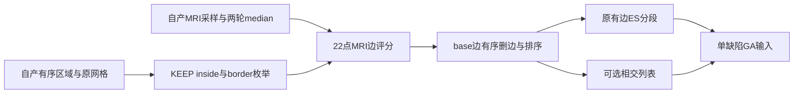

# 有序缺陷域到遗传拓扑搜索输入

## 1. 功能

`ordered_genetic_defect_inputs()` 接收自有前序生成的缺陷区域、MRI准备字段和原→新映射，生成单缺陷的候选边表（ETable）、原有边分段及可选相交列表。它复用已有 MRI 评分、原序删边、边相交和分段函数，不调用原版程序。



这是 GA 输入准备步骤，尚不执行种群优化、连续缺陷修复或最终网格验收。`all_ordered_genetic_defect_inputs()` 可准备所有初始缺陷的输入，共享同一网格的静态邻接和边集合。原标准 GA 的 `edge_table=0` 对应默认 `use_overlap=False`；启用时实际计算相交，未计算时返回 `None`。

## 2. Python调用与输入输出

```python
from fnit.recon_all.topology_genetic_defect_inputs import (
    ordered_genetic_defect_inputs,
    prepare_ordered_genetic_defect_context,
)

context = prepare_ordered_genetic_defect_context(
    canonical_vertices=canonical_vertices,       # float32(N,3)，绑定原域球面版本
    faces=original_faces,                       # 原有序面，建立一环邻接和原边集合
    defect_labels=merged_defect_labels,          # 完整合并域标签
    ordered_regions=merged_regions,             # 完整源有序inside/border记录
    vertex_translation=vertex_translation,      # 完整原→corrected映射
)

defect_inputs = ordered_genetic_defect_inputs(
    canonical_vertices=canonical_vertices,       # float32(N,3)，原域中心化球面，surface RAS/mm
    original_vertices=smoothed_original,         # float32(N,3)，自产两轮平均ORIGINAL/mm
    original_normals=original_normals,           # float32(N,3)，上述平均ORIGINAL的法向，无量纲
    faces=original_faces,                        # 整数(F,3)，原面顺序
    defect_labels=merged_defect_labels,          # 整数(N,)，0 outside、1…D缺陷编号
    ordered_regions=merged_regions,             # D个vertices/border字典，保留合并concat顺序
    retention_status=retention_status,           # 整数(N,)，outside0、KEEP+1、DISCARD−1
    vertex_translation=vertex_translation,      # 整数(N,)，自产原→corrected全排列
    white_values=white_values,                  # float32(N,)，自产白质采样和两轮median
    gray_values=gray_values,                    # float32(N,)，自产灰质采样和两轮median
    volume=brain_volume,                        # uint8(X,Y,Z)，原brain网格，nibabel读取
    ras_to_voxel=ras_to_voxel,                  # (4,4)，surface RAS→上述MRI体素索引
    defect_number=0,                            # 源有序区域编号，从0开始
    use_overlap=False,                          # 默认False；标准GA关闭ETable相交预计算
    context=context,                            # 可选同网格缓存，默认None时独立建立
)
```

单缺陷函数除 `use_overlap` 和 `context` 都必填。区域可包含合并后不直接连通的 inside，必须显式提供完整原序 `vertices` 和零标签边界 `border`；不重新BFS合并域。映射须与 outside 原编号顺序及各区域 inside concat 一致。法向不能使用 raw TMP 或 base 的法向替代。

`prepare_ordered_genetic_defect_context()` 的五参必填，返回 `GeneticDefectInputContext`：区域/邻接只读tuple、原边与base边frozenset、只读corrected→原排列，以及建立秒数。缓存绑定canonical、faces、labels、translation的shape/dtype/字节SHA和完整区域顺序。输入版本变化会拒绝复用，不缓存候选会更新的ORIGINAL坐标、法向或MRI评分。

批量准备使用相同的13个前序参数，不传 `defect_number` 或 `context`：

```python
from fnit.recon_all.topology_genetic_defect_inputs import all_ordered_genetic_defect_inputs

all_inputs = all_ordered_genetic_defect_inputs(
    canonical_vertices=canonical_vertices,       # 原域中心化球面，float32(N,3)/mm
    original_vertices=smoothed_original,         # 自产两轮平均ORIGINAL/mm
    original_normals=original_normals,           # 平均ORIGINAL的自产法向
    faces=original_faces,                        # 原面顺序
    defect_labels=merged_defect_labels,          # 完整合并域标签
    ordered_regions=merged_regions,             # 源inside/border顺序
    retention_status=retention_status,           # outside0/KEEP+1/DISCARD−1
    vertex_translation=vertex_translation,      # 完整原→corrected映射
    white_values=white_values,                  # 自产两轮median白质值
    gray_values=gray_values,                    # 自产两轮median灰质值
    volume=brain_volume,                        # uint8(X,Y,Z)，读取一次后复用
    ras_to_voxel=ras_to_voxel,                  # surface RAS→MRI索引
    use_overlap=False,                          # 原标准GA关闭策略
)
```

批量返回 `defects`（源顺序的单缺陷字典）、`context`、`context_seconds`、`complete_api_seconds`、`complete_ga=False` 和 `final_mesh_quality='not_assessed'`。完整API计时包含一次缓存构建。它只准备固定初态的所有ETable，不冒充前一缺陷修复后的顺序搜索状态。

固定源码 `edgeExists(mris_corrected)` 检查当前corrected一环邻接；base删边和ES也依赖此状态。原网格邻接和原边缓存可以共享，当前base边不能在连续GA中永久沿用初态。当前接口和本页25域benchmark只覆盖初态；后续动态状态接口须独立验证。

返回字典的主要结构：

| 字段 | 格式和含义 |
| --- | --- |
| `edge_vertices` / `edge_used` / `edge_scores` | int32(E,2) corrected端点；int32(E,) 的0新边/1base/2原边；float32(E,) MRI代价 |
| `ordering` / `source_edge_indices` | int32(E,) 初始边访问排列；相对于未删边枚举的行号 |
| `source_order` | int32(N,) corrected→原完整排列 |
| `candidate_source_vertices` | 原域 KEEP inside 后接 border 的候选点顺序 |
| `inside_vertices` / `border_vertices` / `hull_vertices` | corrected域顺序；hull采用源 SMALL_CHULL 的border+外侧一环规则 |
| `original_inside_vertices` / `original_border_vertices` / `original_hull_vertices` | 同组点的原域编号 |
| `inside_discarded` / `inside_status_source` | bool(I,)；int32(I,) 的源KEEP0/DISCARD1，不能与输入±1混用 |
| `old_edge_vertices` / `old_edge_table_indices` | inside-first原有边ES；ES行→完整ETable行号 |
| `old_edge_segments` / `segment_rows` | ES行的分段编号；每个源分段槽对应的ETable行号，保留丢弃后的空槽 |
| `overlaps` / `overlap_offsets` / `overlap_values` / `overlap_complete` | 启用时为升序相交行及CSR和bool(E,)；关闭时全部`None` |
| `seconds` | 完整API及MRI评分、删边排序、ES分段和相交子步骤秒数 |
| `complete_ga` / `final_mesh_quality` | `False` / `not_assessed`，表示此步骤的验证边界 |

代价是22次MRI绝对强度偏差的平均值，新边另加源固定惩罚100，不是毫米长度。相交超过1000项时保存前1000；发现第1001项才标不完整，恰好1000仍完整。非法域、映射、类型、形状、非有限值及越界明确抛 `ValueError`；成熟ES顺序异常抛 `RuntimeError`。函数不修改输入、全局线程、CUDA或TF32。

## 3. 命令行

本函数没有单独生产CLI。真实阶段复现工具读取带SHA的自产检查点，先计算并保存两次候选，再打开诊断参考：

```bash
python tools/benchmark_recon_topology_genetic_defect_inputs.py \
  --prepared-checkpoint own_prepared_checkpoint.npz \
  --prepared-report own_prepared_report.json \
  --regions-json own_ordered_regions.json \
  --brain own_brain.mgz \
  --source-manifest SOURCE_MANIFEST.json \
  --reference-edges benchmark_edges_repeat0.bin \
  --reference-edges-repeat benchmark_edges_repeat1.bin \
  --reference-retess benchmark_retess_before.bin \
  --output new_stage_run \
  --threads 4
```

`prepared-checkpoint`包含自产canonical、原有序faces、labels、±1 status、translation、matrix、平均ORIGINAL及其法向、white/gray值；不消费其中已有候选边或分数。`regions-json`包含检查点SHA、`defect_number`、显式`ordered_regions`和来源说明。其余具名参数依次为brain、候选源码清单、两份原程序ETable及retess参考、新输出目录和总线程预算。已有输出目录拒绝覆盖。

`--use-overlap`显式启用候选相交；只有参考确实启用时才传`--reference-use-overlap`，不能由参考空列表推断开关。`--reuse-context` 先准备一次缓存，缓存秒数独立记录，此时单缺陷API秒数不含该次构建。工具输出候选NPZ、完整JSON比较和带报告SHA的`COMPLETE.json`。API秒数包含验证与CPU计算，写出秒数另列。

完整初态批量工具 `tools/benchmark_recon_topology_all_defect_inputs.py` 的必填参数为 `--base-state`、`--base-maps`、`--base-report`（带SHA的自有rawBase）、`--regions-checkpoint`（自产合并域CSR，字段 `merged_vertex_translation`）、`--input-surface`（同源nofix）、`--brain`、`--source-manifest` 和 `--output`；`--threads` 默认4。它只读取一次原mesh/MRI并计算一次平均ORIGINAL法向，两次调用全部初始ETable，保存每域NPZ、完整逐域重复比较和完成收据；不打开原程序参考。

## 4. 原软件调用

对应固定FreeSurfer源码的 `mrisTessellateDefect_wkr`、`segmentIntersectingEdges` 和 `mrisComputeOptimalRetessellation` 内部输入准备，没有独立命令。外层参考入口为独立benchmark环境中的 `mris_fix_topology -ga <subject> <hemi>`；不能将该命令用于FNIT生产实现。

当前源码固定提交、文件SHA及相交上限规则见验证目录的 `source_rules.json`。源qsort比较器在两个长度和首端点相同时仍返回−1；本接口沿用已有FNIT的 score/vno1/原枚举行号排序，当前真实表逐位相同，未声称所有跨平台同键排序一致。

## 5. 最新真实精度、耗时和脑图

最新实际结果及图在 [独立验证目录](../../validation/recon_all/optimizations/20261010_topology_genetic_defect_inputs/README.md)。使用公开ds000114 sub-07的冻结自产MRI前序，不把历史整例当作当前源码整例结果。

分别报告ETable/域/状态同输入一致性、ES自重复、可选相交策略及完整GA/网格未验项。source标准配方关闭相交预计算；开启模式不能与未计算的参考空字段混成算法精度失败，也不能宣称原程序相交已通过。该单缺陷阶段不提供整例提速或指标等效结论。

## 6. 版本与验证记录

- 初版显式开启相交：完成真实两次自有计算；参考实际上关闭相交，原机器报告严格整字段比较为False，保留原版本与SHA。
- 当前版默认关闭相交，与固定标准GA配方一致；支持显式启用。10项合同覆盖合并域原顺序、错误BFS映射拒绝、MRI精度类型、1000/1001规则、缓存失效及多域共享结果。真实ES分段原程序capture未取得，单列未验证。
- 同网格缓存版本避免每个缺陷重建完整邻接/原边集合。首表真实回归已通过；批量工具原 `vertex_translation` 键错误发生在计算前，新版使用自产检查点实际的 `merged_vertex_translation`，保留旧EXIT1和已独立成功的首表结果。
- 旧BFS接口仍供既有验证；本接口不改旧retessellation调用或生产默认。全流程接入与原始T1整例由主调度后续验证。

## 7. 原实现与参考文献

- [固定FreeSurfer源码](https://github.com/freesurfer/freesurfer/blob/d932c45b7941662ea380a05efef580568b98d41a/utils/mrisurf_defect.cpp)，本页不发布原源码、库或程序。
- Fischl B, Liu A, Dale AM. *Automated manifold surgery: constructing geometrically accurate and topologically correct models of the human cerebral cortex*. IEEE Transactions on Medical Imaging, 2001;20:70–80. [DOI](https://doi.org/10.1109/42.906426)、[PubMed](https://pubmed.ncbi.nlm.nih.gov/11293693/)。
- MRI评分、原序区域及ES分段复用 `topology_edge_mri_score.py`、`topology_preflight_python.py`、`topology_edge_segments.py`，依赖现有 NumPy/Numba/nibabel，无新增安装依赖。
