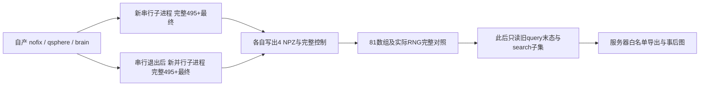
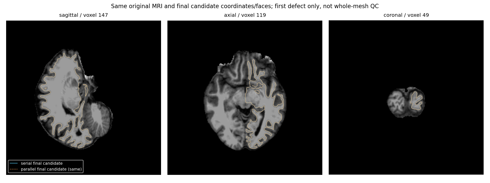
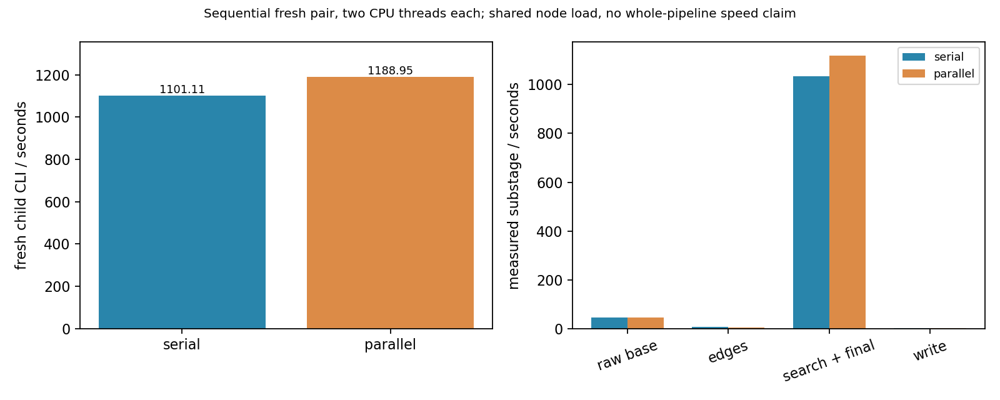

# 完整首缺陷 GA 的显式距离后端回归

## 1. 功能和验证流程

本页验证已实现的 `distance_backend='serial'/'parallel'` 在完整第一个默认缺陷搜索中的实际调用。并行后端只划分单次有符号距离的体素 x slab；候选评分、更新、DVS 恢复、种群顺序和 RNG 仍按原序执行。独立 API 默认保留 `serial`。

两次全新子进程均从同一自产 nofix、qsphere 和 brain MRI 准备全部输入，执行默认 `population_size=10`、`max_unchanged=10`、`niters=-1`、seed 1234。每次实际完成495次搜索评分及最终1次评分/几何写回，共29条代际轨迹（索引0–28）。本次只有第一个缺陷，没有执行全九缺陷、后续 remesh 或整例质量验收。



科学源码来自 Git `eb164824de5dec324f38a42626037f56bd040eb7`，71个具名科学模块和全部依赖逐实际加载 SHA 校验；根包初始化共72份科学源码，没有工作树科学 overlay。诊断入口 SHA `37a8c4e167811b017241a0e49e9ffa104666b67dd03002f708666ac5bd04e4cf`，原冻结清单 SHA `692de9f0a53c81cd28163fb637185ed7f7f6fe14e4281da06a33cf87275fc779`。它没有消费后来变化的 scanner、pial 或当前 HEAD。

## 2. Python 调用、输入和输出

完整计算入口是 `tools/benchmark_recon_topology_genetic_distance_wiring.py::run_pair`。生产评分复用 [`search_and_finalize_defect`](../../src/fnit/recon_all/topology_genetic_search.py)，直接透传距离参数，没有全局函数替换。

| 参数 | 格式与含义 |
|---|---|
| `frozen_source` | 不可变 FNIT 源码目录；含实际入口、全部源码和 `SOURCE_MANIFEST.private.json` |
| `input_surface` | 原自产 `lh.orig.nofix` 三角面文件，surface RAS/mm；坐标转float32、面索引转int32 |
| `input_qsphere` | 同域 `lh.qsphere.nofix`；必须与 nofix 顶点数、有序面一致 |
| `brain` | 同链uint8 `brain.mgz`；Nibabel读入，拓扑采样使用该卷的自产RAS→体素矩阵 |
| `hemisphere` | `lh` 或 `rh`；本次真实输入为 `lh` |
| `output` | 必须不存在的新目录；不写回任何原输入或旧结果 |
| `threads` | 本协议固定2；Torch intraop与调用者Numba线程mask恢复受检，CUDA隐藏 |
| `seed` | 本协议固定1234；同一实际成熟RNG，每次draw记录区间和值的SHA |
| `complete_default_ga` | bool，设 `True` 才是本页495+最终模式；默认False仍为旧五次初始评分加最终一次短阶段 |

```python
from pathlib import Path
import sys

frozen_source_directory = Path("immutable_first_defect_source").resolve()
# 在新的Python进程中导入这一冻结目录的入口；入口会核验自身和全部依赖SHA。
sys.path.insert(0, str(frozen_source_directory / "tools"))
from benchmark_recon_topology_genetic_distance_wiring import run_pair

original_surface_file = Path("own_subject/surf/lh.orig.nofix")
canonical_surface_file = Path("own_subject/surf/lh.qsphere.nofix")
brain_volume_file = Path("own_subject/mri/brain.mgz")
new_output_directory = Path("validation_outputs/default_first_distance_pair")

# 两个fresh子进程依次执行serial、parallel；各自Numba缓存独立。
report = run_pair(
    frozen_source=frozen_source_directory,
    input_surface=original_surface_file,
    input_qsphere=canonical_surface_file,
    brain=brain_volume_file,
    hemisphere="lh",
    output=new_output_directory,
    threads=2,
    seed=1234,
    complete_default_ga=True,
)
```

每个子目录写出 `final_candidate.private.npz`（32字段）、`final_state.private.npz`（40字段）、`search.private.npz`（8字段）和 `all_scores.private.npz`（496项float64 fitness）。候选六项控制和搜索十五项控制另存JSON；COMPLETE关联实际报告SHA。父报告关联两child及比较，父process/EXIT关联request、driver、原清单、协议、报告和完成门。MRI、NPZ、完整私有报告及日志留在服务器。

安全出口为 [`export_completed`](../../tools/export_recon_topology_genetic_distance_full.py)。具名 `input_run` 为完整父运行目录，`frozen_source` 为该计算原源码，`output_directory` 必须不存在；五个 `expected_*_sha256` 分别绑定原源码清单、协议、实际pair报告、COMPLETE、EXIT。出口校验后只写 `metrics.json`、`EXPORT_RECEIPT.json`、`COMPLETE.json`，不会再运行GA。四组字段名也固定为32/40/8/1，拒绝改名后仍凑成81项的输入。

## 3. 命令行调用

```bash
frozen_source_directory="immutable_first_defect_source"
original_surface_file="own_subject/surf/lh.orig.nofix"
canonical_surface_file="own_subject/surf/lh.qsphere.nofix"
brain_volume_file="own_subject/mri/brain.mgz"
new_output_directory="validation_outputs/default_first_distance_pair"

# 固定两核、两线程、无CUDA；实际节点仍共享负载。
CUDA_VISIBLE_DEVICES='' taskset -c 92,93 python \
  "$frozen_source_directory/tools/benchmark_recon_topology_genetic_distance_wiring.py" \
  --frozen-source "$frozen_source_directory" \
  --input-surface "$original_surface_file" \
  --input-qsphere "$canonical_surface_file" \
  --brain "$brain_volume_file" --hemisphere lh \
  --output "$new_output_directory" --threads 2 --seed 1234 --complete-default-ga
```

`--worker` 才是单个child模式，其 `--distance-backend` 选择serial或parallel；父配对模式固定依次执行两者。`--complete-default-ga`不改变库默认参数，只选择诊断工具的完整协议。两次缓存目录、加载、JIT、准备、搜索和读写均进入各自fresh CLI。

安全导出和绘图的 CLI 均为具名参数：

```bash
python tools/export_recon_topology_genetic_distance_full.py \
  --input-run "$completed_run_directory" --frozen-source "$frozen_source_directory" \
  --output-directory "$new_publication_directory" \
  --expected-source-manifest-sha256 "$source_manifest_sha256" \
  --expected-protocol-sha256 "$protocol_sha256" \
  --expected-report-sha256 "$pair_report_sha256" \
  --expected-complete-sha256 "$pair_complete_sha256" --expected-exit-sha256 "$parent_exit_sha256"

python tools/plot_recon_topology_genetic_distance_full.py \
  --input-run "$completed_run_directory" --publication-directory "$new_publication_directory" \
  --frozen-source "$frozen_source_directory" --expected-source-manifest-sha256 "$source_manifest_sha256" \
  --expected-metrics-sha256 "$public_metrics_sha256" --brain "$brain_volume_file" \
  --output-directory "$new_figure_directory"
```

这些SHA由已核准原收据取得，不能用当前HEAD代替冻结源码。绘图只读已完成候选和原MRI；两个SHA绑定原科学清单和安全指标。输出两PNG及绘图收据，坐标显示使用原MRI tkreg的F64逆矩阵，没有拟合、配准或网格重排。

## 4. 原软件对应阶段

完整拓扑阶段对应 `mris_fix_topology -ga <subject> <hemisphere>`。单次有符号距离、子进程配对和安全导出没有独立原软件命令。原版程序仅用于隔离benchmark；本次计算不调用FreeSurfer阶段程序或封装软件。

本页完整配对比较的是两个自有Python实现，以及已有自有query版的可比末态子集。它没有新增完整原生GA逐候选观察，也不据此宣称原生winner或整例指标等效。与固定原生程序的完整九缺陷末态形状结果见 [九缺陷面缓存报告](TOPOLOGY_GENETIC_REPAIR_CACHE.md)。

## 5. 真实精度、运行时间和图

两child及父执行都真实 `exit0/COMPLETE`。原三输入SHA、91份实际payload、实际加载的71模块、原driver/request/协议逐项绑定。每侧495次搜索加最终1次评分，29条轨迹的索引0–28完整；不能把历史 `generations=28` 写成只执行28代。

| 指标 | serial | parallel |
|---|---:|---:|
| fresh child完整CLI，秒 | 1101.111005 | 1188.950796 |
| worker加载至报告前，秒 | 1098.360141 | 1186.003739 |
| raw base，秒 | 45.481794 | 45.435580 |
| global prior/input context，秒 | 4.414329 | 4.443959 |
| 有序边准备，秒 | 6.212753 | 5.999356 |
| 局部prior准备，秒 | 2.550536 | 2.502440 |
| search及最终写回API，秒 | 1033.454756 | 1119.051656 |
| 输出读写段，秒 | 3.014703 | 3.298242 |
| self peak RSS，KiB | 1594184 | 1613044 |

本次fresh CLI并行慢 **7.9774%**，search及最终API慢 **8.2826%**。它是按原协议依次执行的一次共享节点配对，不是多次ABBA；没有独占CPU或稳定负载证明，不能单凭该差异定位因果。父driver wall与pair内部wall分别保留，均不是外部fresh parent CLI；只有上表child CLI是完整fresh子进程实测。Numba内部并行策略实际执行：serial为1 slab，parallel继承2线程mask、2 slabs；OS worker数量没有独立观测，保留 `worker_count_observed=False`，Torch allocated/reserved为null。

启动前load average快照为60.80/60.29/57.55，运行中的一次快照为74.19/69.90/67.05；它们不是完整负载曲线。启动前未见本账号窄亲和性线程占用92–93，仍不能证明节点CPU配额或共享负载在全程稳定。cgroup字段当时不可读，保留null。

**81个数组的dtype、shape、原始字节及4个NPZ完整文件SHA全部相同**。496项真实F64 scores逐项关联495条evaluation trace和最终fitness，最终候选scalar也与最终控制按F64位模式相同。完整候选与搜索控制按类型逐项JSON相等，不证明浮点符号零或JSON文本字节一致。

实际RNG调用 **1362381次**，每次 `index/bounds/value` 的序列SHA双方同为 `283d6299e72451801dbf447206875898e50dfe1af6fa82d3001dafbf4b361b1f`。两个新结果完成落盘后才读取旧query参照：其40字段末态加8字段search、八项可比控制、实际最终fitness都相同；旧RNG只有总次数，因此旧逐draw比较为 `not_assessed`。旧 `first_candidate` 仍是第一候选，没有对应为本次最终候选。



图中两条轮廓是本次serial/parallel的实际同一末态几何，不是原生参考误差。切片由真实selected vertices自动确定，切片名由MRI实际tkreg方向L/I/A生成，顺序为矢状位、轴位、冠状位；首缺陷产物不能当全九缺陷修复后网格。



## 6. 版本、失败保留与benchmark记录

- 已提交短route证明实际生产API透传serial/parallel，原child完整计算成功，但父比较器漏helper而退出；后验救援与原父失败分开，见 [显式距离接口](TOPOLOGY_GENETIC_DISTANCE_ROUTING.md)。短六评分没有替代本页495+最终门。
- 完整配对初版准备driver的换行字符串转义错误，AST预检拒绝，没有运行算法；新独立v2保持科学文件字节不变，通过所有90份Python AST/compile、shell语法和真实冷导入后启动。
- 本页v2固定Git eb164科学源码、71具名模块、独立Numba缓存、CPU92–93共2线程。完整serial→parallel实际完成，两child与父完成门及全部81字段/RNG通过，默认仍为serial。
- 第一版后验检查误读旧清单文件名 `SOURCE_MANIFEST.json`，真实名称带 `.private`；新只读检查修正后闭合旧末态/search子集，原pair、产物和旧参照均未修改，也未重算GA。
- 安全出口独立审计补齐完整父链、固定32/40/8/1字段白名单、实际15项搜索/6项候选控制、全部496评分与最终scalar关联。24项本地合同通过，含22项正负向出口门和2项切片方向合同；1.071103秒仅为合同时间，小文件不充当MRI benchmark。
- 新安全出口独立实际完成，7.041405秒为只读导出，不加入GA墙钟。完整私有原件留服务器，下载前仅导出数值/类型、固定状态与SHA白名单。绘图v1固定体素轴标题造成冠状位/轴位互换，v2依据Nibabel实际tkreg方向修正，原GA和metrics未改。v2绘图1.877418秒亦单独计时；原始数据与许可证不发布。

## 7. 实现和参考文献

- [完整诊断入口](../../tools/benchmark_recon_topology_genetic_distance_wiring.py)、[安全出口](../../tools/export_recon_topology_genetic_distance_full.py)、[事后绘图](../../tools/plot_recon_topology_genetic_distance_full.py)。
- [实际距离核](../../src/fnit/recon_all/topology_defect_signed_distance.py)、[生产评分入口](../../src/fnit/recon_all/topology_candidate_pipeline.py)、[显式搜索入口](../../src/fnit/recon_all/topology_genetic_search.py)。
- [机器指标和哈希清单](../../validation/recon_all/optimizations/20261011_topology_genetic_distance_full/README.md)、[库参数与短门](TOPOLOGY_GENETIC_DISTANCE_ROUTING.md)。
- [FreeSurfer固定源码](https://github.com/freesurfer/freesurfer/tree/d932c45b7941662ea380a05efef580568b98d41a)；其拓扑实现规则由独立固定程序观察验证，原软件不进入FNIT运行时。
- Ségonne F, Pacheco J, Fischl B. Geometrically accurate topology-correction of cortical surfaces using nonseparating loops. IEEE Transactions on Medical Imaging. 2007;26:518–529.
