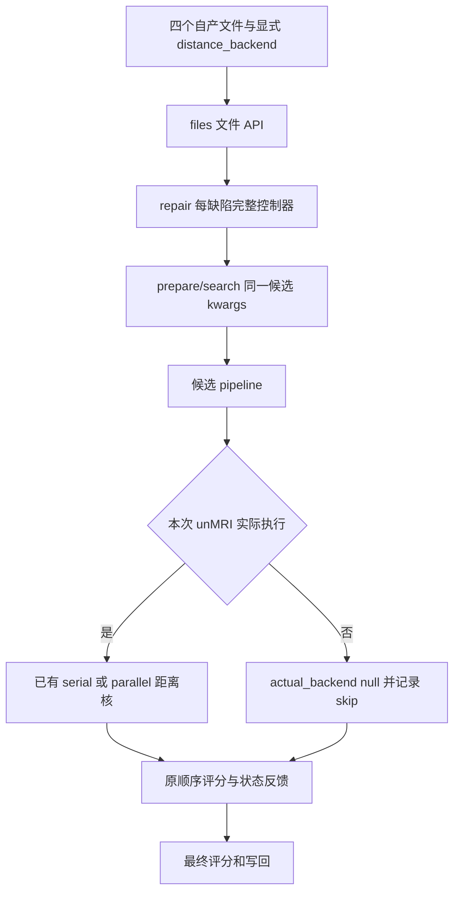

# 遗传拓扑评分的显式距离后端

## 1. 功能简介

完整 GA 的候选评分现在可显式选择已有局部有符号距离核：`distance_backend="serial"` 或 `"parallel"`。四个库入口依次传递同一个选择，搜索、最终评分与最终几何共享候选上下文。默认仍为 `serial`。

并行核只将一个候选的局部体素卷分为互不重叠的 x slab；每个 slab 保留原候选面顺序、F32 运算和归并。候选、RNG、DVS 恢复和 RP 更新仍按原顺序执行。没有全局函数替换、静默回退或降低质量门。



## 2. Python 调用及输入输出

```python
from pathlib import Path
from fnit.recon_all.topology_genetic_files import run_genetic_topology_files

# 四个文件由本次自己的上游产生；brain 用于强度采样，wm 只决定表面体积头。
input_nofix_surface = Path("subject/surf/lh.orig.nofix")
input_quick_sphere = Path("subject/surf/lh.qsphere.nofix")
input_brain_mri = Path("subject/mri/brain.mgz")
input_white_matter_mri = Path("subject/mri/wm.mgz")
new_output_directory = Path("new_python_genetic_output")

result = run_genetic_topology_files(
    input_surface=input_nofix_surface,
    input_qsphere=input_quick_sphere,
    brain=input_brain_mri,
    wm=input_white_matter_mri,
    hemisphere="lh",
    output_directory=new_output_directory,
    threads=2,                       # 当前调用的总计算预算，非每个 slab 两线程
    distance_backend="parallel",    # 显式选择；默认 serial
    face_detection_cache=True,
    blocker_scan_backend="numba",
    final_orig=False,                 # 此调用停在原义的 ORIGINAL premesh
)
```

| 参数或字段 | 格式、意义与输出 |
|---|---|
| `input_surface` / `input_qsphere` | 同 N、同有序三角面；surface RAS/mm；源 nofix 与自产 quick sphere，不能用参考输出作输入 |
| `brain` / `wm` | 同链三维 MGZ；brain 为 uint8 原采样网格，wm 有有效体积头；两者用途不交换 |
| `hemisphere` | `lh` 或 `rh` |
| `output_directory` | 不存在的新目录；失败保留诊断，不能按中间文件存在性判定成功 |
| `threads` | 正整数总预算；成熟 `thread_budget` 设置并恢复调用方 Torch/Numba 状态 |
| `distance_backend` | 仅 `serial` / `parallel` 字符串；非法值在几何计算或创建文件目录前拒绝；四入口默认 serial |
| `face_detection_cache` / `blocker_scan_backend` | 已有独立选项，分别默认 False / python；本次短测试固定 True / numba，未改变它们 |
| `final_orig` | 默认 False 写 premesh；True 才继续标准 remesh3 和严格 orig 清理，详见文件 API 页 |
| `distance_policy` | 候选实际执行记录：requested_backend、executed、actual_backend、skipped_unmri、caller_numba_thread_mask、slab_count、effective_unmri_weight |
| 实际跳过 | 权重为零或局部任一维≤5时 `actual_backend=None`、`executed=False`，不因请求 parallel 就宣称执行了并行核 |
| 预算记录 | NumBa caller mask 与 slab_count 是核的预算/写域，`worker_count_observed=False`；不是采样到的 OS 线程数 |
| 文件报告 | 分别记录 requested、core returned 和每缺陷最终评分实际执行/skip；core returned 不一致则失败、不写 COMPLETE |

完整旧参数与状态格式见 [候选 pipeline](TOPOLOGY_CANDIDATE_PIPELINE.md)、[单缺陷 search](TOPOLOGY_GENETIC_SEARCH.md)、[完整 repair](TOPOLOGY_GENETIC_REPAIR.md) 和 [文件 API](TOPOLOGY_GENETIC_FILES.md)。独立 API 不修改全局环境；调用者负责将其他并发任务纳入总预算。

## 3. 命令行调用

```bash
python -m fnit.recon_all.topology_genetic_files \
  --input-surface subject/surf/lh.orig.nofix \
  --input-qsphere subject/surf/lh.qsphere.nofix \
  --brain subject/mri/brain.mgz --wm subject/mri/wm.mgz \
  --hemisphere lh --output-directory new_python_genetic_output \
  --threads 2 --distance-backend parallel \
  --face-detection-cache --blocker-scan-backend numba
```

短回归工具的具名参数为 `--frozen-source`、`--input-surface`、`--input-qsphere`、`--brain`、`--hemisphere`、`--output`、`--threads 2` 和 `--seed 1234`。它从自己的三输入重新生成初态，固定 population5/niters0，顺序启动 serial/parallel 两个 fresh child，每侧五次初始评分加一次最终评分与完整几何写回；不是默认495评分或完整九缺陷。

## 4. 原软件调用

完整阶段对应 `mris_fix_topology -ga <subject> <hemisphere>`。局部有符号距离是其内部 unMRI fitness 组成，没有独立原软件 CLI。FNIT 复用自有距离核；本次路由和评分不调用原版阶段程序。

## 5. 真实精度、时间与图

本次固定自产 nofix/qsphere/brain，原 child 科学源码清单 SHA 为 `a971bf2d35af23cc8bc083556bc31255349a90c9ad9c8f868dc772dbe6dca499`。四路由源实际为 `c33d027c`、`8ee853a4`、`468b8a22`、`ae646983`，距离核 `11c360b0`；阻挡核采用当时冻结的 `33a` 版本。没有混入正在开发的新 scanner。

| 本次实际边界 | serial | parallel |
|---|---:|---:|
| fresh child 完整 CLI，包括加载、JIT、准备和写出 | 88.134274 s | 94.202747 s |
| search + final API | 30.720948 s | 30.001561 s |
| 实际 CPU affinity / 总线程 | 84–85 / 2 | 84–85 / 2 |
| 最终距离实际 mask / slab | null / 1 | 2 / 2 |
| 实际 RNG 调用 | 20877 | 20877 |

81 个数组字段的 shape/dtype/全部字节和四个完整 NPZ 文件 SHA 相同；有序面、坐标、距离、SFF、H/K/E、状态反馈、全部六评分、两份控制 JSON 均保持。完整实际 RNG bounds/value 序列 SHA 为 `39b81ccb1b67c59ca52e377b19ba690a0fba4b59472e65c884232b7fc41d1851`，两侧相同，预算恢复完成。

原父进程在两 child COMPLETE 后因 comparator 导入路径错误退出1。该失败回执和原耗时保留；新独立后验 comparator 校验同源、同输入和全部产物后 exit0，比较本身 6.136676 秒。没有将它记成原父成功 CLI，没有重跑 child，也没有完整 GA 或整例提速结论。完整默认495回归尚待新协议审阅和运行。节点共享负载，短阶段仅是一次顺序观察。

安全白名单机器证据见 [验证目录](../../validation/recon_all/optimizations/20261011_topology_genetic_distance_wiring/README.md)。本次数组全部相同，脑图沿用独立 [首缺陷真实图](TOPOLOGY_GENETIC_FACE_CACHE.md)，其图不替代本次实际数组门。

## 6. 版本与 benchmark 记录

- 新增四个显式 route，默认 serial；requested、returned 与 actual/skip 分开，不更改距离算法。
- 本地 focused 合同覆盖零权重/小卷跳过、非法参数先拒、调用方 kwargs 不变、搜索与最终评分共用 route、每缺陷透传、CLI、返回不一致不发布。原相关 pipeline/files 合同一起运行，共27项，15.752秒；mock只证明接口和失败门，不是 MRI benchmark。
- short v1 两真实 child 完整成功，父比较器导入设置错误。后续工具显式绑定父进程 frozen FNIT 搜索路径；原已执行工具 SHA `14219516` 和新工具 SHA 分开记录。
- 独立 postcompare v1 对原产物完成全部81字段/控制/RNG门。其新源码和耗时属于后验诊断，不重标原 child 科学源码。
- 安全导出第二版补齐四个完整 NPZ、两控制文件、全部66模块与原协议绑定；实际文件摘要、类型敏感控制和 RNG 控制逐侧核对，拒绝缺项、真值字符串、错误数值类型和嵌套私有字符串。15项独立出口合同通过；新版本只读取原已完成产物，没有重跑或重标原 MRI 子任务。
- 新完整默认495尚 pending；库接口保持显式 opt-in。

## 7. 参考文献和实现

- [显式候选 route](../../src/fnit/recon_all/topology_candidate_pipeline.py)、[搜索 route](../../src/fnit/recon_all/topology_genetic_search.py)、[控制器](../../src/fnit/recon_all/topology_genetic_repair.py)、[文件 API](../../src/fnit/recon_all/topology_genetic_files.py)。
- [已有有符号距离核](../../src/fnit/recon_all/topology_defect_signed_distance.py) 与 [距离专项说明](TOPOLOGY_SIGNED_DISTANCE.md)。
- [FreeSurfer 源码库](https://github.com/freesurfer/freesurfer)，固定阶段依据见现有拓扑模块说明。
- Ségonne F, Pacheco J, Fischl B. Geometrically accurate topology-correction of cortical surfaces using nonseparating loops. IEEE Transactions on Medical Imaging. 2007;26:518–529.
