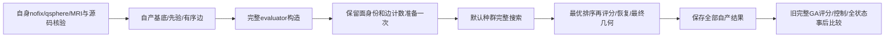
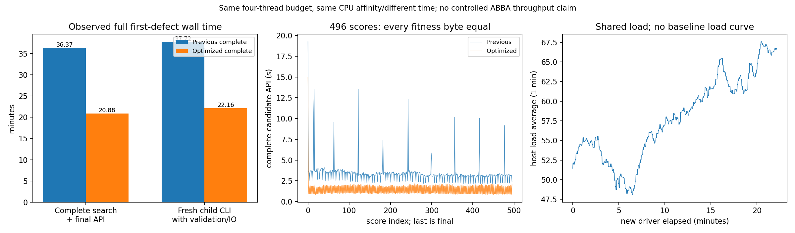
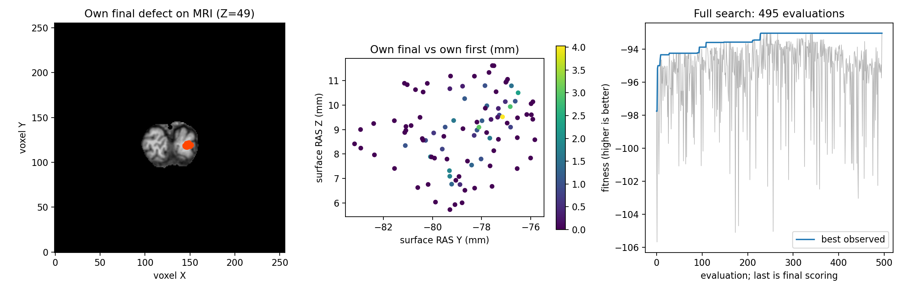

# 默认首缺陷GA的保留面索引缓存

## 1. 功能简介

`benchmark_recon_topology_genetic_face_cache.run()`完整复用已验证的自有默认GA，并为当前缺陷的保留面建立一次不可变索引。每次候选仍重新消费当前动态邻接，执行原有面包含、共边占用、方向及接受/拒绝规则；新增面计数不跨候选共享。首缺陷搜索、连续状态恢复、最终评分和几何写回全部执行。



缓存由当前自产 `evaluator.retessellation_inputs` 的完整 `base_faces` 和顶点数建立，显式追加 `face_detection_context`。全局先验、局部MRI、RNG、geometry/cycle、剔除及停止规则保持同一冻结版本；未混入另一路状态缓存实验。完整首缺陷仍不是全部缺陷、全半球后处理或原始T1 recon-all。

## 2. Python调用、输入和输出

```python
from pathlib import Path
from benchmark_recon_topology_genetic_face_cache import run

face_cache_report = run(
    face_detection_cache=True,  # 显式开启；False完整走旧保留面检测
    input_surface=Path("/benchmark/subject/surf/lh.orig.nofix"),  # 自身surface RAS/mm网格
    input_qsphere=Path("/benchmark/subject/surf/lh.qsphere.nofix"),  # 同编号/有序面quick球面
    brain=Path("/benchmark/subject/mri/brain.mgz"),  # 同链uint8 XYZ MRI
    hemisphere="lh",  # 明确半球，不由文件名推断
    output=Path("/benchmark/new-face-cache/candidate"),  # 不存在的新目录
    threads=4,  # 固定总CPU预算，CUDA隐藏
    population_size=10,  # 标准种群
    max_unchanged=10,  # 标准停止参数
    niters=-1,  # 不截断完整搜索
    seed=1234,  # 成熟VNL序列，半球初始化一次
    initial_selection=True,  # 原ES分组与空槽完整保留
    vertex_eliminate=True,  # 保留原顶点剔除政策
    reference_statistics=Path("/benchmark/reference/patch_statistics.bin"),  # 最终写出后才核首候选
    reference_volume=Path("/benchmark/reference/volume.bin"),  # 原体积项独立捕获
    reference_fitness=Path("/benchmark/reference/fitness.json"),  # 原首候选评分
    baseline_directory=Path("/benchmark/previous-complete/candidate"),  # 本次旧完整版本
    source_manifest=Path("/benchmark/frozen/SOURCE_MANIFEST.private.json"),  # 全冻结py及实际模块SHA
    protocol=Path("/benchmark/frozen/protocol.private.json"),  # 预声明同输入/默认政策/旧报告SHA
)
```

| 参数 | 格式及含义 |
| --- | --- |
| `face_detection_cache` | 必填bool；True工厂准备一次，False不准备；不改变生产默认 |
| `input_surface` | FreeSurfer三角surface；F32 `(N,3)` 坐标、整数 `(F,3)` 有序面、有效自身volume footer；单位surface RAS/mm |
| `input_qsphere` | 自产quick球面surface；与nofix完整编号及有序面相同，不能用标准或注册球面替代 |
| `brain` | 连续上游uint8 `(X,Y,Z)` MGZ；nibabel读取，变换矩阵由自身MRI头生成 |
| `hemisphere` | `lh`/`rh`，本次完整实测为lh |
| `output` | 不存在的新目录；所有结果先完整写出，再打开旧赢家 |
| `threads` | 正整数，与真实CPU affinity一起绑定；本次4 |
| `population_size`、`max_unchanged`、`niters` | 明确整数10/10/−1；不缩短默认搜索，实际停止原因入报告 |
| `seed` | 有符号32位整数；同一连续自有VNL随机流，不每代重新设置 |
| `initial_selection`、`vertex_eliminate` | bool，本次都True；原选择/剔除顺序完整保留 |
| `reference_statistics`、`reference_volume`、`reference_fitness` | 原首候选的同输入独立捕获，只在全部自产结果保存后比较，不生成候选 |
| `baseline_directory` | 前次已验完整GA的candidate目录；正确COMPLETE/report/checkpoint SHA必需，只事后读取 |
| `source_manifest` | 私有JSON含冻结逐文件size/SHA和实际导入模块SHA；运行前及结束核验，不发布完整清单 |
| `protocol` | 私有JSON含同输入SHA、七项完整政策、旧报告SHA及显式缓存配置；算法不读取旧排序/属性 |

返回 `face_cache_report`，包括缓存准备次数/耗时、每次检测耗时和完整判定报告SHA、29条代记录的计数口径、实际工具/下层SHA及继承完整比较绑定。`face_cache.json`与`FACE_CACHE_COMPLETE.json`是本次缓存附加门；继承 `OPTIMIZATION_COMPLETE.json`验证全部评分、控制和完整状态，两者均需退出0。中间失败保存已有科学输出，不写成功回执。

安全导出另调用 `export_recon_topology_genetic_face_cache.export(input_run=..., baseline_run=..., frozen_source=..., output_directory=...)`，四参均为必填Path：分别为实际新运行根、绑定旧完整运行根、实际冻结源码根、不存在的新公开目录。它先核本次cache及继承回执/实际helper和adapter SHA，再完整复用已有指标白名单。输出原数值与安全SHA，不加载或发布MRI、网格NPZ、日志、地址或源码路径；值与类型逐项保留。

### 显式库参数

新版库入口 `prepare_genetic_defect_evaluator()`、`search_and_finalize_defect()` 和 `repair_genetic_topology()` 增加具名参数 `face_detection_cache=False`。它接受Python `bool` 或NumPy `np.bool_`，拒绝整数0/1、字符串、None和NumPy数组。默认关闭；开启时，仅在每个缺陷的准备阶段对实际完整保留面调用一次工厂，并将对象放入 `retessellation_inputs['face_detection_context']`。全部候选及最后评分、几何写回复用这个对象；下一个缺陷根据前一缺陷最终写回的面重新建立，不共享动态面或判定结果。

```python
from fnit.recon_all.topology_genetic_repair import repair_genetic_topology

premesh_result = repair_genetic_topology(
    vertices=own_nofix_vertices,  # 有限float32(N,3)，surface RAS/mm
    faces=own_ordered_faces,  # 整数(F,3)，与qsphere同序
    qsphere_vertices=own_qsphere_vertices,  # 同域float32(N,3)，自产quick球面
    volume=own_brain_volume,  # uint8(X,Y,Z)，同链MRI
    ras_to_voxel=own_surface_ras_to_voxel,  # 自身MRI头生成的4×4矩阵
    source_metadata=own_surface_metadata,  # 自产footer、半球与status=0
    threads=4,  # 总CPU线程预算，外部另固定BLAS和亲和性
    seed=1234,  # 同一半球跨缺陷连续VNL流
    population_size=10,  # 标准完整种群
    max_unchanged=10,  # 原停止门
    niters=-1,  # 不截断默认搜索
    initial_selection=True,  # 保留原分组顺序
    vertex_eliminate=True,  # 保留原剔除规则
    use_overlap=False,  # 标准政策
    normal_status="surface",  # 标准三角表面
    soap_iterations=5,  # 全缺陷之后完整SOAP
    progress_callback=None,  # 可选具名只读观察器
    face_detection_cache=True,  # 显式开启；默认False
)
```

前六项输入、全部状态/坐标槽和输出的详细格式见[完整控制器](TOPOLOGY_GENETIC_REPAIR.md)，单缺陷输入见[搜索接口](TOPOLOGY_GENETIC_SEARCH.md)。三个函数的返回mapping新增 `face_detection_cache` Python bool，准备秒数包含工厂；`actual_policy`、RNG和停止条件不变。没有新增依赖，不改父进程环境。该显式库接线使用独立新源码验证，不能把前面的849文件首缺陷实测改标为新版。

## 3. 命令行调用

```bash
PYTHONPATH=/benchmark/frozen/src:/benchmark/frozen/tools \
CUDA_VISIBLE_DEVICES='' OMP_NUM_THREADS=4 MKL_NUM_THREADS=4 \
OPENBLAS_NUM_THREADS=4 NUMBA_NUM_THREADS=4 \
NUMBA_CACHE_DIR=/benchmark/new-face-cache/numba_cache \
taskset -c 8-11 python tools/benchmark_recon_topology_genetic_face_cache.py \
  --face-detection-cache --input-surface /benchmark/subject/surf/lh.orig.nofix \
  --input-qsphere /benchmark/subject/surf/lh.qsphere.nofix \
  --brain /benchmark/subject/mri/brain.mgz --hemisphere lh --threads 4 \
  --population-size 10 --max-unchanged 10 --niters -1 --seed 1234 \
  --initial-selection --vertex-eliminate --output /benchmark/new-face-cache/candidate \
  --reference-statistics /benchmark/reference/patch_statistics.bin \
  --reference-volume /benchmark/reference/volume.bin \
  --reference-fitness /benchmark/reference/fitness.json \
  --baseline-directory /benchmark/previous-complete/candidate \
  --source-manifest /benchmark/frozen/SOURCE_MANIFEST.private.json \
  --protocol /benchmark/frozen/protocol.private.json
```

`--no-face-detection-cache`明确关闭，其他参数与Python表一致。CPU解释器导入预检另计，完整CLI包含输入/源码核验、MRI读取、缓存工厂、全部默认搜索、最终评分/几何、写出与完整事后比较；冷JIT不删去。

```bash
python tools/export_recon_topology_genetic_face_cache.py \
  --input-run /benchmark/new-face-cache --baseline-run /benchmark/previous-complete \
  --frozen-source /benchmark/frozen --output-directory /benchmark/public-face-cache
```

显式库参数的独立小回归工具如下。它从同一原始三输入完整自产首缺陷准备，仅把阶段政策设为初始种群5、`niters=0`，执行五次初始评分加最后一次评分及完整写回；关闭/开启缓存两个fresh子进程顺序运行。`frozen_source`必须包含绑定全部实际模块的私有源码清单；没有参考或旧赢家输入参数。

```bash
CUDA_VISIBLE_DEVICES='' OMP_NUM_THREADS=4 MKL_NUM_THREADS=4 \
OPENBLAS_NUM_THREADS=4 NUMBA_NUM_THREADS=4 \
taskset -c 88-91 python tools/benchmark_recon_topology_genetic_face_cache_wiring.py \
  --frozen-source /benchmark/new-wiring-source \
  --input-surface /benchmark/subject/surf/lh.orig.nofix \
  --input-qsphere /benchmark/subject/surf/lh.qsphere.nofix \
  --brain /benchmark/subject/mri/brain.mgz --hemisphere lh \
  --output /benchmark/new-wiring-pair --threads 4 --seed 1234
```

这八项参数均必填：五项Path分别是冻结源码、自产nofix、同序qsphere、MRI和不存在的输出目录；半球明确`lh/rh`；正整数线程和有符号32位seed与库相同。内部 `--worker` 只选择独立子进程模式，`--face-detection-cache/--no-face-detection-cache`只用于该模式；外层固定关闭→开启两次配对。它直接把bool传给新搜索函数，不猴补库函数进行接线。完整私有NPZ与控制均保存之后才比较，失败保留已有结果，成功写 `COMPLETE.json`。小回归不代表完整默认495评分、全九缺陷或recon-all。

## 4. 原软件调用

对应固定d932 `detectDefectFaces`及完整 `mrisComputeOptimalRetessellation_wkr`阶段，独立benchmark参考入口为：

```bash
mris_fix_topology -mgz -ga -seed 1234 -threads 4 reference_subject lh
```

生产与本次自有GA不调用该程序。完整本轮旧/新比较对象为相同输入/默认政策的自有完整首缺陷；独立原实现只核首候选以及已捕获的相位，不把自有末态相同说成原版完整赢家逐位相同。

## 5. 当前精度、耗时和脑图

本次完整默认首缺陷已退出0：495次搜索加1次最终评分，全部496个F64评分、完整代际控制、随机调用数1,362,381、剔除和停止决策均与旧完整版本一致。首候选32字段、最终状态40字段、搜索8字段共80字段的shape/dtype/全部原始字节一致，最大/P99差异均0；三个完整NPZ与控制JSON的SHA也相同。执行29条代际记录（索引0–28）；既有`generations=28`表示末次索引。未捕获原版完整随机流或最终赢家，不把自有旧/新精确说成原版完整GA逐位复现。

| 实际完整阶段（秒） | 旧v2 | 本次面缓存 |
| --- | ---: | ---: |
| Fresh冷CLI，含启动/校验/读写 | 2263.4229520456865 | 1329.6288180286065 |
| 搜索加最终写回API | 2182.039243622683 | 1252.5487796692178 |
| Nested prepare（含工厂） | 5.766150800511241 | 6.4059782130643725 |
| 完整搜索 | 2168.716923782602 | 1240.9868765464053 |
| 最终评分/恢复/几何 | 7.307621995918453 | 4.864994557574391 |

工厂实际执行一次：216,722保留面、110,534顶点，1.0952094895765185秒；共497次检测（495搜索评分+最终评分+最终几何）。Nested行已包含在API内，不重复累加。完整冷CLI观察减少41.255%／API减少42.597%，这是同预算、不同运行时段的两次观察，未作完整默认GA受控ABBA，不能据此宣称稳定吞吐或全recon-all提速。该GA内source marker实际调用0，不能给本次收益归因于marker优化。

最终fitness保持−93.04168701171875；253次mutation尝试/1次改进、232次crossover尝试/8次改进，移除20／最佳3顶点、best patch230、`euthanasia_wait_limit`停止均完全保留。初始数据与先验自产，旧完整赢家只在本次全部结果落盘后读取。





脑图位移表示自身最终对自身首候选的运动，不是原软件误差；此阶段未执行全半球SOAP/压缩/标准remesh/最终orig质量或原始T1整例。后续完整九缺陷在独立目录验证，不改本报告源码绑定。完整原始收据服务器保留，公开指标按数值白名单导出。

本次预算CPU8–11总4线程/CUDA隐藏，与自身已验v2同预算且同CPU亲和性；共享节点运行时段不同，负载每秒记录，cgroup不可读项为null，不能归因过去限流。峰值RSS为CPU子进程1,648,036KiB而非显存；GPU/allocated/reserved为null。初始属性和所有MRI/先验自产，不读旧after填中间状态。

### 新显式库接口的独立真实配对

新源码直接调用 `search_and_finalize_defect(face_detection_cache=False/True)`，关闭、开启两个fresh子进程均退出0。每组从相同自身nofix、qsphere和MRI开始，完整自产基底、全局先验、有序边和局部MRI，使用种群5、`niters=0`；五个初始评分加一个最终评分及完整写回全部执行。四个NPZ合计81个字段的shape、dtype、全部字节与完整文件SHA一致；两个完整控制记录和20,877次随机调用的顺序、bounds、值及SHA相同。数值最大/P99差异均0。这是新接口阶段回归，未执行默认495评分或全九缺陷。

| 实际阶段（秒） | 新接口关闭 | 新接口开启 |
| --- | ---: | ---: |
| Fresh冷CLI，含子解释器启动/检查/准备/读写 | 124.8539729565382 | 114.99733323045075 |
| 原始输入到完整遗传基底 | 51.56645257305354 | 49.73441241681576 |
| 全局先验与输入context | 4.965975220315158 | 4.785490119829774 |
| 完整有序边 | 6.618909644894302 | 6.455970015376806 |
| 局部MRI先验 | 2.9227703362703323 | 2.794489299878478 |
| 搜索及最终几何API，含透明数值观察 | 48.945483883842826 | 36.92841023020446 |
| 保存完整自身产物 | 3.294945690780878 | 3.2537527484819293 |

配对父CLI共249.76858772616833秒，含两个fresh子进程、完整源码门及事后比较；子阶段行互不重复，库内nested prepare/search/final记录另见[实际指标](../../validation/recon_all/optimizations/20261011_topology_genetic_face_cache_wiring/metrics.json)。固定CPU88–91、总4线程、CUDA隐藏；一秒采样记录共享负载，运行次序关闭→开启，未作ABBA，因此只报告观察墙钟。子进程自身峰值RSS为1,610,944／1,580,584KiB；父/子同时峰值无法准确归属，allocated/reserved均为null。


脑图是两组自产最终缺陷在同链自身MRI上的体素投影，不是原版误差或最终半球QC。原实现端到端对照及整体指标等效仍未评估。图生成前核实际源码清单、导出指标SHA及实际加载的MRI变换模块路径/SHA，完整私有输入、状态和日志留服务器。

## 6. 更新和benchmark记录

- 既有v2完整默认首缺陷：495+final、80字段/3NPZ及控制逐字节保持，29条代记录（索引0–28），完整冷CLI2263.422952秒；它是本次直接旧对照，不改原报告。
- 保留面缓存原语：完整同候选ABBA由独立模块完成；只证明该模块可进入本次全默认回归，不外推完整GA时间。
- 本次v1：显式factory一次准备，849个冻结Python文件/63个实际模块绑定；源码和默认geometry/cycle维持fc78科学基线，未加入状态缓存实验。
- 导出身份门：继承完成回执被替换或adapter SHA混用均先拒绝，2个JSON合同通过；它们不是MRI/GA数值benchmark。
- 新依赖为零，复用主页Conda的NumPy/Numba/nibabel；精度、生产默认、父进程策略和质量门不变。
- 报告生成器修正了一项说明bug：本次与直接旧v2均CPU8–11，不能沿用更早CPU120–123比较的固定“不同亲和性”文字。新版按实际两组亲和性生成说明和图标题，只影响新导出，既有实测报告不改。
- 显式库接线：新增默认关闭的 `face_detection_cache`，每缺陷一次准备、搜索/最终写回共用；7个新增本地合同通过，包括默认无工厂、真实完整面快照、变更基底重建、非法类型先拒绝及完整控制器透传。新真实六评分配对独立运行，不复用旧849源码身份。
- 新接线实测v1：7合同实际新冻结环境退出0，8.451813747175038秒；真实六评分配对退出0，81字段/四NPZ/控制/RNG完整一致，源码清单SHA `33f234fd…`。本地7合同0.059秒只作契约，不代替真实数据。发布前仅更正两个核心docstring的`bool/np.bool_`类型说明；[发布绑定](../../validation/recon_all/optimizations/20261011_topology_genetic_face_cache_wiring/publication_source_binding.json)分别保留实测和发布SHA，去docstring AST相同，未重标旧实测。
- 图生成器v2：补齐导出指标、科学源码和实际MRI变换加载身份门。v1原图与收据留服务器；安全指标与GA科学结果不变，v2只重新绘图，不重跑GA。

## 7. 参考文献和源码

- [保留面索引原语](TOPOLOGY_FACE_DETECTION_CACHE.md)、[完整默认首缺陷基线](TOPOLOGY_GENETIC_OPTIMIZATION.md)。
- [完整缓存回归入口](../../tools/benchmark_recon_topology_genetic_face_cache.py)、[指标白名单导出](../../tools/export_recon_topology_genetic_face_cache.py)。
- [新显式参数真实配对](../../tools/benchmark_recon_topology_genetic_face_cache_wiring.py)、[安全指标导出](../../tools/export_recon_topology_genetic_face_cache_wiring.py)、[真实图与来源门](../../tools/plot_recon_topology_genetic_face_cache_wiring.py)、[本轮完整报告](../../validation/recon_all/optimizations/20261011_topology_genetic_face_cache_wiring/README.md)。
- [固定FreeSurfer拓扑源码](https://github.com/freesurfer/freesurfer/blob/d932c45b7941662ea380a05efef580568b98d41a/utils/mrisurf_defect.cpp)。
- [Fischl等，2001，Automated manifold surgery](https://doi.org/10.1109/42.906426)。
