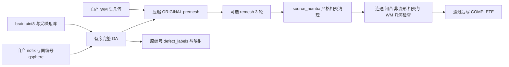

# 完整自有 GA 的文件接口

## 1. 功能简介

`run_genetic_topology_files` 将 FNIT 自产的 nofix、qsphere、brain 和 WM 文件送入已有完整 GA 控制器，保存 premesh、原顶点编号的缺陷标签和映射。`final_orig=True` 再完成三轮 remesh、原坐标自相交清理及最终结构门。计算复用项目 Python/NumPy/Numba 实现，运行时不发现、编译或调用原版 FreeSurfer 程序；通用 Python 计算库可使用自身编译内核。



这是一项表面阶段接口。原始 T1 整例、white/pial、球面配准和整体指标等效不由该接口判定。`final_orig=False` 时 ORIGINAL 的交面数或零面积是 premesh 诊断，不把它提前当成最终 orig；最终质量为 `not_assessed`。

新增显式 `distance_backend="serial"|"parallel"`，默认 serial。搜索与最终评分共用选择；实际 unMRI 跳过时记录 actual=null，Numba mask/slab 与采样 OS 线程数分开。参数、真实六评分和预算证据见 [距离路由](TOPOLOGY_GENETIC_DISTANCE_ROUTING.md)。

## 2. Python 调用、输入和输出

```python
from pathlib import Path
from fnit.recon_all.topology_genetic_files import run_genetic_topology_files

subject_directory = Path("own_subject")  # FNIT 自产被试目录
stage_directory = subject_directory / "scripts" / "lh.topology.genetic"  # 必须尚不存在
result = run_genetic_topology_files(
    input_surface=subject_directory / "surf" / "lh.orig.nofix",  # 原始顶点编号的三角表面
    input_qsphere=subject_directory / "surf" / "lh.qsphere.nofix",  # 同 N、同有序面
    brain=subject_directory / "mri" / "brain.mgz",  # uint8 三维 MRI，供强度采样
    wm=subject_directory / "mri" / "wm.mgz",  # WM 头供表面写出几何
    hemisphere="lh",  # 左半球；右半球使用 rh
    output_directory=stage_directory,
    threads=2,  # 若左右并行且总预算 4，每侧显式传 2
    seed=1234,  # 一个半球内持续的有序随机流
    population_size=10,  # 标准种群大小
    max_unchanged=10,  # 标准无改善停止参数
    niters=-1,  # 标准自动停止；有限值是显式受限搜索
    initial_selection=True,  # 保持初始选择规则
    vertex_eliminate=True,  # 保持顶点删除与跨候选反馈
    use_overlap=False,  # 固定标准 edge_table=0；不是未算重叠的占位
    face_detection_cache=False,  # 显式每缺陷面身份缓存；默认关闭，不缓存动态几何判定
    normal_status="surface",  # 当前完整接口支持标准三角表面
    soap_iterations=5,  # 全部缺陷结束后的源序 SOAP
    final_orig=True,  # 包括一次 remesh 和严格最终 orig 门
    remesh_scalar_storage="python",  # 当前 Python 配方的 CPU 双精度标量存储
)
print(result["outputs"]["orig"])
print(result["quality"]["status"])
print(result["seconds"]["complete_file_api"])
```

输入坐标单位为毫米，空间为 surface/tkregister RAS。nofix 与 qsphere 必须同顶点数、同有序三角面；接口不推断重编号。brain 必须是 uint8 三维 MGH/MGZ，不进行强度量化。brain 的 MGH 头仅用于计算 tkregister RAS 到连续体素的采样矩阵。WM 必须是三维 MGH/MGZ 且其体积头有效；写出 footer 使用其尺寸、间距、方向和中心，不能拿 brain 或 nofix 头替换。接口不将坐标改为 scanner RAS。

| 参数 | 意义和默认值 |
| --- | --- |
| `input_surface`、`input_qsphere`、`brain`、`wm` | 上述四个自产文件，均必填；不接受参考输出修补 |
| `hemisphere` | 必填 `lh` 或 `rh`，决定源半球元数据及输出名 |
| `output_directory` | 必填新目录，创建权限 700；已有目录明确失败，不复用旧完成标记 |
| `threads` | 正整数，默认 4；传给完整 GA，并在 remesh/清理期间使用同一 Torch intraop、当前 Numba 掩码预算；结束或异常均恢复 |
| `seed` | 默认 1234，完整半球共享随机流；不在每个缺陷重新播种 |
| `population_size`、`max_unchanged`、`niters` | 默认 10、10、−1；保留成熟控制器的顺序、接受/拒绝及终止规则 |
| `initial_selection`、`vertex_eliminate` | 默认 `True`；关闭后报告为非标准策略 |
| `use_overlap` | 默认 `False`，对应标准关闭策略；显式 `True` 调用已有完整重叠准备 |
| `face_detection_cache` | 默认 `False`；仅接受 Python `bool` 或 `numpy.bool_`，规范为 Python 布尔值后传给完整 GA 并记录参数。`True` 每缺陷按当前保留面准备身份缓存，搜索与最终写回复用；下个缺陷重新准备，不缓存动态邻接、几何或相交判定。整数、字符串、数组等非法值在创建输出目录前失败 |
| `normal_status`、`soap_iterations` | 默认 `surface` 和 5；不另加 epsilon、近似几何或停止阈值 |
| `final_orig` | 默认 `False`；`True` 要求严格最终 orig 成功 |
| `remesh_scalar_storage` | 默认 `numpy`，也可 `python`；两者均为 CPU 双精度，当前 Python 配方选择 `python` |

线程预算不会限制多个底层库合计活跃线程；新进程的 OMP/BLAS 环境和 CPU 亲和性由上层调度明确设置。面身份缓存由参数显式传递；接口没有全局猴补，不启用其他尚处于 benchmark 猴补形式的候选缓存。

| 输出 | 结构和编号域 |
| --- | --- |
| `H.orig.premesh` | 压缩后 M 顶点和逻辑有序面，写 ORIGINAL 槽；不是已清理的 TMP/CURRENT 坐标 |
| `H.defect_labels` | FreeSurfer morph F32 向量，长度 raw N，`fnum=raw F`；0 是非缺陷，1…D 是原域缺陷编号 |
| `H.genetic.maps.private.npz` | raw→base 完整排列、base→compact 映射（删除为 −1）、复合 raw→compact、原标签/数量及压缩 CURRENT 清理坐标；不声称 remesh 后还有同索引映射 |
| `H.genetic.defects.json` | 每缺陷完整控制、核心分数、随机消耗、终止及分步时间 |
| `H.genetic.progress.jsonl` | 每缺陷最终写回后的标量进度；不作为续跑状态或完成门 |
| `H.orig` | 仅 `final_orig=True` 产生的 remesh 后表面，使用新的顶点域 |
| `H.genetic.orig-intersection.json` | 仅最终 orig 模式产生；同输出 SHA 的源谓词和独立几何复检 |
| `report.json`、`COMPLETE.json` | 输入/模块/输出 SHA、参数、线程恢复、域和质量；只有全部请求步骤通过才有完成标记 |
| `failure.json` | 失败类型和信息；中间文件保留供诊断，不能当成成功输出 |

返回值是可 JSON 序列化字典。`status="complete"`、`final_orig`、`outputs`、同键 `output_sha256`、`report_path`、`report_sha256`、`completion_path`、`maps_path`、`per_defect_path` 和 `seconds` 可直接用于调度。`premesh_quality` 是 GA 中间态检查；`quality` 在最终模式是严格 orig 门，否则为 `not_assessed`。`outputs["orig"]` 未运行时为 `None`。返回路径为绝对路径，落盘报告中的输出路径相对阶段目录，便于半球 worker 发布后保留目录层级。输入绝对路径是私有来源信息，公开报告应脱敏。

`seconds` 分开记录加载、GA、写出、remesh、原坐标清理和最终 QC；返回 `complete_file_api` 包含最终报告写出，落盘报告同字段截至最后两份回执序列化前，边界由 `report_timing_boundary` 声明。core 秒数已包含在父 GA 秒数中，不能重复相加。GPU 内存为 `None`，不表示零显存或整例资源预算已测。

接口要求调用者声明这四个文件为 FNIT 自产，但格式、SHA 和编号校验不能证明其上游生产来源。`internal_ga_inputs_self_generated=True` 仅指本阶段内部准备/搜索状态自产；`input_file_upstream_provenance="caller_supplied_not_verified"`、`input_file_upstream_self_generated=None` 保留上游未核实的范围，`declared_inputs_only=True` 表示只消费上述声明文件。`reference_inputs_used=False` 的范围是本阶段没有额外读取独立参考，`reference_comparison_performed=False` 表示接口没有自行比较参考；二者不为调用者文件的来源背书。生产调度仍须绑定完整自产 MRI/表面链。

## 3. 命令行调用

安装包内可直接运行模块，无需 `tools` 目录：

```bash
python -m fnit.recon_all.topology_genetic_files \
  --input-surface own_subject/surf/lh.orig.nofix \
  --input-qsphere own_subject/surf/lh.qsphere.nofix \
  --brain own_subject/mri/brain.mgz \
  --wm own_subject/mri/wm.mgz \
  --hemisphere lh \
  --output-directory own_subject/scripts/lh.topology.genetic \
  --threads 2 --seed 1234 --population-size 10 --max-unchanged 10 --niters -1 \
  --initial-selection --vertex-eliminate --no-use-overlap --no-face-detection-cache \
  --normal-status surface --soap-iterations 5 --final-orig --remesh-scalar-storage python
```

命令输出返回字典 JSON，失败返回非零退出码。`--no-final-orig` 仅请求中间 premesh；`--face-detection-cache` 显式开启面身份缓存，省略或 `--no-face-detection-cache` 均关闭。这里未改变任何生产默认，上层接线另行验收。

## 4. 对应原软件调用

原版仅在独立 benchmark 中作参考，例如固定源码构建的命令：

```bash
export SUBJECTS_DIR="$REFERENCE_SUBJECTS_DIRECTORY"  # 隔离参考目录，不是 FNIT 生产目录
"$REFERENCE_BINARY_DIRECTORY/mris_fix_topology" -mgz -sphere qsphere.nofix \
  -ga -seed 1234 -threads 1 "$REFERENCE_SUBJECT_NAME" lh
"$REFERENCE_BINARY_DIRECTORY/mris_remesh" --remesh --iters 3 \
  "$REFERENCE_PREMESH" "$REFERENCE_ORIG"
"$REFERENCE_BINARY_DIRECTORY/mris_remove_intersection" "$REFERENCE_ORIG" "$REFERENCE_ORIG"
```

固定原代码在拓扑完成后恢复 ORIGINAL 写表面，并从 WM 复制体积几何；缺陷标签仍在原 nofix 域。此接口保持这两个区别。FNIT 的线程参数同时控制自有阶段预算，与参考 GA 的 `-threads 1` 不混标为同活跃线程证据。

## 5. 最新精度、耗时和可视化

本次新增的是安装包文件适配器。单元合同检查真实文件格式、原域/压缩域区分、WM 头、brain 采样矩阵、最终质量失败、输出哈希及异常时线程恢复；小型测试网格不是影像 benchmark。本版独立文件接口和 `final_orig=True` 的真实影像回归由协调任务在新冻结源码执行，当前未评估，不据接口测试宣称真实 GA 或 recon-all 通过。

本地合同 v2 在 Git `ae6f5e75` 的隔离 `src` 加本模块实际 overlay 上通过 11/11，测试墙钟 1.442 秒。受保护的 retessellation 使用 Git 文件 SHA `4b20a92f9ec1c4f1cc728a26b1fabbae3817497e50f238fdc2fb73e309b42de0`，没有导入工作树中他人的未提交版本。接口源码 SHA `005bd8a3e4c9c88d26b65534b33d534fc5f68139eb5461fb06c52ce3b26b4768`，测试源码 SHA `73a60db7518c04f2bc338f538dfc37705528dcacad2343fbe1982ac60772c764`。`numpy/python` 两种 selector 通过成熟 remesh 文件函数的真实参数校验、读写和 footer 复制，几何重划分内核在此合同中被替换为小文件夹具；这不代表 remesh 或完整 GA 的新影像测评。

文件合同 v3 在 Git `0fccebdcff82cb2dbcf9f65a4a77c84136790901` 的隔离 `src` 加实际接口/测试及两份低层依赖 overlay 上通过 13/13，unittest 报告 1.153 秒；CLI 帮助正常返回。新增合同覆盖缓存默认关闭、显式 `True`、`numpy.bool_` 规范、非法值创建目录前失败、实际核心签名绑定及 CLI 正反开关，同时保留原编号域、WM 头、线程恢复和失败合同。接口源码 SHA `ea9023ff2d94cf92cf13b8fc8462471a86dac3bf98de658e1d8b7dc2da48edce`，测试 SHA `9c6ee33ada0ee284770e40c920c7802ec35305c80a17d6cdb38041a92c4f4013`；实际低层 `topology_genetic_repair.py`/`topology_genetic_search.py` SHA 分别为 `4940cf9eb05984ec2f983b0325e7298bca43b03e3bb8b229c81bb6947a6a347f`/`863bab441966781da1a410bcc1e4270d6dd5cb5f5c989fcdac0a211aaa831164`。受保护 retessellation 仍是上述 Git `4b20a92f` 文件。合同只校验新接口转发与文件语义，核心搜索用夹具替换；没有把其他版本的缓存精度/速度、已有完整 GA 或整例结果改标为本版测量。

已有完整核心及原生重复性证据仍按各自冻结版本保存：[完整 GA 核心](TOPOLOGY_GENETIC_REPAIR.md)、[最终 orig 诊断](TOPOLOGY_GENETIC_ORIG.md)、[固定原生重复性与搜索控制](../../validation/recon_all/optimizations/20261011_topology_native_repeat/README.md)。新文件接口未复用这些旧结果作本版测量，也不宣布 10 分钟目标完成。脑图随本版真实影像报告提供，未用模拟图代替。

## 6. 更新与 benchmark 记录

- 2026-10-11：新增独立文件接口，复用完整自有 GA、成熟 remesh/相交清理和网格检查，未改变计算公式、GA 规则、生产 selector 或默认后端。
- 后续接口版：显式转发每缺陷面身份缓存，默认仍关闭；布尔参数在创建目录前校验，报告记录实际选择。收窄自产来源字段，区分四个调用者文件与内部 GA 状态；旧报告字段与旧科学结果不重写。
- 明确 raw 标签、base、compact 和 remesh 四个编号域；压缩 premesh ORIGINAL 与 TMP/CURRENT 诊断分开。
- 新增源与输出 SHA、同输入文件前后校验、每缺陷摘要、私有新目录、失败无完成标记和可迁移的相对输出路径。
- 接线审查修正首版适配器错误的 `torch` remesh 枚举；真实成熟文件函数仅接受 `numpy/python`，新增文件读写合同验证当前 Python 配方可传播。首轮仅 `numpy` 的 10 项合同不当成这一兼容门。
- 既有真实核心结果、首缺陷搜索结果和全缺陷结果保留原版本边界。历史 `generations=28` 是末代索引，若轨迹为 0…28，实际共 29 轮，不把它改成执行 28 轮。

## 7. 参考文献和原代码

- [Fischl B et al., Automated manifold surgery, 2001](https://doi.org/10.1109/42.906426)。
- 固定 d932c45 的 [mris_fix_topology 入口](https://github.com/freesurfer/freesurfer/blob/d932c45/mris_fix_topology/mris_fix_topology.cpp)和 [mrisurf_defect 算法](https://github.com/freesurfer/freesurfer/blob/d932c45/utils/mrisurf_defect.cpp)，只用于规则核对和隔离 benchmark，不复制原文件到本模块。
- FNIT 使用已安装依赖 NumPy、SciPy、Numba、PyTorch 和 nibabel；本接口无新增依赖、权重、许可证或外部程序要求。
