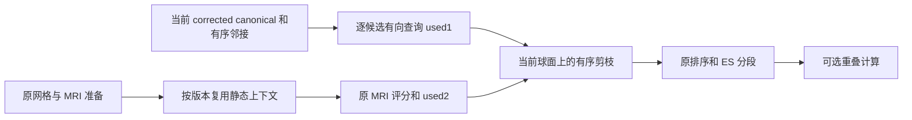

# 拓扑 GA：用当前状态准备下一缺陷的边表

## 1．功能简介

`next_ordered_genetic_defect_inputs()` 读取前一缺陷处理后的 **corrected 球面和有序邻接**，生成下一缺陷的 ETable、旧边 ES 分组和可选重叠表。MRI 评分、原边惩罚、剪枝、排序和分组复用已有实现，不重复写算法。

原程序的 `edgeExists()` 查询第一个端点的 `neighbors[:vnum]`。反向邻接、剩余面、rip 标记或已分配行的尾部不替代这个谓词。剪枝只检查当前 ETable 中的 used1 边与后续候选；原程序没有在这一步扫描表外的全部 base 边。



此前的全部 25 缺陷初态边表仅用于初态准备。连续搜索必须每缺陷调用本接口，消费真实当前状态，不能复用初态 used1、剪枝或 ES 结果。

## 2．Python 调用、输入和输出

```python
from fnit.recon_all.topology_genetic_defect_inputs import prepare_ordered_genetic_defect_context
from fnit.recon_all.topology_genetic_next_defect_inputs import next_ordered_genetic_defect_inputs

original_mesh_context = prepare_ordered_genetic_defect_context(
    canonical_vertices=original_canonical_vertices,  # 原 mris 域的球面 float32(N,3)，mm
    faces=original_faces,                            # 原有序整数(F,3)
    defect_labels=original_defect_labels,            # 完整整数(N,)，outside=0、缺陷=1…D
    ordered_regions=merged_ordered_regions,          # 源合并顺序的 inside/border；不能重做 BFS
    vertex_translation=original_to_corrected,        # 自产完整原→corrected 排列
)
next_defect_inputs = next_ordered_genetic_defect_inputs(
    canonical_vertices=original_canonical_vertices,  # 静态原网格版本，用于缓存校验
    original_vertices=averaged_original_vertices,    # 两轮平均 ORIGINAL，surface RAS/mm
    original_normals=averaged_original_normals,       # 上述 ORIGINAL 自产法向，float32(N,3)
    faces=original_faces,                            # 原邻接/原边惩罚消费的有序面
    defect_labels=original_defect_labels,            # 完整原域标签
    ordered_regions=merged_ordered_regions,          # 允许源合并后 inside 不连通
    retention_status=original_retention_status,      # outside=0、KEEP=+1、DISCARD=-1
    vertex_translation=original_to_corrected,        # outside 原编号升序后接 inside 原序
    white_values=median_white_values,                # 原域自产白质强度 float32(N,)
    gray_values=median_gray_values,                  # 原域自产灰质强度 float32(N,)
    volume=brain_uint8_volume,                       # 原 MRI uint8(X,Y,Z)，不读取参考结果
    ras_to_voxel=surface_ras_to_voxel,                # surface RAS→该 MRI voxel 的(4,4)
    defect_number=next_defect_number,                # 从0开始的源缺陷顺序
    current_surface_state=current_corrected_state,  # 前一缺陷结束后的持久状态
    use_overlap=False,                              # 标准原配方 edge_table=0，明确关闭
    context=original_mesh_context,                  # 同原网格版本缓存；默认 None 则重新建立
)
```

全部参数均为具名输入；只有 `use_overlap=False`、`context=None` 有默认值。静态输入的校验、单位、标签和字段详见[初态边表接口](TOPOLOGY_GENETIC_DEFECT_INPUTS.md)。`original_normals` 为法向，单位无量纲；`white_values/gray_values` 使用原强度单位。不能把 raw TMP 法向、canonical 法向或 corrected 当前几何混成 MRI 评分法向。

`current_surface_state` 必须含下列三个字段；其余完整持久字段由外层保存，本函数不重置：

| 字段 | 结构与意义 |
| --- | --- |
| `canonical_vertices` | corrected 顶点域有限 `float32(N,3)` 球面坐标，mm；必须是 canonical 槽 |
| `vertex_topology` | 整数 `(N,7)`，列依次为 nsizeCur、nsizeMax、vtotal、**vnum**、v2num、v3num、num；本算子只读 vnum |
| `neighbor_storage` | N 个有序一维整数行；被查询行必须至少有 vnum 项，前缀索引须在 corrected 顶点域 |

当前有向查询不对称化、不去重或过滤 rip。未被访问的存储尾部可以保留原容量数据；面表不用于重建邻接。原标准 `optimal_mapping=0` 下原 MRI 和边惩罚可缓存；非默认映射分支若修改原 canonical，旧缓存会因 SHA 不符而拒绝，调用者须重建。

返回初态接口相同的 corrected `edge_vertices int32(E,2)`、`edge_used int32(E,)`（0新边、1当前 base、2原边）、`edge_scores float32(E,)`、排序与原行号、ES→ETable 映射、`segment_rows`、inside/border/hull 与可选 overlap/CSR。**used1 优先于 used2**。分段行号仍是 ETable 域，种群需要 ES 域时由成熟外层转换。

新增 `dynamic_base` 记录当前球面 SHA、被访问有序邻接前缀 SHA、查询/行数、used1 候选数和实际剪枝范围。`seconds.dynamic_state_prepare` 包含静态版本检查、当前查询和坐标重索引；`seconds.complete_next_api` 包含整次 API，不能与内部步骤重复相加。`static_context_seconds` 是原上下文建立时间，缓存复用时不要再次计作该调用的耗时。

本接口不修改输入、原上下文或线程/精度/GPU 策略。缺字段、非有限球面、非法被访问计数/索引、错误排列或缓存版本抛 `ValueError`。完整 GA、最终网格质量及整例等效由外层另行判断。

## 3．命令行调用

这是原算法内部函数，没有独立生产 CLI。冻结同输入回归脚本显式读取 FNIT 自产准备，保存全部计算输出后再打开比较参考：

```bash
python tools/benchmark_recon_topology_genetic_next_defect_inputs.py \
  --prepared-checkpoint own_preparation.npz \
  --prepared-report own_preparation_report.json \
  --regions-json own_ordered_regions.json \
  --brain own_brain.mgz \
  --source-manifest frozen_source_manifest.json \
  --reference-checkpoint old_computed_etable.npz \
  --reference-report old_computed_report.json \
  --reference-edges independently_benchmarked_edges.bin \
  --output fresh_current_base_diagnostic \
  --threads 4
```

参考参数只用于输出后的诊断，不能传入生产 producer。脚本使用成熟 `source_base_neighbors()` 从原自产邻接/标签/映射生成初始 current state，不从参考 state 获取邻接、坐标或映射。

## 4．原软件调用

对应固定源码 `d932c45b7941662ea380a05efef580568b98d41a` 的 `mrisTessellateDefect_wkr()` 和 `edgeExists()`，属于 `mris_fix_topology -ga` 内部步骤，没有独立 CLI。标准源 `edge_table=0` 不计算 overlap；显式 True 才计算原 overlap，并保留发现第1001个交叉后标记截断的规则。

`utils/mrisurf_defect.cpp` 的11458行查询当前 corrected 邻接；11499–11522行只做当前 ETable 的 forward 剪枝。`utils/mrisurf_topology.cpp` 的320–329行有向扫描第一个端点的 vnum 前缀，无 rip/面表谓词。完整原命令仅在独立 benchmark 路径运行，生产接口不调用原版阶段程序。

## 5．最新版真实精度、耗时和脑图

当前阶段报告在[当前邻接边表验证目录](../../validation/recon_all/optimizations/20261010_topology_genetic_next_defect_inputs/README.md)。它复用公开 ds000114 sub-07 LH 的自产冻结前段、原 MRI 和显式区域，使用同一主机 CPU100–103、总4线程，完整 old→next→next→old 含读写及输出后比较。四次4,723边/138旧边、全部17组输出逐字节相同，原冻结ETable端点/used/分数零差。next两次完整API0.238836/0.351365秒，其中当前状态准备0.010433/0.010227秒；诊断含共享上下文和IO总19.493969秒，导入4.322186秒另计。首old含JIT，不由此宣称提速比。严格数值、有效状态和整例/QC分别记录；动态非初态参考比较仍待完整搜索证据。

初态及全部25缺陷的历史真实结果与脑图保留在[原初态验证目录](../../validation/recon_all/optimizations/20261010_topology_genetic_defect_inputs/README.md)，不改标为当前接口结果。本函数是有序 CPU Python/NumPy/Numba 组合，无 GPU 显存占用测试或整例10分钟结论。

## 6．近期更新与 benchmark

- 初态 `a50`：完整当前第一缺陷 ETable/MRI 分数与原参考零差；全部25初态准备两次重复零差。它不消费跨缺陷可变状态。
- 当前 next：保留 `a50` 的评分、排序、分段和交叉算法，追加显式当前 corrected canonical 与有向 vnum 查询。合同覆盖反向独有邻接、未访问尾部、rip、used1 优先和跨缺陷接受边的 forward 剪枝。
- 全流程、动态跨缺陷的原程序对照及最终质量未由本阶段证明；旧失败/未测项目保留，不扩大通过范围。

## 7．参考文献与原代码

- [固定 FreeSurfer 源码](https://github.com/freesurfer/freesurfer/tree/d932c45b7941662ea380a05efef580568b98d41a)，`utils/mrisurf_defect.cpp`、`utils/mrisurf_topology.cpp`；本仓库不复制发布原 `.cpp`。
- Fischl B, Liu A, Dale AM. Automated manifold surgery: constructing geometrically accurate and topologically correct models of the human cerebral cortex. IEEE Transactions on Medical Imaging, 2001. DOI：[10.1109/42.906426](https://doi.org/10.1109/42.906426)。
