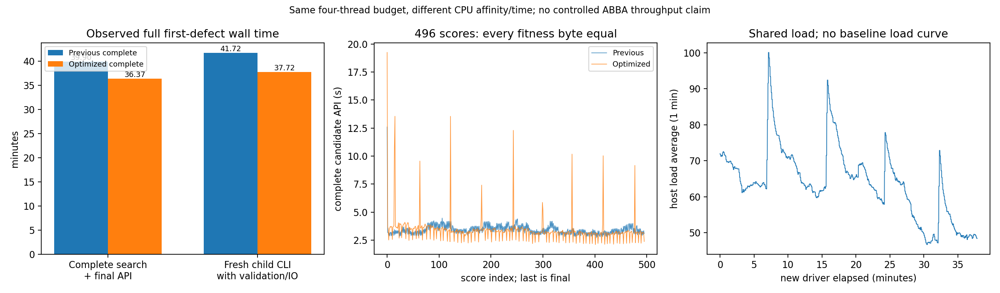

# 默认首缺陷 GA 的完整合并优化回归

## 1. 功能简介

`benchmark_recon_topology_genetic_optimization.run()`复用完整自有 GA 诊断入口，从同一公开被试的自身 `orig.nofix`、`qsphere.nofix` 和 `brain.mgz` 生成基底、先验、有序边、全部候选及最终状态。它只替换已经分别验证的数据组织与内核实现，不改排序、随机流、候选数量、接受、恢复、顶点剔除或停止政策。


本轮合并三组已验证改动：有序交叉候选筛选的 Numba 内核、基底与状态装配的数据组织，以及同一候选的入射面 CSR 复用。交叉 marker 的实际调用次数单列；若为零，不把它称为本轮 GA 的速度来源。

这是完整**首缺陷**回归。全半球还需要其余缺陷、最终 SOAP、压缩、CURRENT 清理、ORIGINAL premesh、标准 remesh 和最终交叉检查；本页不将首缺陷通过称为完整半球、原始 T1 recon-all 或 600 秒目标通过。

## 2. Python 调用、输入与输出

```python
from pathlib import Path
from benchmark_recon_topology_genetic_optimization import run

# 工作区同时提供同一冻结版本的src和tools；以下均为具名必填参数。
optimization_report = run(
    input_surface=Path("/benchmark/subject/surf/lh.orig.nofix"),  # 自身原始三角网格，surface RAS/mm
    input_qsphere=Path("/benchmark/subject/surf/lh.qsphere.nofix"),  # 同顶点编号与有序面的自身quick球面
    brain=Path("/benchmark/subject/mri/brain.mgz"),  # 自身连续上游uint8 XYZ MRI
    hemisphere="lh",  # 明确左/右侧；本次实际输入为左侧
    output=Path("/benchmark/new-run/candidate"),  # 必须不存在的新目录
    threads=4,  # 固定总CPU线程预算；GPU隐藏
    reference_statistics=Path("/benchmark/reference/patch_statistics.bin"),  # 只在自产结果写完后核首候选
    reference_volume=Path("/benchmark/reference/volume.bin"),  # 同输入首次体积项阶段参考
    reference_fitness=Path("/benchmark/reference/fitness.json"),  # 原首候选五项及double评分
    population_size=10,  # 保留原标准种群大小
    max_unchanged=10,  # 保留原未改善门
    niters=-1,  # 不设置候选/迭代截断
    seed=1234,  # 连续自有VNL随机流，半球只初始化一次
    initial_selection=True,  # 保留旧边分组和原空槽
    vertex_eliminate=True,  # 保留全部源顶点剔除规则
    baseline_directory=Path("/benchmark/previous-complete/candidate"),  # 全部新输出写完后才打开
    source_manifest=Path("/benchmark/frozen/SOURCE_MANIFEST.private.json"),  # 本次全部py size/SHA及实际加载模块期望SHA
    protocol=Path("/benchmark/frozen/protocol.private.json"),  # 事先声明同输入SHA、完整政策及既有报告SHA
)
```

| 参数 | 格式与含义 |
| --- | --- |
| `input_surface` | FreeSurfer 三角 surface 文件；F32坐标 `(N,3)`、整数有序面 `(F,3)`。保持自身 volume footer；坐标为 surface RAS，mm |
| `input_qsphere` | 自产球面 surface，同 `input_surface` 的全部顶点编号和有序面；不是标准 sphere 或注册结果 |
| `brain` | 同一生产链的uint8 `(X,Y,Z)` MGZ，nibabel读取；拓扑矩阵由本身MRI头生成，不用参考矩阵替代 |
| `hemisphere` | `"lh"` 或 `"rh"`；本轮完整实测只覆盖 `lh` |
| `output` | 不存在的新目录；不覆盖前次输出或将旧赢家文件复制为新结果 |
| `threads` | 正整数；与预声明协议及真实CPU affinity同时记录，本轮4 |
| `reference_statistics` / `reference_volume` / `reference_fitness` | 同输入的独立首次候选参考，分别为已声明的二进制统计/体积捕获和JSON；只作结果后的精度比较，不生成候选输入 |
| `population_size` / `max_unchanged` / `niters` | 原完整搜索政策整数，本轮10/10/−1；−1不截断，保留实际停止原因 |
| `seed` | 有符号32位整数；本轮1234，使用成熟自有VNL序列和原double区间缩放 |
| `initial_selection` / `vertex_eliminate` | bool；本轮均True，不能为了缩短计算关闭 |
| `baseline_directory` | 既有完整首缺陷输出目录；必须有正确 `COMPLETE.json`、绑定的 `report.json` 和四项检查点SHA；只在新结果全部写完之后读取 |
| `source_manifest` | 本次私有冻结JSON：`payload`逐文件记录size/SHA，`expected_module_sha256`记录旧实际模块及六项新实现的期望SHA；在算法前核验实际导入，结束再核源码未改变 |
| `protocol` | 预声明JSON含 `policy`、`input_sha256` 和 `baseline_report_sha256`。`policy`须逐项匹配传入的7个完整策略参数 |

返回报告包含全部496个double评分的逐字节比较、完整控制轨迹相等性、首候选/末态/种群的字段、shape、dtype、完整数组字节及文件SHA，以及分阶段墙钟、marker调用数、CPU预算和版本绑定。无CUDA使用，因此GPU峰值、Torch allocated/reserved均为 `null`，不以零值冒充测量。

成功条件为退出码0与新 `OPTIMIZATION_COMPLETE.json`，同时绑定 `optimization.json`、原完整报告以及完整输出SHA。继承的 `COMPLETE.json`只证明既有诊断工具的首候选源门，不独自表示本次全495候选优化配对通过。失败保留算法输出与 `optimization_failure.json`；启动/导入失败由外部控制器单独留存，不回写为算法失败或成功。

白名单指标与绘图均在算法成功后独立调用：

```python
from export_recon_topology_genetic_optimization import export_metrics
from plot_recon_topology_genetic_optimization import run as plot_optimization

public_receipt = export_metrics(
    input_run=Path("/benchmark/new-run"),  # 含candidate、进程退出码及负载采样
    baseline_run=Path("/benchmark/previous-complete"),  # 与冻结protocol绑定的旧完整运行
    frozen_source=Path("/benchmark/frozen"),  # 本轮实际源码清单、protocol及六模块SHA
    output_directory=Path("/benchmark/public-metrics"),  # 不存在的新目录
)
figure_receipt = plot_optimization(
    metrics=Path("/benchmark/public-metrics/metrics.json"),  # 完整状态/评分门和执行指标
    candidate_timings=Path("/benchmark/public-metrics/candidate_timings.json"),  # 两版全部496次评分及子计时
    shared_load=Path("/benchmark/public-metrics/shared_load.json"),  # 本轮1秒负载曲线，未知量保留null
    output=Path("/benchmark/public-metrics/complete_times.png"),  # 必须不存在的PNG
)
```

导出输出为安全指标JSON与哈希回执，不加载MRI或网格NPZ；两个旧/新运行身份和全部完成SHA不匹配时先报错。画图只读取以上三份JSON，不执行GA。

## 3. 命令行调用

```bash
PYTHONPATH=/benchmark/frozen/src:/benchmark/frozen/tools \
CUDA_VISIBLE_DEVICES='' OMP_NUM_THREADS=4 MKL_NUM_THREADS=4 \
OPENBLAS_NUM_THREADS=4 NUMBA_NUM_THREADS=4 \
NUMBA_CACHE_DIR=/benchmark/new-run/numba_cache \
taskset -c 8-11 python /benchmark/frozen/tools/benchmark_recon_topology_genetic_optimization.py \
  --input-surface /benchmark/subject/surf/lh.orig.nofix \
  --input-qsphere /benchmark/subject/surf/lh.qsphere.nofix \
  --brain /benchmark/subject/mri/brain.mgz \
  --hemisphere lh --threads 4 \
  --population-size 10 --max-unchanged 10 --niters -1 --seed 1234 \
  --initial-selection --vertex-eliminate \
  --output /benchmark/new-run/candidate \
  --reference-statistics /benchmark/reference/patch_statistics.bin \
  --reference-volume /benchmark/reference/volume.bin \
  --reference-fitness /benchmark/reference/fitness.json \
  --baseline-directory /benchmark/previous-complete/candidate \
  --source-manifest /benchmark/frozen/SOURCE_MANIFEST.private.json \
  --protocol /benchmark/frozen/protocol.private.json
```

命令行参数与上表相同。源码、工具和下层数值库固定；禁止在进行中的目录替换源码。线程、共享负载与首轮JIT分开记录，完整CLI包含新解释器启动、参数检查、源码/输入核验、加载、全部计算、写出和事后完整比较；导入预检另列。

```bash
python tools/export_recon_topology_genetic_optimization.py \
  --input-run /benchmark/new-run --baseline-run /benchmark/previous-complete \
  --frozen-source /benchmark/frozen --output-directory /benchmark/public-metrics
python tools/plot_recon_topology_genetic_optimization.py \
  --metrics /benchmark/public-metrics/metrics.json \
  --candidate-timings /benchmark/public-metrics/candidate_timings.json \
  --shared-load /benchmark/public-metrics/shared_load.json \
  --output /benchmark/public-metrics/complete_times.png
```

## 4. 原软件调用

原对应阶段是固定d932 `mrisComputeOptimalRetessellation_wkr` 的初始种群、交叉、变异、剔除、最终写回；完整参考入口如下，仅在独立benchmark目录使用：

```bash
mris_fix_topology -mgz -ga -seed 1234 -threads 4 reference_subject lh
```

本轮完整优化比较的对照是此前已完成的自有Python默认GA，而非新跑完整原GA赢家。因此“全部495候选及末态0差”表示与相同默认政策的自有旧版逐位保持；原始程序的完整赢家与全半球质量仍单列未评估。

## 5. 当前精度、耗时与脑图

实际同输入完整默认首缺陷已退出0并通过 `OPTIMIZATION_COMPLETE.json`：495次搜索和1次最终评分，全部496个F64评分字节相同。完整代记录为**29条（零基索引0–28）**；继承字段 `search_generations=28` 是末次索引，公开指标另列 `generation_trace_count=29` 和 `last_zero_based_generation_index=28`，不改原科学收据。

| 完整检查 | 本轮结果 |
| --- | --- |
| 全部评分 | shape、dtype及全部字节相同；最大/P99误差0 |
| 搜索控制 | 1362381次随机draw、完整控制文件SHA、剔除及停止记录相同 |
| 状态 | 首候选32、最终状态40、种群8字段，共80字段；全shape/dtype/bytes及3个完整NPZ SHA相同 |
| 首候选对固定原实现 | core、fitness、坐标、有序面、法向、K1、K2、距离与curvbak全部9组逐字节通过 |
| 终值与停止 | 最佳/最终−93.04168701171875；`euthanasia_wait_limit`，253次mutation尝试/1次改善，232次crossover尝试/8次改善 |
| 来源 | 同MRI/网格SHA；算法全部写出后才读取旧赢家；846个Python文件/62个实际导入模块绑定、结束源码未变 |

| 墙钟（秒） | 既有完整默认版本 | 本轮合并优化 |
| --- | ---: | ---: |
| 基底完整API | 74.530429 | 53.980533 |
| 全局先验 | 0.994152 | 1.514378 |
| 输入上下文 | 10.898184 | 4.070122 |
| 完整有序边 | 13.281334 | 6.897616 |
| 局部MRI先验 | 1.888593 | 3.164583 |
| 完整搜索及最终写回API | 2394.128031 | 2182.039244 |
| 其中搜索 | 2381.832310 | 2168.716924 |
| 其中最终评分、恢复及重建 | 8.845548 | 7.307622 |
| 写完整状态 | 2.755502 | 2.924221 |
| 冷子进程完整CLI（含核验/加载/计算/写出/完整比较） | 2502.915552 | 2263.422952 |

本组观察的完整搜索及最终API缩短8.86%，冷CLI缩短9.57%。旧CPU120–123、新CPU8–11均为4线程，但共享节点运行时段和负载不同，不能视为稳定吞吐的配对测量。本轮1秒采样2269次，host一分钟load范围46.72–100.10、中位63.60；旧完整load曲线不可用，cgroup/CPU pressure不可读，未定位限流因果。完整候选API中位3.355561→3.240205秒，包含冷JIT和各次实际共享负载；每次耗时都随报告发布。

CUDA隐藏，GPU峰值/allocated/reserved为null。新子进程CPU峰值RSS1681988 KiB，旧1678568 KiB；它不是显存或精确父子树峰值。本轮marker实际0调用，因此不把已成熟的marker筛选优化计入本轮GA收益。控制器和评价函数本身保持原完整顺序，生产默认未改变。




脑图显示本链最终相对本链首候选的运动，96个保留顶点、65个切片叠加顶点，位移最大4.034098mm/P99 3.069478mm；它不是原软件最终误差。全部首缺陷精确保持只证明合并优化未改变本链结果；全半球GA、最后网格质量、原始T1 recon-all、600秒和整体指标等效均未评估。

## 6. 更新与benchmark记录

- 旧完整默认自有GA：29条代记录（零基0–28）/495搜索评分，1362381次随机draw，最佳与最终评分−93.04168701171875；首候选9组参考门通过，完整原GA赢家未捕获。
- 已成熟的单候选优化：数据组织、状态装配和同候选有序CSR复用均保留完整数值/控制门；本次首次把这些实现放入全部默认搜索连续回归，不外推先前单轮比值。
- v1：启动器没有显式导出FNIT运行根变量，在读环境时停止，无算法运行；原失败日志和SHA保留。
- v2：新独立目录，仅补启动环境变量。六项优化源码、策略、原MRI/网格SHA保持；846个py文件和62个实际模块核验，495+final完整门通过，旧输出不进入算法。
- 指标导出v2：保留科学报告原值，补正确代记录数及末次零基索引；旧导出v1服务器保留。导出核验实际旧报告SHA、旧退出码、冻结protocol/源码及全部新输出SHA；4个控制契约拒绝混用旧耗时目录、失败旧进程、收据状态冲突和被替换protocol。31391个数值/bool/null叶值及类型逐项保留。
- 生产默认、父进程低显存措施、所有源接受/停止/QC阈值保持。本轮新增依赖为零，使用主页Conda已提供的NumPy/Numba/nibabel。

## 7. 参考文献与源码

- [FNIT完整首缺陷搜索](TOPOLOGY_GENETIC_SEARCH.md)、[连续候选恢复](TOPOLOGY_CANDIDATE_CYCLE.md)、[最终写回](TOPOLOGY_GA_FINALIZE.md)。
- [本轮完整回归工具](../../tools/benchmark_recon_topology_genetic_optimization.py)。
- [固定上游拓扑源码](https://github.com/freesurfer/freesurfer/blob/d932c45b7941662ea380a05efef580568b98d41a/utils/mrisurf_defect.cpp)。
- [Fischl等，2001，Automated manifold surgery](https://doi.org/10.1109/42.906426)。
