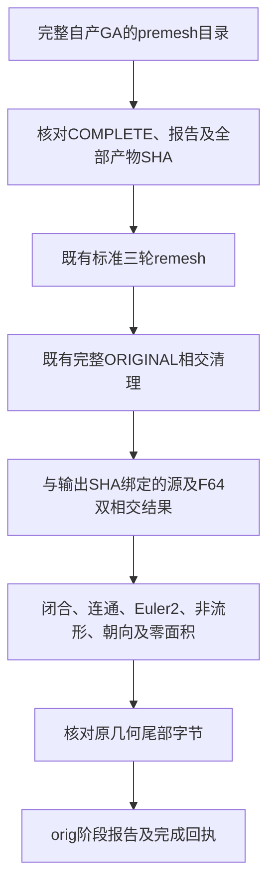

# 完整自产GA后的标准orig验证

## 1. 功能与流程

`benchmark_recon_topology_genetic_orig.run()`核对完整自产GA的完成回执，再复用已有标准三轮remesh和完整ORIGINAL相交清理，最后检查实际写出`orig`的网格结构及几何尾部。没有新写重划分或碰撞算法，不调用原版阶段程序。



这是自产连续拓扑链的后半段验证。premesh可能存在ORIGINAL相交；保持先remesh再清理的原流程。此工具不生成white/pial，不代表原始T1整例完成。生产默认未改变。

## 2. Python调用、输入与输出

```python
from pathlib import Path
import sys
sys.path.insert(0, "/path/to/FNIT/tools")  # 导入仓库中的独立验证工具
from benchmark_recon_topology_genetic_orig import run

orig_report = run(
    premesh_directory=Path("/data/own/complete-genetic-premesh"),  # 完整自产GA目录
    hemisphere="lh",  # 必须与已完成的表面文件侧别一致
    output=Path("/data/runs/new-genetic-orig"),  # 不存在的新输出目录
    threads=4,  # 全部计算的CPU线程预算，外层另固定亲和性及BLAS
    remesh_scalar_storage="numpy",  # 原默认双精度标量存储，同一标准算法
)
orig_path = Path("/data/runs/new-genetic-orig/lh.orig")  # surface RAS/mm三角表面
orig_quality = orig_report["quality"]  # 本阶段实际网格质量，非整体指标等效
```

| 参数 | 格式、默认值与限制 |
|---|---|
| `premesh_directory` | 必填Path/string；含`report.json`、`COMPLETE.json`及`H.orig.premesh`。报告必须完整GA、自身输入、无参考及原版程序调用，premesh结构/CURRENT清理通过 |
| `hemisphere` | 必填`lh`或`rh`；核对对应表面在报告中的SHA |
| `output` | 必填新目录；已存在报`FileExistsError`，不覆盖旧运行 |
| `threads` | 默认4，正整数，复用`thread_budget`并恢复调用方预算；Numba导入时容量和外部CPU配额另核对 |
| `remesh_scalar_storage` | 默认`numpy`，允许`python`；只选择已有标量存储，不更改三轮重划分、顺序更新或双精度算法 |

输入premesh是nibabel可读三角表面，坐标surface RAS、mm；重划分会改变顶点数和面序，不能沿用premesh的顶点索引比较最终orig。输出坐标存储F32、有序面int32，输入体积几何尾部按原字节保留。

输出包括`H.orig`、`intersection.json`、`report.json`和`COMPLETE.json`。返回JSON dict含：父阶段输入与实际模块SHA、premesh/父报告/父回执及输出SHA、本阶段实际模块SHA、完整阶段秒数、线程/亲和性/RSS、最终结构及相交检查。`whole_recon_all/strict_source_final_reproduction/overall_metric_equivalence`仍是`not_assessed`；GPU未使用的显存、allocated/reserved记null。

辅助接口`verified_premesh(premesh_directory=..., hemisphere=...)`返回经SHA校验的表面Path和父报告。父报告必须声明`H.orig.premesh`、`premesh_state.private.npz`和`mappings.private.npz`；全部声明产物逐文件核对。`nofix/qsphere/brain`及实际模块哈希必须完整，输出名称限父目录内的文件，缺产物不能进入remesh。

`final_quality(surface_path=..., cleanup_report=...)`只接受与实际输出SHA相同、成功且`require_zero=True`的完整清理报告；在相同几何上复用已经完成的两种独立相交检查，再计算结构质量，不重复执行昂贵相交核。它不接受零值占位或其他网格版本的结果。最终体积几何头是质量门：`valid`首数值须为1，`volume`是正整数三维尺寸，`voxelsize`是正有限三维毫米值，`xras/yras/zras`与`cras`须为有限三维向量且方向矩阵可逆。源valid行尾注释和微小方向分量允许；空头、无效头或两个空footer不能通过。原footer字节比较仍单独检查。

非法回执、报告/表面SHA、策略或完整状态抛`ValueError`；缺文件抛`FileNotFoundError`；子函数失败原样传播。残余相交或最终结构/尾部失败保存`failure.json`并抛异常，不生成完成回执；已写出的中间`orig`不能当作通过结果。输入目录保持不变。

## 3. 命令行调用

```bash
CUDA_VISIBLE_DEVICES='' OMP_NUM_THREADS=4 MKL_NUM_THREADS=4 \
OPENBLAS_NUM_THREADS=4 NUMBA_NUM_THREADS=4 \
python tools/benchmark_recon_topology_genetic_orig.py \
  --premesh-directory /data/own/complete-genetic-premesh \
  --hemisphere lh \
  --output /data/runs/new-genetic-orig \
  --threads 4 \
  --remesh-scalar-storage numpy
```

选项与Python参数表相同。不在本工具等待或恢复未完成GA，也不能用手工补写回执启动。外层CLI墙钟须另从解释器启动计时；工具自身秒数包含校验、加载、JIT、计算与读写，不能加到包含它的父时间中重复计算。

## 4. 原软件调用

仅在独立benchmark路径执行：

```bash
mris_remesh --remesh --iters 3 /data/benchmark/lh.orig.premesh /data/benchmark/lh.orig
mris_remove_intersection /data/benchmark/lh.orig /data/benchmark/lh.orig
```

输入、标准轮数与坐标语义对应。源程序的拓扑内部清理CURRENT后恢复ORIGINAL写出premesh，外部流程仍须remesh及最终清理；本工具保留此顺序。最终质量汇总属于FNIT验证，没有对应独立原CLI。

## 5. 最新精度、耗时与脑图

本工具尚未取得完整九缺陷GA产物，真实连续`premesh→orig`精度和耗时未评估。初版3项文件/回执合同、6个子测试通过；2026-10-11补修空几何头与未核父产物的检查漏洞，当前6项/19个子测试通过7.41秒。模拟四面体只验证文件和控制，不充当真实MRI benchmark。

现场两例自产nofix的真实头均通过新解析：256³、1mm、valid带源注释且方向可逆。冷观测CLI2.051秒仅含两个头的导入、读取、哈希与校验，不执行GA或网格算法。报告、实际工具/函数SHA与复现脚本见[完成检查修复](../../validation/recon_all/optimizations/20261011_topology_orig_validation/README.md)。已排队的75项冻结初版工具保持原字节，正常产物还须通过新检查；不将冻结预检当作新工具完整阶段验证。

已经完成的真实输入证据分别见[自产首缺陷完整搜索](TOPOLOGY_GENETIC_SEARCH.md)、[全半球GA冻结运行](TOPOLOGY_GENETIC_REPAIR.md)及[非零相交完整阶段](TOPOLOGY_NONZERO_CSR_REPAIR.md)。其中首缺陷是29轮（轨迹索引0–28；继承字段`search_generations=28`保留）/495次搜索评分；非零相交两次完整API为126.955/117.323秒。它们不代表本工具或完整GA的耗时，不能相加估计整例速度。

同源T1脑图见上述真实阶段报告；完整GA后的最终orig脑图尚未生成。最终官方网格一致性、white/pial与138项整例、十分钟目标和整体指标等效均未判定。

## 6. 更新与benchmark记录

- 2026-10-10：新增完整父回执驱动的后续验证，直接复用已有remesh和完整相交修复，没有替换算法或降低质量门。
- 2026-10-11：修复缺几何头仍通过及父产物未逐SHA核对的问题；两例头读取通过，完整九缺陷后续阶段仍未判定。
- 同一输出SHA的相交结果可复用；结构、坐标有限性、零面积及原几何尾部仍检查，避免为汇总再重复两次整网格相交检测。
- 不新增依赖：nibabel、NumPy、Numba、SciPy、PyTorch均在主页Conda路径。本工具通过合同检查，干净环境安装及真实连续链尚未验收。
- 运行成功只表示orig阶段；不将实验工具的完成回执视为完整recon-all交付。

## 7. 参考文献与源码

- [固定FreeSurfer源码](https://github.com/freesurfer/freesurfer/tree/d932c45b7941662ea380a05efef580568b98d41a)。
- [自有标准重划分](../../src/fnit/recon_all/mris_remesh_python.py)、[完整相交修复](../../src/fnit/recon_all/mris_remove_intersection_python.py)、[验证工具](../../tools/benchmark_recon_topology_genetic_orig.py)。
- [全半球自产GA](TOPOLOGY_GENETIC_REPAIR.md)、[重划分标量存储及真实回归](REMESH_SCALAR_STORAGE_20261010.md)。
- [Fischl等，2001，Automated manifold surgery](https://doi.org/10.1109/42.906426)。
