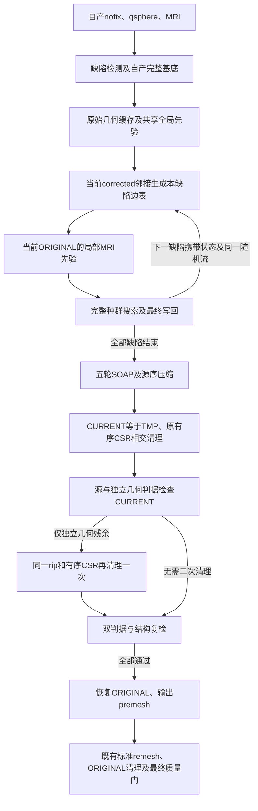

# 自有全半球拓扑搜索与premesh

## 1. 功能与流程

`repair_genetic_topology()`从同一FNIT连续上游的nofix、qsphere和MRI准备全部缺陷，按源顺序完整搜索，再做SOAP、压缩和CURRENT相交清理，最后恢复ORIGINAL作为`orig.premesh`。计算复用已有Python/Numba组件，不调用原版FreeSurfer阶段程序。



这是实验性的premesh阶段，尚未替换生产拓扑默认。后续remesh和最终相交清理是必要步骤。源程序也在清理CURRENT后恢复ORIGINAL写出；ORIGINAL premesh中的相交仅在此阶段记录，最终`orig`仍须通过完整质量门。

当源有向标记已经为零、独立几何检测仍发现CURRENT相交，且其余结构与有限值检查通过时，控制器用现有几何标记SOAP对同一压缩网格再清理一次。它沿用相同的冻结顶点和有序邻接，随后重新检查源标记与独立几何标记是否都为零；仍有相交就失败，不写合格premesh。二次清理只作用于CURRENT诊断坐标，写出的premesh仍是原流程恢复的ORIGINAL。

新增显式 `distance_backend="serial"|"parallel"`，默认 serial。搜索与最终评分共用选择；实际 unMRI 跳过时记录 actual=null，Numba mask/slab 与采样 OS 线程数分开。参数、真实六评分和预算证据见 [距离路由](TOPOLOGY_GENETIC_DISTANCE_ROUTING.md)。

## 2. Python调用、全部输入与输出

```python
import numpy as np
from fnit.recon_all.topology_genetic_repair import repair_genetic_topology

premesh_report = repair_genetic_topology(
    vertices=own_nofix_vertices,  # float32(N,3)，自产nofix的surface RAS，单位mm
    faces=own_ordered_faces,  # 整数(F,3)，nofix和qsphere共同的有序三角面
    qsphere_vertices=own_qsphere_vertices,  # float32(N,3)，同一顶点编号的自产球面
    volume=own_brain_volume,  # uint8(X,Y,Z)，同一自身上游的brain MRI
    ras_to_voxel=own_surface_ras_to_voxel,  # 4×4矩阵，surface RAS/mm到MRI连续体素
    source_metadata=own_surface_metadata,  # 自产头信息；必含几何、半球、RAS及status字段
    threads=4,  # 当前Torch/Numba CPU预算，外部进程还须固定BLAS和CPU亲和性
    seed=1234,  # 一个半球仅初始化一次的VNL随机流，跨缺陷继续消费
    population_size=10,  # 源标准种群；大缺陷沿既有源规则调整
    max_unchanged=10,  # 未改善门，不用缩短此门替代标准算法
    niters=-1,  # 默认不限迭代，保留实际停止、剔除及最后完整写回
    initial_selection=True,  # 保留自产旧边分组及空槽
    vertex_eliminate=True,  # 保留无进展和周期顶点剔除
    use_overlap=False,  # 标准关闭；开启时消费自产完整重叠域
    normal_status="surface",  # 完整控制器仅支持标准三角表面，metadata.status必须0
    soap_iterations=5,  # 源最终五轮F32、双pass、含中心点的SOAP
    progress_callback=None,  # 可选具名回调，在每缺陷完整写回后接收自产结果
    failure_state_callback=None,  # 默认不保存失败网格；私有诊断可显式提供回调
)
premesh_vertices = premesh_report["surface_state"]["current_vertices"]  # 恢复后的ORIGINAL
premesh_faces = premesh_report["surface_state"]["faces"]  # 压缩后的有序面
```

| 参数 | 格式、默认值与限制 |
|---|---|
| `vertices` | 必填，有限F32 `(N,3)`；自身nofix坐标，surface RAS/mm |
| `faces` | 必填，整数 `(F,3)`，合法顶点索引；与qsphere面序一致 |
| `qsphere_vertices` | 必填，有限F32 `(N,3)`，与nofix同顶点编号；球面槽不能替代ORIGINAL |
| `volume` | 必填，uint8三维XYZ；不在此接口重采样、缩放或读取参考MRI |
| `ras_to_voxel` | 必填，有限4×4矩阵；复用`source_topology_ras_to_voxel(volume_header=...)`按自身MRI头生成 |
| `source_metadata` | 必填mapping，含`use_real_ras/status/origxyz_status/volume_geometry/hemisphere`；标准三角表面的整数`status=0`。半球0/1，`volume_geometry`来自自身表面头；无参考默认填补 |
| `threads` | 默认4，正整数，不超过Numba导入时容量；恢复调用方Torch/Numba设置，不允许其他线程同时修改进程线程预算 |
| `seed` | 默认1234，有符号32位整数；复用成熟VNL流及源prime，不逐代/逐缺陷重置 |
| `population_size/max_unchanged` | 默认10/10；格式和大缺陷固定裁剪规则同[单缺陷搜索](TOPOLOGY_GENETIC_SEARCH.md)，不裁剪候选边 |
| `niters` | 默认−1不限，允许非负实验上限；有限上限记录为不同政策 |
| `initial_selection/vertex_eliminate/use_overlap` | 默认True/True/False，必须bool；保持实际政策记录 |
| `normal_status` | 默认且仅支持`surface`。非默认球面patch恢复还有canonical同步语义，不在此完整控制器中开放 |
| `soap_iterations` | 默认5，非负整数；不同轮数明确标实验政策 |
| `progress_callback` | 默认None；可传`callable(*, defect_number, result)`，在完整最终写回后执行；异常原样传播，耗时计入完整API |
| `failure_state_callback` | 默认None；仅最终质量门失败时调用，传入压缩ORIGINAL/CURRENT坐标、面、rip、有序CSR、质量和清理诊断的独立副本。回调本身不写文件；调用者可选择在私有隔离目录保存，异常原样传播 |

当前只支持标准`optimal_mapping=0`。原始canonical/法向/白灰采样缓存不能用于会改写原球面坐标的其他mapping分支。当前corrected邻接、每缺陷局部MRI、种群状态和迭代坐标不作跨缺陷静态缓存。

返回mapping包含：

- `surface_state`：压缩后完整网格状态；CURRENT已恢复ORIGINAL，F32 `(M,3)`、有序整数面 `(G,3)`，M/G由真实删除结果决定。邻接保留原序和未被面支撑的边。
- `metadata`：自身元信息深复制；内部`register_mat=None`不属于nibabel表面footer的序列化字段。
- `raw_to_base_vertex_translation`、`base_to_compact_vertex_translation`：对应原域长度的int32映射，删除项−1；`original_domain_defect_labels`为raw域int32 `(N,)`，0表示非缺陷。
- `per_defect`：源序列表，含实际边/内点数、政策、代数、计数、终止、最佳/最终评分、连续删除状态、随机消费量和完整分段秒数。
- `current_cleanup_vertices`：清理后的CURRENT/TMP `(M,3)`，单独保留，不能用它覆盖premesh ORIGINAL；`current_cleanup`保留源标记修复的原有字段，并以`independent_geometric_fallback`记录二次清理是否触发、前后两种交面数和该次SOAP诊断。
- `finish`：SOAP与压缩报告、源→新顶点/面映射；`quality`分别报告拓扑、有限值、链接、朝向、两坐标槽的两种相交判据、零面积面。
- `seconds`：包括校验、JIT、全部搜索、回调和质量检查的API墙钟，不含外部读写。`complete_ga=True`仅指所有缺陷已执行；`final_mesh_quality/strict_source_final_reproduction/overall_metric_equivalence`仍分开记录。
- `required_next_steps`：标准remesh、ORIGINAL相交清理和最终网格质量检查，不能把premesh成功当作整例成功。

不修改调用者输入、不改变CUDA/TF32或启用半精度。非法策略/坐标域/不完整状态抛`ValueError`；未覆盖的normal坐标扰动明确失败；算子和回调异常传播；CURRENT残余相交或结构失败抛`RuntimeError`，不返回完成结果。接口不写文件，失败不会返回`status="failed"`字典。公开T1的本次二次清理精度和耗时须以新的同输入阶段运行报告为准，旧报告不能视为修复验证。

## 3. 命令行调用

内部控制器没有独立生产CLI。以下隔离工具从自身nofix/qsphere/MRI重新计算所有缺陷，输出目录必须不存在：

```bash
CUDA_VISIBLE_DEVICES='' OMP_NUM_THREADS=4 MKL_NUM_THREADS=4 \
OPENBLAS_NUM_THREADS=4 NUMBA_NUM_THREADS=4 \
python tools/benchmark_recon_topology_genetic_repair.py \
  --input-surface /data/own-subject/surf/lh.orig.nofix \
  --input-qsphere /data/own-subject/surf/lh.qsphere.nofix \
  --brain /data/own-subject/mri/brain.mgz \
  --hemisphere lh \
  --output /data/new-run/full-genetic-premesh \
  --threads 4 --seed 1234 --population-size 10 --max-unchanged 10 --niters -1 \
  --initial-selection --vertex-eliminate --no-use-overlap \
  --normal-status surface --soap-iterations 5 --checkpoint-each-defect
```

三项影像来自同一自身上游；`hemisphere`明确侧别。策略与Python表一致。`checkpoint_each_defect`为必选明确bool CLI选项，True保存每个已完整写回的私有NPZ，False使用`--no-checkpoint-each-defect`；两者不恢复旧状态或读取参考，写出开销计入API/工具墙钟。

输出`lh.orig.premesh`、完整状态/映射私有NPZ、逐缺陷`progress.jsonl`、`report.json`和仅premesh范围的`COMPLETE.json`。JSON包含实际输入/输出/模块SHA、CPU预算、版本、RSS、API与含I/O工具墙钟；GPU未使用记`None`。失败写`failure.json`并抛异常，不生成完成回执。原始T1整例仍须从空目录运行完整入口；这里使用自产中间输入，只是连续拓扑阶段验证。

## 4. 原软件调用

对应固定源码`MRIScorrectTopology`中的全缺陷GA、最终SOAP/压缩、CURRENT相交清理及恢复ORIGINAL，没有独立内部CLI。完整参考入口为：

```bash
mris_fix_topology -mgz -ga -seed 1234 -threads 4 reference_subject lh
```

原软件仅在独立benchmark目录运行。此控制器不接收可执行程序目录、参考文件、官方边表/先验或被冻结的最佳排序。符合源流程语义的坐标槽恢复与压缩保留，后续remesh和最终原始几何清理继续复用项目已有实现。

## 5. 最新精度、耗时与脑图

控制器与文件接口共9项本地合同、14个子测试通过，包含真实nibabel格式往返、全局缓存一次、动态邻接、跨缺陷随机/删除状态、CURRENT/ORIGINAL槽和两种独立残余判据。10.63秒包含导入。这些合同不作为真实MRI benchmark。

公开T1的[自产首缺陷完整默认搜索](TOPOLOGY_GENETIC_SEARCH.md)已经成功退出：29轮（轨迹索引0–28；继承字段`search_generations=28`保留）、495次搜索评分，最终评分与最佳评分相同；初始源候选9组严格逐位一致。完整冷子CLI2502.916秒，单缺陷搜索及写回2394.128秒；这组数据不能代表全部缺陷或完整recon-all。

全半球本轮使用该自产输入的全部9个缺陷，在独立固定目录从nofix/qsphere/MRI起步运行。北京时间2026-10-11已完成第一个缺陷：29轮（轨迹索引0–28；继承字段`search_generations=28`保留）、495次评分，全部末态检查点SHA `58fe9a35b526b9bca690a2363b1464d503a8d2b81aa7bcf907bc46b221390fe3`与独立首缺陷完整搜索相同；代数、全部计数、最佳/最终评分、删除计数及阈值七组连续性检查均通过。这是与先前自产结果的连续性，不是原版完整赢家对照。

该缺陷API2867.968秒，其中search2853.690秒、finalization10.335秒；共享主机非配对运行，不据这两次墙钟差判断优化回归。尚无九缺陷完整退出与premesh质量结果。源码绑定`fc36d6c1c761302ed5b7425b730b17ab4951090b`及68项冻结覆盖，清单SHA `9ddb21a2ff8209a23820a2be0067d5ed058ddb809b391f1d768fb41f9a722bee`；不把源码后续提交冒充运行版本。成功后自动进入[既有标准remesh、最终ORIGINAL清理及orig质量检查](TOPOLOGY_GENETIC_ORIG.md)。完整源赢家、最终orig网格、138项和整体指标等效均未判定。

真实脑图与评分轨迹见[首缺陷报告](../../validation/recon_all/optimizations/20261010_topology_genetic_search/README.md)。图中自身搜索位移不是官方误差，也不表示全半球通过。当前CPU热点正在进行保留数值的配对优化，尚不能给出整例提速或600秒完成结论。

## 6. 更新与benchmark记录

- 2026-10-10：连接现有全局/局部先验、完整种群、最终写回和SOAP/压缩接口；每个缺陷读取上一个末态的有序邻接，避免复用初态边表。
- 调用链检查发现nibabel不能序列化内部`register_mat`字段；文件工具保留自身原footer，已通过实际格式往返合同，未等到昂贵搜索结束才暴露写出错误。
- 只读源审查发现球面patch恢复需要同步canonical；完整控制器先明确拒绝非默认状态。独立finish接口的已声明范围不变。
- 不新增依赖；NumPy、Numba、PyTorch、SciPy和nibabel均在现有主页Conda路径。完整安装/无预装软件隔离运行尚未验收。
- 单缺陷真实通过与全半球执行、最终网格、整例指标分别记录，不删除既有失败或降低门槛。

## 7. 参考文献与源码

- [固定FreeSurfer拓扑源码](https://github.com/freesurfer/freesurfer/blob/d932c45b7941662ea380a05efef580568b98d41a/utils/mrisurf_defect.cpp)。
- [自有控制器](../../src/fnit/recon_all/topology_genetic_repair.py)、[复现工具](../../tools/benchmark_recon_topology_genetic_repair.py)、[有序最终相交清理](TOPOLOGY_FINAL_INTERSECTION_CSR.md)。
- [Fischl等，2001，Automated manifold surgery](https://doi.org/10.1109/42.906426)。
